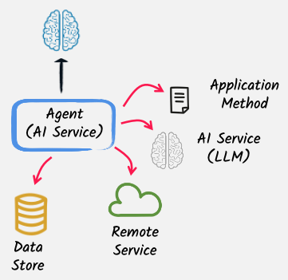
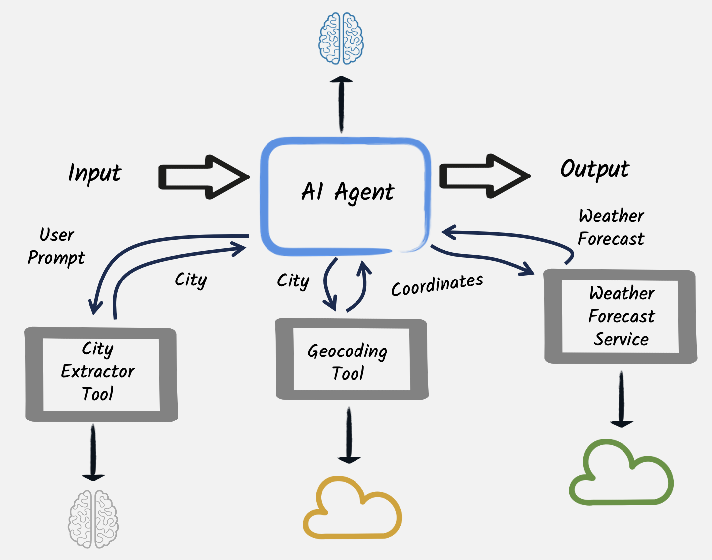
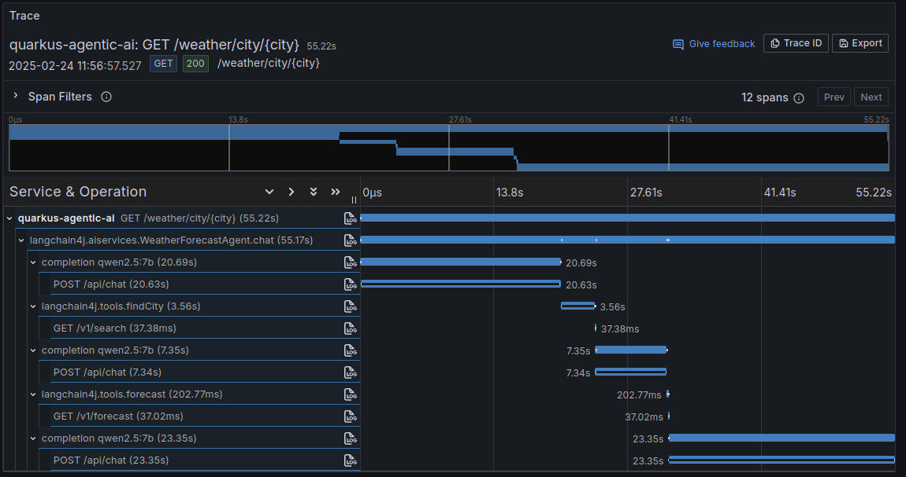
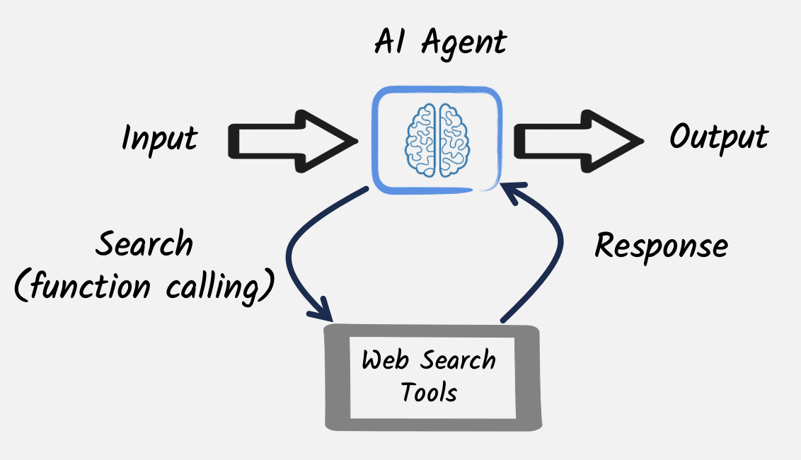
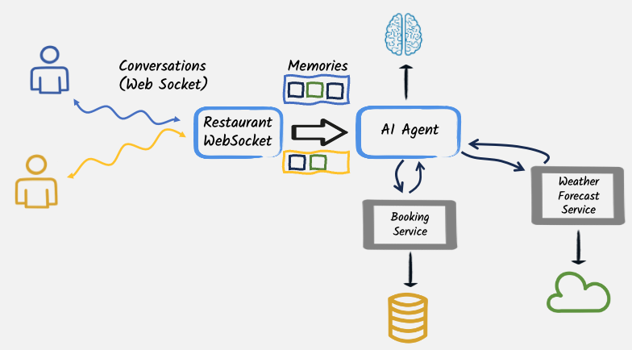
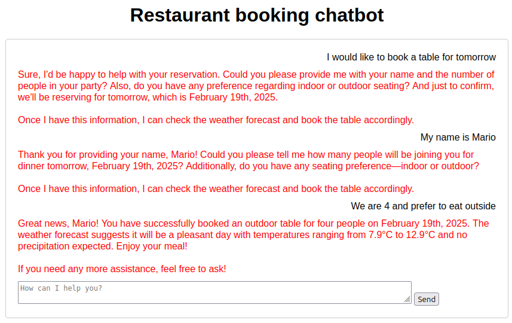

# Agentic AI with Quarkus - part 2

The [first part](https://quarkus.io/blog/agentic-ai-with-quarkus/) of this blog post series briefly introduced agentic AI and discussed workflow patterns. This post will explore another kind of pattern: *agents*. The main difference between the two is that workflow patterns are defined programmatically, while agents are more flexible and can handle a broader range of tasks. With agents, the LLM orchestrates the sequence of steps instead of being externally orchestrated programmatically, thus reaching a higher level of autonomy and flexibility.

## Agents

Agents differ from the workflow patterns because the control flow is entirely delegated to LLMs instead of being implemented programmatically. To successfully implement agents, the LLM must be able to reason and have access to a set of tools (*toolbox*). The LLM orchestrates the sequence of steps and decides which tools to call with which parameters. From an external point of view, invoking an agent can be seen as invoking a function that opportunistically invokes tools to complete determinate subtasks.

The agent's toolbox can be composed of:

- External services (like HTTP endpoints)
- Other LLM / agents
- Methods providing data from a data store
- Methods provided by the application code itself


*Agents can invoke tools*

In Quarkus, agents are represented by interfaces annotated with `@RegisterAiService.` They are called *AI services*. In that aspect, they are not different from the *workflow patterns*. The main difference is that the methods of an agent interface are annotated with `@ToolBox` to declare the tools that the LLM can use to complete the task:

```java
@RegisterAiService(modelName = "my-model")  // <-- The model used by this agent must be able to reason and decide which tools to call
@SystemMessage("...")
public interface RestaurantAgent {

    @UserMessage("...")
    @ToolBox({BookingService.class, WeatherService.class}) // <-- The tools that the LLM can use
    String handleRequest(String request);
}
```

Alternatively, the `@RegisterAiService` annotation can receive the set of tools in its `tools` parameter.

Let's look at some examples of agents to understand better how they work and what they can achieve.

### The weather forecast agent

This [first example](https://github.com/mariofusco/quarkus-agentic-ai/blob/main/src/main/java/org/agenticai/aiastool) of agentic AI implements the following [weather forecast agent](https://github.com/mariofusco/quarkus-agentic-ai/blob/main/src/main/java/org/agenticai/aiastool/WeatherForecastAgent.java). The agent receives a user prompt and must answer questions about the weather using at most three lines. To achieve this goal, the agent has a toolbox containing:

1. An AI service specialized in extracting the name of a city from the user's prompt - which can be another *agent*;
2. A web service returning the geographic coordinates of a given city - this is a remote call;
3. A second web service providing the weather forecast for the given latitude and longitude - another remote call.


*Weather agent architecture*

We do not indicate when and how these tools are used; we just add them to the toolbox. The LLM decides when to call them and with which parameters.

```java
@RegisterAiService(modelName = "tool-use")
public interface WeatherForecastAgent {

    @SystemMessage("""
        You are a meteorologist, and you need to answer questions asked by the user about weather using at most 3 lines.

        The weather information is a JSON object and has the following fields:

        maxTemperature is the maximum temperature of the day in Celsius degrees
        minTemperature is the minimum temperature of the day in Celsius degrees
        precipitation is the amount of water in mm
        windSpeed is the speed of wind in kilometers per hour
        weather is the overall weather.
    """)
    @ToolBox({CityExtractorAgent.class, WeatherForecastService.class, GeoCodingService.class})
    String chat(String query);
}
```

Let's see how are defined the tools used by this agent:

1 . [Another AI Service](https://github.com/mariofusco/quarkus-agentic-ai/blob/main/src/main/java/org/agenticai/aiastool/CityExtractorAgent.java) specialized in extracting the name of a city from the user's prompt (thus also demonstrating how easily an *agent* can be configured to become a tool for another AI service/agent).

```java
@ApplicationScoped
@RegisterAiService(chatMemoryProviderSupplier = RegisterAiService.NoChatMemoryProviderSupplier.class)
public interface CityExtractorAgent {

    @UserMessage("""
        You are given one question and you have to extract city name from it
        Only reply the city name if it exists or reply 'unknown_city' if there is no city name in question

        Here is the question: {question}
        """)
    @Tool("Extracts the city from a question") // <-- The tool description, the LLM can use it to decide when to call this tool
    String extractCity(String question); // <-- The method signature, the LLM use it to know how to call this tool
}
```

2 . A [web service](https://github.com/mariofusco/quarkus-agentic-ai/blob/main/src/main/java/org/agenticai/aiastool/geo/GeoCodingService.java) returning the geographic coordinates of a given city. It's a simple Quarkus REST client interface, meaning that Quarkus automatically generates the actual implementation. It can be combined with fault tolerance, metrics, and other Quarkus features.

```java
@RegisterRestClient(configKey = "geocoding")
@Path("/v1")
public interface GeoCodingService {

    @GET
    @Path("/search")
    @ClientQueryParam(name = "count", value = "1") // Limit the number of results to 1 (HTTP query parameter)
    @Tool("Finds the latitude and longitude of a given city")
    GeoResults findCity(@RestQuery String name);
}
```

3 . Another [web service](https://github.com/mariofusco/quarkus-agentic-ai/blob/main/src/main/java/org/agenticai/aiastool/weather/WeatherForecastService.java) providing the weather forecast for the given latitude and longitude.

```java
@RegisterRestClient(configKey = "openmeteo")
@Path("/v1")
public interface WeatherForecastService {

    @GET
    @Path("/forecast")
    @ClientQueryParam(name = "forecast_days", value = "7")
    @ClientQueryParam(name = "daily", value = {
            "temperature_2m_max",
            "temperature_2m_min",
            "precipitation_sum",
            "wind_speed_10m_max",
            "weather_code"
    })
    @Tool("Forecasts the weather for the given latitude and longitude")
    WeatherForecast forecast(@RestQuery double latitude, @RestQuery double longitude);
}
```

It's possible to invoke the [HTTP endpoint](https://github.com/mariofusco/quarkus-agentic-ai/blob/main/src/main/java/org/agenticai/aiastool/WeatherResource.java) exposing this agent-based weather service:

```shell
curl http://localhost:8080/weather/city/Rome
```

The response will be something like:

```
The weather in Rome today will have a maximum temperature of 14.3°C, minimum temperature of 2.0°C.
No precipitation expected, and the wind speed will be up to 5.6 km/h.
The overall weather condition is expected to be cloudy.
```

In essence, this control flow is quite similar to the prompt chaining workflow (introduced in the [previous post](https://quarkus.io/blog/agentic-ai-with-quarkus/#prompt-chaining)), where the user input is sequentially transformed in steps (in this case, going from the prompt to the name of the city contained in that prompt to the geographical coordinates of that city, to the weather forecasts at those coordinates). The significant difference is that the LLM directly orchestrates the sequence of steps instead of being externally orchestrated programmatically.

The observability automatically provided by Quarkus (in the GitHub project, observability is disabled by default, but it can be turned on with the `-Dobservability` flag) allows one to visually trace the sequence of tasks accomplished by the agent in order to execute its task.


*Tracing weather agent execution*

### A more general-purpose AI agent

In the previous example, the agent has access to very specific tools. It's possible to provide more general tools that help the agent perform a wider range of tasks. Typically, a web search tool can be handy for information retrieval tasks. That's the purpose of [this second example](https://github.com/mariofusco/quarkus-agentic-ai/blob/main/src/main/java/org/agenticai/searchastool). It extends the agent's capabilities by allowing the LLM to search online for information not part of its original training set.

In general, these scenarios require a bigger model, so this example has been configured to use `qwen2.5-14b` and a longer timeout to give it a chance to complete its task:

```properties
quarkus.langchain4j.ollama.big-model.chat-model.model-id=qwen2.5:14b
quarkus.langchain4j.ollama.big-model.chat-model.temperature=0
quarkus.langchain4j.ollama.big-model.timeout=600s
```

The [intelligent agent](https://github.com/mariofusco/quarkus-agentic-ai/blob/main/src/main/java/org/agenticai/searchastool/IntelligentAgent.java) of this example can be configured to use this bigger model passing its name to the `@RegisterAiService` annotation.

```java
@RegisterAiService(modelName = "big-model")
public interface IntelligentAgent {

    @SystemMessage("""
        You are a chatbot, and you need to answer questions asked by the user.
        Perform a web search for information that you don't know and use the result to answer to the initial user's question.
    """)
    @ToolBox({WebSearchService.class}) // <-- the web search tool
    String chat(String question);
}
```

The [tool](https://github.com/mariofusco/quarkus-agentic-ai/blob/main/src/main/java/org/agenticai/searchastool/WebSearchService.java) can perform a web search on *DuckDuckGo* and returns the result in plain text:

```java
@ApplicationScoped
public class WebSearchService {

    @Tool("Perform a web search to retrieve information online")
    String webSearch(String q) throws IOException {
        String webUrl = "https://html.duckduckgo.com/html/?q=" + q;
        return Jsoup.connect(webUrl).get().text();
    }
}
```

It is possible to use more advanced search engines or APIs, like [Tavily](https://docs.quarkiverse.io/quarkus-langchain4j/dev/web-search.html).

The AI service uses this tool to retrieve online information for everything it ignores and arrange that data together to provide an answer to a generic user question.

For instance, consider the following question: *How many seconds would it take for a leopard at full speed to run through the Pont des Arts?* Using this [HTTP endpoint](https://github.com/mariofusco/quarkus-agentic-ai/blob/main/src/main/java/org/agenticai/searchastool/AgenticChatbotResource.java), it would be executed using:

```shell
curl http://localhost:8080/ask/how%20many%20seconds%20would%20it%20take%20for%20a%20leopard%20at%20full%20speed%20to%20run%20through%20Pont%20des%20Arts
```

To reply to this question, the agent invokes the web search tool twice: once to find the length of Pont des Arts and once to retrieve a leopard's speed.


*An agent using an external web search tool*

Then, the agent puts this information together and generates an output like:

```
The length of Pont des Arts is approximately 155 meters. A leopard can run at speeds up to about 58 kilometers per hour (36 miles per hour). To calculate how many seconds it would take for a leopard running at full speed to cross the bridge, we need to convert its speed into meters per second and then divide the length of the bridge by this speed.

1 kilometer = 1000 meters
58 kilometers/hour = 58 * 1000 / 3600 ≈ 16.11 meters/second

Now, we can calculate the time it would take for a leopard to run through Pont des Arts:

Time (seconds) = Distance (meters) / Speed (m/s)
= 155 / 16.11
≈ 9.62 seconds

So, it would take approximately 9.62 seconds for a leopard running at full speed to run through Pont des Arts.
```

This example illustrates how an agent can use *tools* to retrieve data. While we use a search engine here, you can easily implement a tool that queries a database or another service to retrieve the needed information. You can check [this example](https://github.com/quarkusio/quarkus-workshop-langchain4j/blob/main/section-1/step-08/src/main/java/dev/langchain4j/quarkus/workshop/BookingRepository.java) to see how to implement a tool that queries a database using a Quarkus Panache repository.

### Agents and Conversational AI

The flexibility of AI agents can become even more relevant when used in services that are not intended to fulfill a single request but need to have a more extended conversation with the user to achieve their goal. For instance, agents can function as chatbots, enabling them to handle multiple users in parallel, each with independent conversations. It requires managing the state of each conversation, often referred to as memories (the set of messages already exchanged with the LLM).

A [chatbot of a restaurant booking system](https://github.com/mariofusco/quarkus-agentic-ai/blob/main/src/main/java/org/agenticai/restaurant/RestaurantAgent.java), designed to chat with customers and collect their data and requirements, represents an interesting practical application of this pattern.

```java
@RegisterAiService(modelName = "tool-use")
@SystemMessage("""
        You are an AI dealing with the booking for a restaurant.
        Do not invent the customer name or party size, but explicitly ask for them if not provided.
        If the user specifies a preference (indoor/outdoor), you should book the table with the preference. However, please check the weather forecast before booking the table.
        """)
@SessionScoped
public interface RestaurantAgent {

    @UserMessage("""
            You receive request from customer and need to book their table in the restaurant.
            Please be polite and try to handle the user request.

            Before booking the table, makes sure to have valid date for the reservation, and that the user explicitly provided his name and party size.
            If the booking is successful just notify the user.

            Today is: {current_date}.
            Request: {request}
            """)
    @ToolBox({BookingService.class, WeatherService.class})
    String handleRequest(String request);
}
```

> [!TIP]
> Note that the user message conveys not only the customer's request but also includes the current date. This allows the LLM to understand relative dates, such as "tomorrow" or "in three days," which are often used by humans. Initially, we included the current date in the system message, but doing so often caused the LLM to forget it and hallucinate using a different date. Moving it to the user message empirically proved to work much better, possibly because this way, it is passed not only once but in every message in the chat memory.

When the agent completes that information-gathering process, the chatbot uses a [tool accessing the database](https://github.com/mariofusco/quarkus-agentic-ai/blob/main/src/main/java/org/agenticai/restaurant/booking/BookingService.java) of existing reservations to both check if there is still a table available for the customer's needs and to book that table if so.

```java
@ApplicationScoped
public class BookingService {

    private final int capacity;

    public BookingService(@ConfigProperty(name = "restaurant.capacity") int capacity) {
        this.capacity = capacity;
    }

    public boolean hasCapacity(LocalDate date, int partySize) {
        int sum = Booking.find("date", date).list().stream().map(b -> (Booking) b)
                         .mapToInt(b -> b.partySize)
                         .sum();
        return sum + partySize <= capacity;
    }

    @Transactional
    @Tool("Books a table for a given name, date (passed as day of the month, month and year), party size and preference (indoor/outdoor). If the restaurant is full, an exception is thrown. If preference is not specified, `UNSET` is used.")
    public String book(String name, int day, int month, int year, int partySize, Booking.Preference preference) {
        var date = LocalDate.of(year, month, day);
        if (hasCapacity(date, partySize)) {
            Booking booking = new Booking();
            booking.date = date;
            booking.name = name;
            booking.partySize = partySize;
            if (preference == null) {
                preference = Booking.Preference.UNSET;
            }
            booking.preference = preference;
            booking.persist();
            String result = String.format("%s successfully booked a %s table for %d persons on %s", name, preference, partySize, date);
            Log.info(result);
            return result;
        }
        return "The restaurant is full for that day";
    }
}
```

To assist the customer in deciding whether to eat outside, the agent can also reuse, as a second tool, the [weather forecast service](https://github.com/mariofusco/quarkus-agentic-ai/blob/main/src/main/java/org/agenticai/restaurant/weather/WeatherService.java) implemented in one of the former examples, passing to it the geographic coordinates of the restaurant.

```properties
restaurant.location.latitude=45
restaurant.location.longitude=5
```

The final architectural design of the chatbot is the following:


*The restaurant chatbot agent*

Once the customer provides all necessary details, the chatbot confirms the booking and presents a reservation summary. The final booking is then stored in the database. It is possible to give this a try by accessing the URL:

<http://localhost:8080/restaurant.html>

A typical example of user interaction could be something like this:


*An example of interaction with the restaurant chatbot agent*

## Conclusions and next steps

This blog post series illustrates how you can use agentic patterns to implement AI-infused applications with Quarkus and its LangChain4j extension.

We have covered *workflow patterns in a previous post* and *agents in this post*. Both sets of patterns are based on the same underlying principles but differ in how the control flow is managed. The workflow patterns are more suitable for tasks that can be easily defined programmatically, while agents are more flexible and can handle a broader range of tasks.

Nevertheless, the examples discussed in this series can be improved and further generalized with other techniques that will be introduced in future works, such as:

- Memory management across LLM calls
- State management for long-running processes
- Improved observability
- Dynamic tools and tool discovery
- The relation with the MCP protocol and how agentic architecture can be implemented with MCP clients and servers
- How can the RAG pattern be revisited in light of the agentic architecture, both with workflow patterns and agents?
