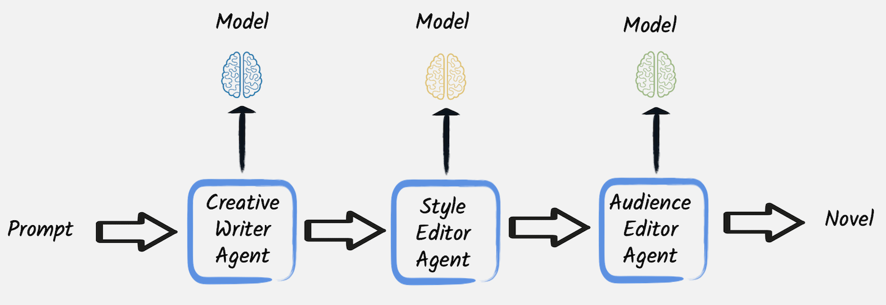
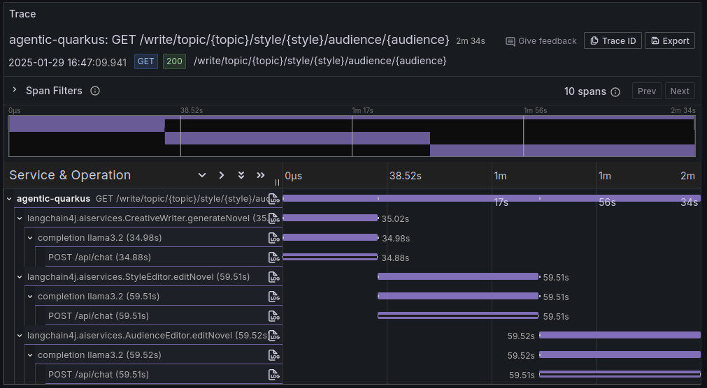
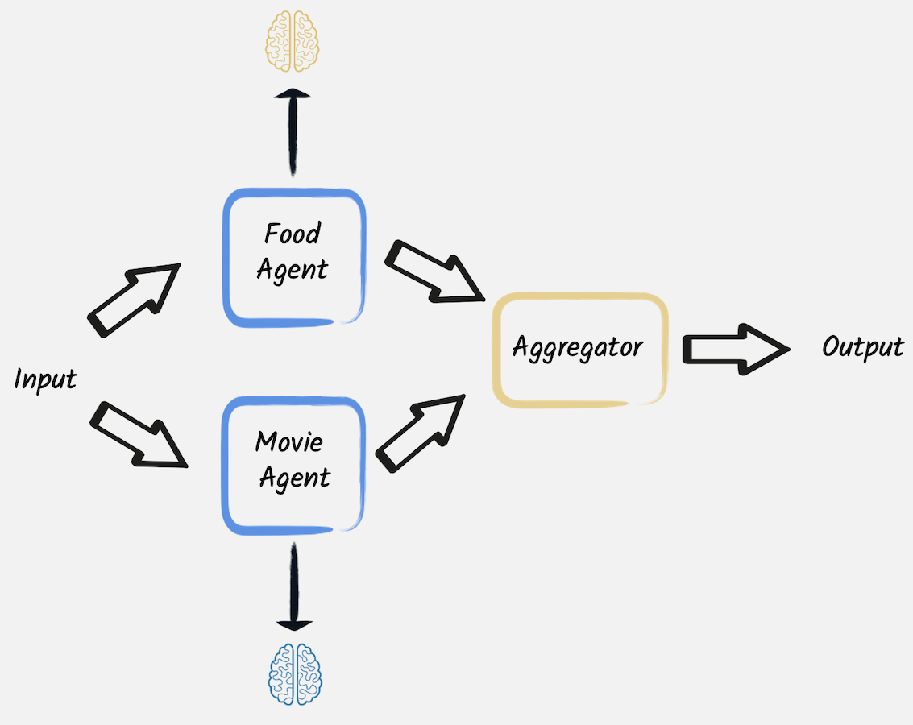
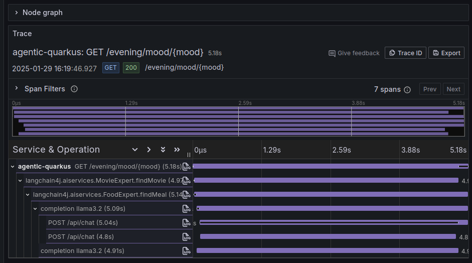
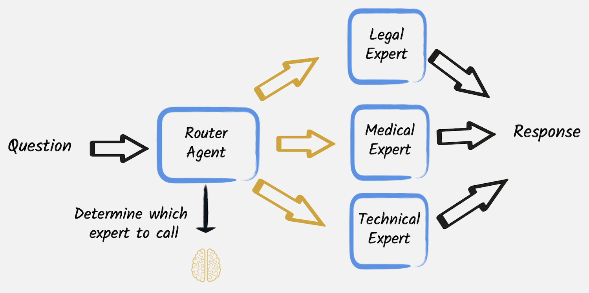

# Agentic AI with Quarkus - part 1

Although there is no universally agreed definition of an AI agent, several emerging patterns demonstrate how to coordinate and combine the capabilities of multiple AI services to create AI-infused applications that can accomplish more complex tasks.

According to a [recent article published by Antropic researchers](https://www.anthropic.com/research/building-effective-agents), these *Agentic System architectures* can be grouped into two main categories:

1. **workflows**: LLMs and tools are orchestrated through predefined code paths,
2. **agents**: LLMs dynamically direct their processes and tool usage, maintaining control over how they execute tasks.

The goal of this series of articles is to discuss the most common workflow and agentic AI patterns and architectures, with the practical aid of [this project](https://github.com/mariofusco/quarkus-agentic-ai) that demonstrates for each of them an example of how they can be implemented through Quarkus and its LangChain4j integration. Of course, a real-world application may use and combine these patterns in multiple ways to implement a complex behavior.

This first article focuses on the *workflow* patterns. A second article will cover the *agent* patterns.

All the demos in that project run the LLMs inference locally through an [ollama](https://ollama.com/) server. In particular the demos in the workflow section use a llama3.2 model, while the ones relative to the pure agents one employ qwen2.5 since this last model empirically demonstrated of working better when multiple tool callings are required.

## Workflow patterns

AI workflows are patterns in which different LLM-based services (*AI services* in the Quarkus vocabulary) are coordinated **programmatically** in a predetermined manner. This article introduces three base patterns, namely:

- [the prompt chaining pattern](#prompt-chaining)
- [the parallelization pattern](#parallelization)
- [the routing pattern](#routing)

<a id="prompt-chaining"></a>
## Prompt chaining

Prompt chaining is, without a doubt, the simplest yet powerful and effective technique in agentic AI workflows. In this technique, the output of one prompt (the response from an LLM) becomes the input of the next, enabling complex, multi-step reasoning or task execution. It is ideal for situations with a straightforward way to decompose a complex task into smaller and better-delimited steps, thus reducing the possibility of hallucinations or other LLMs misbehaving.

Understanding that each coordinated call to LLM may rely on different models and system messages is essential. Thus, each step can be implemented using a more specialized model and system message.

A typical use case for applying this technique is content creation, like advertising or novel writing. For instance, this [first example](https://github.com/mariofusco/quarkus-agentic-ai/blob/main/src/main/java/org/agenticai/promptchaining) leverages this pattern to implement a creative writing and editing workflow, where the [first AI service](https://github.com/mariofusco/quarkus-agentic-ai/blob/main/src/main/java/org/agenticai/promptchaining/CreativeWriter.java) is the following:

```java
@RegisterAiService(chatMemoryProviderSupplier = RegisterAiService.NoChatMemoryProviderSupplier.class)
public interface CreativeWriter {
    @UserMessage("""
            You are a creative writer.
            Generate a draft of a short novel around the given topic.
            Return only the novel and nothing else.
            The topic is {topic}.
            """)
    String generateNovel(String topic);
}
```

It generates a story draft on a topic provided by the user. In contrast, two more services, implemented very similarly to this one, subsequently modify the outcome of the first one. In particular, a [second service](https://github.com/mariofusco/quarkus-agentic-ai/blob/main/src/main/java/org/agenticai/promptchaining/StyleEditor.java) rewrites the draft to make it more coherent with a determined style, while a [third one](https://github.com/mariofusco/quarkus-agentic-ai/blob/main/src/main/java/org/agenticai/promptchaining/AudienceEditor.java) executes a final edit to make it a good fit for the required audience.

It is also worth to be noted that all these three AI services are intended to be used through one-shot calls in a completely stateless way, so they are configured to not have any [chat memory](https://docs.langchain4j.dev/tutorials/chat-memory/). Regardless of this configuration, each AI service has its own chat memory, confined to the single service, and this is why it is necessary to explicitly pass to each of them the output produced by the former LLM in the chain.


*Prompt chaining pattern*

In this case, it is pretty straightforward to expose this service through a [HTTP endpoint](https://github.com/mariofusco/quarkus-agentic-ai/blob/main/src/main/java/org/agenticai/promptchaining/WriterResource.java) that invokes these AI services one after the other, making the editors rewrite or refine the content produced by the first creative writer:

```java
// The createWriter, styleEditor, and audienceEditor fields are AI services injected by Quarkus, see full code for details
@GET
@Path("topic/{topic}/style/{style}/audience/{audience}")
public String hello(String topic, String style, String audience) {
    // Call the first AI service:
    String novel = creativeWriter.generateNovel(topic);

    // Pass the outcome from the first call to the second AI service:
    novel = styleEditor.editNovel(novel, style);

    // Pass the outcome from the second call to the third AI service:
    novel = audienceEditor.editNovel(novel, audience);

    // Return the final result:
    return novel;
}
```

The HTTP endpoint allows us to define a topic, style, and audience of the novel to be produced; so, for example, running the project locally, it would be possible to obtain a drama about dogs having kids as the target audience by calling this URL:

```shell
curl http://localhost:8080/write/topic/dogs/style/drama/audience/kids
```

As an example, it generates a result like [this](https://github.com/mariofusco/quarkus-agentic-ai/blob/main/text/dogs-novel.txt). Since this project integrates the observability capabilities provided by Quarkus out-of-the-box, it is also possible to look at the tracing of the flow of invocations performed to fulfill this request, which, of course, puts in evidence of the sequential nature of this pattern.


*Tracing sequential execution of the prompt chaining pattern*

<a id="parallelization"></a>
## Parallelization

This second pattern also orchestrates multiple calls to LLMs. However, unlike the prompt chaining pattern, the calls are independent and do not require the output of one call to be used as the input of another. In these situations, those calls can be performed in parallel, followed by an aggregator that combines their outcomes.

To demonstrate how this works, let's consider this [second example](https://github.com/mariofusco/quarkus-agentic-ai/blob/main/src/main/java/org/agenticai/parallelization). This code recommends a plan for a lovely evening with a specific mood, combining a movie and a meal that matches that mood. The [HTTP endpoint](https://github.com/mariofusco/quarkus-agentic-ai/blob/main/src/main/java/org/agenticai/parallelization/EveningPlannerResource.java) implements this goal by invoking two different AI services **in parallel** and then combining their outcome, putting together the three different suggestions of the two different LLM-based experts.

```java
import java.time.Duration;@GET
@Path("mood/{mood}")
public List<EveningPlan> plan(String mood) {
    var movieSelection = Uni.createFrom().item(() -> movieExpert.findMovie(mood)).runSubscriptionOn(scheduler);
    var mealSelection = Uni.createFrom().item(() -> foodExpert.findMeal(mood)).runSubscriptionOn(scheduler);
    return Uni.combine().all()
            .unis(movieSelection, mealSelection) // This invokes the two LLMs in parallel
            .with((movies, meals) -> {
                // Both calls have completed, let's combine the results
                List<EveningPlan> moviesAndMeals = new ArrayList<>();
                for (int i = 0; i < 3; i++) {
                    moviesAndMeals.add(new EveningPlan(movies.get(i), meals.get(i)));
                }
                return moviesAndMeals;
            })
            .await().atMost(Duration.ofSeconds(60));
}
```

The [first LLM](https://github.com/mariofusco/quarkus-agentic-ai/blob/main/src/main/java/org/agenticai/parallelization/MovieExpert.java) is an AI service asked to provide three titles of movies matching the given mood.

```java
@RegisterAiService
public interface MovieExpert {

    @UserMessage("""
            You are a great evening planner.
            Propose a list of 3 movies matching the given mood.
            The mood is {mood}.
            Provide a list with the 3 items and nothing else.
            """)
    List<String> findMovie(String mood);
}
```

The [second one](https://github.com/mariofusco/quarkus-agentic-ai/blob/main/src/main/java/org/agenticai/parallelization/FoodExpert.java), with a very similar implementation is asked to provide three meals. When these LLM calls are complete, the results (3 lists of 3 items each) are aggregated to create a list of 3 fantastic evening plans with a suggested movie and meal each.


*The parallelization pattern*

For instance asking that endpoint to provide evening plans for a romantic mood:

```shell
curl http://localhost:8080/evening/mood/romantic
```

The outcome is something like:

```
[
  EveningPlan[movie=1. The Notebook, meal=1. Candlelit Chicken Piccata],
  EveningPlan[movie=2. La La Land, meal=2. Rose Petal Risotto],
  EveningPlan[movie=3. Crazy, Stupid, Love., meal=3. Sunset Seared Scallops]
]
```

In this case, the tracing of the flow of invocations performed to fulfill this request shows, as expected, that the two LLM invocations are performed in parallel.


*Tracing parallel LLMs invocation*

<a id="routing"></a>
## Routing

Another common situation is the need to direct tasks requiring specific handling to specialized models, tools, or processes based on determined criteria. In these cases, the routing workflow allows the dynamic allocation of tasks to the most suitable AI service.

[This example](https://github.com/mariofusco/quarkus-agentic-ai/blob/main/src/main/java/org/agenticai/routing) shows how this pattern can be applied in a simple scenario where a user asks a question that has to be redirected to a [legal](https://github.com/mariofusco/quarkus-agentic-ai/blob/main/src/main/java/org/agenticai/routing/LegalExpert.java), [medical](https://github.com/mariofusco/quarkus-agentic-ai/blob/main/src/main/java/org/agenticai/routing/MedicalExpert.java) or [technical](https://github.com/mariofusco/quarkus-agentic-ai/blob/main/src/main/java/org/agenticai/routing/TechnicalExpert.java) expert to be answered most accurately, where any of these experts are an AI service implemented for instance as follows:

```java
@RegisterAiService
public interface MedicalExpert {

    @UserMessage("""
            You are a medical expert.
            Analyze the following user request under a medical point of view and provide the best possible answer.
            The user request is {request}.
            """)
    String chat(String request);
}
```

The categorization of the user's request is performed by [another LLM service](https://github.com/mariofusco/quarkus-agentic-ai/blob/main/src/main/java/org/agenticai/routing/CategoryRouter.java)

```java
@RegisterAiService
public interface CategoryRouter {

    @UserMessage("""
            Analyze the following user request and categorize it as 'legal', 'medical' or 'technical'.
            Reply with only one of those words and nothing else.
            The user request is {request}.
            """)
    RequestCategory classify(String request);
}
```

that returns one of the possible categories of the user's request, encoded in this enumeration:

```java
public enum RequestCategory {
    LEGAL, MEDICAL, TECHNICAL, UNKNOWN
}
```

Thus, the [router service](https://github.com/mariofusco/quarkus-agentic-ai/blob/main/src/main/java/org/agenticai/routing/RouterService.java) can send the question to the right expert.

```java
public UnaryOperator<String> findExpert(String request) {
    var category = RequestType.decode(categoryRouter.classify(request));
    return  switch (category) {
        case LEGAL -> legalExpert::chat;
        case MEDICAL -> medicalExpert::chat;
        case TECHNICAL -> technicalExpert::chat;
        default -> ignore -> "I cannot find an appropriate category for this request.";
    };
}
```


*Routing pattern*

In this way, when the user calls the [HTTP endpoint](https://github.com/mariofusco/quarkus-agentic-ai/blob/main/src/main/java/org/agenticai/routing/ExpertAssistanceResource.java), exposing this service writing something like: "I broke my leg what should I do":

```shell
curl http://localhost:8080/expert/request/I%20broke%20my%20leg%20what%20should%20I%20do
```

The first LLM categorizes this request as a medical one, and the router forwards it to the medical expert LLM, thus generating a result like [this](https://github.com/mariofusco/quarkus-agentic-ai/blob/main/text/expert-response.txt).

## Conclusion

This article demonstrated how you can implement *workflow patterns* with Quarkus Langchain4J. Quarkus Langchain4J provides a powerful and flexible way to implement these patterns, allowing you to orchestrate multiple AI services in a way that is both efficient and easy to understand.

The next article will cover the *agent patterns*. So, stay tuned!
