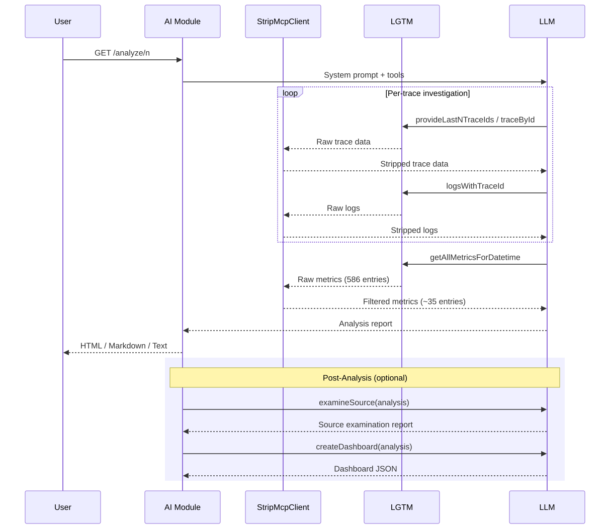

# AI Root Cause Analysis: Architecture, Testing, and Evaluation

In the [introductory post](/blog/ai-root-cause-analysis/), we showed what AI Root Cause Analysis does and how to get started. This post goes deeper -- into the architecture, the analysis pipeline, how we keep telemetry data within LLM context limits, and how we test analysis quality using chaos engineering with LLM-as-judge evaluation.

## Architecture

The system has a layered architecture connecting monitored applications to the AI analysis engine through an observability stack:



Your applications just need OpenTelemetry instrumentation -- no code changes required. The AI module connects to your existing LGTM stack via MCP and optionally to your running Quarkus applications via Quarkus Dev MCP for source examination and dashboard generation.

The AI module uses [LangChain4j](https://docs.langchain4j.dev/) `@RegisterAiService` interfaces backed by a \~290-line system prompt that instructs the LLM on three-way telemetry correlation, chaos detection patterns, severity classification, and structured output formatting.

Five tools are exposed to the LLM during analysis:

| Tool | What It Provides |
| --- | --- |
| `provideLastNTraceIds` | Recent trace IDs from Tempo (TraceQL) |
| `traceById` | Full trace data for a specific trace |
| `logsWithTraceId` | Correlated Loki logs for a trace |
| `getRootSpanStartTime` | Timestamp for metric queries |
| `getAllMetricsForDatetime` | Prometheus metrics at a point in time |

The LLM orchestrates these tools autonomously -- it decides which traces look interesting, pulls their logs, checks metrics, and builds the analysis iteratively.

## The Analysis Pipeline

When you hit `GET /analyze/{n}`, the following sequence unfolds:

1. **Tool dispatch** -- The AI module sends the system prompt and tool definitions to the LLM
2. **Trace retrieval** -- The LLM calls `provideLastNTraceIds` to get the N most recent traces
3. **Per-trace investigation** -- For each trace, the LLM pulls full trace data and correlated logs through `StripMcpClient`, which strips SDK noise, localhost attributes, and redundant fields
4. **Metrics context** -- The LLM queries Prometheus metrics at the root span's start time; the filtering layer removes Netty/OTel internals, static counters, and histogram bucket breakdowns
5. **Analysis synthesis** -- The LLM produces a structured report with per-trace sections covering root cause, slowest operations, error patterns, and cross-trace correlation

If source examination or dashboard generation is enabled, a post-analysis pipeline kicks in using `DevMcpAiService` -- a separate `@RegisterAiService` that uses Dev MCP tools to read application source code and write Grafana dashboard JSON back to each workspace.



## Data Filtering: Staying Within Context Limits

One of the trickiest engineering challenges is keeping telemetry data within LLM context limits while preserving signal. The `StripMcpClient` decorator applies per-tool filtering functions:

- **Traces**: Removes SDK metadata (`telemetry.sdk.*`, `otel.*`), localhost attributes, and instrumentation library details
- **Logs**: Strips SDK metadata, redundant fields, and duplicate information already present in trace spans
- **Metrics**: Removes Netty internals, static/constant values, histogram bucket breakdowns, and per-region metric breakdowns -- reducing 586 entries to \~35

The system prompt also instructs the LLM to treat chaos-related log entries as authoritative evidence, even when Prometheus metrics don't confirm them -- because point-in-time metric snapshots can miss transient pressure spikes that logs capture.

## Testing with Chaos Engineering

How do you test an AI-powered analysis tool? You need realistic failure scenarios with known root causes, and you need an objective way to score the analysis quality. AI Root Cause Analysis solves this with chaos engineering + LLM-as-judge evaluation.

### Chaos Scenarios

The project includes companion test applications that simulate distributed microservices with configurable chaos failure modes. These expose 11 chaos types via `GET /chaos?type={type}&intensity={value}`:

| Chaos Type | What It Does |
| --- | --- |
| `delay` | Thread.sleep for configurable milliseconds |
| `memory` | Allocate N MB (released after request) |
| `cpu` | CPU burn loop for N ms |
| `leak` | Allocate N MB (never freed) |
| `error` | Random 5xx WebApplicationException |
| `exception` | Unhandled RuntimeException (HTTP 500) |
| `threadpool` | Block 10 threads via CountDownLatch |
| `contention` | 10 threads competing for a synchronized lock |
| `gc` | Rapid alloc/dealloc -> GC pressure |
| `intermittent` | Random failures at configurable rate |
| `deadlock` | Two threads deadlocked on competing locks |

### Database and Weather Chaos

Beyond application-level chaos, the test suite also covers infrastructure-level failures using [**Toxiproxy**](https://github.com/Shopify/toxiproxy) -- a TCP proxy that can inject latency, cut connections, and throttle bandwidth at the network layer:

**Database chaos** routes JDBC connections through Toxiproxy to MySQL:


Tests include slow queries (3s latency injection), connection pool exhaustion (4s latency + small pool + concurrent requests), and full database outages (connection cut). JDBC telemetry creates separate database query spans, so the AI sees `GET /poke (3019ms) -> SELECT ... (3015ms)` and can identify database-level root causes.

**Weather API chaos** routes REST client calls through Toxiproxy to an external API:


Tests include slow external API responses and full API outages.

No application code changes are required -- chaos is injected purely at the network layer via the Toxiproxy REST API.

### The Evaluation Mechanism: LLM-as-Judge

Each integration test follows the same pattern:

1. **Inject chaos** into the test application (or do nothing for baseline tests)
2. **Wait** for telemetry to propagate to LGTM
3. **Run analysis** via `GET /analyze/{n}`
4. **Capture** all tool outputs (raw telemetry data the LLM saw)
5. **Score** the analysis using a separate LLM call

The scoring uses an `AnalysisEvaluationStrategy` that builds a detailed evaluation prompt containing:

- The original telemetry data (traces, logs, metrics) the AI analyzed
- The system prompt used for analysis
- The analysis output being evaluated
- Scenario-specific evaluation criteria

A judge LLM (`EvaluationJudge`) then scores the analysis on four dimensions, each worth 0-25 points:

| Dimension | What It Measures |
| --- | --- |
| **Completeness** | Did it find all the issues present in the telemetry? |
| **Accuracy** | Are the identified root causes correct? |
| **Correlation Quality** | Did it properly link traces, logs, and metrics? |
| **Actionability** | Are the remediation suggestions useful and specific? |

The passing threshold defaults to **70/100**. Set `EVALUATION_THRESHOLD` to override it for any test script:

```bash
export EVALUATION_THRESHOLD=80
./run-integration-test.sh chaos                    # chaos tests with threshold 80
./run-integration-test.sh db grok grok             # DB tests with threshold 80
```

If the score falls below the threshold, the evaluation also outputs **prompt improvement suggestions** -- concrete changes to the system prompt that would improve analysis quality. This creates a feedback loop: run tests, get scores, improve the prompt, run tests again.

### Cross-LLM Combinations

A critical design choice is that the **analyzer LLM** and the **scorer LLM** can be different providers. This prevents self-evaluation bias -- an LLM scoring its own output might be systematically lenient.

The test scripts support all combinations:

```bash
./run-integration-test.sh chaos openai grok     # AI=OpenAI, scorer=Grok
./run-integration-test.sh chaos grok openai     # AI=Grok, scorer=OpenAI
./run-integration-test.sh db openai grok        # DB tests, cross-provider
./run-integration-test.sh weather grok grok     # Weather tests, same provider
```

All 19 test scenarios pass across provider combinations:

| AI Provider | Scorer | Chaos | DB | Weather |
| --- | --- | --- | --- | --- |
| OpenAI | Grok | 12/12 | 4/4 | 3/3 |
| Grok | OpenAI | 12/12 | 4/4 | 3/3 |
| OpenAI | OpenAI | 12/12 | 4/4 | 3/3 |
| Grok | Grok | 12/12 | 4/4 | 3/3 |

The cross-provider combinations (OpenAI/Grok, Grok/OpenAI) are the most important -- they validate that analysis quality is genuine, not an artifact of one LLM being generous about its own or a peer's output.

## What's Next

The project is designed for extensibility -- adding a new LLM provider is a Maven profile + Quarkus configuration, adding new chaos types is a method in the test application's chaos endpoint, and the evaluation framework automatically validates any changes against the full test matrix.

AI Root Cause Analysis is a [Quarkiverse project](https://github.com/quarkiverse/quarkus-ai-rca) -- contributions, feedback, and testing across different application architectures are welcome.
