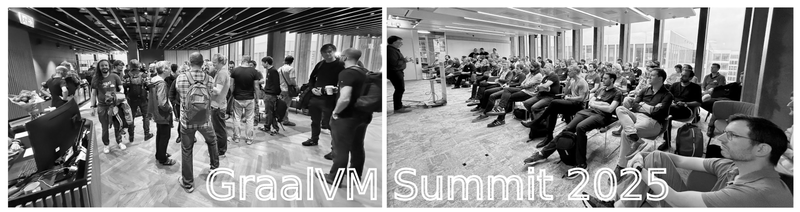
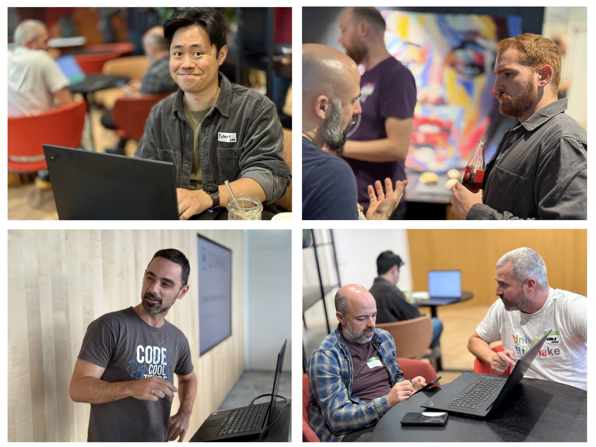

# Continued Focus on Native

From its inception, Quarkus has offered the ability to compile Java applications into native binaries. This feature is crucial for achieving rapid startup times and reduced memory consumption, two properties that remain paramount to Quarkus' mission and that Quarkus remains committed to.

We have already started preparing for the adoption of GraalVM 25 (via our Mandrel distribution), and expect to switch to it as the primary native builder in the near future.

Quarkus uses the Mandrel GraalVM distribution to ensure continuity of updates on native-image capabilities. [Mandrel 25](https://quarkus.io/blog/mandrel-25-released) empowers Quarkus users to leverage the latest JDK innovations (JDK 25) and target cloud-native deployments through its native compilation capabilities. Our collaboration with the upstream GraalVM community during GraalVM 25’s development has strengthened our involvement, bringing these shared innovations directly to Quarkus users with the incorporation of the Mandrel 25 release.

Key improvements that Mandrel 25 and Quarkus are expected to bring:

- **Readiness for JDK 25 - Enhanced Compatibility and Stability:** Mandrel 25, based on OpenJDK 25, offers improved compatibility with the latest OpenJDK features and libraries, ensuring that Quarkus applications can leverage the full spectrum of the Java ecosystem while maintaining the stability and reliability expected of production-ready enterprise systems.
- **Continued Focus on Key Metrics:** Mandrel 25 will be the technology of choice in order to deliver on the cloud-native performance goals of fast startup and low memory footprint of Quarkus releases for the next years to come. Quarkus continues to enable aggressive initialization at build time to achieve this.
- **Enhanced Static Analysis Accuracy:** GraalVM 25 enables [https://github.com/oracle/graal/pull/9821\[Whole-Program](https://github.com/oracle/graal/pull/9821[Whole-Program)  Sparse Conditional Constant Propagation (WP-SCCP)\] by default, improving the precision of points-to analysis in native image. This optimization enhances static analysis accuracy and scalability, potentially reducing the size of the final native binary. [More information on the GraalVM blog](https://medium.com/graalvm/skipflow-producing-smaller-executables-with-graalvm-f18ca98279c2).
- **Improved Error Reporting and Diagnostics:** When resources or certain reflective accesses aren't properly registered at image build time, it is now being appropriately flagged by raising a specific exception when building with Mandrel 25. Flags, `-XX:MissingRegistrationReportingMode=Warn` and `-XX:MissingRegistrationWarnContextLines=<#lines>` can be used to diagnose. The ability to handle `OutOfMemoryError` was added.
- **Enhanced Monitoring Possibilities:** By leveraging Mandrel 25 more monitoring options of the deployed native Quarkus application binary become possible closing the gap between JVM mode and native mode. New JFR events, such as Socket IO and native memory tracking events as well as JFR allocation profiling become possible (via the `jdk.ObjectAllocationSample` event). The addition of [Java Diagnostic Command](https://www.graalvm.org/jdk25/reference-manual/native-image/debugging-and-diagnostics/jcmd/)  (JCMD) allows for triggering of certain actions on the running native image. The JFR monitoring feature of native image has been enhanced to be more configurable (via `-XX:FlightRecorderOptions`), previously only available in JVM mode. Native memory tracking can be optionally enabled in order to diagnose memory leaks (using `-Dquarkus.native.monitoring=nmt` at build time and `-XX:+PrintNMTStatistics` at runtime)
- **Full Support for the Foreign Function & Memory (FFM) API:** Quarkus applications can now make use of full support of the FFM API (included in JVM mode since JDK 22) when compiling to native using Mandrel 25. Upcall and downcall support has been added for all supported Quarkus operating systems and architectures.

By seamlessly integrating Mandrel 25, and Quarkus’ continued focus on developer joy and productivity, together with new and emerging AI capabilities further solidifies Quarkus's position as the premier framework for building high-performance, cloud-native Java applications. Developers can confidently leverage these advancements to deploy applications that are not only efficient but also deliver exceptional user experiences. Quarkus and Mandrel 25 combine to create a powerful synergy that pushes the boundaries of Java in today's modern computing landscape. This combination delivers on Quarkus’s Cloud Native Mission, offering swift start-up times and a low memory footprint.

## Looking Ahead

Beyond GraalVM 25, we are tracking the evolution of GraalVM closely as we have done in the past and will continue to work with the GraalVM team to evolve accordingly and ensure that Quarkus integrates well with it. We expect to see some promising and useful new features in coming releases, not the least:

1. [Shenandoah GC](https://github.com/oracle/graal/issues/12237) integration
2. [Project Crema](https://github.com/oracle/graal/issues/11327) and dynamic Java on top of native-image. This will unlock Java use cases that today cannot run as native-image
3. [Native Image Layers](https://github.com/oracle/graal/issues/7626) to make it possible to tune performance vs. usability
4. Polyglot - First-class [JavaScript](https://www.graalvm.org/jdk25/reference-manual/js/), [Python](https://www.graalvm.org/python/) and [Wasm](https://www.graalvm.org/webassembly/docs/) integrations

## GraalVM Community Collaboration and GraalVM Summit

The collaboration between Quarkus, Mandrel and GraalVM developers continues to be strong. What’s more, Mandrel is being developed as part of the GraalVM Github organization and the GraalVM for JDK 21 community effort was established as part of those community gatherings. Mandrel developers assumed maintainer roles for the [https://github.com/graalvm/graalvm-community-jdk21u/\[GraalVM](https://github.com/graalvm/graalvm-community-jdk21u/[GraalVM) for JDK 21 maintenance repository\]. We hope to establish a similar model for GraalVM 25 and its downstream, Mandrel 25. The Mandrel team is certainly interested in stepping up for community maintenance of GraalVM 25 when the time comes.

For the past few years Quarkus and Mandrel developers have been attending the GraalVM Community summit. A powerful platform to exchange ideas and experience with the GraalVM technology. In 2025, five Quarkus/Mandrel developers attended the GraalVM Community Summit. We believe the event was a great success. These gatherings are paramount to the Quarkus and GraalVM collaboration. We were glad to see that there is shared interest in making the public [GraalVM github repository](https://github.com/oracle/graal/) a true upstream with an open governance model. This would further strengthen the GraalVM community and would help self-sustain certain areas.  Some of this has been already tested with the [https://github.com/graalvm/graalvm-community-jdk21u/\[GraalVM](https://github.com/graalvm/graalvm-community-jdk21u/[GraalVM) for JDK 21 upstream\] community repository.

## Commitment to delivering "Supersonic Subatomic Java"

The Quarkus project will continue to evaluate and incorporate the best available technologies to ensure its users benefit from optimal reliability, performance, and efficiency. This includes exploring advancements in all technologies and runtime environments as they evolve, such as project Leyden. Our goal remains to ensure that Quarkus remains at the forefront of cloud-native Java development. Our commitment is to provide developers with the flexibility to choose the tools that best fit their project's needs, while always delivering on our promise of "Supersonic Subatomic Java", and provide optimal, highly efficient deployment formats for a broad range of environments.

Onward with Quarkus Native!

You can share your feedback with us in Quarkus' [Zulip chat workspace](https://quarkusio.zulipchat.com/) or on [GitHub](https://github.com/quarkusio/quarkus/).
