# Eclipse got Quarkused !

# Eclipse got Quarkused !

You have probably already heard about tooling for [Microsoft VSCode](https://marketplace.visualstudio.com/items?itemName=redhat.vscode-quarkus) or [JetBrains IntelliJ](https://plugins.jetbrains.com/plugin/13234-quarkus-tools).

Last week the first version of Quarkus Tools for Eclipse was released. It's free and open source and we encourage you to use it. Let's see how you can get it and play with the features.

## Installation

There are several ways to get Quarkus Tools inside the Eclipse IDE.

Quarkus Tools is part of [JBoss Tools](https://tools.jboss.org). So if you are already a JBoss Tools user and if you updated to the latest [version](https://tools.jboss.org/downloads/jbosstools/2019-12/4.14.0.Final.html) (4.14.0.Final) then you already have Quarkus Tools installed in your Eclipse IDE.

Quarkus Tools is also part of [Red Hat CodeReady Studio](https://developers.redhat.com/products/codeready-studio), a Red Hat supported version of JBoss Tools. So if you are already using CodeReady Studio and if you updated to the latest [version](https://developers.redhat.com/download-manager/file/codereadystudio-12.14.0.GA-installer-standalone.jar) (12.14.0.GA) then you already have Quarkus Tools installed.

If you are not a JBoss Tools or Red Hat CodeReady Studio user, you can install Quarkus Tools from your Eclise IDE. Let's see how.

Launch your Eclipse IDE and select the `Help -> Eclipse Marketplace...` menu:

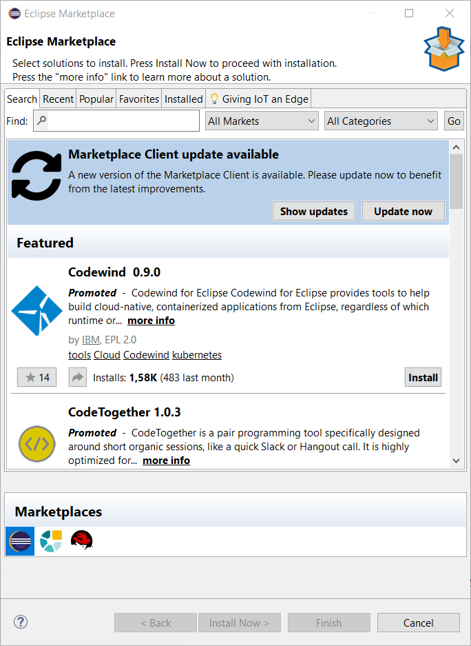

In the `Find` textbox, enter *quarkus* and press the `ENTER` key:

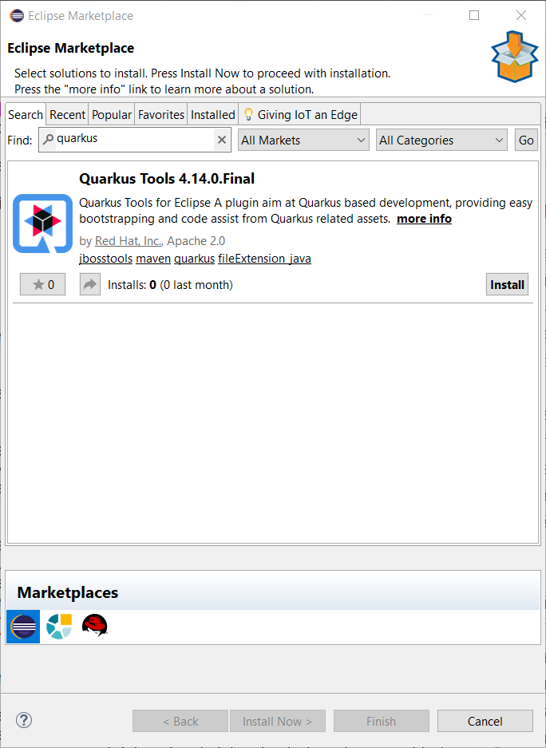

Click the `Install` button to start the installation:

When presenting the Review licenses dialog, select the `I accept the terms of the license agreements` checkbox and click the `Finish` button:

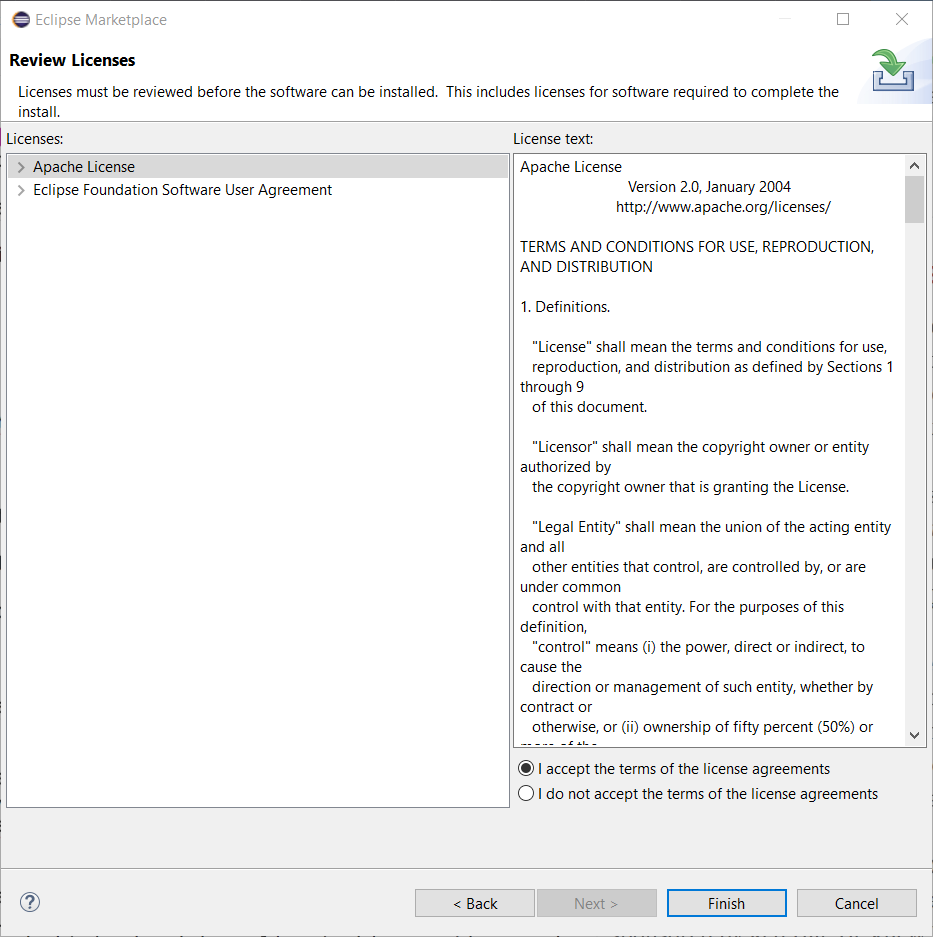

When presenting the Unsigned content dialog, click the `OK` button. Restart the IDE at the end of the installation procedure. Quarkus Tools is now installed in your IDE.

## Create your first Quarkus project

Quarkus Tools has a wizard based on <https://code.quarkus.io>. In order to launch it, first enter Ctrl+N to get the list of available wizards:

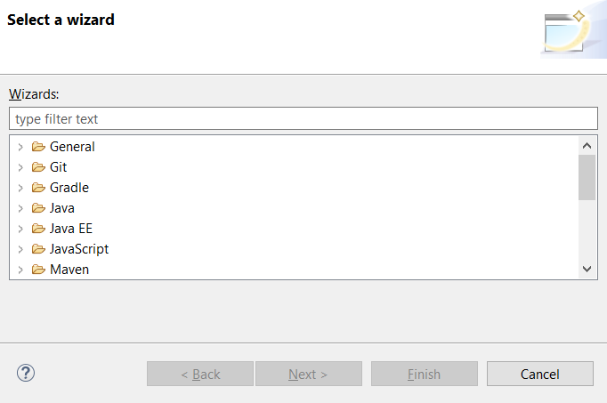

In the filter text box, enter the `qu` characters to filter the list of wizards:

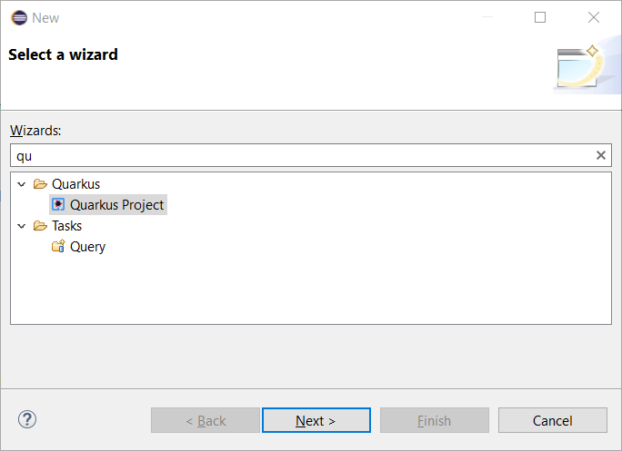

Select the **Quarkus Project** wizard and click the **Next** button:

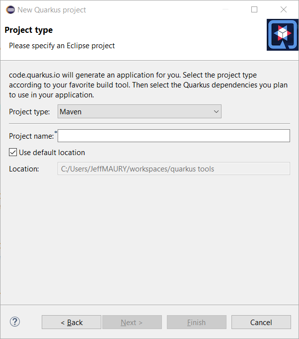

The **Project type** combo allows you to choose between Maven or Gradle tool used to manage your project. We'll go with Maven for this tutorial.

Enter a project name (we will use code-with-quarkus) and click the **Next** button:

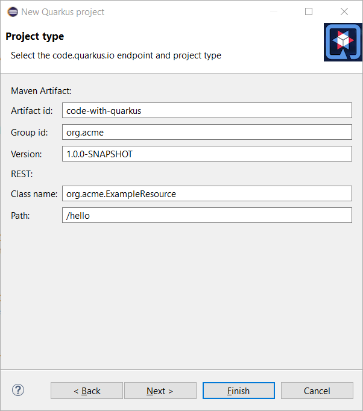

This dialog allows you to choose various parameters for you project, like the project coordinates (group id, artifact id and version) along with the base REST endpoint information. We'll use the default so click on the **Next** button:

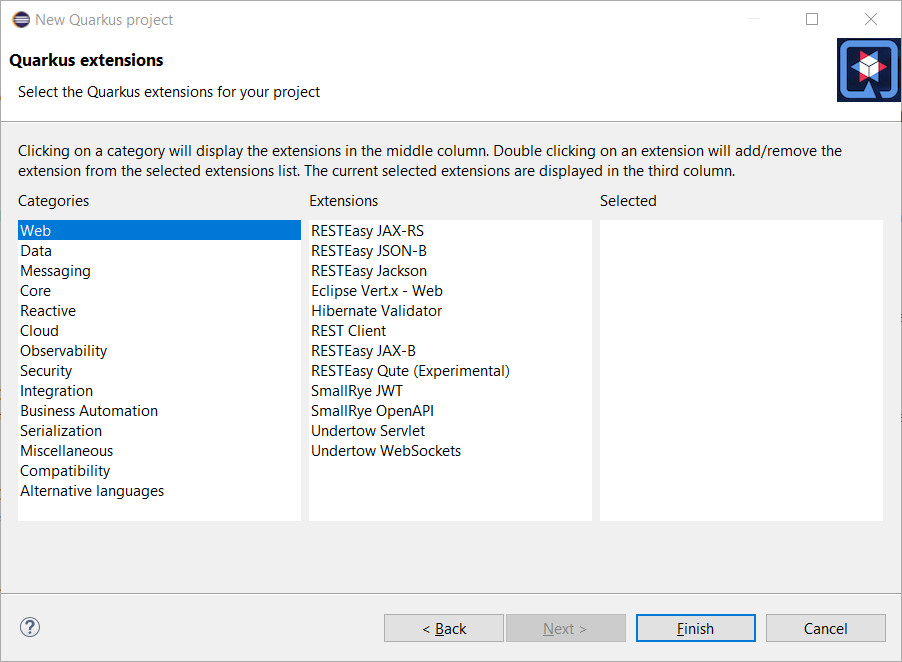

This dialog allows to select which Quarkus extensions you want to add to your project. The extensions are grouped by categories, so first select a specific category in the left table. We will choose the **Web** one:


You should have noticed that the middle table has been updated. In order to add an extension, double click on the extension in the middle table. We will add **RESTEasy JAX-RS** and **RESTEasy Qute** (a templating engine):

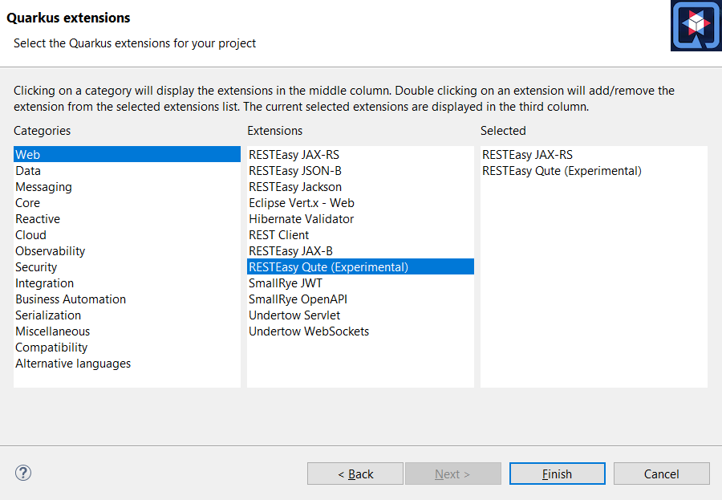

You should have noticed that the extensions that you double clicked on are now being added to the right table. If you want to remove an extension from the list of selected ones, double click again either in the center table or in the right table.

We are now all set so click on the **Finish** button to launch the project creation. The project creation job is then launched, dependencies are being retrieved and after a while, the new project will appear in the **Project Explorer** window:

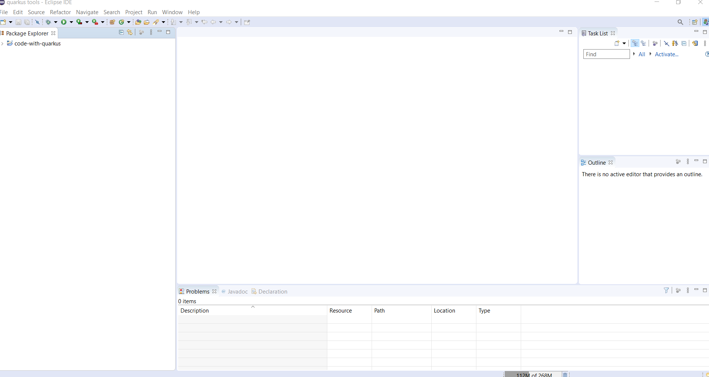

We have successfully created our first Quarkus project. Let's see now how we can launch this application and debug it.

<a id="run-application"></a>
## Running the Quarkus application

Running a Quarkus application can be done from the workbench Run configurations. Select the **Run -> Run Configurations...** menu to display the dialog allowing to create a Run configuration.

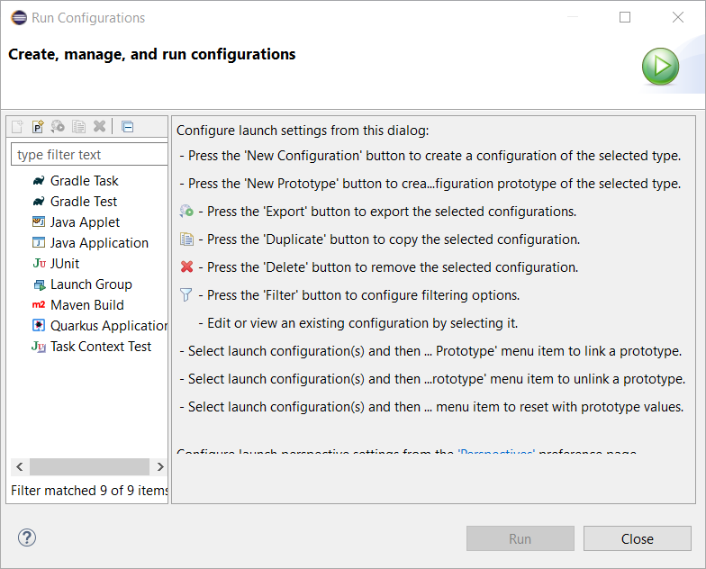

Scroll down until the **Quarkus Application** is visible and select it:

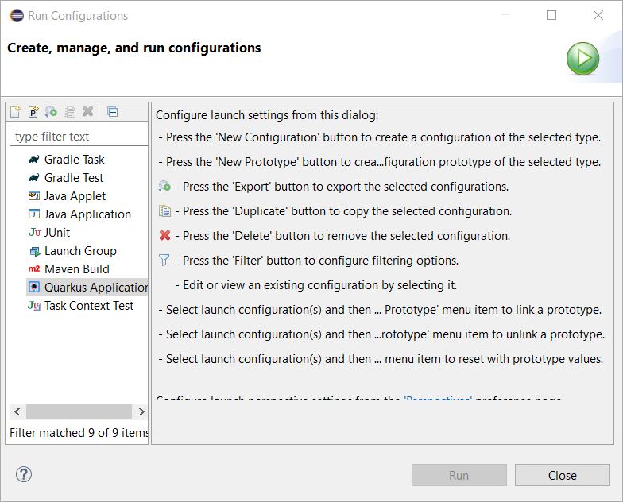

Click on the **New configuration** button (top left):

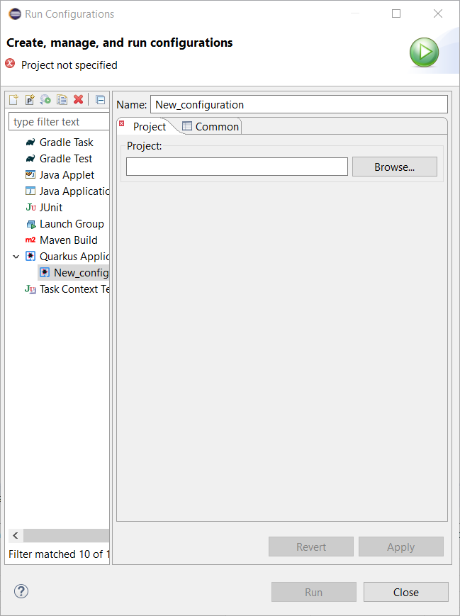

A workspace project needs to be associated with the configuration so click on the **Browse** button to see the project selection dialog:

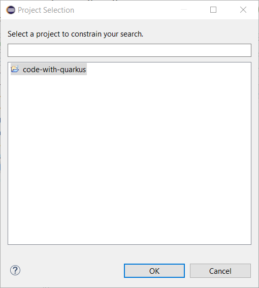

As the workspace contains a single project, it is automatically selected and we can click on the **OK** button:

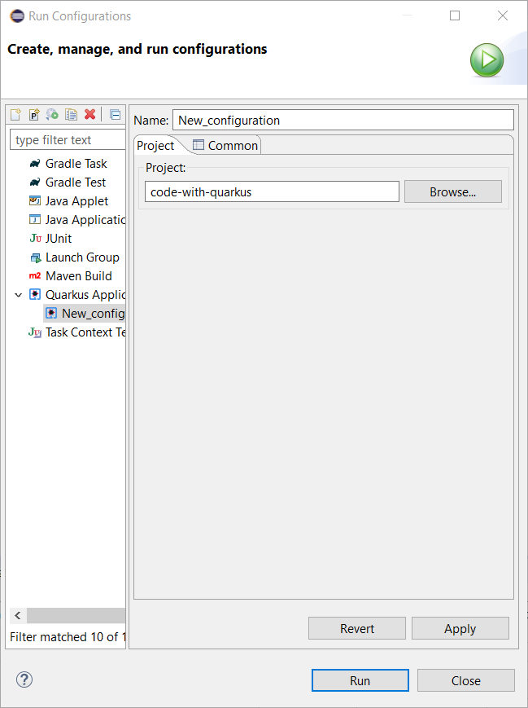

The configuration is now ready to be used. So let's start our Quarkus application by clicking on the **Run** button:

You should see a new Console being displayed.

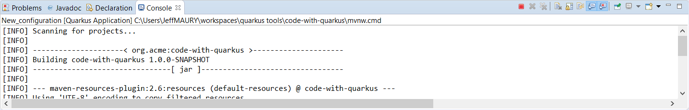

The application is being built and after a while, it will be started:

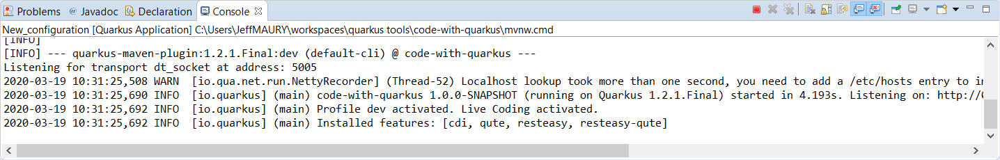

## Debugging the Quarkus application

Debugging a Quarkus application is just a simple as launching the previous configuration we've just created in Debug. You just need to open the **Run -> Debug Configurations...**. menu and click on the **Debug** button.

It will start the Quarkus application like in the previous paragraph but also connect a remote JVM debug configuration to your running Quarkus application. So if you have set breakpoints in your application source files, the execution will automatically stops there.

## application.properties content assist

Every Quarkus application is configured through a configuration called **application.properties**.

The content of this configuration file is dependent of the set of Quarkus extensions that your application is using. Some settings are mandatory, some others are not and the possible values are specific to the nature of the setting: boolean, integer, limited set of values (enumerations).

So, as a developer, you need to look at various guides and documentations (the core Quarkus and the extension specific ones)

So Quarkus Tools provides content assist on those specific files that:

- validates the content of the application.properties files
- provides you with the possible setting names and values

Let's see it in action.

Go to **src/main/resources/application.properties** in the project and double click the file to open an editor:

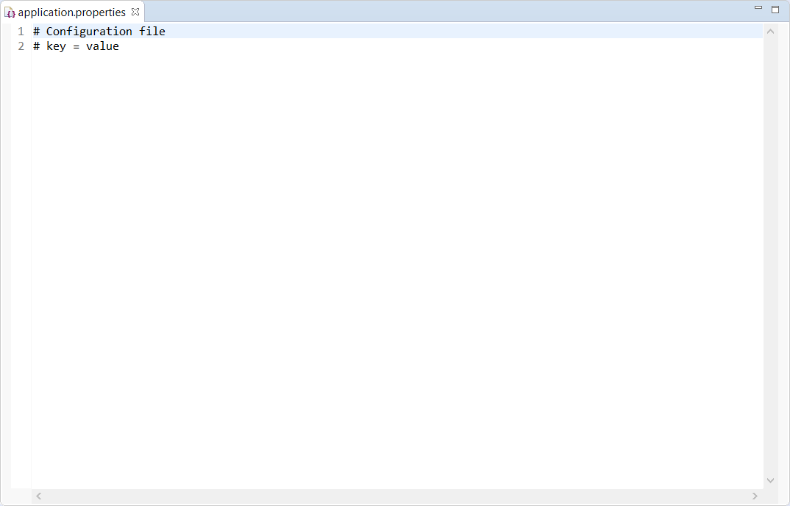

Go the third line of the file and invoke code completion (Ctrl + Space):

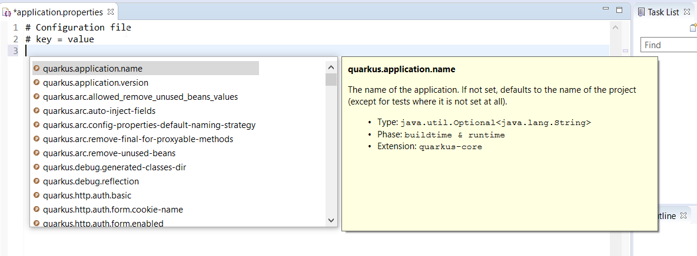

For each setting, a documentation is displayed when you mouse over the setting. Let try to add **quarkus.http.port** to the file and mouse over this name:

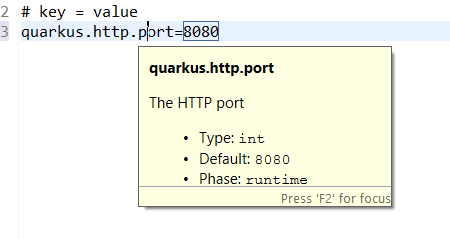

If we enter a wrong value (false instead of a numeric value), then the error will be highlighted:

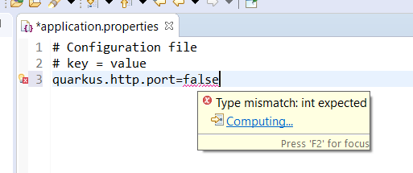

## Access application from the source code endpoint

If your Quarkus application is started, when you navigate into one of the application source code endpoints, the URL for that endpoint will be computed and presented into the source code as a **code lens** which is simply an additional comment virtually added into the source code. Let's see how this works.

Make sure your Quarkus application is started (see [Running the Quarkus application](#run-application))

Go to **src/main/java/org/acme/ExmapleResource.java** in the project and double click the file to open an editor:

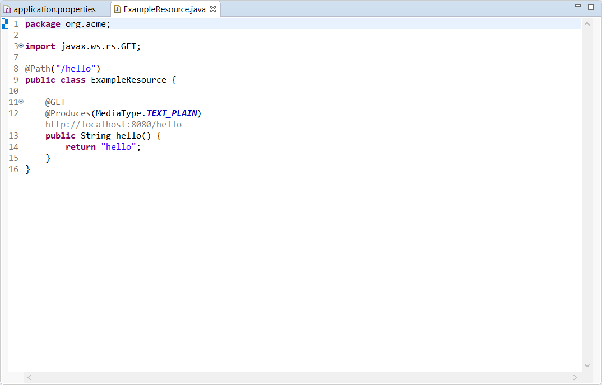

You should have noticed that an URL is now present the line above the `hello` method definition. If you mouve the mouse over this URL, you will see that this URL is clickable. Click the URL and this will open a browser window:

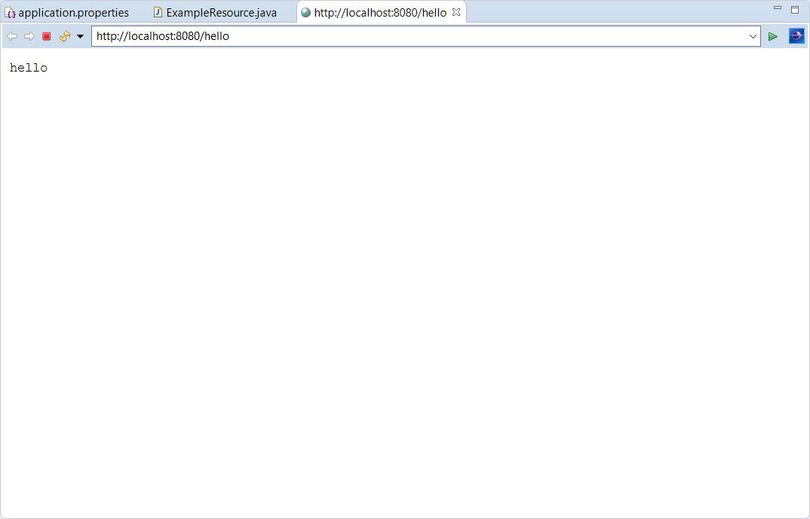

Please note that if you change your resource or endpoint path configuration, the URL will be dynamically updated: in this scenario, I changed the resource path from `hello` to `hello1` (on line 8):

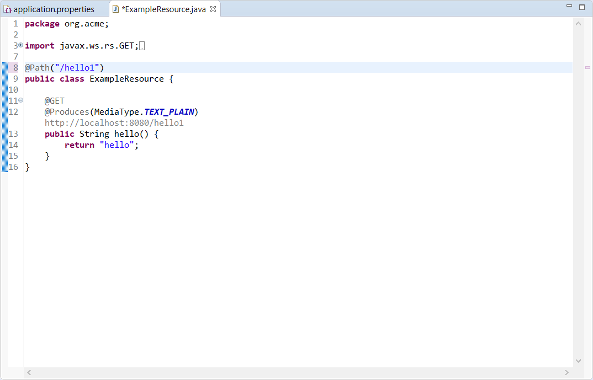

## Language support for Kubernetes, Openshift, S2i and Docker properties

There is now completion, hover, documentation and validation for kubernetes.\*, openshift.**, s2i.**, docker.\* properties coming from the [Kubernetes Quarkus extension](https://quarkus.io/guides/kubernetes#enable-kubernetes-support).

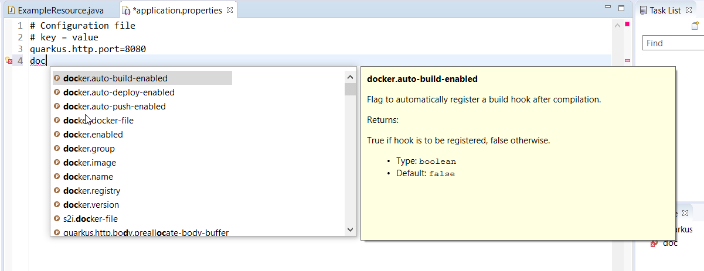

## Language support for MicroProfile REST Client properties

Likewise, there is now completion, hover, documentation and validation for the MicroProfile properties from REST Client.

Create a `MyServiceClient.java` file in the org.acme package with the following content:

```java
package org.acme;

import javax.ws.rs.GET;
import javax.ws.rs.Path;
import javax.ws.rs.core.Response;

import org.eclipse.microprofile.rest.client.inject.RegisterRestClient;

@RegisterRestClient
public interface MyServiceClient {
    @GET
    @Path("/greet")
    Response greet();
}
```

Switch back to the `application.properties` file editor and enter `or` and ask for code assist (Ctrl + ENTER):

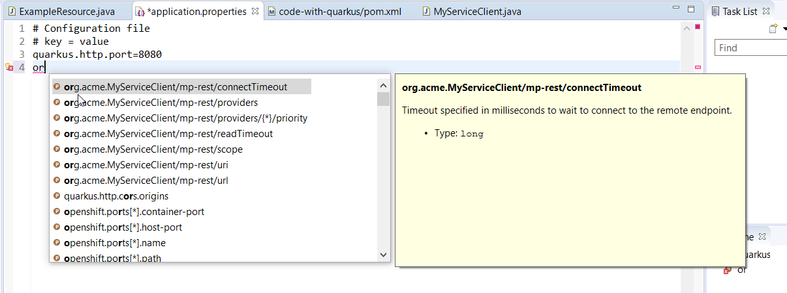

You can change the configuration key for the client by changing the line:

```java
@RegisterRestClient
```

to

```java
@RegisterRestClient(configKey = "myclient")
```

and the code assist will be adjusted accordingly:

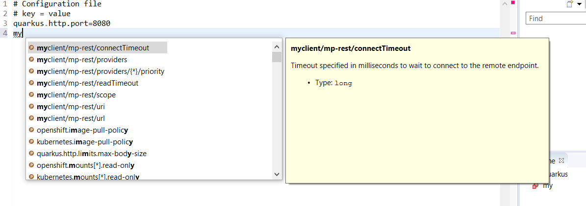

## Moving Forward

This wraps up the major features in this very first release. If you have any questions, suggestions or feedback, by all means please [open an issue](https://issues.redhat.com/secure/CreateIssueDetails!init.jspa?pid=10020&issuetype=1&summary=Summary&components=12333057).

For future releases we are aiming to improve language support for MicroProfile properties.

Thank you for reading and stay tuned for the next release!

## Links

- GitHub repository: <https://github.com/jbosstools/jbosstools-quarkus>
- Open an issue: <https://issues.redhat.com/secure/CreateIssueDetails!init.jspa?pid=10020&issuetype=1&summary=Summary&components=12333057>
