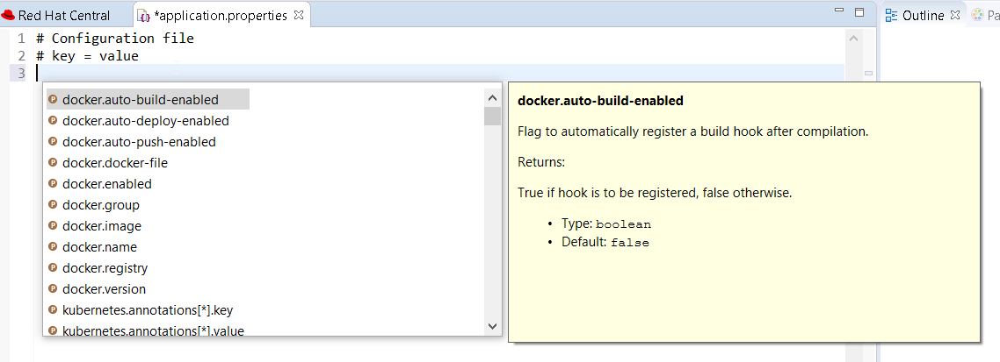
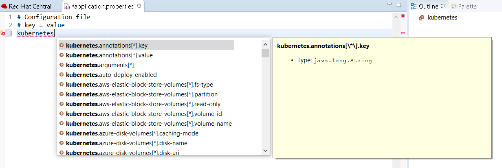
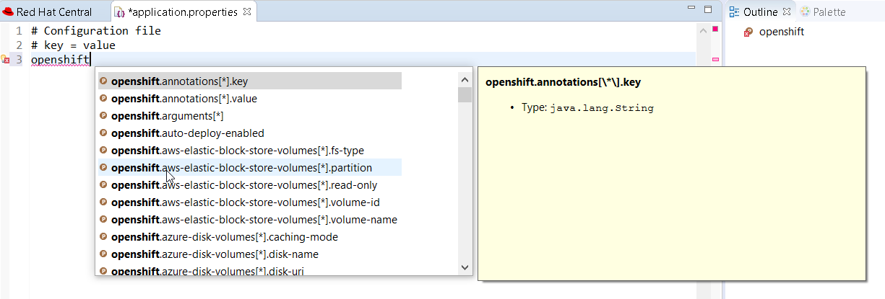
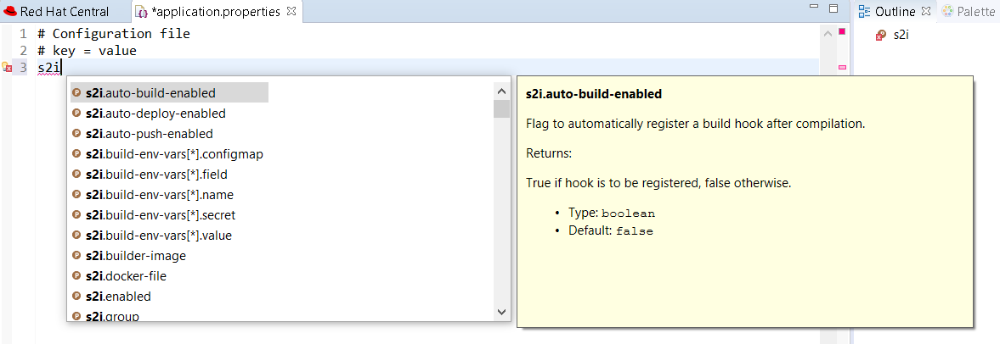
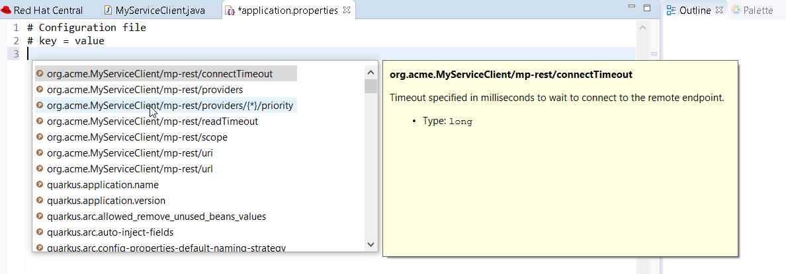
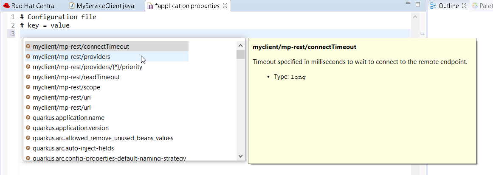
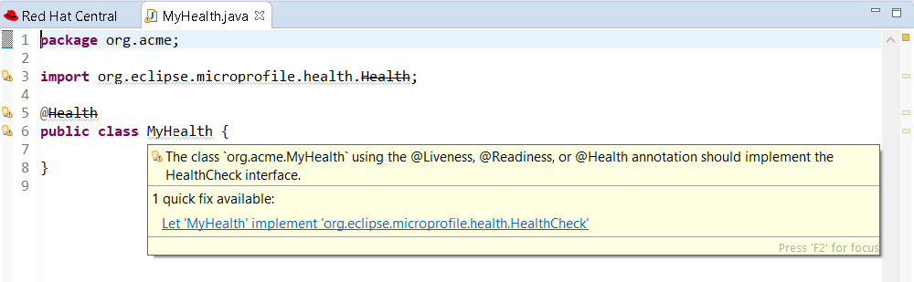
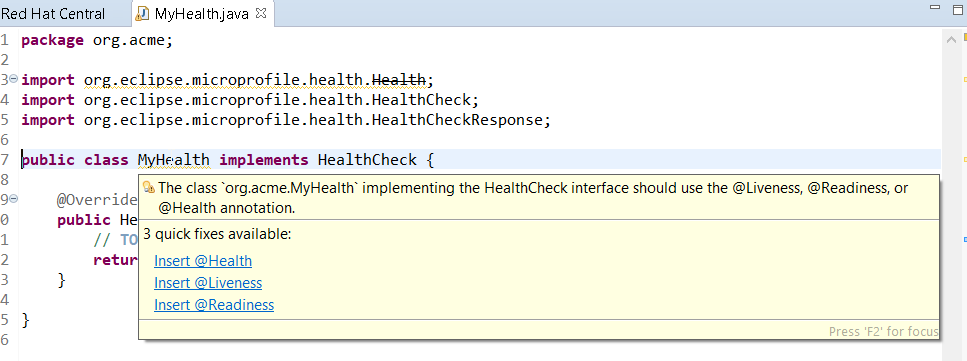
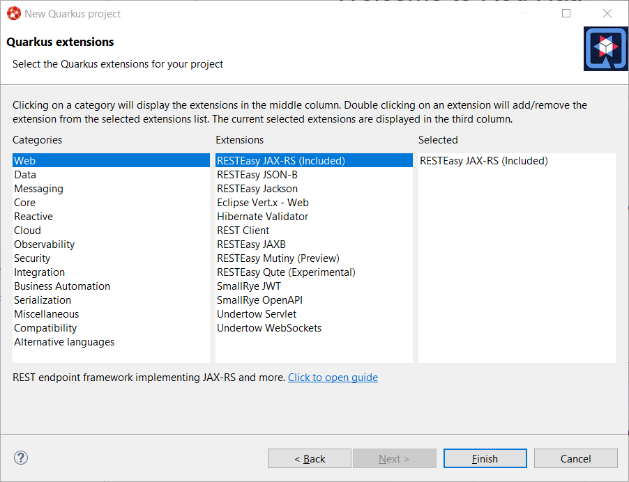
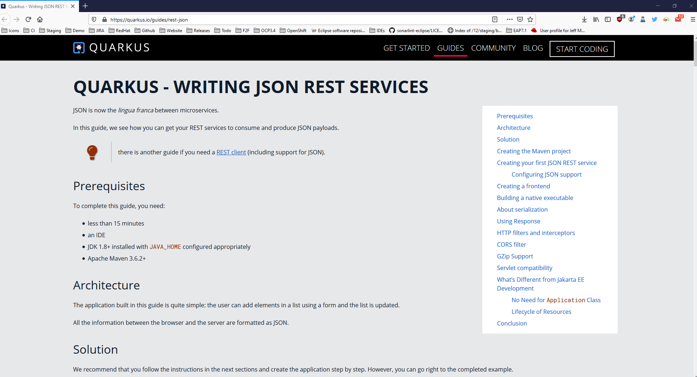

# Quarkus Tools for Eclipse 4.15.0.Final release !

In a previous [post](/blog/eclipse-got-quarkused), we announced the first version of Quarkus Tools for Eclipse. We're now announcing a new version for Quarkus Tools for Eclipse, including better support for Eclipse Microprofile, Java 11 and enhancements to the wizard.

## Language support for Kubernetes, Openshift, S2i and Docker properties

There is now completion, hover, documentation and validation for kubernetes.\*, openshift.**, s2i.**, docker.\* properties



Enter `kubernetes` prefix:



Enter `openshift` prefix:



Enter `s2i` prefix:



## Language support for MicroProfile REST Client properties

Likewise, there is now completion, hover, documentation and validation for the MicroProfile properties from REST Client.

After registering a REST client using `@RegisterRestClient` like so:

```java
package org.acme;

import javax.ws.rs.GET;
import javax.ws.rs.Path;
import javax.ws.rs.core.Response;

import org.eclipse.microprofile.rest.client.inject.RegisterRestClient;

@RegisterRestClient
public interface MyServiceClient {
    @GET
    @Path("/greet")
    Response greet();
}
```

The related MicroProfile Rest config properties will have language feature support (completion, hover, validation, etc.).



Change the Java code so that the configuration key is changed:

```java
package org.acme;

import javax.ws.rs.GET;
import javax.ws.rs.Path;
import javax.ws.rs.core.Response;

import org.eclipse.microprofile.rest.client.inject.RegisterRestClient;

@RegisterRestClient(configKey = "myclient")
public interface MyServiceClient {
    @GET
    @Path("/greet")
    Response greet();
}
```

and notice the code assist is changed accordingly:



## Language support for MicroProfile Health

Likewise, there is now completion, hover, documentation and validation for the MicroProfile Health artifacts.

So if you have the following Health class:

```java
package org.acme;

import org.eclipse.microprofile.health.Health;

@Health
public class MyHealth {

}
```

you will get a validation error (as the class does not implement the `HealthCheck` interface:



Similarely, if you have a class that implements `HealthCheck` but is not annotated with `Health`, some workflow applies:

```java
package org.acme;

import org.eclipse.microprofile.health.HealthCheck;
import org.eclipse.microprofile.health.HealthCheckResponse;

public class MyHealth implements HealthCheck {

    @Override
    public HealthCheckResponse call() {
        // TODO Auto-generated method stub
        return null;
    }

}
```

you will get a validation error (as the class is not annotated with `Health` interface:



As there are several ways to fix the problem, then several quick fixes are proposed.

## Better extensions reporting in the Quarkus project wizard

With the Quarkus extensions ecosystem growing, we improved information about extensions in the Quarkus project wizard.

When you select an extension in the wizard, you will see the extension description in the lower side of the wizard. If the extension has a guide on the Quarkus web site, a link will also be displayed and clicking on that link will open the guide on your local web browser.





## Moving Forward

If you have any questions, suggestions or feedback, by all means please [open an issue](https://issues.redhat.com/secure/CreateIssueDetails!init.jspa?pid=10020&issuetype=1&summary=Summary&components=12333057).

For future releases we are aiming to improve language support for YAML properties file.

Thank you for reading and stay tuned for the next release!

## Links

- GitHub repository: <https://github.com/jbosstools/jbosstools-quarkus>
- Open an issue: <https://issues.redhat.com/secure/CreateIssueDetails!init.jspa?pid=10020&issuetype=1&summary=Summary&components=12333057>
