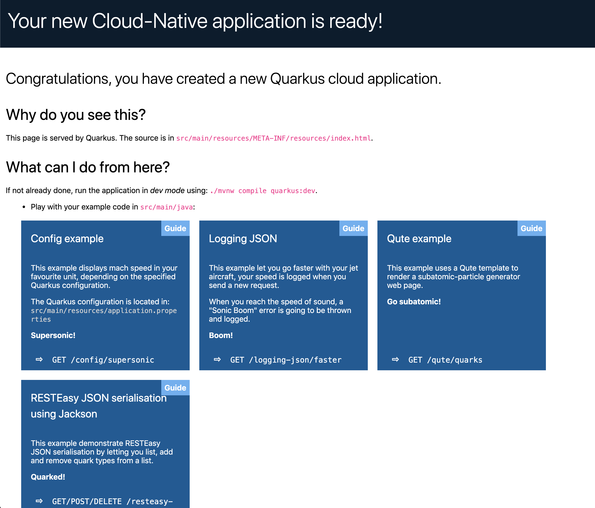
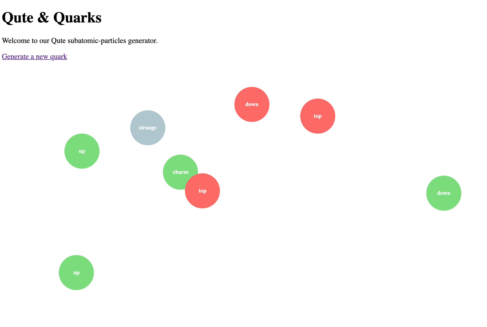

# Extension codestarts - A new way to learn & discover Quarkus

What’s nice about Extension codestarts is that it’s useful for fresh Quarkus developers as well as experienced ones. This is because of the wide range (and growing) of Quarkus extensions, you simply can’t know them all.

When I am comparing frameworks, I think that Doc is a very important factor, but I am also often pretty lazy when it comes to reading it... don't you?

By the way you can see that Quarkus is pretty well [documented](https://quarkus.io/guides/).

With this feature, we tried to take it a step further and transform that boring learning part to the thing we love most **CODING**..

Starting now, when you wish to try some new extensions, you directly have the code showing you their true power, ready to run in your favorite IDE in a matter of seconds!

All this, using your chosen build tool (Maven, Gradle or also Gradle with Kotlin DSL) and your chosen language (Java, Kotlin or Scala).

It’s been slowly making its way in for a while now (since 1.7), Codestarts are now the official way of generating your Quarkus applications starting from 1.10!



## Existing Extension codestarts

We already prepared examples for a dozen of extensions, you may spot them on [code.quarkus.io](https://code.quarkus.io) (with the jet fighter icon).

You can also find them on most of our Quarkus tooling:

- The Quarkus Maven plugin:

  ```shell
  mvn io.quarkus:quarkus-maven-plugin:create
  ```

- The Quarkus CLI, it is still experimental, and we don't provide an installer yet. Still, you can easily try it using the amazing [JBang](https://jbang.dev/)

  ```shell
  jbang cli@quarkusio create
  ```

- The [IDE plugins](https://quarkus.io/blog/march-of-ides/) which support "Wizards w/code.quarkus.io"

## A bit of fun in some of our examples

My favorite one is the new Qute example with a subatomic-particles generator :)



- [Here on code.quarkus.io](https://code.quarkus.io/?g=its.subatomic&a=subatomic-particles-generator&v=1.0.0-SNAPSHOT&b=MAVEN&s=xTN&cn=code.quarkus.io)
- With the CLI:

  ```shell
  jbang cli@quarkusio create qute
  ```


## We need more Extension codestarts!

Codestarts are designed to make it easy and quick to provide new examples for extensions. So whether you are an extension owner, or you are keen to create an example for an extension you like, contributions are very welcome!

We provide [doc and tooling](https://github.com/quarkusio/quarkus/blob/main/independent-projects/tools/codestarts/README.adoc) for it, you may also [come and ping me (@ia3andy) on Zulip](https://quarkusio.zulipchat.com/#narrow/stream/187038-dev/topic/Codestarts.2E.2E.2E) for more info.

For now, we focus on the [core extensions](https://github.com/quarkusio/quarkus/blob/main/extensions), but we will make it available to the broader ecosystem soon.
