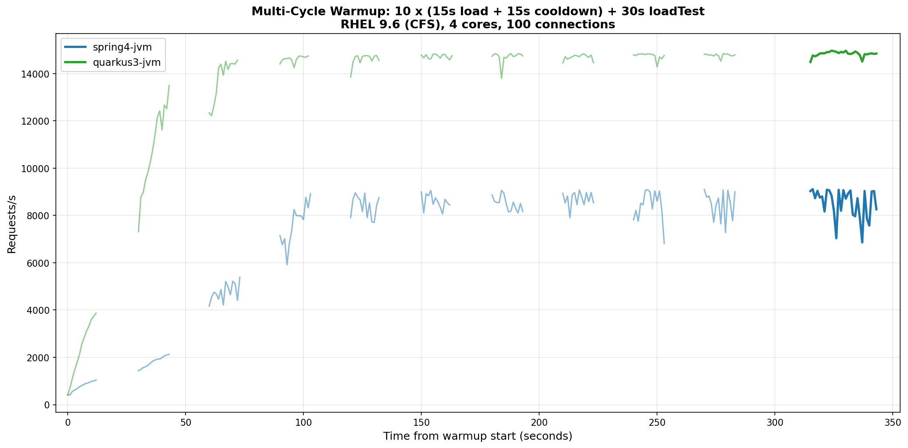
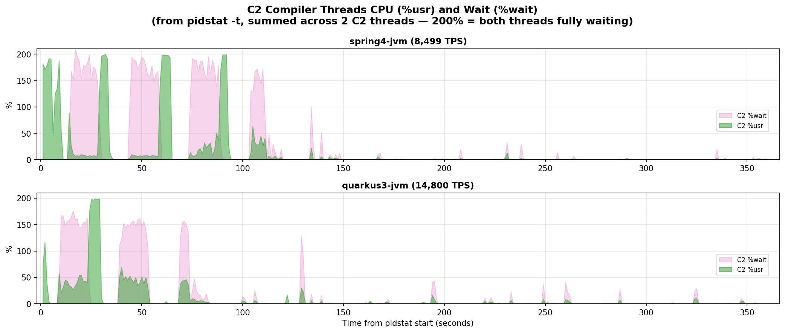
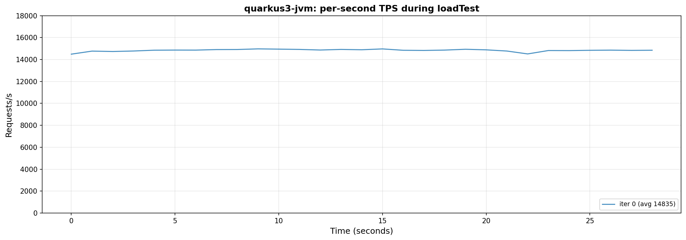
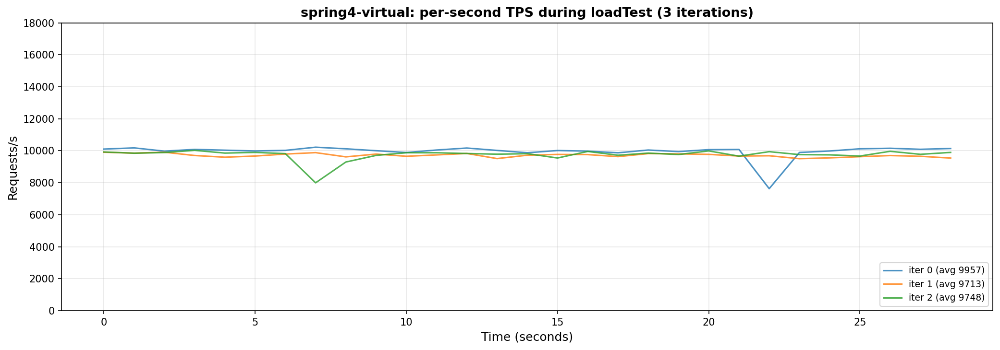
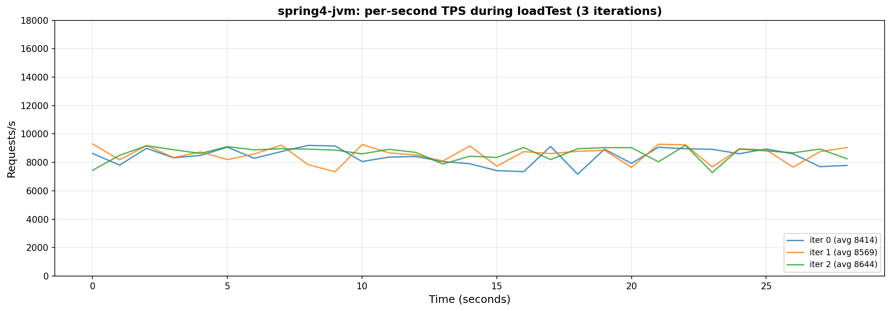
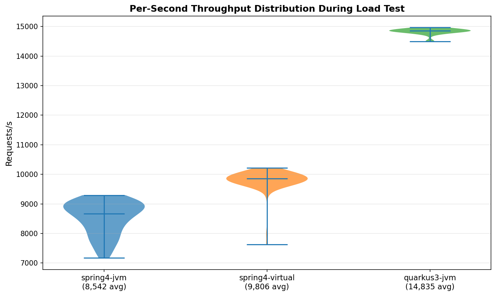

# Improving a Competitor's Numbers (On Purpose)

*"The first principle is that you must not fool yourself — and you are the easiest person to fool."* ([Richard Feynman, 1974](https://calteches.library.caltech.edu/51/2/CargoCult.htm))

Our [previous article](https://quarkus.io/blog/when-the-jit-cant-keep-up/) dug into C2 compiler starvation: Spring's \~100 platform threads on 4 cores were hogging all the CPU, leaving the JIT compiler unable to do its job. The measured throughput reflected half-baked code running at C1 tier, not the peak Spring could actually achieve.

That raised an uncomfortable question. If our benchmark was measuring Spring mid-compilation, were we measuring peak performance... or just punishing slow warmup?

## What does "fair" even mean?

If you're claiming to compare peak throughput, every runtime needs to have finished compiling before the stopwatch starts. Otherwise you're comparing one runtime's peak against another's still-warming-up numbers, and calling it a day.

Our old warmup was a single 2-minute continuous blast followed by a 30-second cooldown and a 30-second measurement. Quarkus was done compiling in 60 seconds. Spring wasn't done when measurement began.

That's a framework problem: Quarkus doesn't have it despite higher throughput, because its leaner request processing leaves CPU gaps for the compiler. Or as Mytkowicz et al. put it: we were ["producing wrong data without doing anything obviously wrong"](https://dl.acm.org/doi/10.1145/1508244.1508275). In production, nobody pauses traffic so the JIT can catch up — continuous load is the realistic scenario. But it's still our call to make sure the benchmark gives every runtime the best chance to show its peak.

## The fix

We can't just make the warmup longer. The whole point of the [previous analysis](https://quarkus.io/blog/when-the-jit-cant-keep-up/) was that C2 never gets CPU during continuous load. More time under load just means more time starved.

The trick: **break the warmup into short bursts with cooldown gaps.** During each 15-second cooldown, the 2 C2 compiler threads get full access to the 4 available cores and can drain the compilation queue. 10 cycles of load+cooldown, 5 minutes total, then measure.

Quarkus peaks by cycle 2. Spring ramps through 5 cycles and stabilizes. By the time measurement starts, both are fully compiled. In cloud deployments with fewer cores, the starvation would be worse — reaching peak quickly vs. slowly translates directly to provisioning cost.

The C2 compiler thread activity confirms it. Compare this to the [previous article's charts](https://quarkus.io/blog/when-the-jit-cant-keep-up/) where C2 was starved for the entire warmup:

Both frameworks show near-zero C2 activity during the load test (rightmost region). The compiler is done.

## What changed

Spring went from \~7,850 to \~8,500 TPS — an \~8% improvement just from letting C2 finish its job. Quarkus held steady at \~14,800. The ratio narrowed from \~1.9x to \~1.7x.

**The performance gap is real, and Quarkus's lead remains definitive.** What we removed is the artificial penalty from measuring before Spring finished compiling.

## A number hides a shape

The multi-cycle warmup fixed the peak measurement. But here's something the average still can't tell you. These are the per-second TPS traces during the load test with the new warmup, across multiple iterations:

> [!NOTE]
> Only one quarkus3-jvm iteration is shown. The per-second throughput barely moves, so additional iterations would be indistinguishable from the first.

Quarkus is stable within the measurement window. spring4-virtual is stable across all three iterations, with occasional single-second dips. spring4-jvm wobbles continuously across all iterations, despite no C2 compiler activity during the load test (as we saw in the previous section). The instability is not a compilation problem.

A violin plot makes the distributions visible at a glance:

In a [Quarkus Insights session with Holly Cummins](https://quarkus.io/blog/quarkus-insights-252-performance-engineering-lessons/), we discussed the value of having a noiseless benchmark: if the measurement is stable enough, you don't need statistics at all. A single number tells the story. When it doesn't, [violin plots](https://en.wikipedia.org/wiki/Violin_plot) show what's really happening, but they add cognitive load. The goal is to make statistics unnecessary, not to add more of them.

### Why does spring4-jvm still wobble?

This isn't a warmup problem anymore. Compilations are done. The wobble comes from how Spring's \~100 platform threads interact with the [CFS scheduler](https://en.wikipedia.org/wiki/Completely_Fair_Scheduler) on the performance lab (RHEL 9.6, kernel 5.14).

Spring Boot's default connection pool has a yield-spin pattern that creates a storm of involuntary context switches when many platform threads contend on few cores. The effect is OS-scheduler-dependent: severe on CFS, invisible on EEVDF. Quarkus uses [Agroal](https://agroal.github.io/), which doesn't have this pattern.

> [!NOTE]
> **`Thread.yield()` is not what it seems.** The `sched_yield()` syscall keeps the thread in `TASK_RUNNING` state. The kernel classifies the resulting context switch as **involuntary**, not voluntary, because the thread never blocked. This means the high involuntary context switch counts for Spring are partly driven by HikariCP choosing to yield.
>
> With virtual threads, `Thread.yield()` is handled by the JVM's virtual thread scheduler in userspace. No syscall, no involuntary context switch storm.

**Virtual threads stabilize Spring in our benchmark.** They collapse \~100 OS threads to a handful of carrier threads, where `Thread.yield()` is no longer the OS scheduler's responsibility. spring4-virtual reaches peak in 2 warmup cycles and delivers stable throughput. But virtual threads are not a universal fix for yield-spin: `Thread.yield()` on a virtual thread unmounts it from the carrier, but the virtual thread can be immediately re-enqueued on the same carrier, and under load all carriers can end up spinning in the yield loop. This was severe enough to cause pod restarts in production and was fixed in [HikariCP 7.1.0](https://github.com/brettwooldridge/HikariCP/issues/2398).

As discussed in the [previous article](https://quarkus.io/blog/when-the-jit-cant-keep-up/), machines with the [EEVDF scheduler](https://lwn.net/Articles/925371/) don't exhibit the platform-thread CFS problem.

## We've done this before

This isn't the first time we've faced this dilemma. In [issue #521](https://github.com/quarkusio/spring-quarkus-perf-comparison/issues/521), we found that both frameworks were given 512MB heap even though **Quarkus could run with far less**. Rather than give Quarkus a memory advantage, we kept the same heap for both: a common baseline, even if it doesn't showcase Quarkus's density. Same principle: **measure what you claim to measure.**

## Takeaways

- **Even after giving Spring every advantage — multi-cycle warmup, full C2 compilation, peak conditions — Quarkus delivers 1.7x the throughput.** The gap narrowed from 1.9x, but the lead remains definitive.
- **If the compiler never finishes, you're not measuring peak.** Continuous warmup starves C2 on thread-heavy runtimes. Break it into cycles. Let the compiler breathe.
- **When your competitor looks slow, check your methodology before you celebrate.** We did. Spring gained \~650 TPS. We sleep fine.
- **A throughput number is a lossy compression of reality.** Quarkus draws a flat line. Spring wobbles. Same average, very different stories. Show the trace, not just the score.
- **Fairness isn't charity, it's credibility.** A benchmark that flatters you by handicapping the other side is a benchmark nobody should trust.

## Tools and data

- Previous article: [Harder, Better, Faster, Stronger... Earlier!](https://quarkus.io/blog/when-the-jit-cant-keep-up/)
- Multi-cycle warmup: [PR #681](https://github.com/quarkusio/spring-quarkus-perf-comparison/pull/681) / [issue #633](https://github.com/quarkusio/spring-quarkus-perf-comparison/issues/633)
- Fairness precedent: [issue #521](https://github.com/quarkusio/spring-quarkus-perf-comparison/issues/521) (heap sizing)
- HikariCP virtual-thread yield-spin: [HikariCP #2398](https://github.com/brettwooldridge/HikariCP/issues/2398) (fixed in 7.1.0)
- Performance engineering discussion: [Quarkus Insights #252](https://quarkus.io/blog/quarkus-insights-252-performance-engineering-lessons/)
