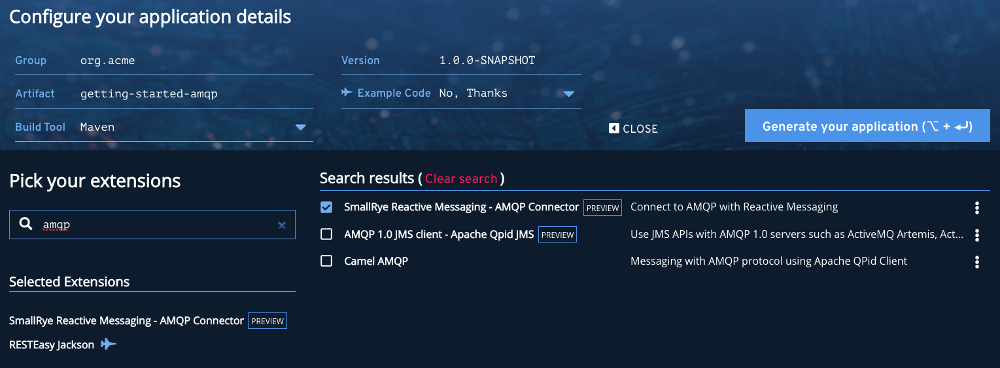

# Getting Started with AMQP in your Quarkus application

[AMQP 1.0](https://www.amqp.org/) is a standard for passing messages between applications or organizations. It connects systems, feeds business processes with the information they need, and reliably handles communication between systems. AMQP is a robust and mature protocol widely used in event-driven applications.

This post is the equivalent of the [Kafka getting started post](https://quarkus.io/blog/getting-started-kafka/), but focuses on the usage of AMQP. You will learn how to get started with AMQP in your Quarkus application in less than ten steps. We will use [SmallRye Reactive Messaging](https://smallrye.io/smallrye-reactive-messaging/latest/) - a declarative approach to building event-driven microservices.

> [!NOTE]
> The complete code is available from [GitHub](https://github.com/cescoffier/getting-started-quarkus-amqp).

## Step 1 - Generate your project

Let's start with the very beginning, getting a new project structure with the right dependencies. Go to <https://code.quarkus.io>, enter your group id and artifact id. Then in the extension list, select:

- SmallRye Reactive Messaging - AMQP Connector
- RESTEasy Jackson



> [!TIP]
> You can disable the "Example Code" to avoid the generated project containing examples.

Then, click on *Generate your application*, download the project as a zip file, unzip it, and load it in your favorite IDE.

If you opened the generated `pom.xml`, you would see that the `quarkus-smallrye-reactive-messaging-amqp`  and `quarkus-resteasy-jackson` dependencies are declared, so we're ready to write some code.

## Step 2 - What are we going to exchange?

We need something to exchange. Without much originality, let's say we will send and receive `Movie` objects. In your project, create the `org.acme.Movie` class with the following content:

```java
package org.acme;

public class Movie {

    public String title;
    public int year;

}
```

With AMQP, we exchange [messages](http://docs.oasis-open.org/amqp/core/v1.0/os/amqp-core-messaging-v1.0-os.html#section-message-format), which can have multiple *data* sections (or multiple AMQP sequences, or a single AMQP value section). In our application, as we are exchanging `Movie` object, it encodes the instances as JSON and transfers it in a single *data* section. The `content-type` header is set to `application/json`.

AMQP messages are sent to a destination. To keep things simple, let's name it *movies*.

## Step 3 - Configure the application

As said above, we will use Reactive Messaging. When you use Reactive Messaging, you send messages to a channel and receive them from another channel. These channels are mapped to the underlying messaging technology by configuration. We must indicate that our reception and publication channels will use the *movies* address in our application. In `src/main/resources/application.properties`, add the following content:

```properties
# The AMQP broker location and credentials
amqp-host=localhost
amqp-port=5672
amqp-username=quarkus
amqp-password=quarkus

# Configuring the incoming channel (reading from AMQP)
mp.messaging.incoming.movies-in.connector=smallrye-amqp
mp.messaging.incoming.movies-in.address=movies

# Configuring the outgoing channel (writing to AMQP)
mp.messaging.outgoing.movies-out.connector=smallrye-amqp
mp.messaging.outgoing.movies-out.address=movies
```

After having configured the broker location and credentials (`amqp-` properties), we configure our two channels: `movies-in` (receiving the records) and `movies-out` (publishing the records).

We use the `mp.messaging.incoming.movies-in` prefix to configure the channel. The `connector` attribute indicates who's responsible for this channel, here the AMQP connector. We also need to specify the consumed destination using the `address` attribute.

To configure the outbound `movies-out` channel, we use the `mp.messaging.outgoing.movies-out` prefix. In addition to indicating who's responsible for that channel, we also need to configure the address.

## Step 4 - Publishing movies to AMQP

Now, it's time to send messages. Create the `org.acme.MovieProducer` class with the following content:

```java
package org.acme;

import org.eclipse.microprofile.reactive.messaging.Channel;
import org.eclipse.microprofile.reactive.messaging.Emitter;

import javax.enterprise.context.ApplicationScoped;
import javax.inject.Inject;

@ApplicationScoped
public class MovieProducer {

    @Inject
    @Channel("movies-out")
    Emitter<Movie> emitter;

    public void send(Movie movie) {
        emitter.send(movie);
    }
}
```

In this class, we inject an `Emitter,` i.e., an object responsible for sending a message to a channel. This emitter is attached to the `movies-out` channel (and will send messages to AMQP). The connector automatically encoded the content as JSON and set the `content-type` header.

> [!IMPORTANT]
> You need to make sure your payload can be encoded to JSON.

So, the rest of our application can use the `send` method to send a movie to our AMQP destination.

## Step 5 - Consuming movies

Let's now look at the other side and retrieve the movies from AMQP.

```java
package org.acme;

import org.eclipse.microprofile.reactive.messaging.Incoming;
import org.jboss.logging.Logger;

import javax.enterprise.context.ApplicationScoped;

@ApplicationScoped
public class MovieConsumer {

    private final Logger logger = Logger.getLogger(MovieConsumer.class);

    @Incoming("movies-in")
    public void receive(Movie movie) {
        logger.infof("Got a movie: %d - %s", movie.year, movie.title);
    }
}
```

Here, we use the `@Incoming` annotation to indicate to Quarkus to call the `receive` method for every received record.

Remember, the movie is encoded into JSON, so we need to help the connector produce a `Movie` from the received JSON.

Create the `org.acme.JsonToObjectConverter` class with the following content:

```java
package org.acme;

import io.smallrye.reactive.messaging.MessageConverter;
import io.smallrye.reactive.messaging.amqp.IncomingAmqpMetadata;
import io.vertx.core.json.JsonObject;
import org.eclipse.microprofile.reactive.messaging.Message;

import javax.enterprise.context.ApplicationScoped;
import java.lang.reflect.Type;

@ApplicationScoped
public class JsonToObjectConverter implements MessageConverter {

    @Override
    public boolean canConvert(Message<?> in, Type target) {
        return in.getMetadata(IncomingAmqpMetadata.class)
                .map(meta -> meta.getContentType().equals("application/json")  && target instanceof Class)
                .orElse(false);

    }

    @Override
    public Message<?> convert(Message<?> in, Type target) {
        return in.withPayload(((JsonObject) in.getPayload()).mapTo((Class<?>) target));
    }
}
```

This class is a *converter*. It maps the content of a `Message` to another type. In the `canConvert` method, we verify that the incoming message is coming from AMQP (so contain the `IncomingAmqpMetadata` metadata) and that the content-type is set to `application/json`. The `convert` method maps the received `JsonObject` into the target type (`Movie` in our case).

With this converter, our `consume` method will receive the `Movie` objects.

## Step 6 - Sending movies from a REST endpoint

It's quite common to send messages to AMQP from a REST endpoint. To do this, create the `org.acme.MovieResource` class with the following content:

```java
package org.acme;

import javax.inject.Inject;
import javax.ws.rs.Consumes;
import javax.ws.rs.POST;
import javax.ws.rs.Path;
import javax.ws.rs.Produces;
import javax.ws.rs.core.MediaType;
import javax.ws.rs.core.Response;

@Path("/")
@Consumes(MediaType.APPLICATION_JSON)
@Produces(MediaType.APPLICATION_JSON)
public class MovieResource {

    @Inject
    MovieProducer producer;

    @POST
    public Response send(Movie movie) {
        producer.send(movie);
        // Return an 202 - Accepted response.
        return Response.accepted().build();
    }
}
```

This class uses the `MovieProducer` we implemented above to send the `movies`. You could also use an `Emitter` directly.

## Step 7 - Let's get this running!

Well, first, we need an AMQP broker, for example [Apache ActiveMQ Artemis](http://activemq.apache.org/components/artemis/). You can follow the [Getting Started with Artemis](http://activemq.apache.org/components/artemis/documentation/latest/using-server.html) documentation, or use the following `docker-compose.yaml` file:

```yaml
version: '2'

services:

  artemis:
    image: vromero/activemq-artemis:2-alpine-latest
    ports:
      - "5672:5672"
      - "8161:8161"
      - "61616:61616"
    environment:
      ARTEMIS_USERNAME: quarkus
      ARTEMIS_PASSWORD: quarkus
```

Copy the `docker-compose.yaml` file in your project, and from a terminal, start your broker with: \`docker-compose up -d'

Then, run the application using:

```bash
./mvnw quarkus:dev
```

The application runs in dev mode, meaning that you can still update the code. It will reload it automatically.

In another terminal, emit a few HTTP POST request such as:

```bash
curl --header "Content-Type: application/json" \
--request POST \
--data '{"year":1994, "title":"The Shawshank Redemption"}' \
http://localhost:8080/

curl --header "Content-Type: application/json" \
--request POST \
--data '{"year":1972, "title":"The Godfather"}' \
http://localhost:8080/

curl --header "Content-Type: application/json" \
--request POST \
--data '{"year":2008, "title":"The Dark Knight"}' \
http://localhost:8080/

curl --header "Content-Type: application/json" \
--request POST \
--data '{"year":1994, "title":"Pulp Fiction"}' \
http://localhost:8080/

curl --header "Content-Type: application/json" \
--request POST \
--data '{"year":2010, "title":"Inception"}' \
http://localhost:8080/
```

In the terminal running the application, you will see:

```text
...
2021-01-27 09:29:41,087 INFO  [org.acm.MovieConsumer] (vert.x-eventloop-thread-9) Got a movie: 1994 - Pulp Fiction
2021-01-27 09:29:41,114 INFO  [org.acm.MovieConsumer] (vert.x-eventloop-thread-9) Got a movie: 2010 - Inception
...
```

It works!

## Step 8 - Native packaging

If you have [GraalVM installed and configured correctly](https://quarkus.io/guides/building-native-image), you can package this application as a native executable:

```bash
./mvnw package -Pnative
```

Then, execute your native executable with: `./target/getting-started-amqp-1.0.0-SNAPSHOT-runner`, and you get a Quarkus application using AMQP starting in a few milliseconds and consuming a ridiculous amount of memory: only 33Mb after 100 ingested records!

```bash
$ rss getting-started-amqp-1.0.0-SNAPSHOT-runner
PID 0M COMMAND
54986 33M ./target/getting-started-amqp-1.0.0-SNAPSHOT-runner
```

## Summary

In less than 10 minutes, we have a new Quarkus application using AMQP. If you want to go further, check the [AMQP guide](https://quarkus.io/guides/amqp).
