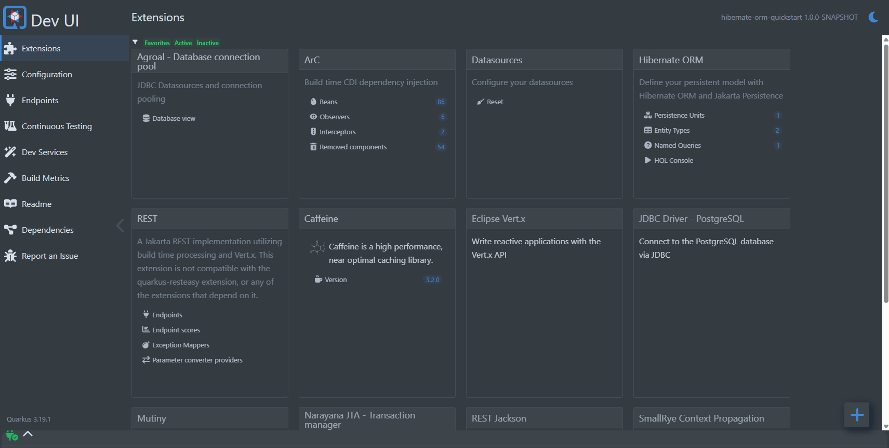

# Hibernate ORM 7 on Quarkus: each new version brings a better database experience

### Introduction

Hibernate ORM is improving at a very fast speed, and so is its integration with Quarkus, as great database access is a key part of the Quarkus experience. The latest Quarkus 3.24 release upgrades Hibernate to version 7, a major upgrade that implies some breaking changes, and thus will require paying attention to the [migration guide](https://docs.jboss.org/hibernate/orm/7.0/migration-guide/migration-guide.html) when upgrading. Developers working on Hibernate and Quarkus are constantly collaborating, so here’s a quick peek at what happened over the past few months and at what Quarkus users might expect in the future.

### License and Governance Updates

Both Quarkus and Hibernate are now projects of the [Commonhaus Foundation](https://www.commonhaus.org), a non-profit organization dedicated to creating a collaborative environment for open-source libraries. Since the upgrade to Hibernate 7, Quarkus and all Hibernate libraries now share the same open-source license: the [Apache License Version 2.0](https://www.apache.org/licenses/LICENSE-2.0).

### Hibernate ORM 7.0 Updates

The new version of Hibernate brings better performance and [all kinds of new features](https://docs.jboss.org/hibernate/orm/7.0/whats-new/whats-new.html), some of which improve the developer experience, such as [using `findMultiple()` and `getMultiple()`](https://docs.jboss.org/hibernate/orm/7.0/whats-new/whats-new.html#session-find-multiple) to efficiently fetch entities in batches.

#### Support for Jakarta Data

[Jakarta Data](https://jakarta.ee/specifications/data/1.0/jakarta-data-1.0.html) is a simpler way to write data-accessing applications, and it’s been supported in Quarkus since [November 2024](https://in.relation.to/2024/11/04/data-in-quarkus/). We suggest giving it a try, as it enables a very quick and easy implementation of the DAO/repository patterns, without any boilerplate code and in a type-safe manner. To get started, simply include the `jakarta.data:jakarta.data-api` dependency with the latest version of Quarkus, i.e.:

```xml
<dependency>
       <groupId>jakarta.data</groupId>
       <artifactId>jakarta.data-api</artifactId>
 </dependency>
```

Here’s an example of how a simple repository can be written:

```java
@Repository
public interface Library {

    @Find
    Optional<Book> byIsbn(String isbn);

    @Query("""
            select b.isbn, b.title, listagg(a.name, ' & ')
            from Book b join b.authors a
            group by b
            order by b.isbn
            """)
    List<Summary> summarize();
}
```

This topic deserves a deeper dive, so let us know if you're interested, as we could provide more content.

In the meantime, you can always refer to the [dedicated Quarkus guide](https://quarkus.io/version/main/guides/hibernate-orm#jakarta-data-2) to get started quickly, and to the [corresponding documentation in Hibernate ORM](https://docs.jboss.org/hibernate/orm/7.0/repositories/html_single/Hibernate_Data_Repositories.html) for more advanced usage.

#### New Restrictions API

After the deprecation of the old Hibernate Criteria API, developers were still missing its simplicity, so the Hibernate team introduced a new [Restrictions API](https://docs.jboss.org/hibernate/orm/7.0/introduction/html_single/Hibernate_Introduction.html#restrictions-and-ordering) that even has new features, such as the possibility to further restrict an already-written JPQL/HQL query.

```java
List<Book> books =
    SelectionSpecification.create(Book.class,
        """
            from Book where discontinued = false
        """)
        .restrict(Restriction.startsWith(Book_.title, "hibernate"))
        .sort(Order.desc(Book_.title))
        .createQuery(session)
        .setPage(Page.first(50))
        .getResultList();
```

This feature can also be used with [Hibernate Data Repositories](https://docs.jboss.org/hibernate/orm/7.0/repositories/html_single/Hibernate_Data_Repositories.html#dynamic-restrictions) (the Hibernate implementation of the Jakarta Data API), and create a repository that allows filtering without having to write any JPQL/HQL code:

```java @Find List<Book> books(Restriction<Book> restriction, Order<Book> order); ```

When user will call the method, they can pass the `Restriction` objects to filter the wanted book.

```java var books = library.books(Restriction.contains(Book_.title, "Hibernate"), Order.of(_Book.title.ascIgnoreCase(), _Book.isbn.asc())); ```

### Hibernate Reactive together with Hibernate ORM

A long-awaited feature is the ability to [mix Hibernate ORM and Hibernate Reactive extensions](https://github.com/quarkusio/quarkus/issues/13425) in the same Quarkus application. Without this feature, making the two extensions coexist required workarounds that are now unnecessary: since Quarkus 3.24, it's now possible to mix the two.

Hibernate Reactive is a powerful reactive data access abstraction, but its advantages vary per project. Instead of dictating usage, we now enable users to experiment easily with both Hibernate ORM and Reactive. Projects using Hibernate ORM can add the Reactive extension, create reactive resources reusing mapped entities, run tests and benchmarks, and determine if it suits their specific needs and scalability goals. While using both, it’s easier to choose the most suitable approach for different use cases. Another benefit is that it makes it easier to migrate in small steps from one to the other as necessary.

Panache users will also have this possibility starting from [Panache 2.0](https://github.com/quarkusio/quarkus/issues/46096)

### Injection of the SchemaManager

The Hibernate Schema Manager is a powerful tool to generate DDL scripts out of Java objects. Its power is now available to be used in Quarkus via dependency injection. This is particularly useful when [writing tests](https://docs.jboss.org/hibernate/orm/7.0/introduction/html_single/Hibernate_Introduction.html#testing) letting you programmatically control when to do schema export, schema validation, data cleanup, and schema cleanup.

### The Future

The teams have many plans for the future of these important projects: the DevUI of Quarkus will be enhanced with improvements to the developer experience, with the possibility of [executing arbitrary HQL queries](https://github.com/quarkusio/quarkus/issues/39584) to try out the syntax and experiment with test data and [generating migration scripts on the fly](https://github.com/quarkusio/quarkus/issues/43723).



We’re working on improving the Hibernate Reactive extension as well, by providing support for [Named Data Sources and Named Persistence Units](https://github.com/quarkusio/quarkus/pull/48007).

Also, as part of giving a better experience for the user, the Quarkus and Hibernate teams constantly collaborate on performance and efficiency improvements. For example, an optimization that [avoids the need for an `IdentityHashMap` to track persistence entities](https://hibernate.atlassian.net/browse/HHH-18326) improved the performance by [8% while running a simple query of 100-1000 immutable entities](https://github.com/hibernate/hibernate-orm-benchmark/pull/15), end even more when dealing with persistent collections. And that's just *one* improvement among many, and not the last one: even bigger performance improvements are expected in the future.

[Take a look at the new release](https://quarkus.io/guides/update-quarkus) and let us know what you think!
