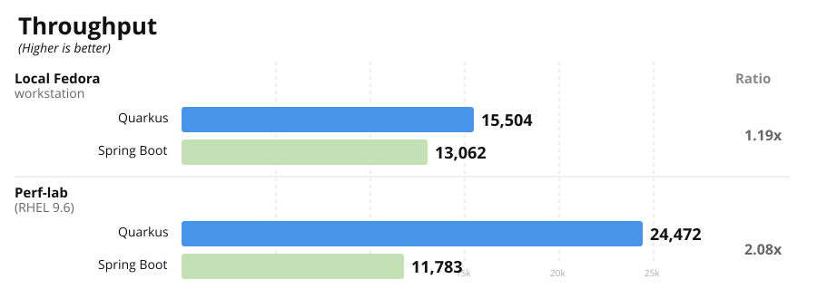
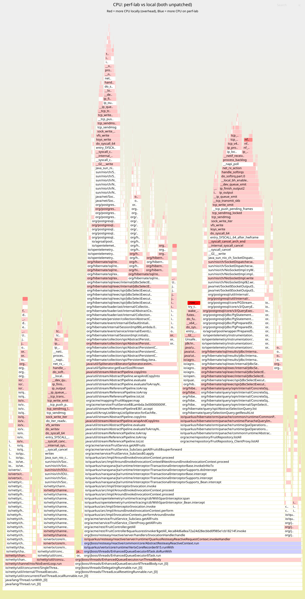
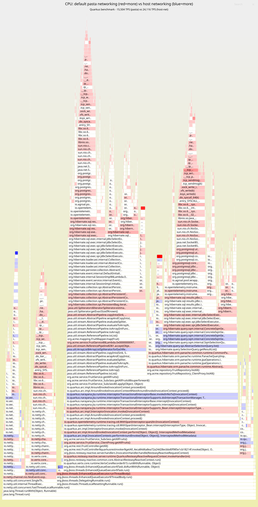

# Why isn't Quarkus 2x faster than Spring on my machine?

A community member ran our [Quarkus vs Spring CRUD benchmark](https://github.com/quarkusio/spring-quarkus-perf-comparison) on their bare-metal Fedora workstation and asked:

> *Why do I see only 1.19x instead of 2x?*

**Our perf-lab shows Quarkus at 2.08x Spring's throughput, but locally the gap nearly disappears.**

This post walks through the investigation that found the culprit.

## The gap

The benchmark is a REST/CRUD application backed by PostgreSQL. The app runs on the host, PostgreSQL in a rootless podman container. Each HTTP request executes 2 SQL queries (confirmed via [pg_stat_statements](https://www.postgresql.org/docs/current/pgstatstatements.html)).



Spring delivers roughly the same throughput in both environments. Quarkus swings from 15.5K to 24.5K TPS — it is being held back locally. **Something in the local environment is capping Quarkus but not Spring.**

## mpstat: where is the CPU going?

The benchmark collects [mpstat](https://man7.org/linux/man-pages/man1/mpstat.1.html) data during every run — per-CPU utilization split into `%usr` (application code), `%sys` (kernel), `%soft` (softirq, mainly network packet processing), and `%idle`. This is part of our [active benchmarking practice](https://github.com/quarkusio/spring-quarkus-perf-comparison/issues/62): observing the system *while it runs*, not just collecting final TPS numbers.

Both environments run Quarkus at 2.3GHz with the same workload and CPU pinning. The mpstat profiles could not be more different:

| Environment | %usr | %sys | %soft | %idle |
| --- | --- | --- | --- | --- |
| Local (Fedora, 15,504 TPS) | 39-50% | 34-41% | 9-17% | 3-5% |
| Perf-lab (RHEL, 24,472 TPS) | 87-94% | 5-11% | 0-2% | 0% |

`%usr` is time running application code. `%sys` is time in the kernel. On perf-lab, over 85% of CPU goes to the application. Locally, nearly half goes to the kernel. Same application, same clock speed, same workload: **locally, a significant fraction of CPU time is spent in the kernel rather than in application code.**

## Where is the kernel time going?

A [differential flamegraph](https://www.brendangregg.com/flamegraphs.html) of the JFR CPU profiles (collected via [async-profiler](https://github.com/async-profiler/async-profiler)) from the perf-lab and local Quarkus runs shows exactly where the extra kernel time is spent:

[](/assets/images/posts/hidden-cost-rootless-container-networking/diff-flamegraph-gap.svg)

Red frames appear more in the local run; blue frames appear more on the perf-lab. The brightest red hotspots are kernel spin locks (`_raw_spin_unlock_irqrestore`), nftables firewall evaluation (`nft_do_chain`, `nft_meta_get_eval`), and TCP packet processing (`tcp_clean_rtx_queue`, `skb_defer_free_flush`). The blue band at the bottom is application code that gets more CPU on the perf-lab — because the kernel isn't eating it. **The local kernel is spending cycles on network packet processing and firewall rules that the perf-lab doesn't need.**

The brightest red frame — `_raw_spin_unlock_irqrestore` — is worth a closer look. The stack trace shows it's triggered by Agroal (Quarkus's connection pool) returning a JDBC connection after a query: `ConnectionPool.returnConnectionHandler` → `LinkedTransferQueue.tryTransfer` → `LockSupport.unpark` → kernel `futex_wake` → `try_to_wake_up` → spin lock. If network round-trips are slower, JDBC connections are held longer and more threads pile up waiting for a free connection. Every connection return triggers a `futex_wake` to unpark a waiter — the higher the network latency, the more waiters accumulate, and the more kernel time is spent waking them.

## The suspect: pasta, the userspace TCP proxy

Rootless podman on Fedora uses [pasta (passt)](https://passt.top/passt/) to forward container ports. Unlike rootful podman (which uses kernel-level port forwarding), pasta is a userspace process that proxies every TCP packet:

```
With pasta (default rootless):
  App  -->  kernel  -->  pasta (userspace)  -->  kernel  -->  container netns  -->  PostgreSQL

With --network=host:
  App  -->  kernel  -->  PostgreSQL (same network namespace)
```

Every JDBC packet traverses two extra kernel/userspace boundary crossings plus a userspace copy in the pasta process. For a chatty protocol like JDBC with small, frequent packets, this adds up fast. The kernel functions visible in the flamegraph — `nft_do_chain`, `tcp_clean_rtx_queue`, `skb_defer_free_flush` — are not pasta's own CPU time (pasta runs in a separate process), but they are the kernel-side cost of the extra network hops that the application's syscalls now traverse. The connection pool contention (`futex_wake` from Agroal) could be a consequence of the added queuing delay: if each round-trip takes longer, connections are held longer, and waiters accumulate.

Crucially, **pasta is single-threaded**. It processes all forwarded packets on a single CPU core. If that core saturates, packet processing queues up — latency spikes and throughput hits a ceiling regardless of how many cores the application has available. The alternative is `--network=host`: the container shares the host's network namespace, so packets stay in the kernel and never pass through a proxy.

## Quantifying the overhead with pgbench

To measure pasta's impact on database traffic, we ran [pgbench](https://www.postgresql.org/docs/current/pgbench.html) with the same 2-query workload (50 clients — matching the default JDBC connection pool size for both Quarkus and Spring — prepared statements, 30 seconds) over different network paths. We also tested with Fedora's [nftables](https://wiki.nftables.org/) firewall disabled, since the flamegraph showed `nft_do_chain` in the kernel stacks:

| Network path | TPS |
| --- | --- |
| Host -> container (pasta + nftables) | 18,106 |
| Host -> container (pasta, no nftables) | 20,402 |
| Host -> container (`--network=host`) | 53,262 |

With `--network=host`, throughput jumps from 18K to 53K TPS — roughly a 3x increase. Pasta caps at \~18K TPS for this 2-query workload: that is the ceiling imposed by a single-threaded proxy.

## The fix

Run the PostgreSQL container with `--network=host` instead of port-mapping (`-p 5432:5432`). We added `DB_HOST_NETWORK=true` to the benchmark's [infrastructure script](https://github.com/quarkusio/spring-quarkus-perf-comparison/blob/main/scripts/infra.sh).

| Configuration | Quarkus TPS | Spring TPS | Ratio |
| --- | --- | --- | --- |
| Default (pasta + nftables) | 15,504 | 13,062 | 1.19x |
| `--network=host` | 24,116 | 13,368 | 1.80x |
| `--network=host` + no nftables | 26,039 | 13,214 | 1.97x |
| Perf-lab (RHEL 9.6, different hardware) | 24,472 | 11,783 | 2.08x |

**With host networking, Quarkus throughput improves by 55% while Spring moves by +2.3%.** Disabling the firewall on top recovers another 8% for Quarkus, bringing the ratio from 1.19x back to 1.97x — close to the perf-lab's 2.08x.

Fedora's `firewalld` loads nearly 1000 [nftables](https://wiki.nftables.org/) rules that every packet traverses. This is independent of pasta — disabling the firewall adds another 13% throughput in the pgbench test (18,106 → 20,402 TPS).

## Why Quarkus is affected but Spring is not

As the pgbench data shows, pasta caps at \~18,000 TPS for a 2-query workload. pgbench is a minimal client that does nothing between queries — it represents the maximum throughput pasta can forward. Quarkus, which also processes HTTP requests, runs ORM and serialization between SQL queries, reaches 15,504 TPS through pasta — lower than pgbench's 18,106 because the application work between queries reduces the pressure on the proxy, but still constrained by it.

With host networking, Quarkus reaches \~24,000 TPS — well above what pasta can deliver. Spring reaches \~13,000 TPS, which is below pasta's ceiling regardless of networking mode. **Any application that can push close to pasta's ceiling will be constrained by it; any application that stays well below it will not notice.**

## Confirming the fix

A second differential flamegraph — this time comparing the local default (pasta) run with the local `--network=host` run — confirms the overhead is gone:

[](/assets/images/posts/hidden-cost-rootless-container-networking/diff-flamegraph.svg)

Red means more CPU in the default (pasta) run; blue means more CPU with host networking. The red stacks that dominated the first flamegraph — `_raw_spin_unlock_irqrestore`, `nft_do_chain`, `tcp_clean_rtx_queue` — have disappeared.

**With `--network=host`, the app and PostgreSQL share the same network namespace; packets never leave the kernel.**

## Takeaways

- **A benchmark that saturates an unexpected resource and component is not measuring what you think.** This is what Brendan Gregg calls [active benchmarking](https://www.brendangregg.com/activebenchmarking.html):

  > *You benchmark A, but actually measure B, and conclude you've measured C.*
  >
  > — Brendan Gregg


\+ We benchmarked framework throughput, but Quarkus was saturating pasta's single CPU core — so we were measuring pasta's forwarding capacity, not framework performance. Only by collecting [mpstat](https://man7.org/linux/man-pages/man1/mpstat.1.html) and flamegraphs *during* the run — as [required by our benchmarking practice](https://github.com/quarkusio/spring-quarkus-perf-comparison/issues/62) — did we identify which resource and component was saturated. Without that, the 1.19x ratio would have been taken at face value.

- **The impact is asymmetric.** Pasta's single-threaded ceiling affects only applications whose throughput would otherwise exceed it. In this benchmark, Quarkus exceeds the ceiling and is capped; Spring does not and is unaffected. The same logic applies to any workload — the proxy is invisible until you hit its limit.

- **Check your networking path.** Run `podman info | grep rootlessNetworkCmd` to see your backend. If it says `pasta` and your benchmark talks to a containerized database, use `--network=host` for the database container.

- **Firewall rules add up.** Nearly 1000 nftables rules cost 8-13% throughput on this workload (8% for Quarkus with host networking, 13% for pgbench through pasta). For benchmarking, consider temporarily disabling the firewall or using a minimal ruleset.

## Known upstream issues

Our findings are consistent with several known issues in the podman/pasta ecosystem:

- **pasta is single-threaded by design** and degrades under concurrent load. Community reports confirm that above \~8 connections, even the older [slirp4netns](https://github.com/rootless-containers/slirp4netns) backend can outperform it. ([Podman Discussion #22559](https://github.com/containers/podman/discussions/22559))

- **pasta consuming 90-100% CPU** has been reported under sustained network load, e.g. Wireguard tunnels on kernel 6.x. ([Podman Issue #23686](https://github.com/containers/podman/issues/23686))

- **Java + PostgreSQL hang** -- a Spring app running PostgreSQL `COPY FROM STDIN` via pasta consistently freezes mid-transfer. `--network=host` fixes it. ([Podman Issue #22593](https://github.com/containers/podman/issues/22593))

- **Throughput far below host capacity** -- rootless containers on multi-gigabit hosts achieving only \~100 Mbit/s through pasta. ([Podman Issue #17865](https://github.com/containers/podman/issues/17865))

- **Traffic stalls under sustained load** -- TCP downloads through pasta start normally then halt, with pasta pinned at high CPU. ([Podman Issue #17703](https://github.com/containers/podman/issues/17703))

- The official [Podman performance tutorial](https://github.com/containers/podman/blob/main/docs/tutorials/performance.md) documents `--network=host` and socket activation as workarounds for network-sensitive workloads.
