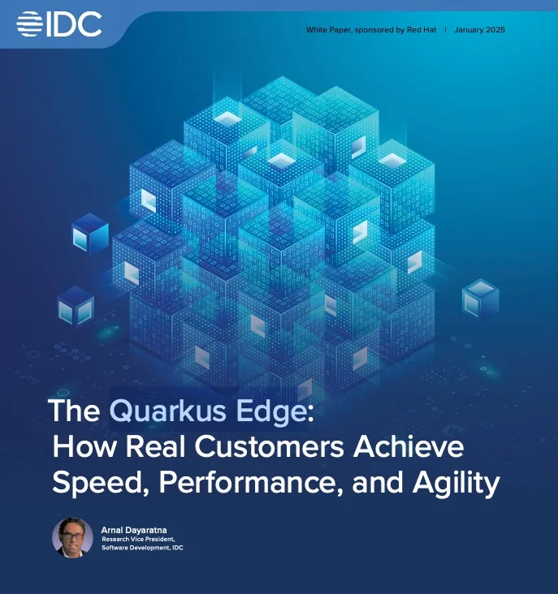

# The Quarkus Edge: How Real Customers Achieve Speed, Performance, and Agility

## [***Download the full report***](https://www.redhat.com/en/engage/idc-the-quarkus-edge-analyst-material)

If you’re part of the Quarkus community, you already know it’s fast, lightweight, and designed for cloud-native workloads. But have you ever wondered how other organizations are using Quarkus in production?

A new IDC whitepaper, ***The Quarkus Edge: How Real Customers Achieve Speed, Performance, and Agility***, showcases how three organizations have transformed their developer productivity, infrastructure efficiency, and business agility with Quarkus. These case studies highlight why organizations are choosing Quarkus and how it's driving measurable results in industries like telecommunications, transportation, and banking.

If you're looking for compelling, real-world stories to share with your peers, leadership, or decision-makers, this report is exactly what you need. Let's dive into the highlights.

## Why Organizations Are Choosing Quarkus

The report highlights several common drivers behind Quarkus adoption:

✅ **Massive Performance Gains**: up to **10x** CPU cost reduction and **85%** faster start-up times.

✅ **Cloud-Native & Kubernetes-Ready**: built for containerization and event-driven architectures.

✅ **Developer Productivity Boosts**: live coding, lower memory footprint, and seamless integration w/ DevOps workflows.

✅ **Lower Costs**: significant reduction in cloud infrastructure spend, especially for high-throughput, low-latency applications.

## Case Study #1 (Telco): Powering Edge & IoT with Quarkus

A major telecommunications company needed to meet 5G and edge computing demands. After benchmarking against alternatives like Spring WebFlux and Vert.x, they selected Quarkus for its CPU efficiency and latency performance.

🔹 **10x** reduction in CPU costs, crucial for high-throughput workloads.

🔹 Lower latency, enabling real-time IoT and edge applications.

🔹 Seamless integration with Kafka, RabbitMQ, and event-driven architectures.

## Case Study #2 (Transportation): Faster Event-Driven Services

A global transportation services provider turned to Quarkus for its event-driven architecture (EDA). The result was a dramatic reduction in infrastructure footprint and start-up times, helping them move toward a cloud-native future.

🔹 Start-up time reduced from **5-10** minutes to seconds.

🔹 Significantly lower memory and CPU usage, cutting operational costs.

🔹 Seamless event-driven integration with Kafka and reactive messaging.

## Case Study #3 (Banking): Modernizing Financial Services

A leading European bank began migrating its core banking platform to Quarkus, driven by support discontinuation for legacy systems. They needed a solution that was secure, scalable, and cost-effective.

🔹 **85%** faster start-up times, improving deployment and system resilience.

🔹 **30%** more applications hosted on existing infrastructure.

🔹 Increased developer productivity, reducing time-to-market for new financial products.

## Use This Report to Advocate for Quarkus

If you’re already using or evaluating Quarkus, this report is a powerful tool to help spread the word within your organization.

🔹 **developers**: share it with your peers to highlight how Quarkus improves developer experience and reduces friction in cloud-native development.

🔹 **architects & decision-makers**: use the case studies to showcase Quarkus’ proven success in real-world deployments.

🔹 **executives**: the whitepaper quantifies cost savings, performance gains, and business agility, making the case for standardizing on Quarkus.

## Want to share your story

Tell us how you are using Quarkus by writing your own user story on Quarkus.io.

[Learn More](https://github.com/quarkusio/quarkusio.github.io?tab=readme-ov-file#writing-a-blog)
