# Quarkus Tools for IntelliJ 1.0.0 release !

We are very pleased to announce the 1.0.0 release of Quarkus Tools for IntelliJ. This release brings enhanced code completion and syntax validation for `application.properties` and better support for Microprofile in Java files. It is not based anymore on the LSP Support plugin in order to increase stability.

In order to install it, search for `Quarkus Tools` in the JetBrains marketplace or download from [here](https://plugins.jetbrains.com/plugin/13234-quarkus-tools).

Here is an overview of the major features:

## application.properties support

### Code completion (Ctrl + ENTER)

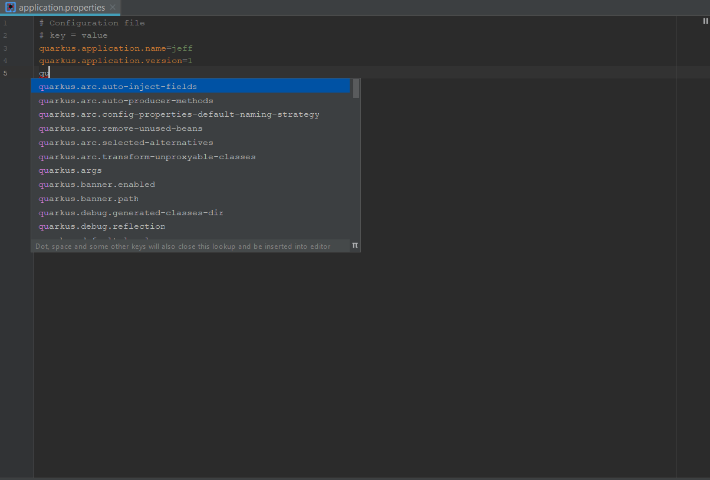

### Property documentation

Select a property and press Ctrl+Q

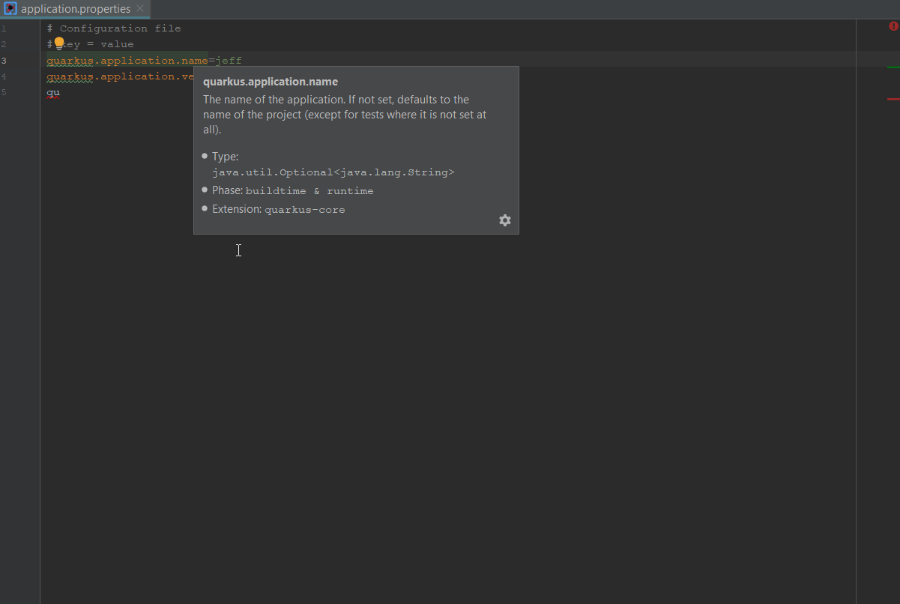

### Goto property definition

Select a property and press Ctrl+B

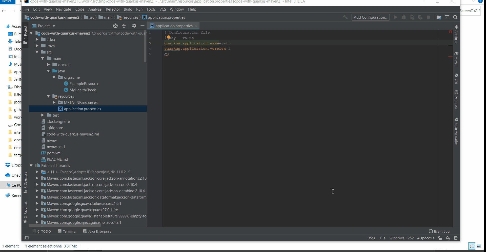

### Syntax validation

Wrong property key names or values are reported

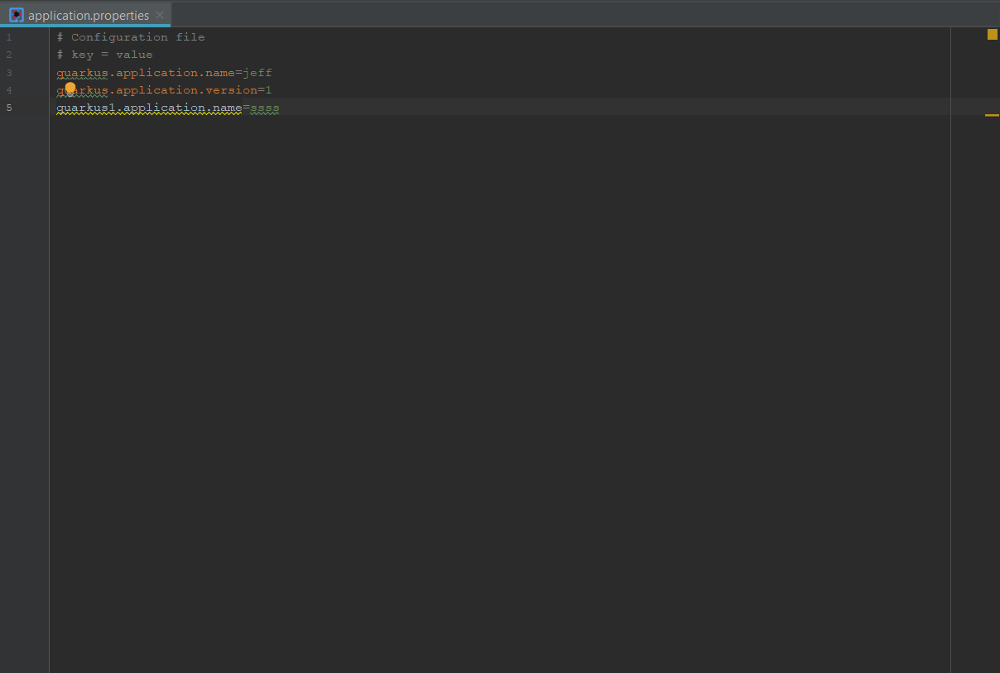

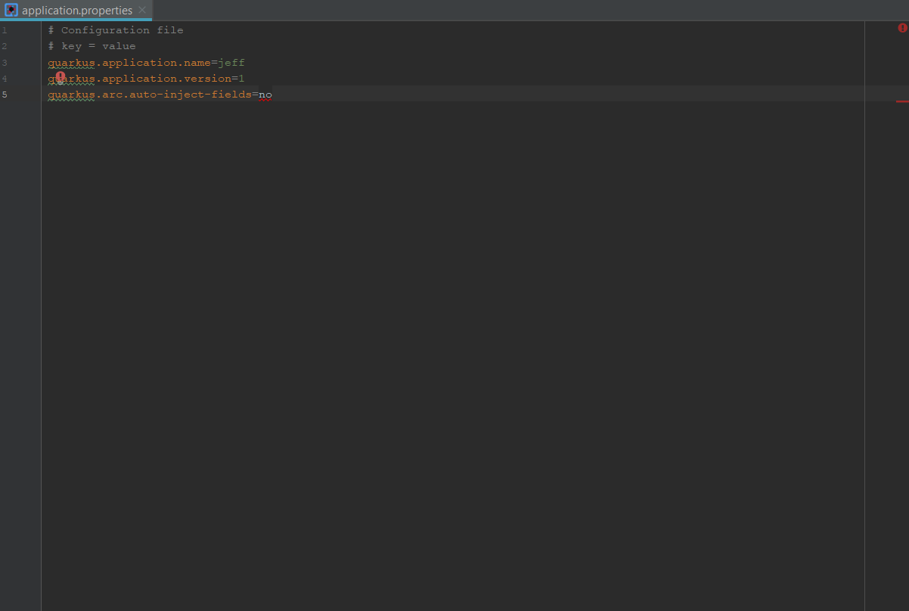

### Property hover in Java files

Property managed in your code through @ConfigProperty:

\* code completion in application.properties is adjusted accordingly if you define new properties \* hover over the property field will display the current value

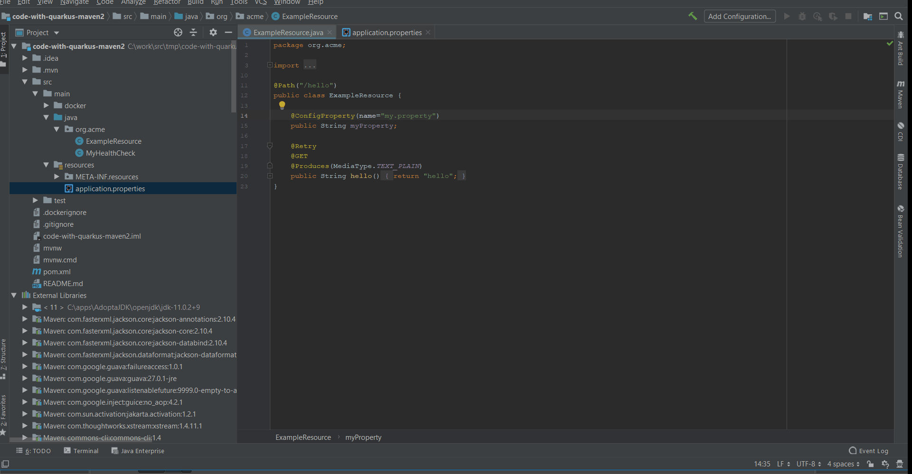

### MicroProfile Health

Syntax validation is being performed for Java files using the MicroProfile Health assets:

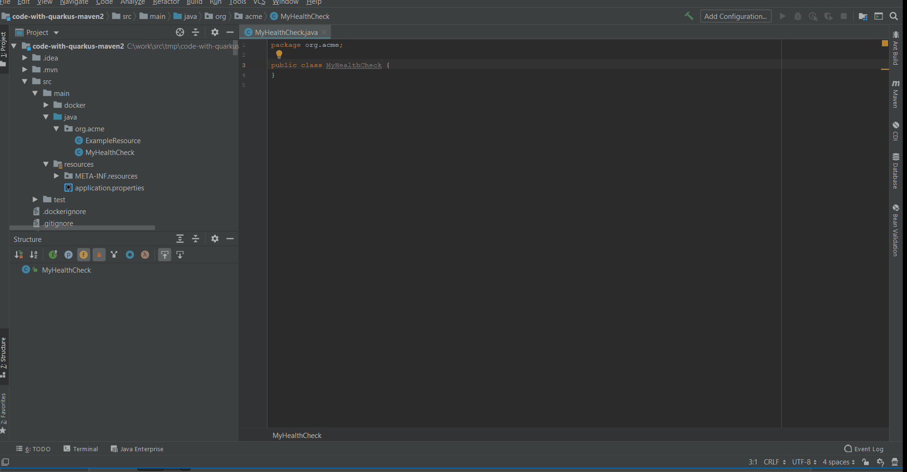

### MicroProfile Fault Tolerance

MicroProfile Health related properties are supported in `application.properties` completion and syntax validation as soon as you use MicroProfile related annotation in your Java source files

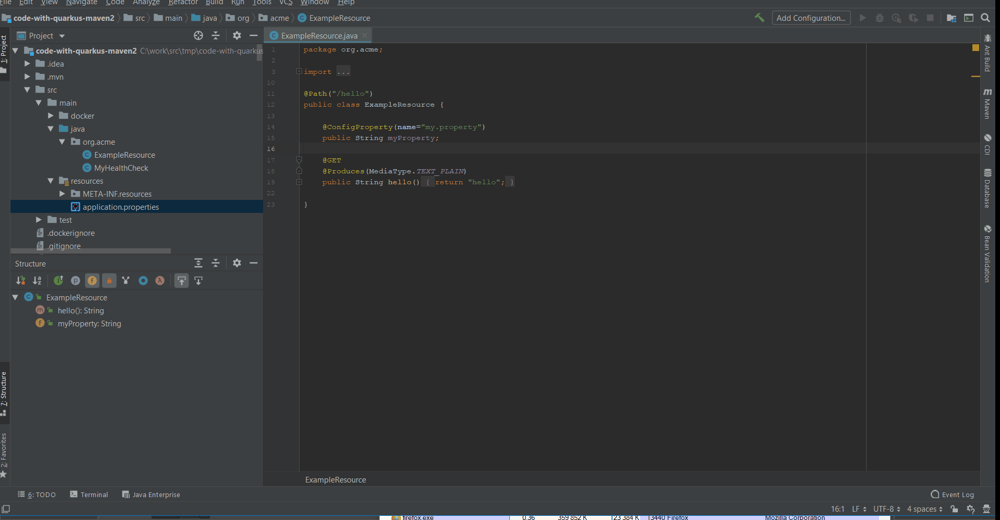

### MicroProfile Rest Client

MicroProfile Rest Client references are checked against valid injections

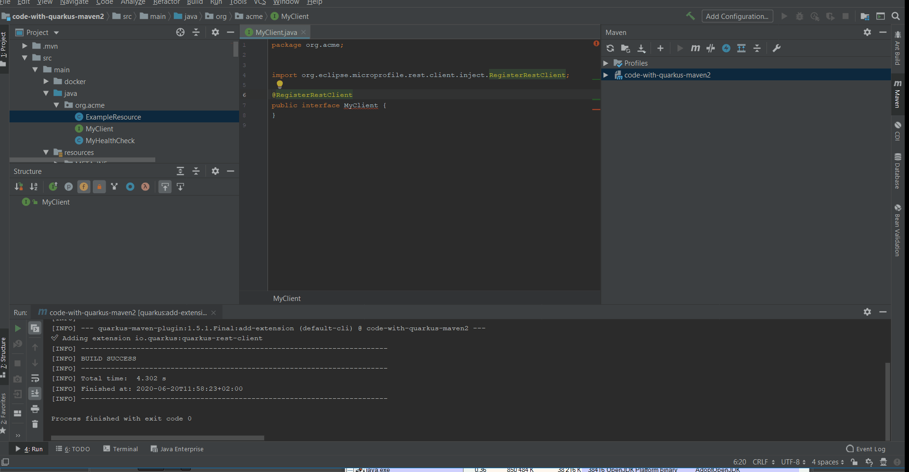

### MicroProfile LRA

MicroProfile LRA related properties references are supported in `application.properties` completion and syntax validation as soon as you use MicroProfile LRA in your Quarkus application

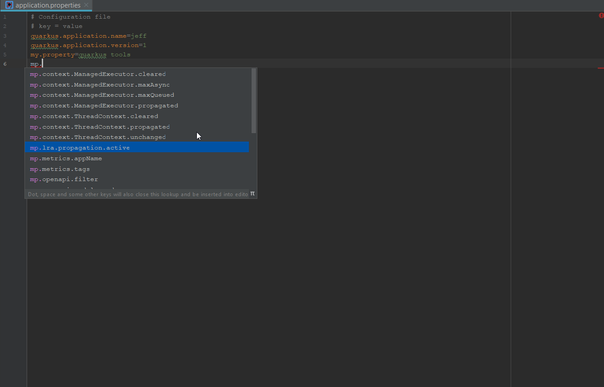

### MicroProfile OpenAPI

MicroProfile OpenAPI related properties references are supported in `application.properties` completion and syntax validation as soon as you use MicroProfile OpenAPI in your Quarkus application

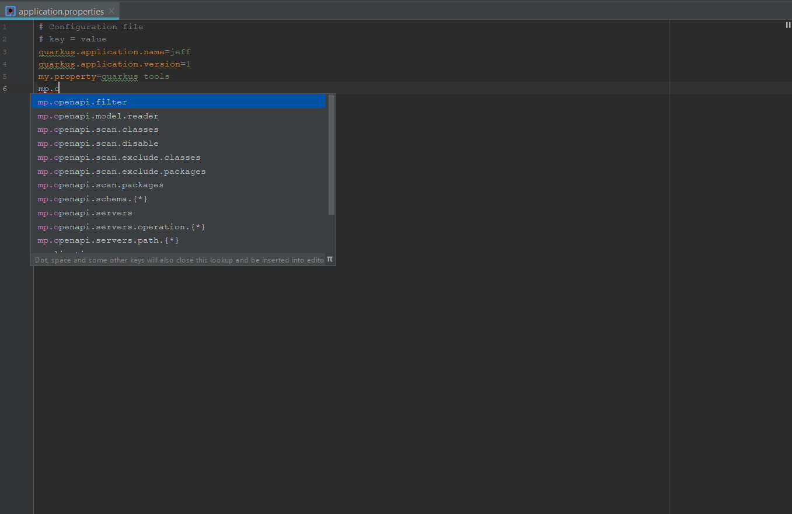

### MicroProfile Metrics

MicroProfile Metrics related properties references are supported in `application.properties` completion and syntax validation as soon as you use MicroProfile Metrics in your Quarkus application

### MicroProfile OpenTracing

MicroProfile OpenTracing related properties references are supported in `application.properties` completion and syntax validation as soon as you use MicroProfile OpenTracing in your Quarkus application

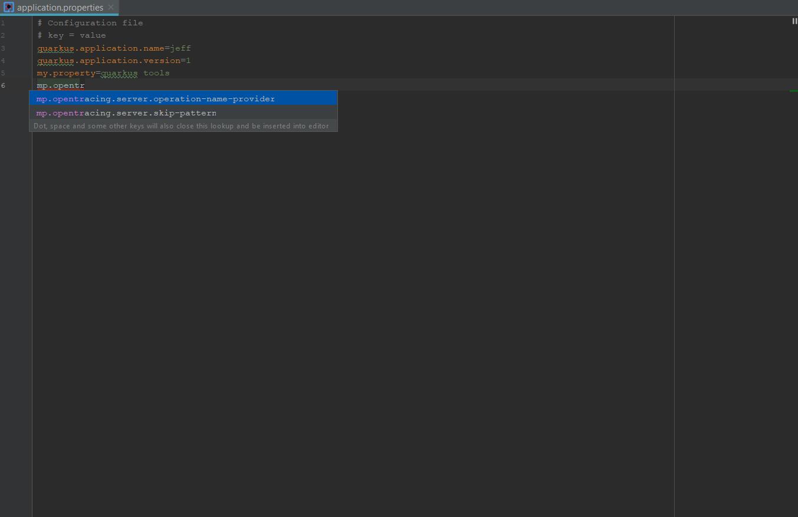

## Moving Forward

If you have any questions, suggestions or feedback, by all means please [open an issue](https://github.com/redhat-developer/intellij-quarkus/issues).

For future releases we are aiming to improve language support for YAML properties file.

Thank you for reading and stay tuned for the next release!

## Links

- GitHub repository: <https://github.com/redhat-developer/intellij-quarkus>
- Open an issue: <https://github.com/redhat-developer/intellij-quarkus/issues>
