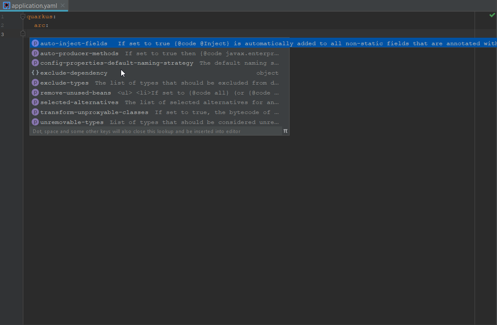
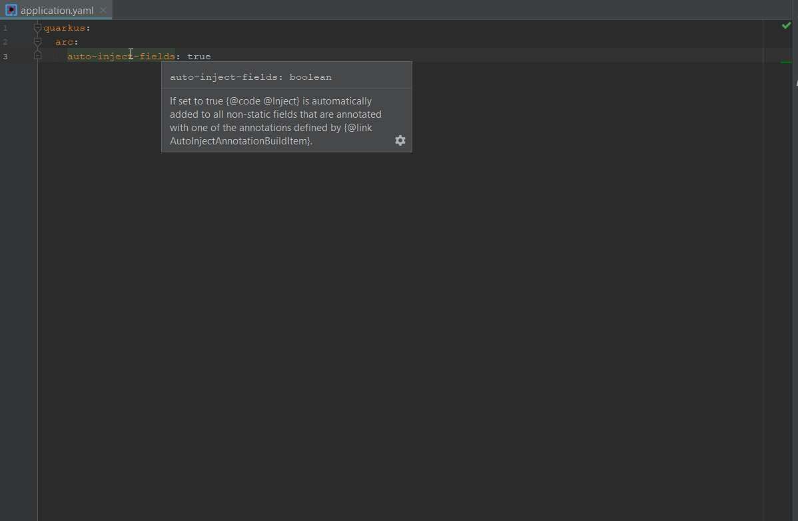
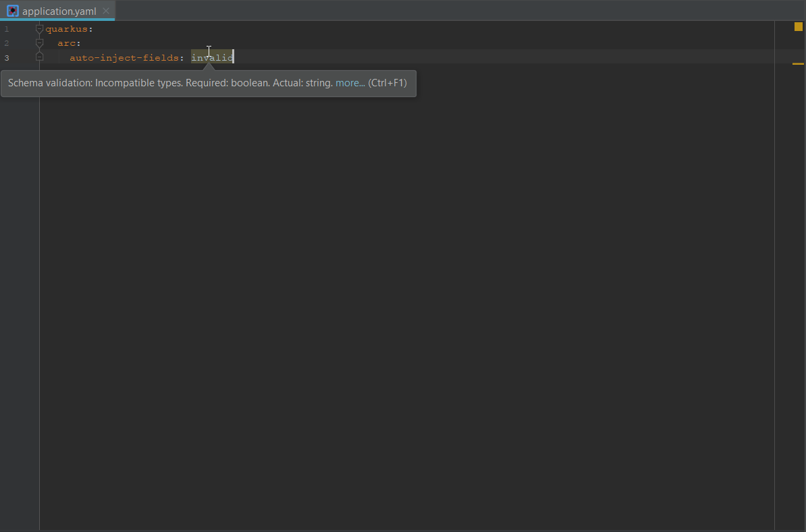

# Quarkus Tools for IntelliJ 1.1.0 released!

We are very pleased to announce the 1.1.0 release of Quarkus Tools for IntelliJ. This release brings support for YAML configuration files and bug fixes.

## application.yaml support

### Code completion (Ctrl + ENTER)

### Property documentation

Select a property and press Ctrl+Q

### Syntax validation

Wrong property key names or values are reported

## Moving Forward

If you have any questions, suggestions or feedback, by all means please [open an issue](https://github.com/redhat-developer/intellij-quarkus/issues).

Thank you for reading and stay tuned for the next release!

## Links

- GitHub repository: <https://github.com/redhat-developer/intellij-quarkus>
- Open an issue: <https://github.com/redhat-developer/intellij-quarkus/issues>
