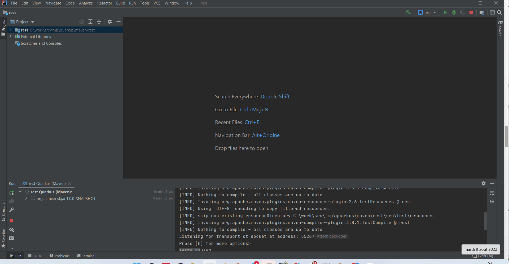

# Quarkus Tools for IntelliJ 1.12.0 released!

We are very pleased to announce the 1.12.0 release of Quarkus Tools for IntelliJ. This release improves the Quarkus wizard and Quarkus run experience but also aligns with LSP4MP 0.5.0 and quarkus-ls 0.12.1.

## Improved Quarkus wizard

The Quarkus wizard can be used from `File -> New -> Module -> Quarkus`.

It has been improved so that it is now possible to filter the list of displayed Quarkus extension by name pattern and allow or disallow the inclusion of non platforms Quarkus extensions.

## Improved Quarkus run experience

Quarkus tools supports running or debugging Quarkus applications through a specific configuration type for a while.

The experience has been improved so that developers can easily open Quarkus Dev UI or applications from Quarkus Tools.

After the application is started, a console is displayed by IntelliJ. From that console, you can open a browser to either the Quarkus Dev UI or to the Quarkus application. Right click in the console and a Quarkus submenu will be displayed. It has 2 submenus: Open Dev UI and Open application. When one of these menus is selected, a new browser window is opened to the desired location.

## Moving Forward

If you have any questions, suggestions or feedback, by all means please [open an issue](https://github.com/redhat-developer/intellij-quarkus/issues).

Thank you for reading and stay tuned for the next release!

## Links

- GitHub repository: <https://github.com/redhat-developer/intellij-quarkus>
- Open an issue: <https://github.com/redhat-developer/intellij-quarkus/issues>
