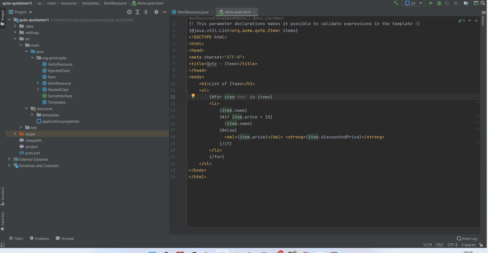
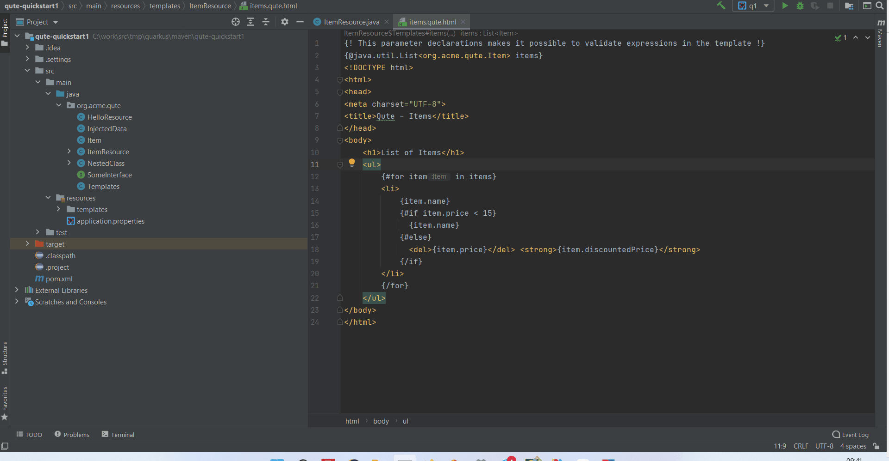

# Quarkus Tools for IntelliJ 1.13.0 released!

We are very pleased to announce the 1.13.0 release of Quarkus Tools for IntelliJ. This release improves the Qute developer experience.

## Improved Qute developer experience

### InlayHint support

InlayHint is a new feature. It allows to add inline information about parameters and variables. This is very useful for Qute templates to get type information. InlayHints may also be clickable.

### DocumentHighlight

DocumentHightlight allows to hightlight parts of the document that are related to the current selection. This is useful for Qute templates to highlight matching part of a Qute section.

## Moving Forward

If you have any questions, suggestions or feedback, by all means please [open an issue](https://github.com/redhat-developer/intellij-quarkus/issues).

Thank you for reading and stay tuned for the next release!

## Links

- GitHub repository: <https://github.com/redhat-developer/intellij-quarkus>
- Open an issue: <https://github.com/redhat-developer/intellij-quarkus/issues>
