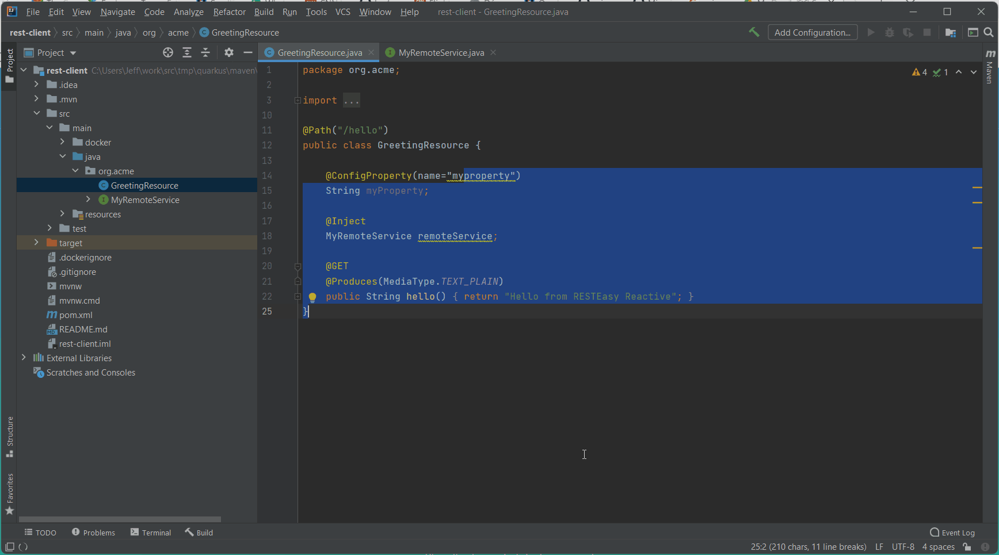
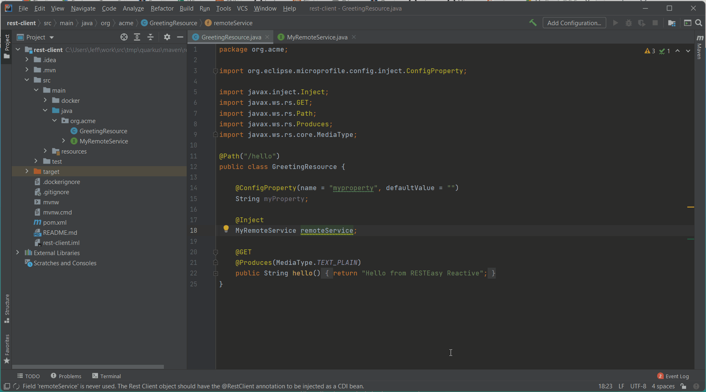

# Quarkus Tools for IntelliJ 1.14.0 released!

We are very pleased to announce the 1.14.0 release of Quarkus Tools for IntelliJ. This release adds support for CodeActions and Quick Fixes.

## CodeActions / Quick Fixes

When an error is detected on one of your Quarkus project files, it is highlighted in the source editor (for instance when you define one property through `@ConfigProperty` but it is not defined.).

If this error can be fixed through an automatic action, it will be available from the `More actions` context menu or through the `Alt+Enter` key binding.

In this example, we will add a default value for a property defined with `@ConfigProperty`:

In this other example, a MicroProfile REST Client is defined and bound to a REST resource but the `@RestClient` annotation is missing from the binding:

## Moving Forward

If you have any questions, suggestions or feedback, by all means please [open an issue](https://github.com/redhat-developer/intellij-quarkus/issues).

Thank you for reading and stay tuned for the next release!

## Links

- GitHub repository: <https://github.com/redhat-developer/intellij-quarkus>
- Open an issue: <https://github.com/redhat-developer/intellij-quarkus/issues>
