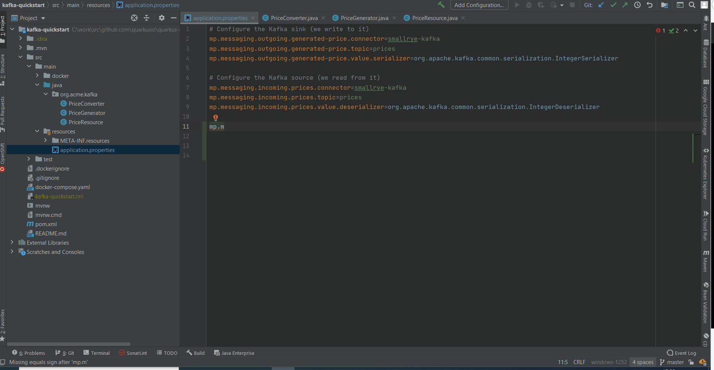
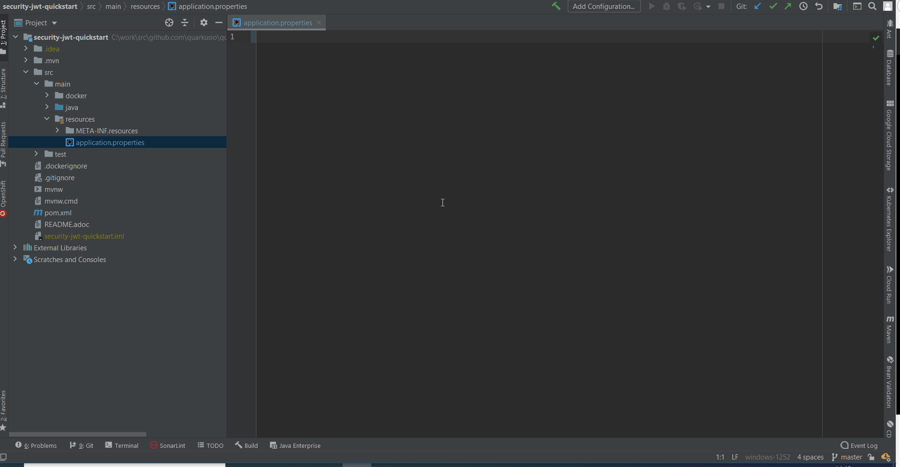
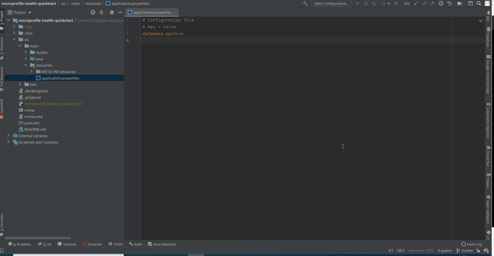
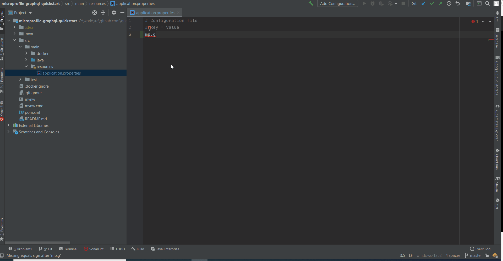

# Quarkus Tools for IntelliJ 1.2.0 released!

We are very pleased to announce the 1.2.0 release of Quarkus Tools for IntelliJ. This release brings enhanced support for Eclipse Microprofile.

## Eclipse Microprofile Reactive Messaging

If your application is based on Eclipse Microprofile Reactive Messaging, properties are enabled for:

- @Connector annotation
- @Outgoing annotation
- @Incoming annotation

Here is an example of a Kafka based application:

## Eclipse Microprofile JWT

If your application is based on Eclipse Microprofile JWT, the following properties will be enabled for your application:

- `mp.jwt.verify.publickey`
- `mp.jwt.verify.publickey.location`
- `mp.jwt.verify.publickey.algorithm`
- `mp.jwt.decrypt.key.location`
- `mp.jwt.verify.issuer`
- `mp.jwt.token.header`
- `mp.jwt.token.cookie`
- `mp.jwt.verify.audiences`

## Eclipse Microprofile Health

If your application is based on Eclipse Microprofile Health, the following property will be enabled for your application:

- `mp.health.disable-default-procedures`

## Eclipse Microprofile GraphQL

If your application is based on Eclipse Microprofile GraphQL, the following property will be enabled for your application:

- `mp.graphql.defaultErrorMessage`
- `mp.graphql.hideErrorMessage`
- `mp.graphql.showErrorMessage`

## Moving Forward

If you have any questions, suggestions or feedback, by all means please [open an issue](https://github.com/redhat-developer/intellij-quarkus/issues).

Thank you for reading and stay tuned for the next release!

## Links

- GitHub repository: <https://github.com/redhat-developer/intellij-quarkus>
- Open an issue: <https://github.com/redhat-developer/intellij-quarkus/issues>
