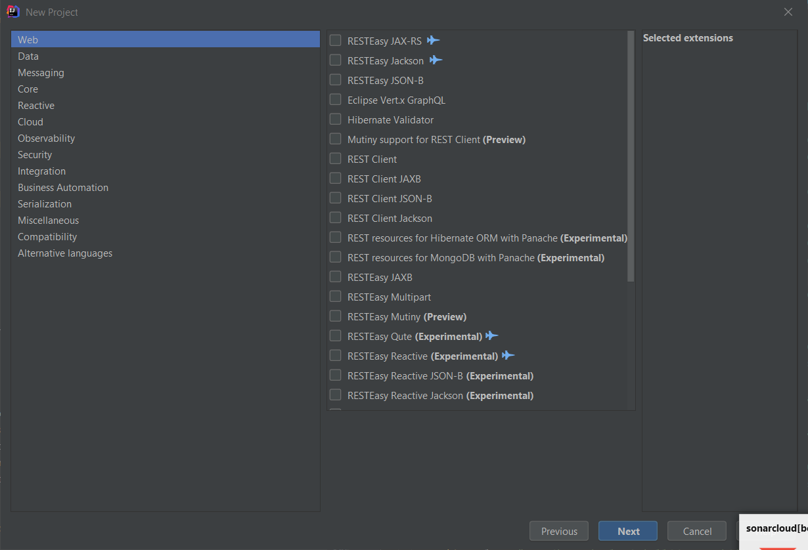

# Quarkus Tools for IntelliJ 1.4.0 released!

We are very pleased to announce the 1.4.0 release of Quarkus Tools for IntelliJ. This release enhances codestarts support in the Quarkus project wizard.

## Codestarts

The Quarkus project wizard now highlights codestarts enabled extension with a specific icon (right to the extension name), similar to code.quarkus.io, allowing users to better identify codestarts enabled extensions.

## Moving Forward

If you have any questions, suggestions or feedback, by all means please [open an issue](https://github.com/redhat-developer/intellij-quarkus/issues).

Thank you for reading and stay tuned for the next release!

## Links

- GitHub repository: <https://github.com/redhat-developer/intellij-quarkus>
- Open an issue: <https://github.com/redhat-developer/intellij-quarkus/issues>
