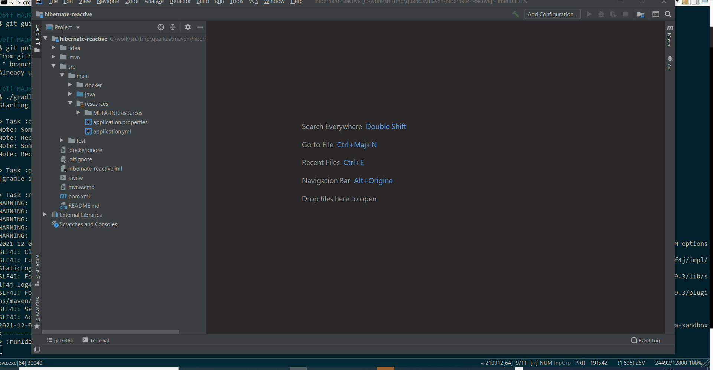

# Quarkus Tools for IntelliJ 1.9.0 released!

We are very pleased to announce the 1.9.0 release of Quarkus Tools for IntelliJ. This release adds support for Quarkus streams in the new project/module Quarkus wizard and fixes compatibilities with just released IntelliJ 2021.3.

## Quarkus streams

When a new Quarkus project/module is to be generated, it is now possible to select the Quarkus stream (see [this article](https://quarkus.io/blog/quarkus-2x-platform-quarkiverse-registry/)) on which the generated application will be based on.

By default, the recommended (latest release) will be selected but you can choose another one:

## Moving Forward

If you have any questions, suggestions or feedback, by all means please [open an issue](https://github.com/redhat-developer/intellij-quarkus/issues).

Thank you for reading and stay tuned for the next release!

## Links

- GitHub repository: <https://github.com/redhat-developer/intellij-quarkus>
- Open an issue: <https://github.com/redhat-developer/intellij-quarkus/issues>
