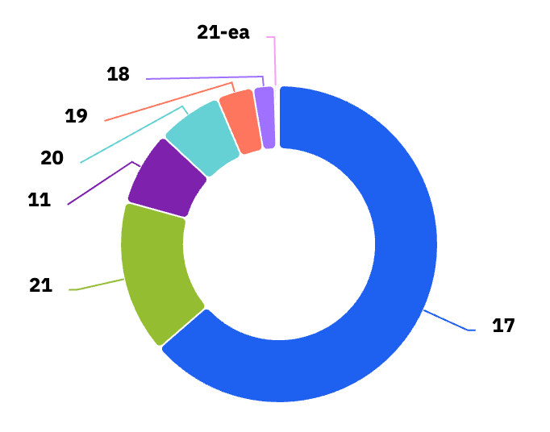

# Java 17 will be the minimum version for Quarkus 3.7

Today we are anouncing that Quarkus 3.7 will move Quarkus to use Java 17 as the minimum JDK.

When we started Quarkus 3.0, [we stayed on Java 11](https://quarkus.io/blog/road-to-quarkus-3/#java-target). The feedback we got was that moving to Jakarta EE 10 was for many easier than to also move the underlying JDK. We wanted to give the ecosystem time to catch up and make sure we had a good story for users that needed to stay on Java 11.

In 3.0 release, we supported Java 11 for Quarkus core, and we [marked Java 11 as deprecated](https://quarkus.io/blog/quarkus-3-0-final-released/#java-11-deprecated). It should be noted that parts of the platform, especially the Camel Extensions for Quarkus, already require Java 17.

Today we are taking the step to move Quarkus core to Java 17 as the minimum JDK for Quarkus 3.7 and onwards.

This means that Quarkus 3.7 will require Java 17 to build and run all Quarkus applications.

Below are some of the reasons for this decision and what it means for you as a Quarkus user.

## Everyone is using Java 11 - you cannot do this!

We know that many users are still using Java 11 and we are not forcing you to move to Java 17. We are just making it the minimum version for Quarkus 3.7 and onwards.

That said - the [usage data development builds](https://quarkus.io/usage/) in the last 30 days shows less than 8% using Java 11 for Quarkus Development.

We expect the Java 11 number to be higher in production but the trend is clear - Java 11 usage is low and declining.

> [!NOTE]
> If you like to help us get more accurate data for future, then please consider contributring anonymous build time data - see [quarkus.io/usage](https://quarkus.io/usage/) for details.

## I cannot move to Java 17 yet, what should I do?

If you cannot move to Java 17 yet, then you can continue to use Quarkus 3.6, but we recommend you consider to use the Quarkus 3.2 LTS stream as that is the version that will get updates and fixes for the longest.

Be mindful though that Java 11 itself is rapidly heading towards going out of full support. Example Red Hat's full [Java 11 support ends in October 2024](https://access.redhat.com/articles/1299013#OpenJDK_Life_Cycle) and [Oracle ended Premier support in September 2023](https://www.oracle.com/java/technologies/java-se-support-roadmap.html). Thus we highly recommend you start planning your migration to Java 17 or even Java 21 as soon as possible.

## I'm already using Java 17, what does this mean for me?

If you are already using Java 17 then this change will not affect you. You can continue to use Quarkus using records, multiline strings, faster runtime performance and all the other cool stuff in Java 17.

## Why Java 17 and not Java 21?

Quarkus supports Java 21 already today. The most well known feature of Java 21 is probably [virtual threads](https://quarkus.io/blog/virtual-thread-1/) and we supported that already when it was made preview in Java 19. We mainly recommend Java 21 because of all the improvements made that makes any Java application faster and more efficient - with or without Virtual Threads.

Reality is though that companies and organizations today are still in the process of migrating to Java 17 and we want to make sure that we are not forcing them to also migrate to Java 21 at the same time.

But please do use Quarkus with Java 21 if you can, it is awesome!

## I'm a Quarkus extension developer, what does this mean for me?

If you are a Quarkus extension developer then you should already be testing your extension with Java 17. If you are not, then you should start doing so now.

If you are part of the [Quarkiverse extension ecosystem](https://quarkiverse.io) then we already recommend at time of Quarkus 3.2 to have a branch targeting 3.2.

If you already have that, things should be fairly straightforward.

Build your extension for Quarkus 3.2 against Java 11 and have your main branch using Java 17.

Some extensions may still be able to release on Java 11 but they will then target Quarkus 3.2 or 3.6 - extra care should be taken to make sure that the extension is continuing to work on Quarkus 3.7 and onwards.

There are things like Quarkus ecosystem CI which we will want to update to target multiple branches - if interested in that and especially helping out on making that work, then please follow and/or post on the [quarkus-dev mailing list](https://groups.google.com/g/quarkus-dev) or in the dev channel on [Zulip](https://quarkusio.zulipchat.com/).

## Quarkus does not need to be built with Java 17, thus why require it?

Today Quarkus does not use Java 17 features, we deliberatly did it that way so we could support Java 11, Java 17, Java 21 etc. at the same time. We could continue doing so - we don't **really** need records, multiline strings etc. to build Quarkus.

Unfortunately we are starting to see dependencies we or other extensions have that are moving to Java 17 and we want to make sure we can support them and users can use them.

One particular example coming in 2024 is that JPA 3.2 for Hibernate ORM 7 is requiring Java 17.

There are many more, and thus starting when [this PR](https://github.com/quarkusio/quarkus/pull/37335) is merged - Quarkus main will require Java 17 to build and run.
