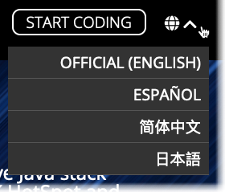

# Hola, 你好, こんにちは Quarkus

Since the [launch](https://quarkus.io/blog/ja-quarkus-io/) of Japanese [ja.quarkus.io](https://ja.quarkus.io), we got contributors translating the website into (simplified) Chinese at [cn.quarkus.io](https://cn.quarkus.io) and recently we added Spanish at [es.quarkus.io](https://es.quarkus.io) too.

These sites are now accessible via the drop-down "globe" menu in the top-right corner.

I find it amazing and want to thank the \~30 contributors who have helped to translate the website into these languages and continues to do so!

Especially big thanks to Yoshikazu Nojima for creating the first infrastructure to handle ja.quarkus.io translations using a mix of computer aided translation and human edit/verification. Big thanks for Zheng Feng and Ruben Novelli to reuse this setup for for cn.quarkus.io and es.quarkus.io respectivelly.

If you want to help improve the language coverage see the readme file in one of the following repositories:

- <https://github.com/quarkusio/ja.quarkus.io> for Japanese
- <https://github.com/quarkusio/cn.quarkus.io> for Chinese (simplified)
- <https://github.com/quarkusio/es.quarkus.io>) for Spanish

Or if you want to create a translation for a new language, copy one of the above repositories and check out the README for more details.

If questions post at [discussions](https://github.com/quarkusio/quarkus/discussions) and mention `@maxandersen` .

Have fun!
