# Automating Quarkus with GitLab

# Automating Quarkus with GitLab

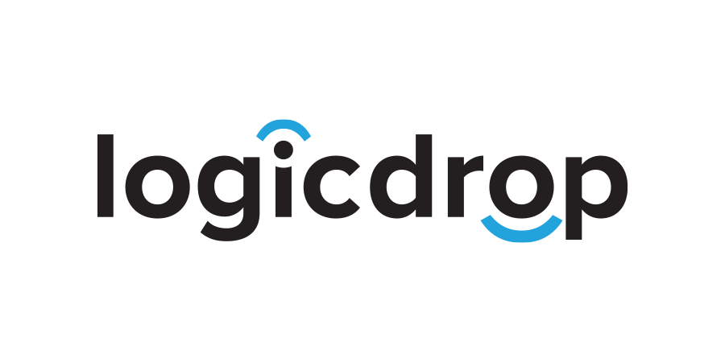

[Logicdrop^](https://logicdrop.com) provides a business automation and data intelligence platform that enables enterprises to design their own solutions and run them in the cloud. We process millions of transactions a month across a global client-base and add significant value to mission-critical processes.

## The Challenge

Since moving to [Quarkus^](https://quarkus.io/), our productivity quickly started to outpace our CI/CD process. We needed a better way to leverage microservice and cloud-native approaches, deploy faster and more frequently, and involve everyone throughout the entire process.

We eventually determined that the complexity was not in the actual deployment, but in orchestrating all the efforts that went into it and handling it afterwards.

Some of the challenges we faced were:

- Environments got more complicated with more services
- Debugging distributed services was challenging
- Different tool sets were needed and used for visibility
- No isolated way to develop or share work, except locally
- Collaboration between front and back-end teams was lacking

*There had to be a better way...*

This is our evolving blueprint of how we use [Quarkus^](https://quarkus.io/), especially the extensions, with [GitLab^](https://about.gitlab.com/) to tie everything together into one cohesive ecosystem accessible by everyone.

## GitLab Projects

The structure we settled on was to split cluster operations, templates, and Quarkus services into individual projects.  This allows us to easily introduce changes to existing configurations or apply new ones with minimal effort and maximum flexibility.

The **cluster** project centralizes anything touching the Kubernetes cluster. It is configured as a GitLab [cluster-management^](https://docs.gitlab.com/ee/user/clusters/management_project_template.html) project so we can manage other cluster services like Elastic, Nginx, or any other Helm charts.

The **templates** project contains the building blocks used by all our GitLab projects. It makes maintenance easier, provides flexibility, and promotes consistency.  Developers can add new applications or services using these templates in less than a few minutes.

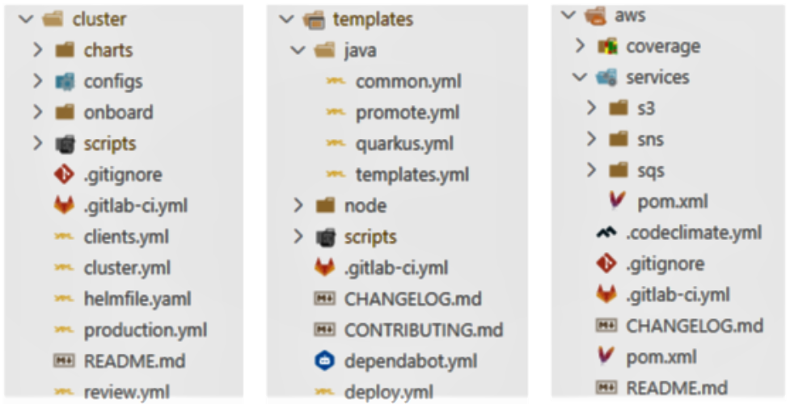

**Quarkus projects** are treated as *families of services* each worked on and deployed individually. Each service uses triggers to notify the cluster when it's ready to be deployed or cleaned up.

> [!TIP]
> We found using [Quarkus profiles^](https://quarkus.io/guides/config-yaml#profiles) with abstracting common release and Kubernetes properties into a shared JAR shielded developers even more from having to manage individual configurations.

Using Quarkus we eliminated having to maintain Helm charts for the services. We even have Quarkus services that interact directly with GitLab for specific tooling and metrics we maintain.

## Quarkus Extensions

Using out-of-box [Quarkus extensions^](https://quarkus.io/guides/) it was straight-forward to quickly expose a wide range of logs, metrics, and functionality.

Taking it a step further and integrating the extensions into GitLab we:

- Saved time
- Reduced efforts
- Increased visibility
- Fostered collaboration
- Minimized complexity

The most important extensions we use are the [Quarkus Kubernetes^](https://quarkus.io/guides/deploying-to-kubernetes) and [Quarkus Kubernetes Config^](https://quarkus.io/guides/kubernetes-config) extensions.

Other extensions we integrated into GitLab are:

- [Quarkus Jacoco^](https://quarkus.io/guides/tests-with-coverage) for coverage [results^](https://docs.gitlab.com/ee/ci/pipelines/settings.html#add-test-coverage-results-to-a-merge-request) and [reports^](https://docs.gitlab.com/ee/user/project/merge_requests/test_coverage_visualization.html)
- [Quarkus Logging Sentry^](https://quarkus.io/guides/logging-sentry) hooks into [GitLab Error Tracking^](https://docs.gitlab.com/ee/operations/error_tracking.html)
- [Quarkus SmallRye Health^](https://quarkus.io/guides/smallrye-health) hooks into [GitLab Metrics^](https://docs.gitlab.com/ee/operations/metrics/)
- [Quarkus SmallRye OpenAPI^](https://quarkus.io/guides/openapi-swaggerui) exposes the [Swagger API^](https://docs.gitlab.com/ee/api/openapi/openapi_interactive.html)
- [Quarkus OpenTelemetry Tracing^](https://quarkus.io/guides/opentelemetry-tracing) hooks into [GitLab Tracing^](https://docs.gitlab.com/ee/operations/tracing.html)

Using the Quarkus extensions in combination with GitLab we get a complete picture of our environments, from development to deployment and monitoring, making building microservices easier.

## Dreaming of Pipelines

### Developer Powered Deployments

Our most important pipelines revolve around making the developer process more streamlined and easier to work with. Developing, debugging, and collaborating on multiple services needed to be as easy and painless as possible.

Previously, deployments to higher environments were tedious but doable but developers were not fully involved in this process.

> [!TIP]
> Since moving to Quarkus, developers are now responsible for developing *and* deploying (limitations apply) their own services.

We decided to use GitLab [merge requests pipelines^](https://docs.gitlab.com/ee/ci/pipelines/merge_request_pipelines.html) as the catalyst to drive our process.

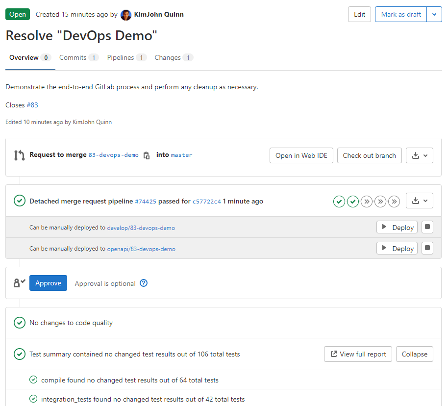

On every push, the merge request will:

- Run all the unit tests
- Run any integration tests (Mongo, AWS, Redis)
- Run any E2E tests (other external services)
- Generate code coverage and quality reports
- Publish an interactive Swagger API

**The most useful feature of the merge request is that we can use it to deploy any number of services, and interact with them, into isolated environments.**

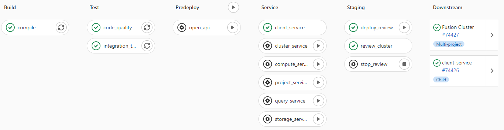

*Review* services lets us go beyond automated testing. We can spot-test only what is being worked on or even run a full suite of services if needed (this is especially useful during a combined UX and multiple service feature).

> [!TIP]
> Lighter than a feather, Quarkus native executables are a small fraction of the size compared to their pure Java counterparts. This allows us to deploy a full set of services in less space than would be needed to deploy the equivalent Spring Boot services.

### Building Quarkus Services

The downstream Quarkus pipeline is a specialized set of jobs that handle building, testing, and containerizing Quarkus services only.

For each changed service we:

- Build a native executables or fast jar
- Run any tests (including native ones if needed)
- Generate the Kubernetes manifests
- Build and deploy its container

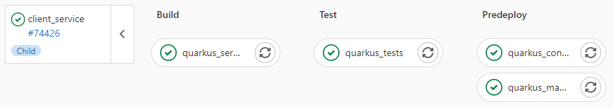

> [!TIP]
> We *only* push the container and upload the manifests to AWS S3. This lets us accumulate changes into a single package, composed of one or more services, that can be deployed.

### Faster Faster Pipelines

To speed up the pipelines, especially when building multiple native executables, we rely on GitLab AutoScaling runners to run the jobs in parallel.  This allows us to build any number of services in a relatively constant time frame.

> [!TIP]
> Currently, for 20+ services, we can perform complete end-to-end deployments, including native executables, in less than 20 minutes without manual intervention. Most of the time, since we are only deploying changed services, the net time is far less.

We use the GitLab's [`needs`^](https://docs.gitlab.com/ee/ci/yaml/#needs) keyword to short-circuit the pipelines so we can get to more important jobs faster without waiting. This allows us to immediately, and repeatedly if needed, deploy services as they become ready.

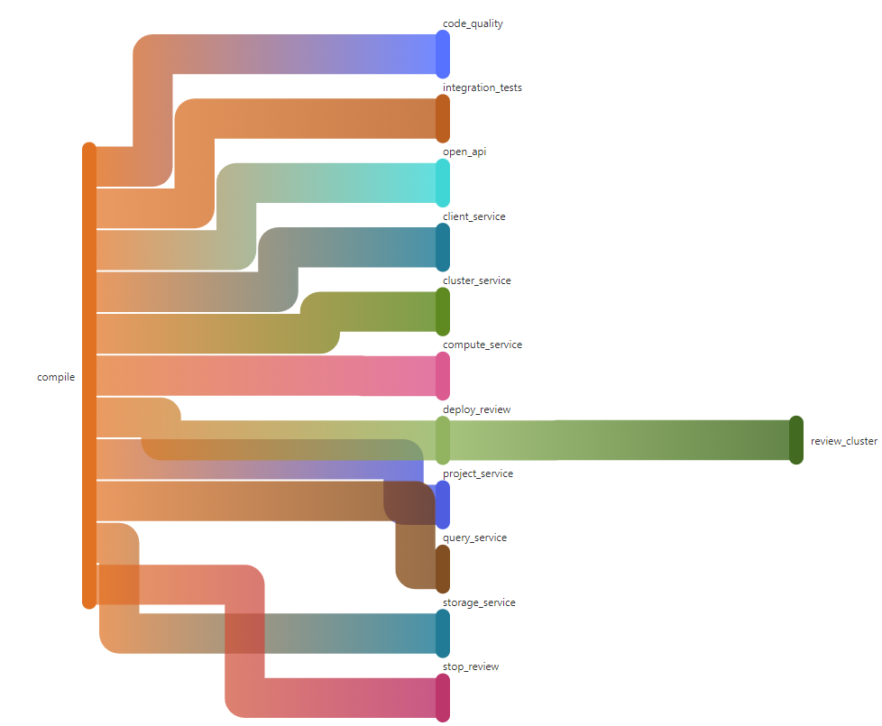

In the above [DAG^](https://docs.gitlab.com/ee/ci/directed_acyclic_graph/), as services are built we can deploy them without having to wait for other services to finish.

> [!TIP]
> Native builds are intensive so it is best to run them in parallel. Mileage may vary but we found AWS M5.XL instances to be the best value for our money when doing this.

## One Deploy to Rule Them All

Where a branch drives the development process, a tag drives the release process.

At any time the default branch can be promoted. This initiates a series of jobs that ultimately *deploys the updated services into the cluster without intervention*.

Unless a test fails (which should have been caught before-hand), the pipeline, whether it originates from a developer branch or the default branch is *fully automated*.

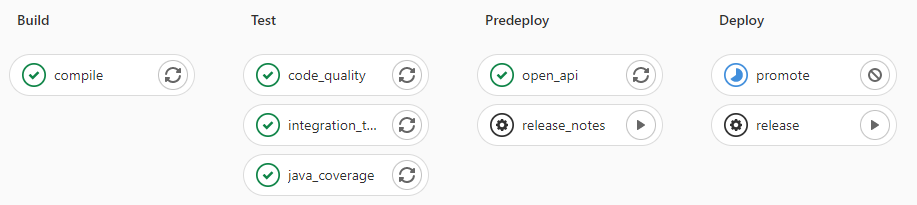

Clicking `promote` starts out by performing these steps:

- Reconcile Maven versions
- Update the changelog
- Create the release tag
- Build service(s) and deploy the containers
- Generate the Kubernetes manifests
- Publish Swagger API and generate OpenAPI clients
- Bumps the version to the next `-SNAPSHOT` version

> [!TIP]
> For better or worse, we do use [Maven CI Friendly^](https://maven.apache.org/maven-ci-friendly.html) versions to help us simplify versioning and deployment.

The below image shows multiple jobs all running at the same time, including every Quarkus service being built.

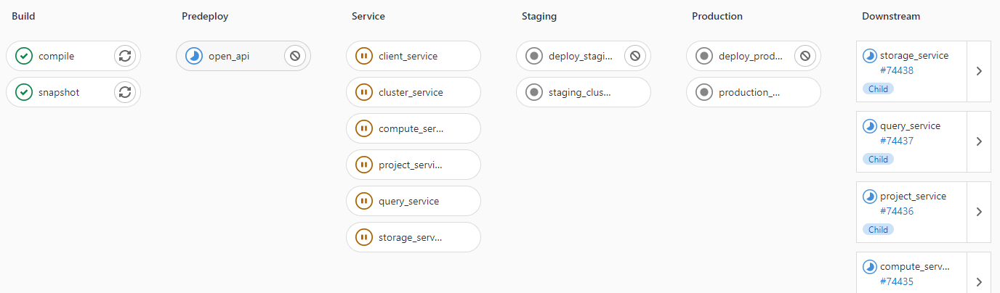

Once the changed services are finished building the deployment begins automatically.

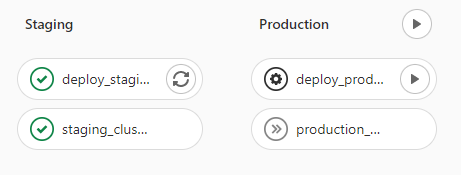

The cluster is then notified to grab the manifests, perform any last minute configurations, and finally deploy the services.

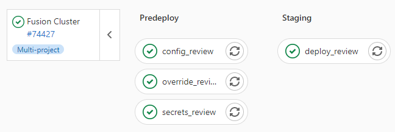

> [!TIP]
> This is where we leverage the [Quarkus Kubernetes Config^](https://quarkus.io/guides/kubernetes-config). We convert properties into expected configmaps and secrets that get deployed into the namespace.

The example below shows how a pipeline transitions from a merge request, to getting merged, and finally released.

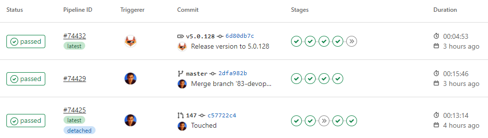

## Git Your Quarkus Features

By tightly integrating GitLab with our Quarkus platform, our process has become more fluid and provides a one-stop shop for tools, logs, and monitoring right from within GitLab...

Teams now look to GitLab first instead of having to interact with different tools and applications (except in advanced scenarios).

### Interactive API Endpoints

Swagger can be viewed and interacted with directly in GitLab. This allows for quick and easy spot testing during development or validating endpoints post-deployment.

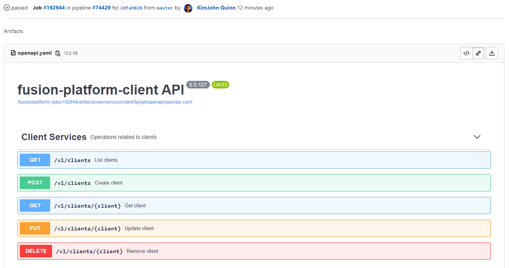

### Errors and Warnings

Sentry is hooked into each project so that specific errors and warnings can be found quicker without having to dig through the logs. GitLab can even be used to create or resolve tickets from the Sentry issue.

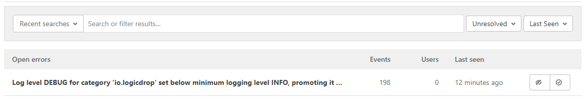

### Coverage and Quality Reports

Jacoco generates coverage reports for each project. Metrics are maintained and visible throughout the lifetime of each service.

Additionally, Code Climate is used to measure changes in quality between the default branch and each merge request throughout the lifetime of every service.

### Distributed Service Traces

Jaeger provides us with insights into how our APIs are used and lets us trace interactions between multiple services.

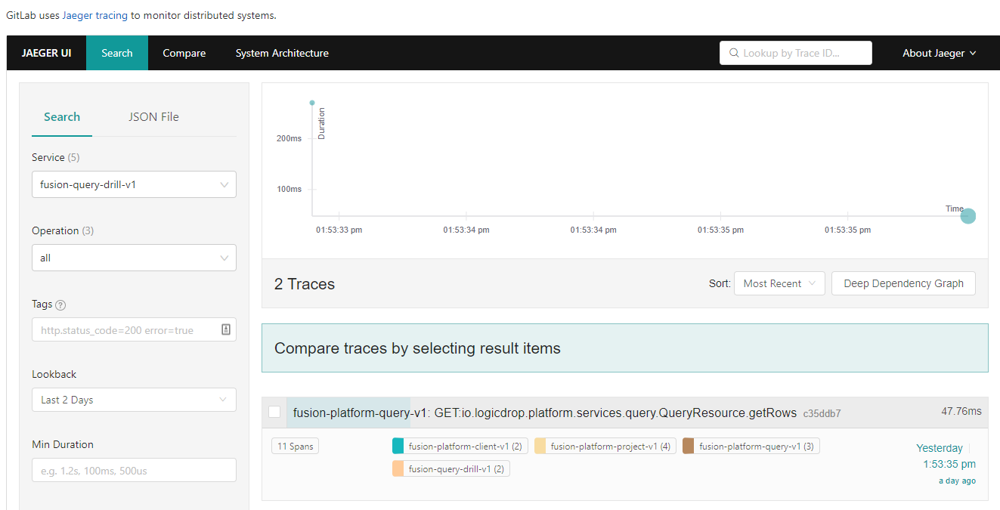

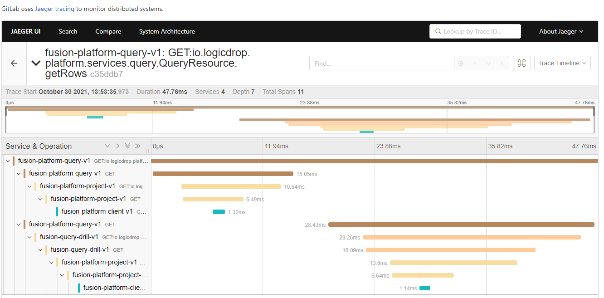

> [!TIP]
> Jaeger has been invaluable to us because we heavily rely on single-responsibility services that frequently communicate with other services.

### Dependency Changes

Dependabot is wired in to let us know when there are changes to any dependencies.

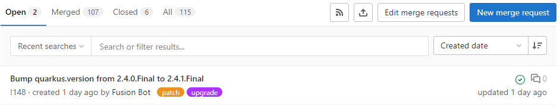

> [!TIP]
> This is especially helpful when our dependencies get released and other projects need to be made aware of it. Since it creates a merge request, the tests are run and we can see if the upgrade will break anything.

### Environments and Pod Health

Every environment is monitored and you can see what pods are active in them by adding a couple of GitLab-specific annotations to the Quarkus Kubernetes configuration.

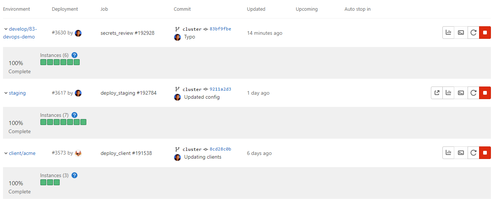

### Cluster Logs

Kubernetes logs can be viewed right from GitLab, eliminating the need for access to the cluster by developers.

Logs can be viewed per environment or filtered for specific pods.

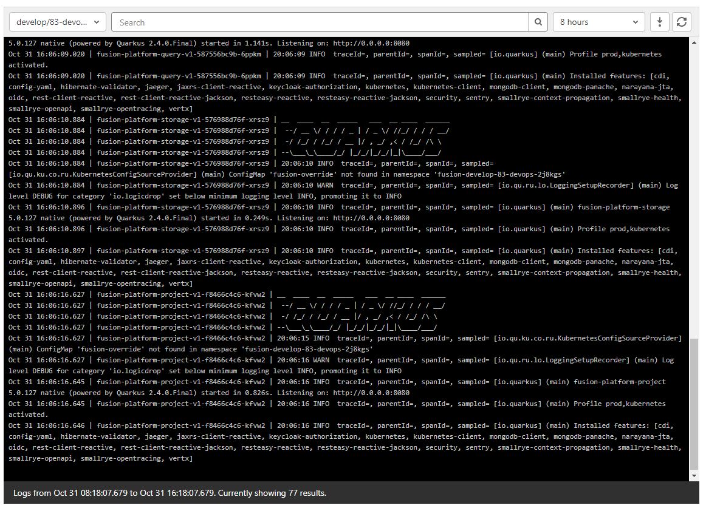

### Prometheus Metrics

Prometheus metrics are exposed using GitLab's monitoring and metrics.

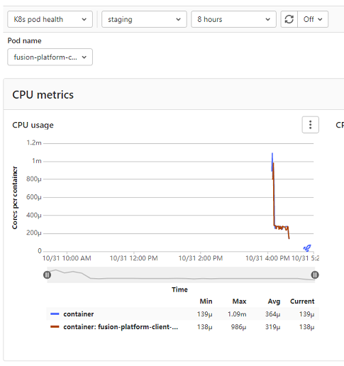

### Value Stream Analytics

We can use GitLab's [Value Stream Analytics^](https://docs.gitlab.com/ee/user/analytics/value_stream_analytics.html) to track the velocity within any project. This gives us rough insights into the time it takes from the moment a ticket is created to when it is deployed.

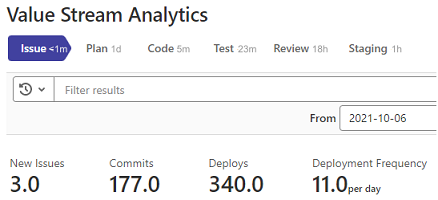

## Conclusion

Integrating Quarkus deeply into GitLab has added significant value to our process and was well worth the little effort it took.

Building upon our *level the playing field* philosophy, developing, debugging, deploying, and monitoring cloud-native services is more optimal than ever.

Because of the natural fit Quarkus has with cloud technologies, and the functionality provided through extensions, we have been able to create a comprehensive DevOps ecosystem that normally would be challenging to set up and orchestrate.

Highlights of the new process are:

- Services can be worked on in isolation
- Parallelizing builds decreased the time to deliver changes
- Common tools are available within GitLab
- Preview services make it easier to collaborate
- Deployments are completely automated

At the end of the day, we do not have to train staff on different tools, grant access any further than GitLab, or expose any infrastructure directly.

This new process, while it may seem intensive, has been easy to manage and build upon and is completely automated end-to-end with almost no manual intervention.

Key functionalities we use are now accessible within GitLab and that helps us to iterate, collaborate, and react quicker.
