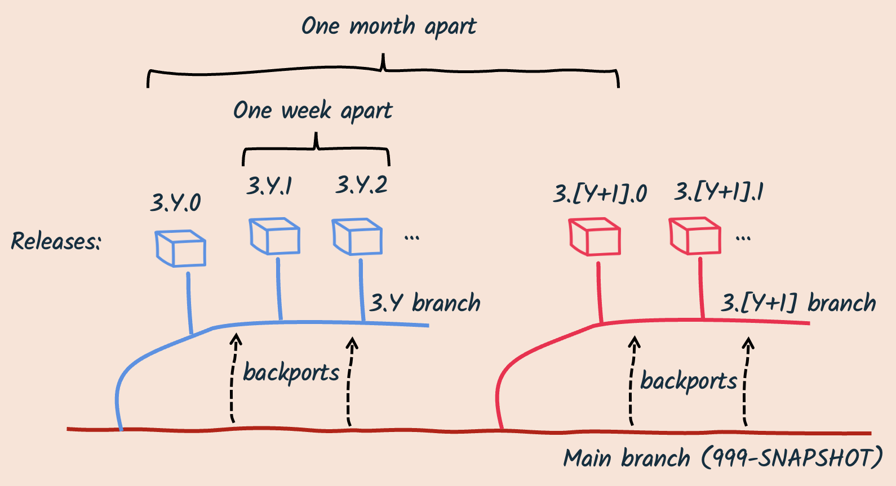
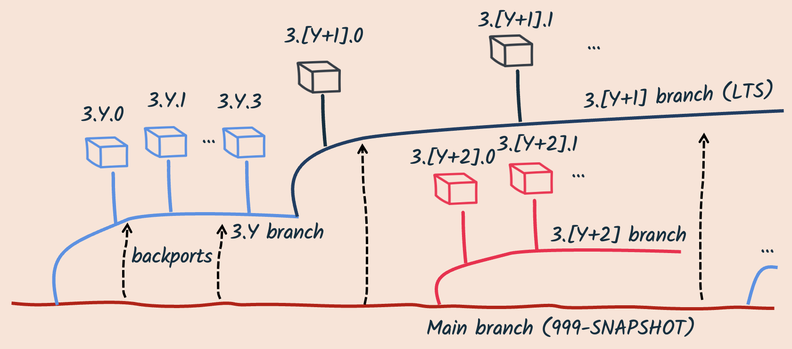
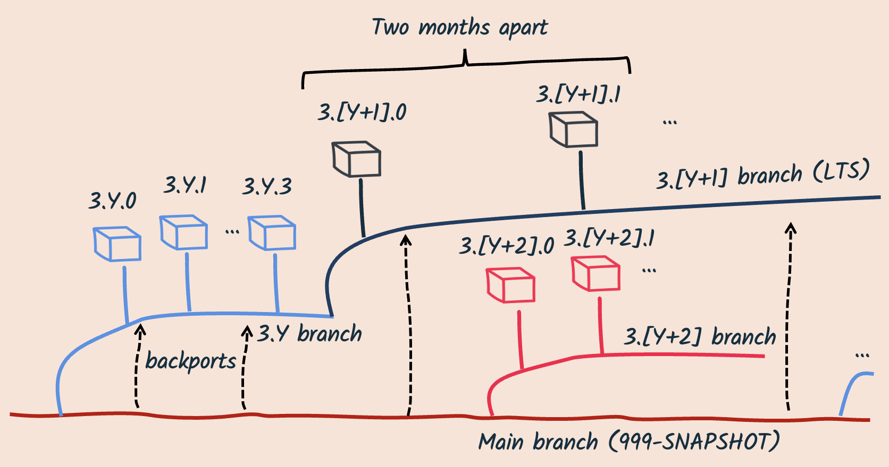

# Quarkus LTS - New Release Cadence Explained

Quarkus releases an [LTS](https://quarkus.io/blog/lts-releases/) (Long-Term Support) version every six months. LTS is designed for users who prioritize stability over new features. These versions are maintained for one year and receive critical bug and CVE fixes. An overlap period allows a smooth upgrade to the next LTS.

Until now, LTS micro-releases (e.g., 3.8.1, and 3.8.2) have occurred regularly but without a predictable schedule. **We’re changing this.**

**TLDR:** LTS releases will follow a predictable cadence, with micro-releases every two months. The [A New Cadence for LTS Micro-Releases](#new-cadence) section provides more details.

## Releases, Releases, and More Releases

Since its inception, Quarkus has followed a fast-paced release cycle:

- *Minor releases:* Once per month (e.g., 3.16, 3.17).
- *Micro-releases:* Weekly (e.g., 3.17.1, 3.17.2).

The development process revolves around the main branch, which serves as the cutting edge of Quarkus development.

Here’s how the regular release process works:

- *Minor releases (3.y)*: A new branch is created from *main*, capturing all the changes from development up to that point.
- *Micro-releases (3.y.z)*: These only include bug fixes and CVE remediations, backported from *main* to the minor release branch.

## How LTS Releases Differ

LTS releases prioritize stability over the latest features, and the process reflects this. Let’s look at the example of 3.19 (a minor release) and 3.20 (the next LTS):

1. A new branch for 3.19 is created from main, containing the latest development at that time.
2. Bug fixes and CVE remediations are backported to the 3.19 branch for its micro-releases.
3. When preparing the LTS release (3.20), the branch is not created from main. Instead, it is created from the 3.19 branch, ensuring no new features from main are included.

This approach improves the reliability of LTS releases by excluding potentially unstable or unproven changes.

Once we had this initial release, we did not have clear rules about the new micro releases of the LTS (3.20.1, 3.20.2…). So, while we have a predictable release calendar for the regular micro and minor releases, LTS micro releases were irregular.

## A New Cadence for LTS Micro-Releases

Starting with 3.15 LTS, we’re introducing a predictable cadence for LTS micro-releases:

- A new LTS version will be released every six months.
- For each LTS, micro-releases will occur every two months (e.g., 3.20.1, 3.20.2).

## What’s Included in an LTS Micro-Release?

LTS micro-releases are strictly limited to:

- Bug fixes considered low-risk.
- CVE fixes (moderate and critical).
- Dependency updates for CVE remediation or critical bug fixes.

**Nothing else.**

## Emergency Exceptions

In the event of a critical CVE (because we know it will happen), we’ll release an emergency micro-release outside the two-month cadence. These releases may follow a separate versioning scheme (e.g., 3.20.0.1) to indicate their exceptional nature (still under discussion).

## What if?

*What if I want a feature in the next LTS?*

To be included, the feature must be merged into main at least one month before the LTS branch is created. Don’t play with the clock - having a feature merged can take time, and the CI tends to be busy just before releases.

*What if I want a feature to be added to an existing LTS?*

**No.** New features are only included in future LTS versions. For immediate access, consider using regular (non-LTS) releases.

*What if a bug fix is needed in the next LTS micro-release?*

We’re happy to consider backporting bug fixes, provided they are low-risk. Risky fixes will require further discussion and may not be included. We will particularly consider bugs impacting features from previous LTS releases.

*What if I want to know what’s included in the next LTS micro-release?*

We’re establishing an LTS working group to improve transparency and track backports.

*What if a moderate CVE is reported against an LTS?*

The next LTS micro will include moderate CVE fixes every two months. Exceptional releases are only for important (where there is no mitigation) and critical CVEs.

*How will the Quarkus Platform align with this cadence?*

The Quarkus Platform will follow the same release schedule. If you are a platform member,  we recommend subscribing to this coordination group if you have not already done so.

## Two-Line Summary

- For regular users: Monthly minor and weekly micro-releases continue as before.
- For LTS users: Expect LTS versions every 6 months, with micro releases every 2 months.

The next LTS will be [3.20](https://quarkus.io/blog/next-lts-3-20/). The dates and schedule are communicated on the [Release Planning Wiki Page](https://github.com/quarkusio/quarkus/wiki/Release-Planning).
