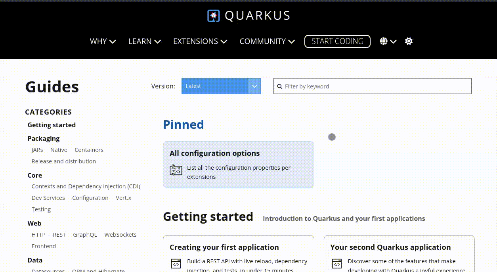
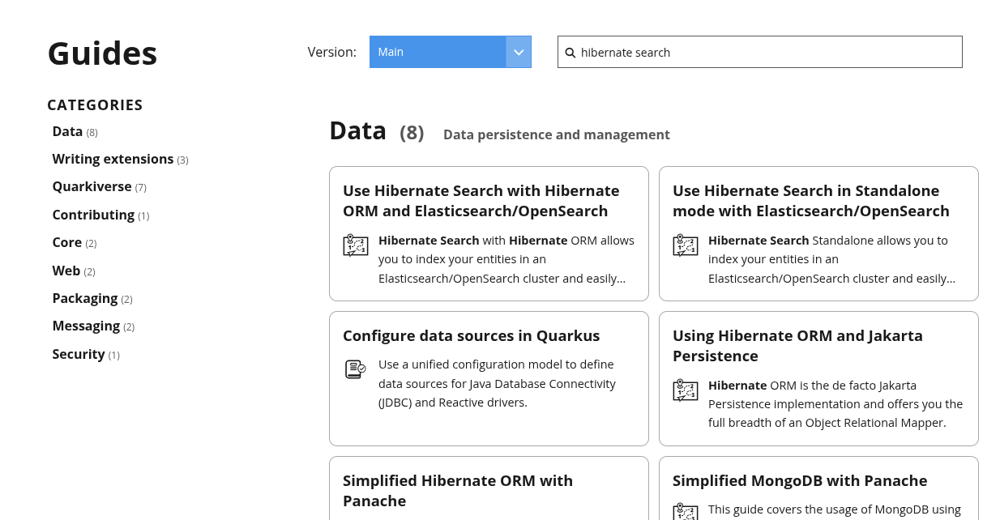
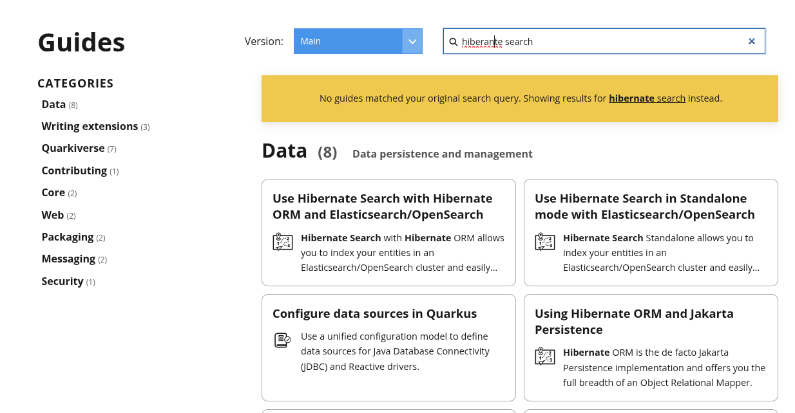
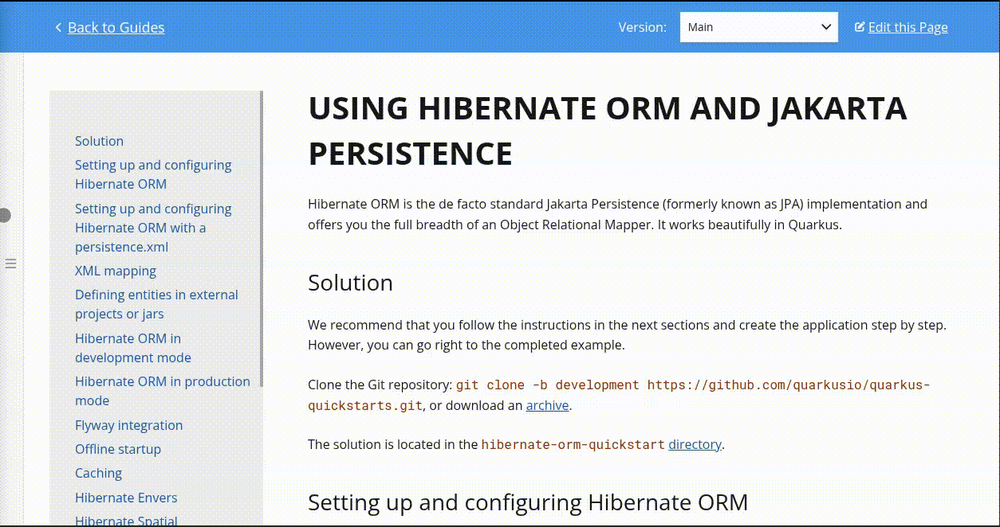
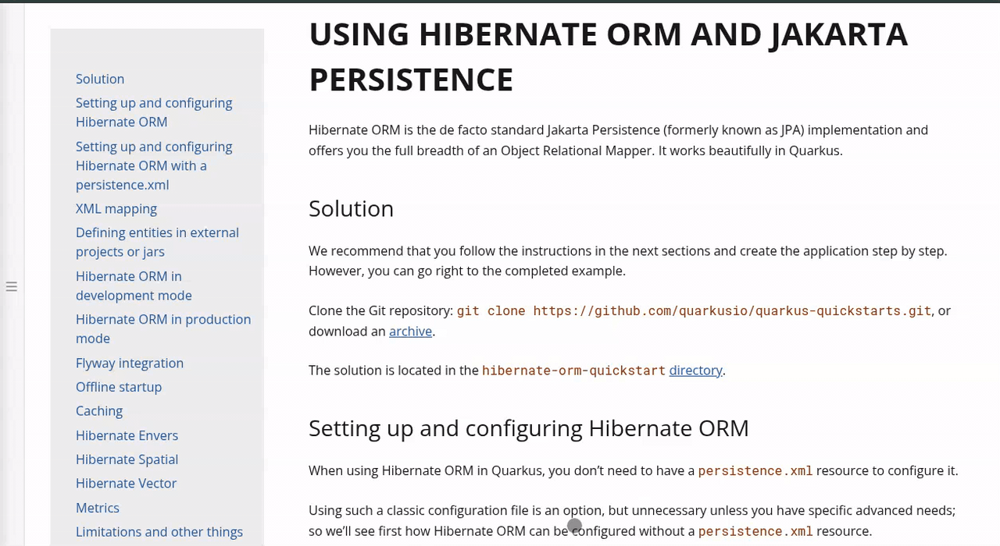
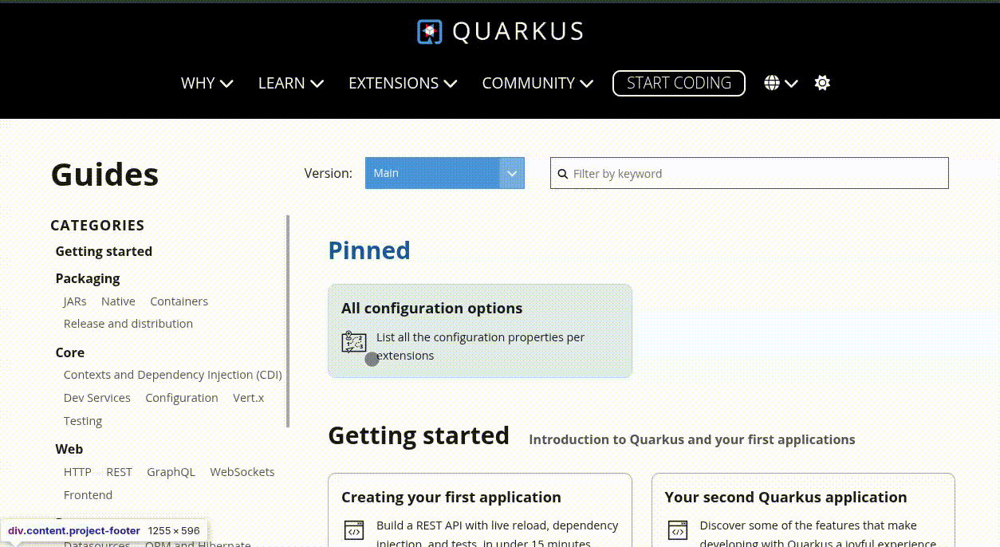
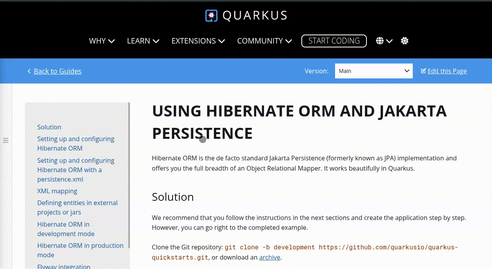
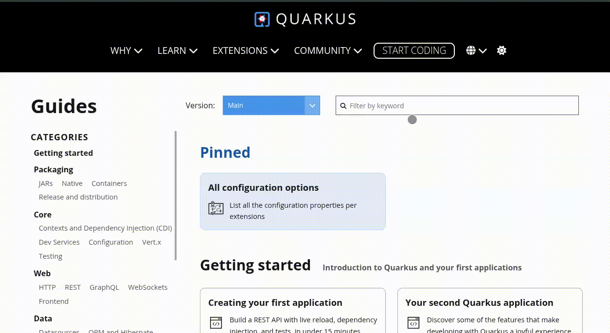

# Guides, reimagined: categories, search, and improved navigation

The number of different guides and documentation materials grew over the years, to the point where it became harder to find information unless you knew what you were looking for, or relied solely on the search functionality.

To address this, we have decided to reorganise the guides by categories rather than keeping them grouped by types (guide, tutorial, etc.). In addition, we wanted to make it easier to navigate between the guides once you have already opened a specific page.

> [!NOTE]
> These changes affect the newer versions of guides, while the 3.27 and earlier ones stay in their previous form, at least for now.

## What actually changed ?

### Curated category groups of guides

Grouping the guides by type simply stopped working with the number of different guides that we have now. Hence, we have decided to reorganise them into category groups by the topic they belong to. We have kept the already familiar icons for the guide types so that it's also clear what to expect from a particular document.

Having a small, concise group with a clear topic helps narrow down to the guide you are looking for. Some categories are also divided into subcategories for a more fine-grained grouping. But as the number of groups grows, how do you discover what categories are available? That is why we have also introduced a navigation menu on the left that helps you jump from one category to another.

This is a curated set of categories, and within each category, guides are placed in a specific order: more relevant/fundamental guides to the category go first, followed by more specialised guides.

We have decided to have a dedicated pinned section where we include the guides that may or may not be in other categories, but which we find to be useful or often visited.

We have also slightly changed the guide cards style and behaviour -- now they will open in the same tab rather than a new one. You can still open them in a new tab as any other page -- just `Ctrl`/`cmd`+`click` as you would any other link.

### Updated search behaviour

After some discussions and considerations, we landed on preserving the category groups in the search results representation. Our concern was whether we would lose the search relevance if we preserve the categories when displaying search results. We addressed this by reordering the category groups based on your search. The more relevant guides to your query a category contains, the closer to the top of the category list it is.

We have also decided to remove the highlighted content snippets from the results screen. While our intuition, when the feature was initially delivered, was that these could help decide whether a particular guide contains the information you are looking for, it turned out that we would need to show much more content to provide enough context to make that decision. Doing so clutters an already information-heavy page even further.

We've preserved the other search capabilities. In particular, we kept the search suggestions, which try to find something close to what you were trying to look up but may have made a typo.

And as a reminder, it is a full text search, not just a keyword search!

### Actual guide page

The biggest change to a guide page is also the one easiest to miss -- we have added a full categorised list of guides that you can pull out from the left slide-out panel -- just click on that grey bar.

This allows you to navigate between the guides without going back to the all guides page. It also makes it easier to explore guides from the same categories that the current guide belongs to -- those are expanded by default when you pull out the panel.

We have also slightly modified the table of contents, and it now shows the list of top-level sections. When you scroll through the guide the section you are currently reading will be highlighted and if it has any subsections, it will expand and a corresponding subsection title will be highlighted. This helps you see where you are currently at, especially with those longer guides.

## Navigation examples

We are sure that you will find your own way around the guides and have a flow that works best for you. But we did want to share a few practical examples of how we ourselves navigate through the pages.

Sometimes you just need to find a configuration property key and either your IDE does not give you a suggestion, or you do not have a Dev UI running to look it up there -- well, look no further -- the list of all configuration properties is pinned right there at the top of the guides page:

If you know exactly what you are looking for, let's say you need to look up some Hibernate ORM extension specifics, you can just click on the `Data` category or even more specific on the `ORM and Hibernate` and pick the flavour of Hibernate ORM you prefer, be it a regular Jakarta Persistence, Reactive, or something more high level as Hibernate ORM with Panache -- they all are under that category.

Once on the Hibernate ORM guide page you may realise that you need to check how to configure the datasources or maybe tune the Hibernate Validator for validating the entities -- there is no need to go back to the all guides page. Just open the list of all categorised guides hidden on the left-side pullout panel:

If you aren't quite certain what category/guide may contain the information you need, or if maybe you are looking for something that might be in the Quarkiverse -- search is your best friend in this case. Just start typing what you are looking for:

As search results preserve the category groups, you can easily jump from one to another by clicking through the categories you see on the left.

## What is next ?

The release of these improvements also coincided with the migration of the site from Jekyll to Roq (a Quarkus-powered static site generator). We would like to address a few remaining migration concerns first, but we are also discussing ideas as possible improvements to ease the documentation discovery, lookup, and navigation to related content.

## Feedback

We would like to hear back from you and your experience navigating the Quarkus guides. What does work for you, what would you like to see us improve ?

We do value your feedback and if you spot any problems -- please [let us know](https://github.com/quarkusio/quarkusio.github.io/issues)!

If you are a Quarkus user or just curious, don't be shy and join our welcoming community:

- provide feedback on [GitHub](https://github.com/quarkusio/quarkus/issues);
- craft some code and [push a PR](https://github.com/quarkusio/quarkus/pulls);
- discuss with us on [Zulip](https://quarkusio.zulipchat.com/) and on the [mailing list](https://groups.google.com/d/forum/quarkus-dev);
- ask your questions on [Stack Overflow](https://stackoverflow.com/questions/tagged/quarkus).
