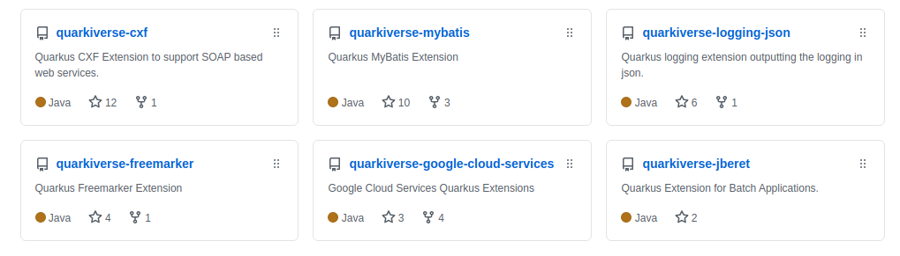
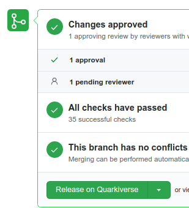
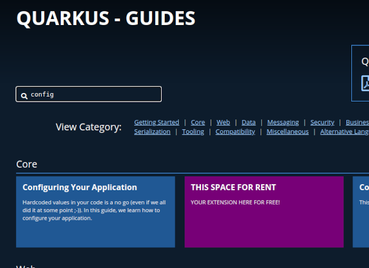

# Quarkiverse Hub - Home of Community Extensions

Today we're proud to announce [Quarkiverse Hub](https://github.com/quarkiverse), a GitHub organization where any contributor can host their Quarkus extensions.



Hosting your extension in the Quarkiverse Hub makes it available to all Quarkus users through the Quarkus tooling.

So read on to discover more and find out how you can make your extension available to all Quarkus developers today!

## Features

By hosting an extension under the Quarkiverse Hub, the following features are enabled:

**Automated and secured publishing of your Maven releases to Maven Central**


Registering and publishing artifacts to Maven central can become a daunting task. In Quarkiverse that is automated by GitHub Actions, requiring no manual interaction with any command line tools. Releasing an artifact is as simple as opening a pull-request changing the [`.github/project.yml`](https://github.com/quarkiverse/quarkiverse-template/blob/main/.github/project.yml) file in the extension's repository. Once the pull-request is merged, a GitHub action is triggered invoking `mvn release:prepare release:perform` and the extension is deployed to Maven central. The Quarkiverse wiki has [more details and troubleshooting tips](https://github.com/quarkiverse/quarkiverse/wiki/Release).



**Automated cross-testing of your extension with Quarkus builds/releases**


Quarkus Core releases happen constantly and keeping up with the latest changes before a release is performed is crucial. Quarkiverse extensions are built daily against the latest [Quarkus core](https://github.com/quarkusio/quarkus) using the [Quarkus Ecosystem CI](https://github.com/quarkusio/quarkus-ecosystem-ci) and listed in the [Quarkus Status](https://status.quarkus.io/) page.

**Consistent formatting and release of projects**


The `quarkiverse-parent` artifact (inherited by each extension in Quarkiverse) enables plugins that will format your source code to the same format used in Quarkus core.

**Documentation aggregation**


Get your versioned extension documentation automatically published (including guides)! Quarkiverse Hub uses [Antora](https://antora.org) to aggregate each extension documentation in the Quarkiverse docs website. Although the layout is still a work in progress, you can check it out at <https://quarkiverse.github.io/quarkiverse-docs/>



**Automated inclusion in the upcoming Extension registry**


The Extension registry is still a work in progress (<https://registry.quarkus.io>), but the gist of it is to have a single place to browse for extensions (including <https://code.quarkus.io>, command line and IDE plugins).

## Requirements

In order to automate extension releases and publication of docs, there are some rules that need to be followed for projects under the Quarkiverse organization:

- The extension repository should be named `quarkus-<project>`
- A Quarkiverse extension MUST belong to the `io.quarkiverse.<project>` groupId
- The root pom.xml MUST inherit from `io.quarkiverse:quarkiverse-parent`
- A Quarkiverse extension has the following structure:

```tree
├── deployment <1>
├── runtime
├── integration-test
├── docs <2>
├── pom.xml
├── LICENSE
└── README
```

1. The **deployment**, **runtime** and **integration-test** directories containing the extension classes. See [How to create new extension modules using Maven](https://quarkus.io/guides/writing-extensions#create-new-extension-modules-using-maven) for more details.
2. **docs** (optional): The docs should follow the [Antora's Standard File and Directory Set](https://docs.antora.org/antora/2.3/standard-directories/). See an example [here](https://github.com/quarkiverse/quarkiverse-freemarker/tree/b41701b05f5886fd7c91148cdd273028fcd28950/docs).

For more information, look at the [Quarkiverse Wiki](https://github.com/quarkiverse/quarkiverse/wiki)


## How do I sign-up?

Create an **Extension Proposal** ticket in the [Quarkus issue tracker](https://github.com/quarkusio/quarkus/issues) (first check if the extension you're proposing is not created yet) and let us know if you want to lead the development of this extension by commenting on the issue.

The Quarkus team will get you started with the boring stuff of setting up a brand new repository and deployment scripts, so you'll have fun coding it.

As usual, we're always improving, so take a look at [Joining Quarkiverse](https://github.com/quarkiverse/quarkiverse/wiki#joining-quarkiverse) for the process we are currently using.

## What extensions are in Quarkiverse already?

Check out the [extensions that are already there](https://github.com/search?q=topic%3Aquarkus-extension+org%3Aquarkiverse&type=Repositories).

Stay tuned for the latest info about Quarkiverse in the [Quarkiverse Wiki](https://github.com/quarkiverse/quarkiverse/wiki)

## Can I reuse this setup for an extension outside the Quarkiverse organization?

Yes, right now we're in the process of documenting the extra steps to make your extension releases visible to our tooling in this case.
