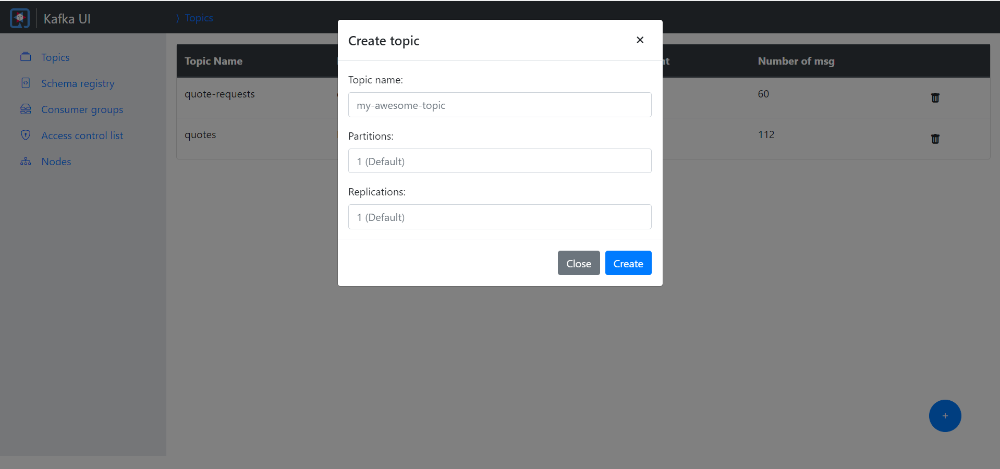

# Quarkus 2.13.0.Final released - Cross site request forgery prevention filter, Kafka Dev UI

We don't have a ton of big new features in Quarkus 2.13.0.Final but it comes with a ton of small enhancements that should improve your overall experience with Quarkus.

It still comes with some exciting stuff:

\* Cross Site Request Forgery (CSRF) prevention filter for RESTEasy Reactive (well, security is not always exciting but being well prepared prevents some unnecessary stressful times) \* Kafka Client Dev UI

It is also worth noticing that a lot of work is invested in improving the performances of Quarkus lately and you should see significant performance boosts from release to release in the next few months.

## Migration Guide

To migrate from 2.12, please refer to [our migration guide](https://github.com/quarkusio/quarkus/wiki/Migration-Guide-2.13).

## What's new?

### Cross Site Request Forgery (CSRF) prevention filter

Quarkus now provides a RESTEasy Reactive filter that might help to prevent CrossSite Request Forgery attacks.

RESTEasy Reactive is our default REST layer and is a perfect fit for both reactive and blocking workloads.

It comes in the form of a new extension and you can find all the details in the [dedicated guide](/guides/security-csrf-prevention).

### Kafka Dev UI

Quarkus 2.13.0.Final introduces a brand new Kafka Dev UI. It brings several exciting features allowing you to manage your Kafka instance from Dev UI.

Feedback and contributions are very welcome in this area.

## Full changelog

You can get the full changelog of [2.13.0.CR1](https://github.com/quarkusio/quarkus/releases/tag/2.13.0.CR1) and [2.13.0.Final](https://github.com/quarkusio/quarkus/releases/tag/2.13.0.Final) on GitHub.

## Contributors

The Quarkus community is growing and has now [705 contributors](https://github.com/quarkusio/quarkus/graphs/contributors). Many many thanks to each and everyone of them.

In particular for the 2.13 release, thanks to Alexey Loubyansky, anavarr, Andrii Maliuta, Andy Damevin, Bill Burke, brunobat, Cedric Lewe, Chris Laprun, Clement Escoffier, Davide Angelocola, Davide D'Alto, Emiliia Nesterovych, Erin Schnabel, Falko Modler, Fernando Comunello, Foivos Zakkak, freakse-sa, galiacheng, George Gastaldi, Georgios Andrianakis, Guillaume Le Floch, Guillaume Smet, Heiko W. Rupp, Helber Belmiro, hmanwani-rh, Holly Cummins, Ignasi Camacho Redó, Ioannis Canellos, Jan Martiska, Joao Pedro Schmitt, Jose Carvajal, Justin Lee, Katia Aresti, Knut Wannheden, Ladislav Thon, Loïc Mathieu, Luke Thompson, Manyanda Chitimbo, Marc Nuri, Marc Wrobel, Mark Sailes, Martin Kouba, Matej Novotny, Max Rydahl Andersen, Michael Edgar, Michal Vavřík, Michał Szynkiewicz, Michelle Purcell, Oleksiy Lukin, Ozan Gunalp, Philip Hayes, Phillip Krüger, Robbie Gemmell, Robert Stupp, Roberto Cortez, Rostislav Svoboda, Rudy De Busscher, Réda Housni Alaoui, Sanne Grinovero, Sergey Beryozkin, Severin Gehwolf, shjones, Stuart Douglas, Tero Saarni, Tomas Hofman, Viswa Teja Nariboina, vsevel, xiezhang, xstefank, Yoann Rodière, Yoshikazu Nojima, zedbeit, Zheng Feng.

## Come Join Us

We value your feedback a lot so please report bugs, ask for improvements... Let's build something great together!

If you are a Quarkus user or just curious, don't be shy and join our welcoming community:

\* provide feedback on [GitHub](https://github.com/quarkusio/quarkus/issues); \* craft some code and [push a PR](https://github.com/quarkusio/quarkus/pulls); \* discuss with us on [Zulip](https://quarkusio.zulipchat.com/) and on the [mailing list](https://groups.google.com/d/forum/quarkus-dev); \* ask your questions on [Stack Overflow](https://stackoverflow.com/questions/tagged/quarkus).
