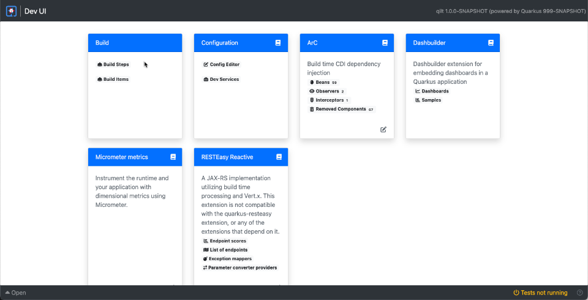

# Quarkus 3.0.0.Alpha5 released - now with Hibernate ORM 6, new Dev UI and more!

We are in the process of getting Quarkus 3 ready - with the last alpha, we got our main branch to Jakarta EE 10 to let us getting more things integrated and tested faster. This time we move from Hibernate 5 to Hibernate 6 - which **will** cause breakages thus please read the section below for details if you are a Hibernate ORM and especially Hibernate Reactive user!

On top of it all is a new and improved Dev UI!



The list of highlights for this release is:

\* [Hibernate ORM 6](https://github.com/quarkusio/quarkus/pull/31235) (without Hibernate Reactive) \* @Inject for [Hibernate StatelessSession](https://github.com/quarkusio/quarkus/pull/31392)  \* [Multiple Persistence Unit](https://github.com/quarkusio/quarkus/pull/31175) support for Spring Data repositories \* New Dev UI \* `quarkus deploy` in Quarkus CLI \* `@Scheduled` [support for timezones](https://github.com/quarkusio/quarkus/pull/31343)  \* Support [HTTP/2 connections](https://github.com/quarkusio/quarkus/pull/31192) in REST Client Reactive \* `@ClientRedirectHandler` [to support custom redirect in REST Client Reactive](https://github.com/quarkusio/quarkus/pull/31142)  \* Add support for [Gradle 8](https://github.com/quarkusio/quarkus/pull/31159)  \* [Multiple OIDC code flows now allowed in same browser](https://github.com/quarkusio/quarkus/pull/31079)

## Hibernate ORM 6

Hibernate ORM 6 is a major upgrade to the main persistence layer of Quarkus. It brings a lot of improvements and new features, but also some breaking changes. We will do our best to make the migration as smooth as possible, but some changes are unavoidable.

We have started a [Hibernate ORM 5 to 6 migration](https://github.com/quarkusio/quarkus/wiki/Migration-Guide-3.0:-Hibernate-ORM-5-to-6-migration) guide for Quarkus users to help you with the migration.

Take particular note of the ["Best-effort Hibernate ORM 5.6 compatability switch"](https://github.com/quarkusio/quarkus/wiki/Migration-Guide-3.0:-Hibernate-ORM-5-to-6-migration#database-orm-compatibility) which can reduce the impact of the default schema changes in Hibernate 6 and give you more time to migrate.

We want to improve and simplify these migration steps in preparation for Quarkus 3 thus do please [report](https://github.com/quarkusio/quarkus/issues/new/choose) migration issues you encounter so we can improve the migration documentation and scripts.

### Hibernate Reactive Temporarily Disabled

An early alpha version of Hibernate Reactive 2 is under active development and unfortunately not ready for use.

In name of getting early feedback on all other parts of Quarkus we have excluded Hibernate Reactive from the Alpha5 relese. We are working hard on re-enabling it for an upcoming future release.

### Inject Hibernate StatelessSession

One of my favorite least-known features of Hibernate is the `StatelessSession` which is a lightweight session that does not track any state. It is perfect for batch processing and for those with a preference for a command oriented use-cases (insert,delete,update,...) over managed entities.

Before this release you had to manually configure it - with Quarkus 3 you can now simply inject a `StatelessSession`:

```java
@Inject
StatelessSession statelessSession;
```

You can read more about `StatelessSession` in the [Hibernate ORM guide](https://docs.jboss.org/hibernate/orm/6.2/userguide/html_single/Hibernate_User_Guide.html#_statelesssession).

## New Dev UI

Quarkus 2 introduced the Dev UI which provides a web ui to use during development. Extensions could provide their own Dev UI pages to provide additional functionality.

Quarkus 3 now has a new Dev UI which is more extensible and easier to use. It also has a new look and feel.

For now the new Dev UI is served at <http://localhost:8080/q/dev-ui>

The old Dev UI is still the default as not all extensions have migrated.

We have a [playlist](https://www.youtube.com/watch?v=sz5ihmA4gaE&list=PLsM3ZE5tGAVbyncLm7ue2V25cwFck7ew9) on Quarkus YouTube channel that shows off the new Dev UI, explains the new features and how to use and extend it.

## `quarkus deploy` in all dev tools

Quarkus CLI and the Maven and Gradle plugins now have the ability to `deploy`.

```bash
quarkus deploy
mvn quarkus:deploy
gradle deploy
```

This enables the deployment of Quarkus applications to platforms like Kubernetes, Knative and OpenShift. All without requiring changes to the project dependencies or configuration and therefore simplifying developer experience.

## Trying out Quarkus 3

For now the easiest way to get started is using [code.quarkus.io](https://code.quarkus.io/?S=io.quarkus.platform%3A3.0) or use the Quarkus CLI:

```bash
quarkus create app --stream=3.0
```

Mind you that at this stage, while all the core extensions are available, only parts of the Quarkus platform is present. Not all extensions have yet migrated to Jakarta packages (e.g. Camel Quarkus or Kogito are not yet available).

## Upgrading to Quarkus 3

For existing applications where all extensions are available, we have an OpenRewrite recipe that you can try.

There is a one-liner that attempts to do it automatically using a JBang script.

If you have JBang already installed, run:

```bash
jbang --fresh upgrade-to-quarkus3@quarkusio
```

If not, for Linux and macOS:

```bash
curl -Ls https://sh.jbang.dev | bash -s - --fresh upgrade-to-quarkus3@quarkusio
```

and for Windows:

```bash
iex "& { $(iwr https://ps.jbang.dev) } --fresh upgrade-to-quarkus3@quarkusio"
```

Once this has been run your project should have its dependencies, source code and documentation updated to use Quarkus 3.

If it does not work for you, it could be we missed something or you are using extensions not yet supporting Quarkus 3.

Let us know in either case so we can together improve the migration script.

## Come Join Us

We value your feedback a lot so please report bugs, ask for improvements... Let's build something great together!

If you are a Quarkus user or just curious, don't be shy and join our welcoming community:

\* provide feedback on [GitHub](https://github.com/quarkusio/quarkus/issues); \* craft some code and [push a PR](https://github.com/quarkusio/quarkus/pulls); \* discuss with us on [Zulip](https://quarkusio.zulipchat.com/) and on the [mailing list](https://groups.google.com/d/forum/quarkus-dev); \* ask your questions on [Stack Overflow](https://stackoverflow.com/questions/tagged/quarkus).
