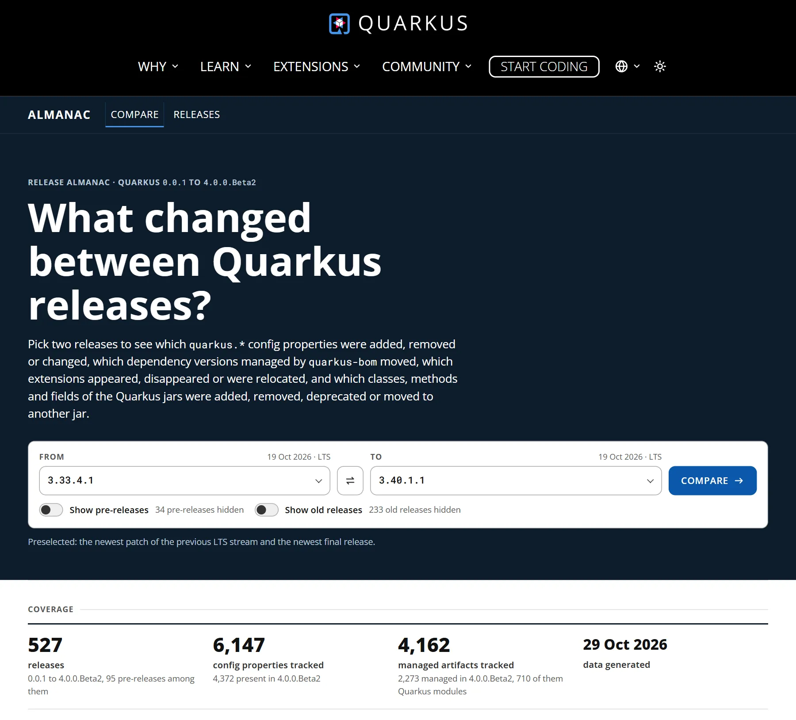
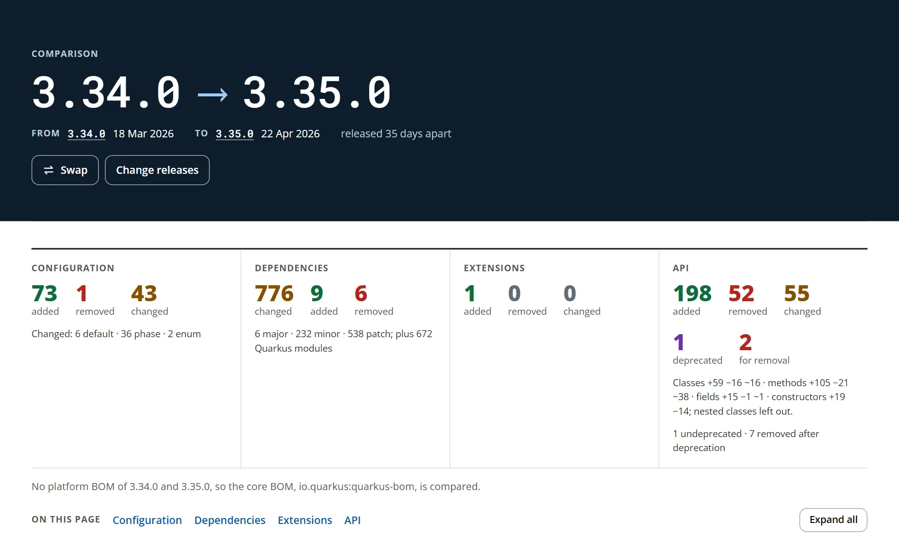
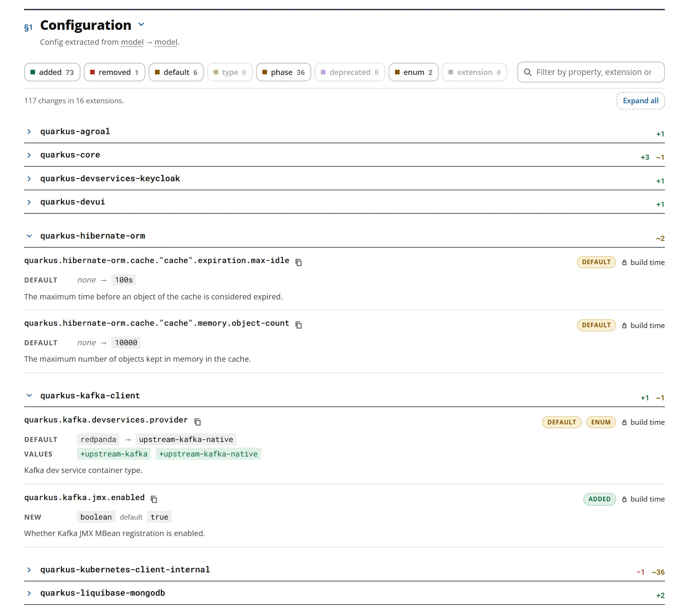
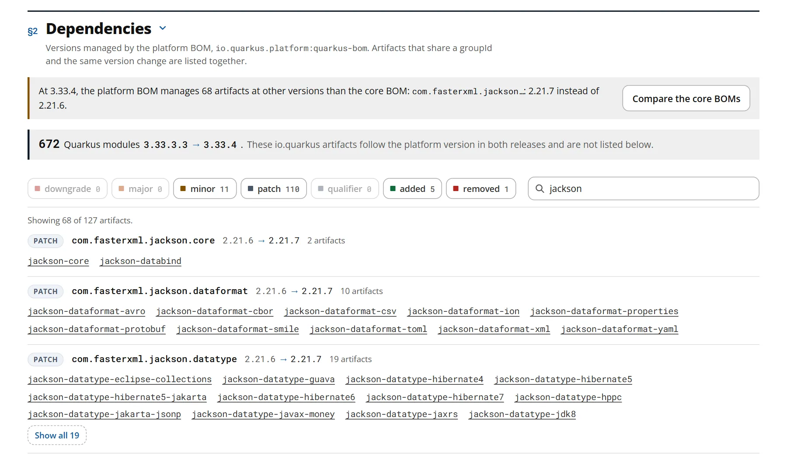
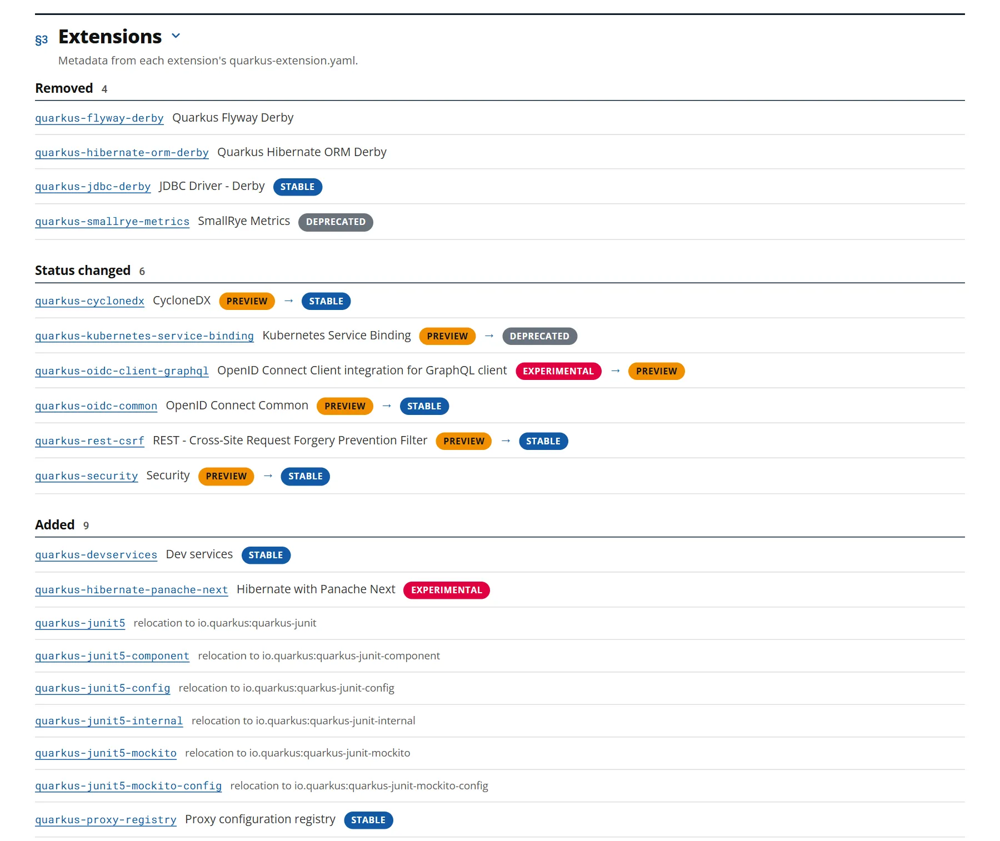
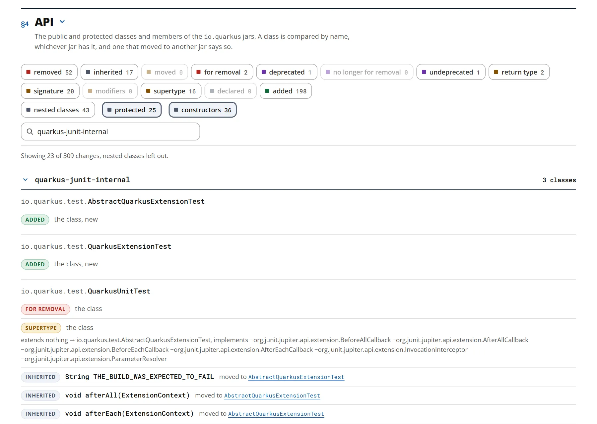
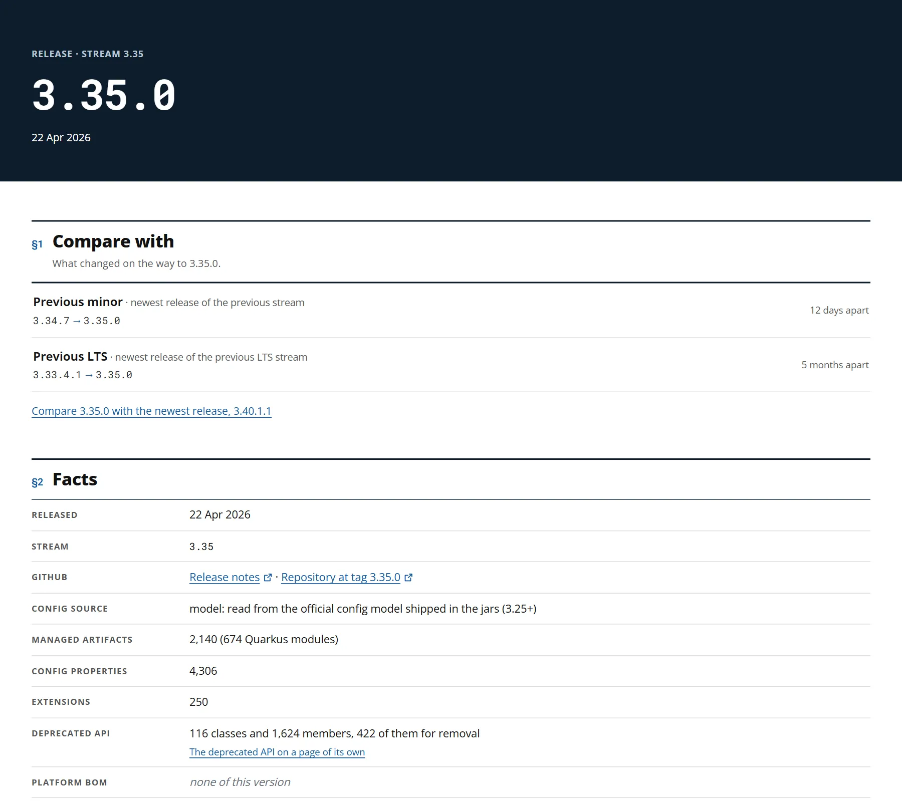
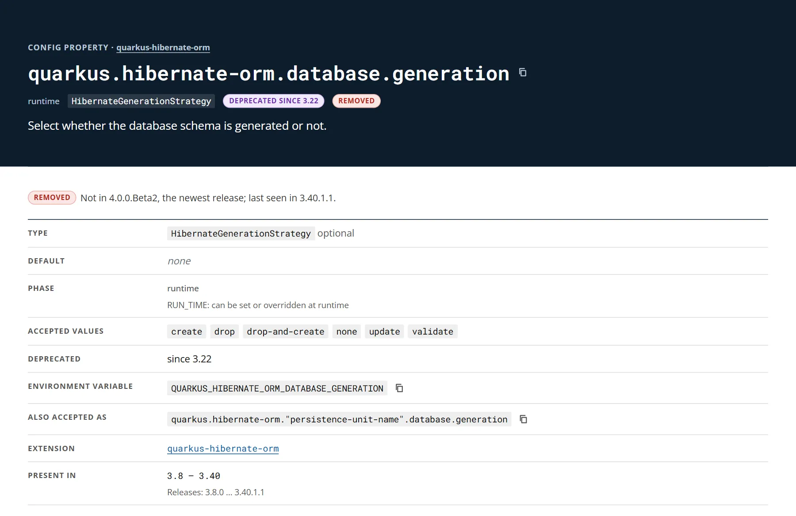
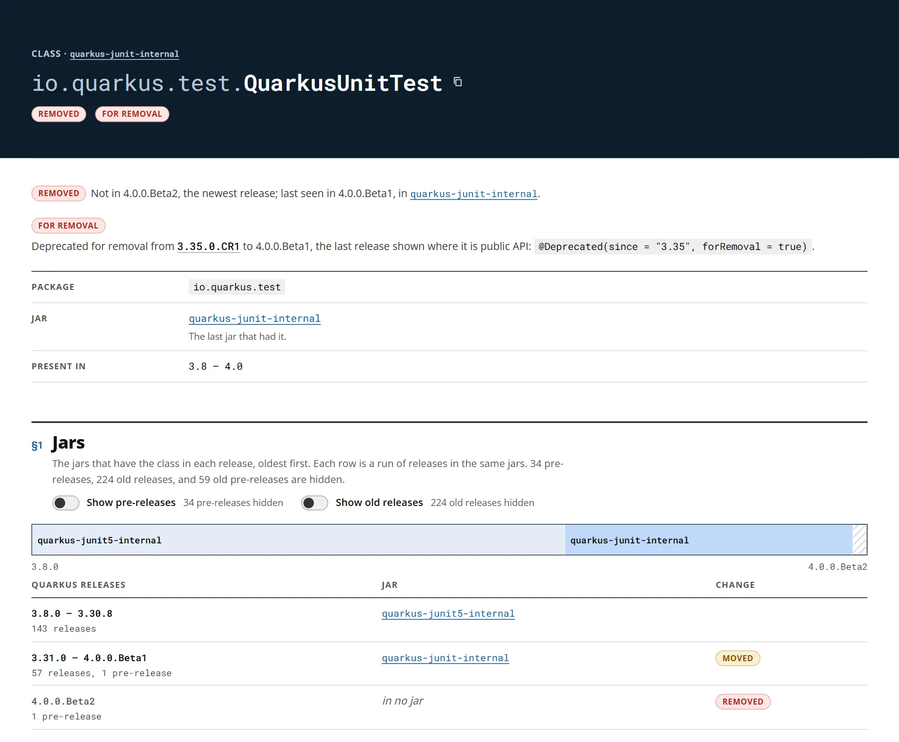
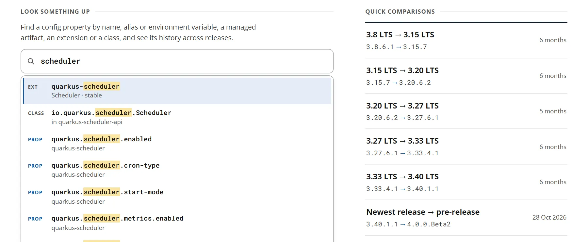

# Introducing the Quarkus Almanac

Upgrading Quarkus starts with a question: what changed between the release I use and the one I want? The answer is spread over migration guides, release notes, the BOM, the configuration reference, and the code.

The [Quarkus Almanac](https://quarkus.io/almanac/) puts it in one place. Pick two releases, and it shows what changed between them: config properties, managed dependencies, extensions, and the API of the classes in the Quarkus jars. It covers every Quarkus release, from 0.0.1 to the latest release.

The Almanac is inspired by [javaalmanac.io](https://javaalmanac.io), the Java Version Almanac, which collects the history of every Java release and compares the API of any two of them.

## Compare two releases

Pick a release to compare from and a release to compare to. The home page also offers quick comparisons, for example between two LTS releases.

A comparison starts with a summary that counts the changes of each kind. The sections below it list the changes, and start collapsed: open the ones you need.

## Configuration

The Configuration section lists the config properties that were added or removed, and those whose default value, type, accepted values, or phase changed, or that were deprecated. The properties are grouped by extension: open an extension to see its changes, or filter by property, extension, or description.

## Dependencies

The Dependencies section compares the versions that the Quarkus BOM manages: major, minor, and patch upgrades, downgrades, and the artifacts that were added or removed.

Applications generated by [code.quarkus.io](https://code.quarkus.io) import the platform BOM, `io.quarkus.platform:quarkus-bom`, which sometimes manages other versions than the core BOM, `io.quarkus:quarkus-bom`. The Almanac compares the platform BOMs when both releases have one; turn off the **Platform BOM** switch to compare the core BOMs instead. From 3.33.3.3 to 3.33.4, for example, the platform BOM upgrades 68 Jackson artifacts from 2.21.6 to 2.21.7, while the core BOM keeps them at 2.21.6.

## Extensions

The Extensions section lists the extensions that were added or removed, and those whose name or status changed. Between the LTS releases 3.27 and 3.33, for example, the Derby extensions were removed, and CycloneDX and Security became stable.

## Classes and their API

The Almanac also reads the class files of every Quarkus jar. The API section lists the public and protected classes, fields, methods, and constructors that were added or removed, deprecated, or marked for removal, and those whose signature, modifiers, or supertypes changed. A class that moved to another jar says which jar it was in, as the test framework did in 3.31.

In 3.35, for example, `AbstractQuarkusExtensionTest` and `QuarkusExtensionTest` are new, and `QuarkusUnitTest` is deprecated for removal. 17 of its members moved to its new superclass, `AbstractQuarkusExtensionTest`, so they are still there, inherited.

## Releases

The Releases page lists every release by stream, newest first, with its date, and marks the LTS streams. The page of a release links to the comparisons that matter for it, such as with the previous minor release and the previous LTS release. It also shows how many managed artifacts, config properties, and extensions the release has, its deprecated API, and what changed in its API since the release before it.

## A page for each property, artifact, and class

Every config property, managed artifact, and class has a page with its history across releases.

A config property page shows its type, default value, phase, accepted values, environment variable, and the releases that have it. `quarkus.hibernate-orm.database.generation`, for example, is deprecated since 3.22 and no longer exists in 4.0.

A class page shows the jars that have the class in each release, its members, and the history of its API. `QuarkusUnitTest` moved from `quarkus-junit5-internal` to `quarkus-junit-internal` in 3.31, was deprecated for removal in 3.35, and is gone in 4.0.0.Beta2.

## Search

Search finds a config property by its name, an alias, or its environment variable, as well as managed artifacts, extensions, and classes.

## How it works

The data comes from the artifacts that Quarkus publishes on Maven Central. A command-line tool reads the BOMs, the config and extension metadata, and the class files of every release, and keeps them as a dataset in the [quarkusio/almanac](https://github.com/quarkusio/almanac) repository. Every twelve hours, a GitHub workflow adds the new releases. The site itself is static: your browser computes every comparison.

## Try it

Open <https://quarkus.io/almanac/> and compare the release you use with the one you want. Problems and ideas are welcome in the [issue tracker](https://github.com/quarkusio/almanac/issues).
