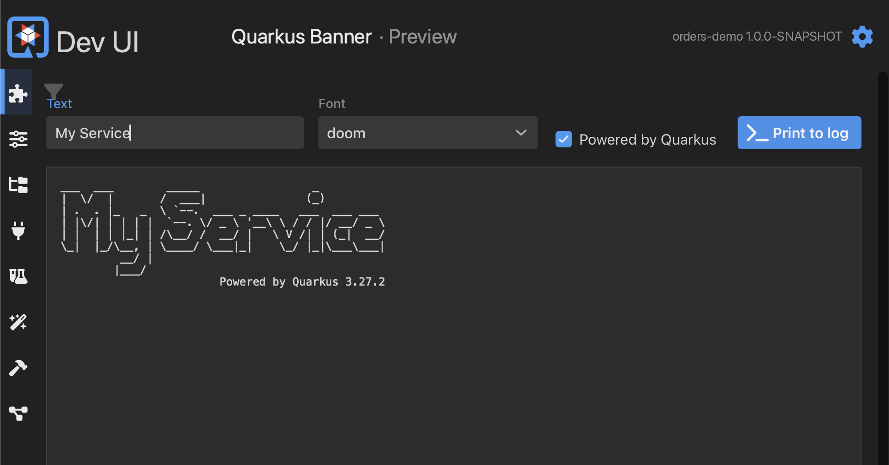

# Custom ASCII-art startup banners for Quarkus

You know the feeling. Three terminals open, a dozen services, and a wall of logs scrolling past. Which one just restarted? Was that *orders* or *order-history*? You scroll back up, squint, and hunt for the line that tells you.

Quarkus already prints a banner at start-up -- but it is the **same** banner for every application. So I built a small Quarkiverse extension that fixes that: **Quarkus Banner** turns your application name into a big, unmissable piece of ASCII art.

```text
 _________________ ___________  _____
|  _  | ___ \  _  \  ___| ___ \/  ___|
| | | | |_/ / | | | |__ | |_/ /\ `--.
| | | |    /| | | |  __||    /  `--. \
\ \_/ / |\ \| |/ /| |___| |\ \ /\__/ /
 \___/\_| \_|___/ \____/\_| \_|\____/
```

Now when that service scrolls past, you know exactly what you are looking at -- no squinting required.

## Try it in 30 seconds

Add the extension:

```xml
<dependency>
    <groupId>io.quarkiverse.banner</groupId>
    <artifactId>quarkus-banner</artifactId>
    <version>1.1.0</version>
</dependency>
```

Start your app. That is it -- you already have a banner built from your application name. Want to make it your own? Pick some text with `quarkus.banner-generator.text` and a font with `quarkus.banner-generator.font`:

```properties
quarkus.banner-generator.text=Orders
quarkus.banner-generator.font=doom
```

## 246 fonts, one of them is yours

This is where it gets fun. The extension ships with **246 FIGlet fonts**, so you are never stuck with one look. Want something clean and readable? Reach for `standard`, `slant` or `big`. Want to make a statement? `doom`, `colossal` and `3d_diagonal` are waiting. There is everything from tidy and corporate to gloriously, unapologetically over-the-top -- the same word rendered in `standard`:

```text
   ___  ____  ____  _____ ____  ____
  / _ \|  _ \|  _ \| ____|  _ \/ ___|
 | | | | |_) | | | |  _| | |_) \___ \
 | |_| |  _ <| |_| | |___|  _ < ___) |
  \___/|_| \_\____/|_____|_| \_\____/
```

...becomes this in `doom`, just by changing one property:

```text
 _________________ ___________  _____
|  _  | ___ \  _  \  ___| ___ \/  ___|
| | | | |_/ / | | | |__ | |_/ /\ `--.
| | | |    /| | | |  __||    /  `--. \
\ \_/ / |\ \| |/ /| |___| |\ \ /\__/ /
 \___/\_| \_|___/ \____/\_| \_|\____/
```

The full catalogue, with author credits, is in the [`FIGLET-FONTS.md`](https://github.com/quarkiverse/quarkus-banner/blob/main/FIGLET-FONTS.md) file in the repository.

## A playground in the Dev UI

Trawling 246 fonts sounds like a chore -- so it is not one. In dev mode the extension adds a **Quarkus Banner** card to the [Quarkus Dev UI](http://localhost:8080/q/dev-ui/) with a **Preview** page built for exactly this.

Type any text, pick any font from the list, toggle the *Powered by Quarkus* tagline, and the rendered banner updates live in front of you -- no restart, no HTTP request, no rebuild. When you find the one, a **Print to log** button drops it straight into your application console so you can see it in context. Cycling through fonts until one clicks becomes the genuinely fun five minutes it should be.



## The good bits

- The banner is rendered at **build time**, so there is zero runtime cost -- it is baked in, not computed on every start-up.
- It slots in exactly where Quarkus' own banner goes, honouring your console colours and format, and it shows up when you run your tests too.
- Nothing to disable and nothing to break: if you turn it off, or the text will not render, you simply get the default Quarkus banner back.

Everything else -- the config options and dev-mode tips -- lives in the [extension documentation](https://docs.quarkiverse.io/quarkus-banner/dev/).

## Give it a go

Quarkus Banner is deliberately tiny. It does one thing: it makes your application instantly recognisable, and it makes start-up a little more fun.

I would love to hear what you think -- which fonts you land on, where it is useful, and especially what you would like it to do next. Drop your thoughts, ideas and feature requests on the [GitHub repository](https://github.com/quarkiverse/quarkus-banner).

Happy bannering!
