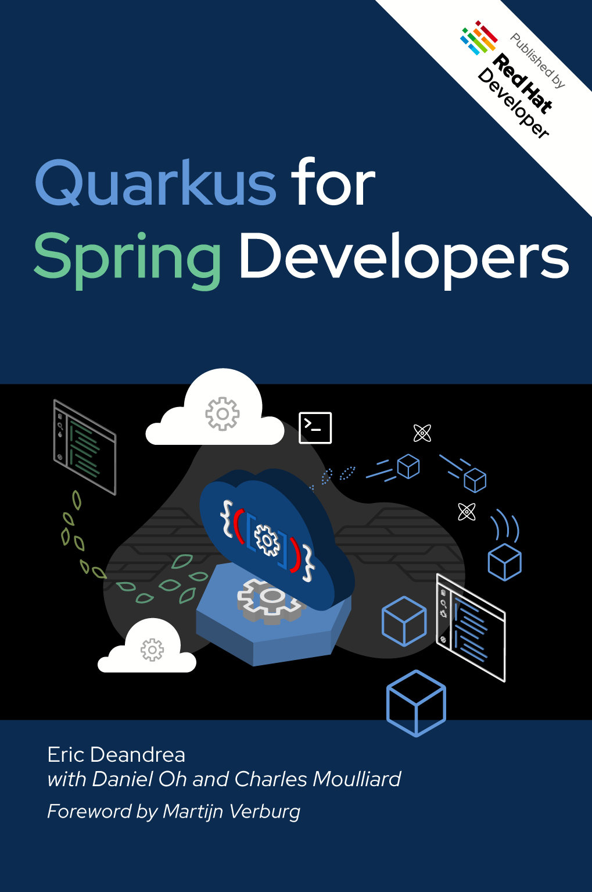
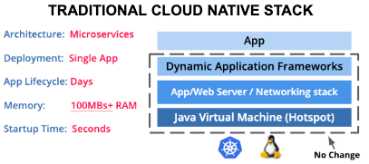
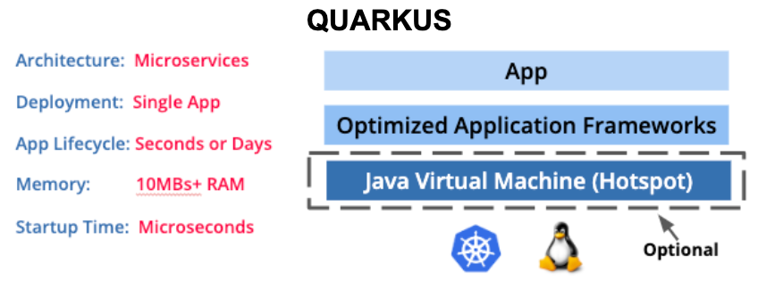

# Quarkus for Spring Developers

The arrival of Quarkus 1.0 brings an innovative platform for developing Linux container- and kubernetes-native Java microservices. Developers typically have to set aside their existing knowledge as they begin to evaluate new and innovative runtime frameworks. Quarkus is different because it was created by a collection of engineers with a deep expertise in a broad collection of Java technologies. This includes Spring API compatibility, brought to Quarkus by the same engineers that bring Spring Boot support to [Red Hat Runtimes](https://www.redhat.com/en/products/runtimes).

> [!TIP]
> 
>
> A free 140-page book, [Quarkus for Spring Developers](https://red.ht/quarkus-spring-devs), is now available that discusses this topic in greater, and updated, detail.

## I'm a Spring developer. Why Quarkus?

It is becoming increasingly apparent that containerization in general and Kubernetes in particular is forcing a re-evaluation of Java for the development of cloud native applications. Kubernetes is a  highly dynamic shared infrastructure that becomes more cost effective as the number of applications a cluster can host grows and the responsiveness to application lifecycle changes improves, like redeployments and scaling up/down. Traditional Java cloud native runtimes have layered new functionality on an existing stack, without really re-thinking the underlying stack itself. This results in larger memory consumption and slower startup times, to the point where organizations are now willing to forgo their deep Java expertise to retrain and retool for Go and Node.js to drive more value out of their large investment in Kubernetes clusters.



This is the very problem that Quarkus addresses.  Quarkus is optimized for memory density and rapid startup time. Quarkus applications running on the JVM can deliver nearly twice as many application instances in the same amount of RAM when compared to other cloud native Java stacks, and up to 7x more instances when packaged as a native binary. This is more than simply compiling to a native binary using [SubstrateVM](https://github.com/oracle/graal/tree/master/substratevm) (a feature of [GraalVM](https://www.graalvm.org/)). Quarkus has optimized traditionally “highly dynamic” frameworks for Kubernetes immutable infrastructure, resulting in reduced memory utilization and faster initialization. These optimized and [well-documented](https://quarkus.io/guides/) frameworks, called “extensions”, consist of best of breed and standard APIs. The result is [significant improvements in runtime efficiency](https://quarkus.io/assets/images/home/quarkus_metrics_graphic_bootmem_wide.svg).



## What existing knowledge can Spring developers bring to Quarkus?

Quarkus’ Spring API compatibility includes [Spring DI](https://quarkus.io/guides/spring-di-guide), [Spring Web](https://quarkus.io/guides/spring-web-guide), and [Spring Data JPA](https://quarkus.io/guides/spring-data-jpa-guide). Additional Spring APIs are being planned like Spring Security and Spring Config. When running on the JVM, Quarkus applications can utilize virtually any Java library. Many libraries, as long as they do not use Java reflection, will compile to native". Lombok, a popular library among Spring developers for example, works with native compilation. To be clear, the Spring API compatibility in Quarkus is not intended to be a complete Spring platform to re-host existing Spring applications. The intent is to offer enough Spring API compatibility to make developing new applications with Quarkus a natural getting started experience. When combined with pre-optimized extensions, Quarkus delivers an [amazing amount of functionality](https://quarkus.io/guides/) for microservices development. With all this being said, developers have successfully migrated Spring applications to Quarkus :-)

> [!IMPORTANT]
> The Spring Framework is highly dynamic in nature. To address this, the Quarkus Spring compatibility extensions map Spring APIs to APIs in existing extensions that have already been optimized for fast startup, reduced memory utilization and native compilation, like RestEasy and CDI. Also, the Quarkus Spring compatibility extensions do not utilize the Spring application context. For these reasons, attempting to utilize additional Spring libraries will likely not work.

**Quarkus Spring Web Example**

```java
import java.util.List;
import java.util.Optional;
import org.springframework.web.bind.annotation.*;

@RestController
@RequestMapping("/person")
public class PersonController {
    @GetMapping(path = "/greet/{id}", produces = "text/plain")
    public String greetPerson(@PathVariable(name = "id") long id) {
        String name="";
        // ...
        return name;
    }

    @GetMapping(produces = "application/json")
    public Iterable<Person> findAll() {
        return personRepository.findAll();
    }
```

**Quarkus Spring Repository Example**

```java
package org.acme.springmp;

import java.util.List;
import org.springframework.data.repository.CrudRepository;

public interface PersonRepository extends CrudRepository<Person, Long> {
    List<Person> findByAge(int age);
}
```

**Quarkus Spring Service + MicroProfile Fault Tolerance Example**

```java
import org.eclipse.microprofile.faulttolerance.Fallback;
import org.eclipse.microprofile.faulttolerance.Timeout;
import org.eclipse.microprofile.rest.client.inject.RestClient;
import org.springframework.beans.factory.annotation.Autowired;
import org.springframework.beans.factory.annotation.Value;
import org.springframework.stereotype.Service;

@Service                                            // Spring
public class PersonService {

    @Autowired                                      // Spring
    @RestClient                                     // MicroProfile
    SalutationMicroProfileRestClient salutationRestClient;

    @Value("${fallbackSalutation}")                 // Spring
    String fallbackSalutation;

    @CircuitBreaker(delay=5000, failureRatio=.5)    // MicroProfile
    @Fallback(fallbackMethod = "salutationFallback")// MicroProfile
    public String getSalutation() {
        return salutationRestClient.getSalutation();
    }
```

## Are there additional benefits for Spring developers?

In addition to the improved memory utilization and startup time, Quarkus offers the following benefits to Spring developers:

- **Function-as-a-Service (FaaS) Runtime.** When compiled to a native binary, Quarkus applications can start in under .0015 seconds, making it possible to use the existing Spring and Java API knowledge with FaaS functions. ([Azure](https://quarkus.io/guides/azure-functions-http), [AWS Lambda](https://quarkus.io/guides/amazon-lambda))
- **Live Coding.** Start with a “Hello World” sample app and transform it into a complex microservice without ever restarting the app. Just save and reload browser to see changes along the way. Quarkus live coding “just works” out of the box, regardless of IDE.
- **Support for reactive and imperative models.** Quarkus has a reactive core that supports the traditional imperative model, reactive model, or both in the same application.
- **Early detection of dependency injection errors.** Quarkus catches dependency injection errors during compilation instead of at runtime.
- **Use best of breed frameworks and standards together.** Quarkus supports Spring API compatibility, Eclipse Vert.x, MicroProfile (JAX-RS, CDI, etc), reactive streams and messaging, and more in the same application. Read [“@Autowire MicroProfile into Spring Boot”](https://developers.redhat.com/blog/2019/10/02/autowire-microprofile-into-spring-with-quarkus/) for using Spring and MicroProfile APIs together in the same project.

## How should Spring developers get started with Quarkus?

Recommended steps include:

- Follow the [Getting Started Guide](https://quarkus.io/get-started/) as a general Quarkus introduction.
- Follow the [Spring DI](https://quarkus.io/guides/spring-di-guide), [Spring Web](https://quarkus.io/guides/spring-web-guide), and [Spring Data JPA](https://quarkus.io/guides/spring-data-jpa-guide) guides.
- Create a new app using [code.quarkus.io](https://code.quarkus.io/).
- Optionally watch [Kubernetes Native Spring Apps on Quarkus](https://www.youtube.com/watch?v=9wJm8g83vqA&list=PLsM3ZE5tGAVYUKfQRUC6Gp61oV1WJEIPJ&index=10&t=0s) Devoxx presentation
