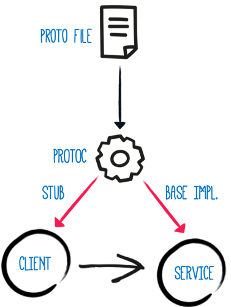

# gRPC with Quarkus!

In Quarkus 1.5, we shipped the first version of the [gRPC Quarkus extension](https://quarkus.io/guides/grpc-getting-started).

If you are not familiar with [gRPC](https://grpc.io/), it's a highly efficient Remote Procedure Call mechanism relying on HTTP/2 and [Protobuf](https://developers.google.com/protocol-buffers). You can implement and consume gRPC services from any language such as Go, JavaScript, Python, and Java. gRPC supports bi-directional streams of data as well as the more classical request-reply interation scheme. gRPC is particularly well suited for microservices. It provides support for authentication, tracing, and health, 3 major concerns when building microservice systems.

gRPC services are described in `proto` files listing the different methods (`Hello` in the following example) and defining the exchanged messages (`HelloRequest` and `HelloReply`):

```
syntax = "proto3";

option java_multiple_files = true;
option java_package = "io.quarkus.grpc.examples.helloworld";
option java_outer_classname = "HelloWorld";

package io.quarkus.grpc.example;

service Greeter {
    rpc Hello (HelloRequest) returns (HelloReply) {}
}

message HelloRequest {
    string name = 1;
}

message HelloReply {
    string message = 1;
}
```

`protoc`, the Proto Compiler, generates the stub (client) and base implementations (service) from these proto files for the different targetted languages:



To enable the gRPC support in Quarkus, add the `quarkus-grpc` extension. You can do that by adding the following dependency to your project or run the following command.

**The quarkus-grpc dependency**

```xml
<dependency>
  <groupId>io.quarkus</groupId>
  <artifactId>quarkus-grpc</artifactId>
</dependency>
```

**Add the quarkus-grpc extension to an existing project**

```bash
mvn quarkus:add-extension -Dextension=quarkus-grpc
```

Of course, you can also select `gRPC` from [the project generator](https://code.quarkus.io/).

> [!NOTE]
> At the moment, the extension does not cover the `protoc` generation, and you need to configure your project to do so. You can find an example [here](https://github.com/quarkusio/quarkus-quickstarts/blob/main/grpc-plain-text-quickstart/pom.xml).

The gRPC extension supports:

- implementing gRPC services
- consuming of gRPC services
- plain-text and TLS
- mutual authentication
- the gRPC health and reflection services
- the gRPC "bare" Java API and a Mutiny API that integrates with the reactive APIS from Quarkus.

Enough *blabla*, time to see it in action:

<iframe width="560" height="315" src="https://www.youtube.com/embed/anGcuMJPkQY" frameborder="0" allow="accelerometer; autoplay; encrypted-media; gyroscope; picture-in-picture" allowfullscreen></iframe>

The code shown in this video is available from this [GitHub project](https://github.com/cescoffier/quarkus-grpc-demo).

## More to come!

That's just the first step. We have plenty of ideas to make it better. First, we want to cover the `protoc` generation and improve the hot-reload experience by allowing modifying these `proto` files at development time. The support of custom compressors, load-balancers, and name resolvers are also on the roadmap.

We value your feedback a lot so please report bugs, ask for improvements...

If you are a Quarkus user or just curious, don't be shy and join our community:

\* provide feedback on [GitHub](https://github.com/quarkusio/quarkus/issues); \* craft some code and [push a PR](https://github.com/quarkusio/quarkus/pulls); \* discuss with us on [Zulip](https://quarkusio.zulipchat.com/) and on the [mailing list](https://groups.google.com/d/forum/quarkus-dev); \* ask your questions on [Stack Overflow](https://stackoverflow.com/questions/tagged/quarkus).
