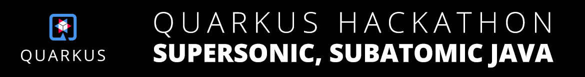

# Quarkus Global Hackathon

# Quarkus Global Hackathon

The Quarkus community is excited to announce the [Supersonic, Subatomic Java Hackathon](https://quarkus.devpost.com/) for developers to create Kubernetes-native applications for a chance to win **$30,000** in prizes. This hackathon is a great opportunity to learn about the future of cloud-native Java development and showcase your coding skills.

The Quarkus community and ecosystem have experienced tremendous growth since its inception.  The goal of the hackathon is to continue to grow this ecosystem by showcasing the framework and the developers who power it.

## Get Involved

There are a number of ways to participate including:

1. [Register](https://quarkus.devpost.com/) and submit an application showcasing the “greatness” of Quarkus

1. Support participating developers with questions and issue via the hackathon [Zulip chat room](https://quarkusio.zulipchat.com/#narrow/stream/243144-hackathon)

1. Participate and share your expertise during the weekly hackathon [Office Hours](https://YouTube.com/quarkusio/live)

1. Cheer on and congratulate the winners during the live judging and [awards ceremony](https://YouTube.com/quarkusio/live)

## Prize Categories ($30k)

• **Best Overall**: $10,000 • **Best Serverless App**: $5,000 • **Best Kubernetes-native App**: $5,000 • **Best IoT App**: $5,000 • **Best Migrated App**: $5,000

## Judges

[Adam Bien](https://twitter.com/AdamBien?s=20) (Java Champion, author, consultant)

[Jason Greene](https://twitter.com/jtgreene?s=20) (Red hat Distinguished Engineer, Quarkus Community Leader)

[Katia Aresti](https://twitter.com/karesti?s=20) (Java Champion, Red Hat Senior Software Engineer)

[Ken Johnson](https://www.linkedin.com/in/ken-johnson-kzj/) (Vice President, Red Hat Application Services)

## Enablement Sessions

(Wed, Jun 17th @ 10 AM EST) [Opening Ceremony](https://youtube.com/quarkusio/live)

(Mon, Jun 22nd) [DevNation Quarkus Master Course I - Quarkus Basics](https://developers.redhat.com/devnation/master-course/quarkus/?sc_cid=7013a000002gWC9AAM)

(Wed, Jun 24th) [DevNation Quarkus Master Course II - Quarkus Cloud-Native](https://developers.redhat.com/devnation/master-course/quarkus/?sc_cid=7013a000002gWC9AAM)

(Wed, Jul 1st @ 10 AM EST) [Quarkus Office Hours](https://youtube.com/quarkusio/live)

(Wed, Jul 8th @ 10 AM EST) [Quarkus Office Hours](https://youtube.com/quarkusio/live)

(Wed, Jul 15th @ 10 AM EST) [Quarkus Office Hours](https://youtube.com/quarkusio/live)

(Wed, Jul 22nd @ 10 AM EST) [Closing Ceremony](https://youtube.com/quarkusio/live)

(Fri, Aug 14th @ 10 AM - 12 PM EST) [Live Judging and Winner Announcement](https://youtube.com/quarkusio/live)

## **Happy Hacking!**
