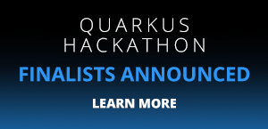

# Announcing Quarkus Supersonic, Subatomic Hackathon Finalist

## Quarkus Hackathon Finalists

The Quarkus community is excited to announce the finalists for the [Supersonic, Subatomic Java Hackathon](https://quarkus.devpost.com/). The submissions were outstanding and greatly exceeded our expectations. Thank you to all of the participants who submitted their Quarkus applications.

### Hackathon Highlights

• **330+** participants from **15+** countries • **35+** applicaitons submitted • **8+** hours of enablement and training sessions

#### The "Best Overall" and individual sub-category winners will be announced on Friday, August 21st @ 10 AM - 12 PM EDT via the [**Quarkus YouTube Live**](https://www.youtube.com/watch?v=j24uuhA3Wc8) channel.

##### The finalist selection committee had a hard time narrowing the list down but here they are (in no particular order):

### **Best Overall**

| [**TidePool**](https://devpost.com/software/appname-ybfhks) | [**PopulationHealth IoT**](https://devpost.com/software/mikro-minyma) | [**Slurpanize**](https://devpost.com/software/slurpanize) | [**Weblith**](https://devpost.com/software/weblith-io) |
| --- | --- | --- | --- |

### **Best Serverless**

| [**BrightAct Social Innovation**](https://devpost.com/software/brightact-app-againt-domestic-violence) | [**Quarkus Classify**](https://devpost.com/software/test-dy4jlx) |
| --- | --- |

### **Best Kubernetes-native**

| [**Slurpanize**](https://devpost.com/software/slurpanize) | [**TidePool**](https://devpost.com/software/appname-ybfhks) |
| --- | --- |

### **Best IoT**

| [**PopulationHealth IoT**](https://devpost.com/software/mikro-minyma) | [**Test Your Trivia**](https://devpost.com/software/test-your-trivia) |
| --- | --- |

### **Best Modernized**

| [**Weblith**](https://devpost.com/software/weblith-io) | [**Quarkus Spring Data JPA**](https://devpost.com/software/quarkus-spring-data-jpa-integration-no-api-no-panache) |
| --- | --- |
