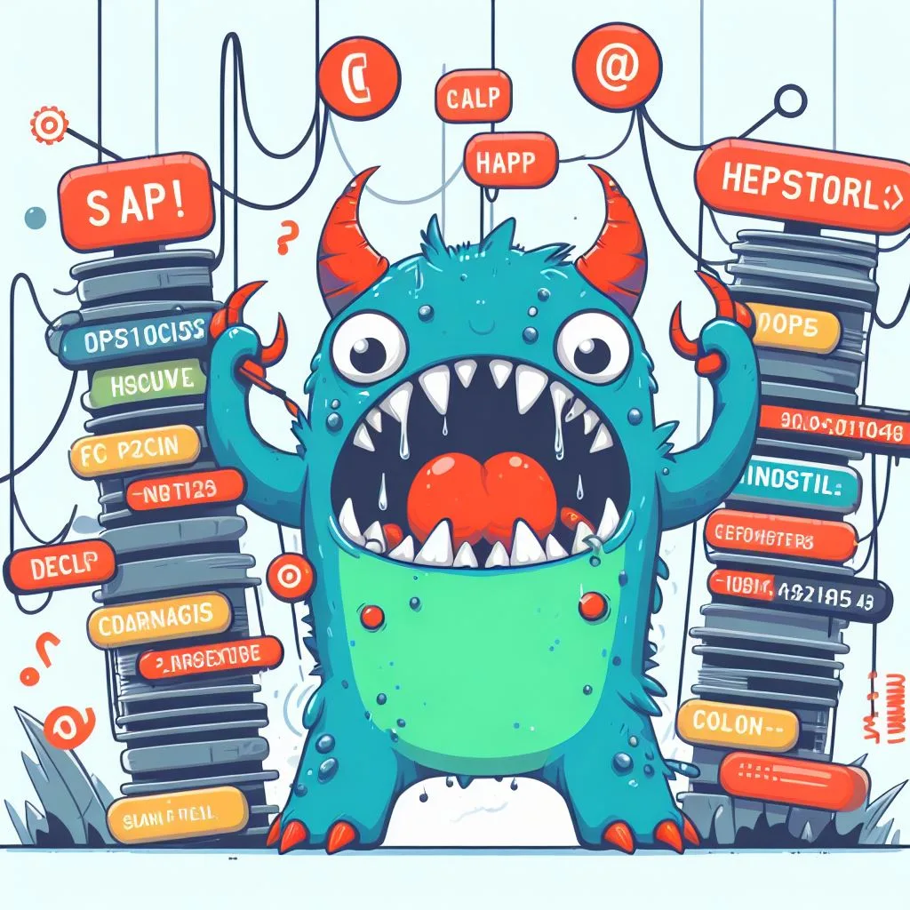
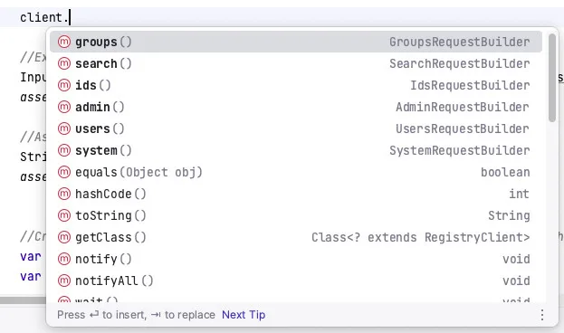

# The road to generated SDKs with Kiota using Quarkus

## The Challenge

Quarkus applications typically expose functionalities through API endpoints; here, we discuss how to easily consume those APIs and provide a smooth experience for our beloved users. While HTTP calls are easy to perform in any programming language and environment, when API complexity increases, and the number of available endpoints becomes uncountable, the need for better tools becomes apparent.



### Developer Experience Wishlist:

- Fully typed programmatic APIs that make discovering and invoking HTTP endpoints safe, expressive, and elegant
- An easy and idiomatic way to plug in various authentication mechanisms
- Smooth upgrades of the generated code when the description evolves

Looking at the learnings from big companies facing this issue at scale, a viable solution is to ship multiple language-specific SDKs (Software Development Kits), i.e. for Java, Python, Go, JavaScript etc. For years, companies have been paying developers to manually provide the abstraction layer, making cloud services functionalities more easily accessible. This approach adds up to the maintenance burden, increases the operational complexity of releases, and, worst, is tedious for developers.

To pave the way for better tooling, new standards are being defined in the computer industry. For building HTTP-based APIs, [OpenAPI](https://www.openapis.org) stands out as a widely adopted option. In the context of this article we are going to assume you already have an OpenAPI description of the service.

### Current Status in Quarkus

Quarkus already provides an expressive and fully integrated [Rest Client](https://quarkus.io/guides/rest-client-reactive) to enable you to craft HTTP calls beautifully. Additionally, the [quarkus-openapi-generator](https://github.com/quarkiverse/quarkus-openapi-generator) is a mature Quarkus extension designed to generate client code from OpenAPI. This option is recommended when a tight integration with Quarkus is your primary focus.

In this post, we will introduce an alternative solution that addresses the same problem but makes different trade-offs to prioritize consistency across languages and frameworks.

### A Story of Open Source Collaboration

#### Microsoft - Kiota

Recognizing the challenges faced by the industry in generating comprehensive and efficient SDKs for diverse APIs, the [Microsoft Graph](https://learn.microsoft.com/en-us/graph/overview) team took the lead and introduced [Kiota](https://github.com/microsoft/kiota), a CLI to streamline and automate the process of creating Software Development Kits (SDKs) for HTTP APIs.

Kiota, born and raised in the open source, fosters collaboration and is ground-up designed with [modularity](https://learn.microsoft.com/en-gb/openapi/kiota/design) in mind. The Kiota project's community is extra welcoming, and it has demonstrated to be easy to open an issue not only for bugs but also to improve over the design decisions.

Nowadays, Kiota demonstrates its value daily with the automated generation of SDKs for an incredible number of Microsoft services. More big industries, like [GitHub](https://github.blog/2024-01-03-our-move-to-generated-sdks/), are quickly following the lead.

#### Red Hat - Apicurio

Being focused on APIs and having products built with a contract-first approach from OpenAPI specifications, the Apicurio team from Red Hat joined the effort on Kiota. The collaboration led to important milestones, directly blossomed from this collaboration:

- To make the usage of the generated code almost indistinguishable from a human-crafted product, we thoroughly implemented language-specific mangling of names.
- To ease the fruition of the Kiota CLI from standard Java projects, we implemented a [Maven plugin](https://github.com/kiota-community/kiota-java-extra?tab=readme-ov-file#maven-plugin).
- To make frictionless the usage of Kiota on different and opinionated technological stacks, we ship alternative core libraries to let the user easily swap out from Microsoft's defaults (OkHttp + Gson): [Jackson Serde](https://github.com/kiota-community/kiota-java-extra?tab=readme-ov-file#serialization-jackson), [Vert.X Http](https://github.com/kiota-community/kiota-java-extra?tab=readme-ov-file#http-vertx), [JDK Http](https://github.com/kiota-community/kiota-java-extra?tab=readme-ov-file#http-jdk).
- To increase compatibility with alternative Java runtimes, we completely removed the usage of reflection from all of the internals. Thus, Kiota-generated SDKs are automatically, and with zero configuration, able to be compiled and run on [GraalVM native-image](https://www.graalvm.org/latest/reference-manual/native-image/).
- Feeling the pain of un-maintained and various levels of maturity of URI Templates implementations (internally used to compose URLs), we rolled out a [dependency-free unified library](https://github.com/std-uritemplate/std-uritemplate?tab=readme-ov-file#motivation) available for all of the languages Kiota supports.

Along with additional bug fixes and improvements, we finally achieved a sweet spot where Kiota can be easily integrated and leveraged by mainstream and mature software projects. [Apicurio Registry stands out among others](https://github.com/Apicurio/apicurio-registry) shipping (and extensively leveraging it in the tests) the generated [Java SDK](https://github.com/Apicurio/apicurio-registry/tree/main/java-sdk) along with the [Python SDK](https://github.com/Apicurio/apicurio-registry/tree/main/python-sdk) and the [Go SDK](https://github.com/Apicurio/apicurio-registry/tree/main/go-sdk).

### Quarkus Meet Kiota

Now that all the dots have been connected, the final and crucial step is a seamless integration with supersonic, subatomic applications leveraging Quarkus! This is the motivation behind the birth of the new ``quarkus-kiota`` extension. The project is in its early stages, and we encourage you to try it out and provide feedback.

The codebase lives in the [Quarkiverse](https://github.com/quarkiverse/quarkus-kiota), the project is listed in the [extensions](https://quarkus.io/extensions/io.quarkiverse.kiota/quarkus-kiota/) and the [docs](https://docs.quarkiverse.io/quarkus-kiota/dev/index.html) are available at the usual location.

Get started by adding this extension:

```
quarkus ext add io.quarkiverse.kiota:quarkus-kiota
```

Since it's a code generator extension, you will want to check the `generate-code` goal is present in the `quarkus-maven-plugin` `executions` section. Default Quarkus generated projects have it but custom or older projects might not:

```xml
<plugin>
  <groupId>io.quarkus</groupId>
  <artifactId>quarkus-maven-plugin</artifactId>
  <extensions>true</extensions>
  <executions>
    <execution>
      <goals>
        <goal>build</goal>
        <goal>generate-code</goal>
      </goals>
    </execution>
  </executions>
</plugin>
```

Add the necessary dependencies, we are going to replace the default HTTP and JSON serialization libraries published by Microsoft and swap in Vert.X and Jackson (published from this [repository](https://github.com/kiota-community/kiota-java-extra)) as they nicely play with the rest of the stack of a typical Quarkus based application.

```xml
<dependency>
  <groupId>com.microsoft.kiota</groupId>
  <artifactId>microsoft-kiota-abstractions</artifactId>
  <version>${kiota.libs.version}</version>
</dependency>
<dependency>
  <groupId>io.kiota</groupId>
  <artifactId>kiota-http-vertx</artifactId> <!-- alternatively <artifactId>kiota-http-jdk</artifactId> -->
  <version>{kiota-java-extra.version}</version>
</dependency>
<dependency>
  <groupId>io.kiota</groupId>
  <artifactId>kiota-serialization-jackson-quarkus</artifactId>
  <version>{kiota-java-extra.version}</version>
</dependency>
<dependency>
  <groupId>com.microsoft.kiota</groupId>
  <artifactId>microsoft-kiota-serialization-text</artifactId>
  <version>${kiota.libs.version}</version>
</dependency>
<dependency>
  <groupId>com.microsoft.kiota</groupId>
  <artifactId>microsoft-kiota-serialization-form</artifactId>
  <version>${kiota.libs.version}</version>
</dependency>
<dependency>
  <groupId>com.microsoft.kiota</groupId>
  <artifactId>microsoft-kiota-serialization-multipart</artifactId>
  <version>${kiota.libs.version}</version>
</dependency>
<dependency>
  <groupId>jakarta.annotation</groupId>
  <artifactId>jakarta.annotation-api</artifactId>
</dependency>
```

Now we need to generate the actual client for our OpenAPI description, to do so, you should drop the OpenAPI file (in ``yaml`` or ``json`` format) in the ``src/main/openapi`` folder of your project. You are all set to use the client in your application!

```java
import io.apisdk.example.yaml.ApiClient;
import io.kiota.http.vertx.VertXRequestAdapter;

var client = new ApiClient(new VertXRequestAdapter(vertx));
client.
```

striking ``.`` after client, the code completion of your IDE kicks in and provide you a beautiful, fully typed, builder pattern matching the endopoint descriptions provided in the OpenAPI specification.



For example an endpoint definition like [this one](https://github.com/Apicurio/apicurio-registry/blob/6882af10e9de8e1d245006db01f039b1fbf6355a/common/src/main/resources/META-INF/openapi-v2.json#L668) nicely unroll in Java as:

```java
client
  .groups()
  .byGroupId(groupId)
  .artifacts()
  .byArtifactId(artifactId)
  .meta()
  .get();
```

## Come Join Us

We value your feedback a lot so please report bugs, ask for improvements... Let's build something great together!

If you are a Quarkus-Kiota user or just curious, don't be shy and join our welcoming community:

\* provide feedback on [GitHub](https://github.com/quarkiverse/quarkus-kiota/issues); \* craft some code and [push a PR](https://github.com/quarkiverse/quarkus-kiota/pulls);
