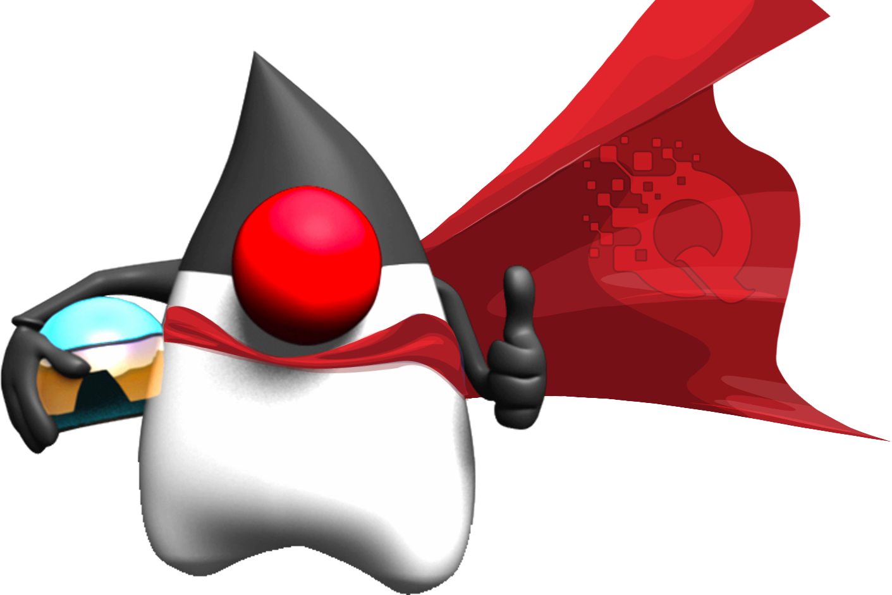
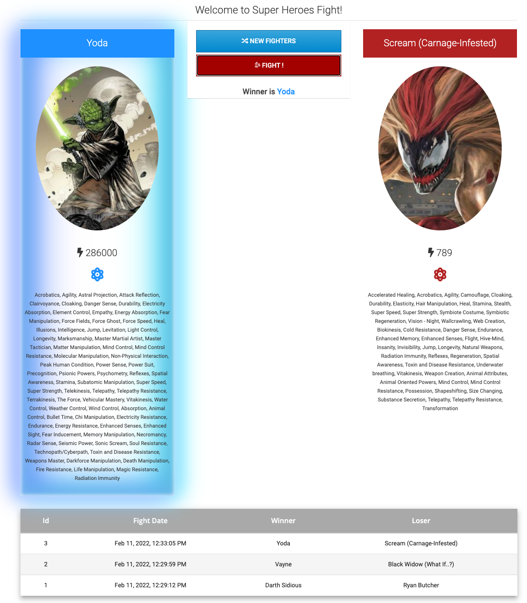
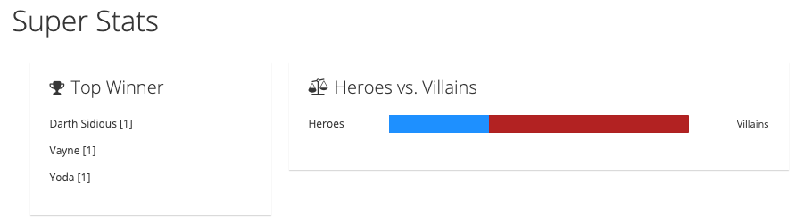
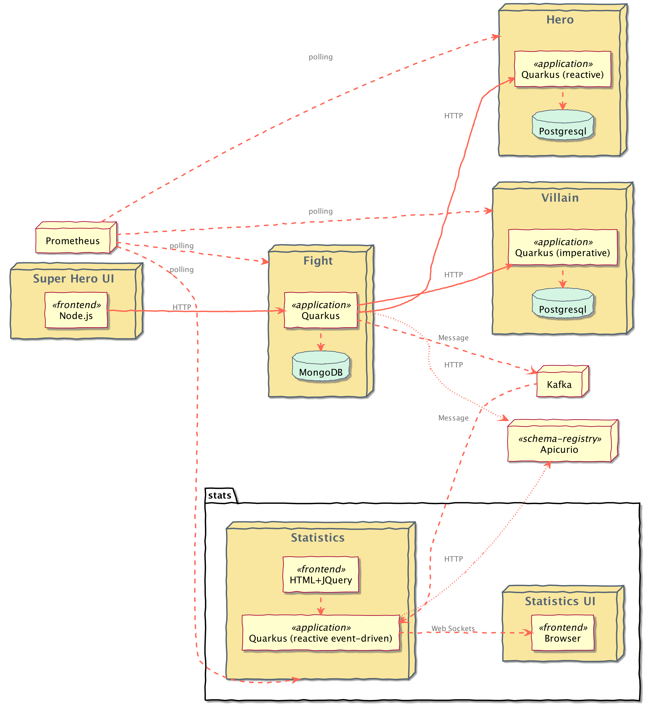

# Quarkus Superheroes to the Rescue!

# Quarkus Superheroes to the Rescue!

Are you a developer building microservices? Do you struggle with developing and testing individual microservices that are part of a larger system? Do you want to learn about building REST-based and event-driven applications?

## Introduction

Quarkus has excellent [documentation^](https://quarkus.io/guides) and [quickstarts^](https://github.com/quarkusio/quarkus-quickstarts) to help developers become familiar with various features in the Quarkus ecosystem. However, what was missing was a fully-implemented sample set of real-world applications that use these features, patterns, and best practices while also reflecting problems Quarkus is trying to solve.

This article introduces the [Quarkus Superheroes sample application^](https://github.com/quarkusio/quarkus-super-heroes), discusses some of the requirements for building it, and illustrates how to run it locally or deploy it to [Kubernetes^](https://kubernetes.io). You can also watch the [Quarkus Insights episode^](https://youtu.be/7M0Tvlx-GTA) where it was introduced.

### Requirements

In addition to simply being fun, some other requirements were essential as well:

- The overall architecture should be a multi-service microservices architecture.
- It needs to be more than “hello world” but not the “kitchen sink,” picking a set of common capabilities, such as [REST^](https://en.wikipedia.org/wiki/Representational_state_transfer), [WebSockets^](https://en.wikipedia.org/wiki/WebSocket), database interaction, messaging, [health checks^](https://quarkus.io/guides/smallrye-health), [monitoring/metrics^](https://quarkus.io/guides/micrometer), [Apache Avro^](https://quarkus.io/guides/kafka-schema-registry-avro), and [OpenAPI^](https://quarkus.io/guides/openapi-swaggerui) integration.
- The applications should be kept up-to-date with each Quarkus version and be part of the [standard Quarkus ecosystem continuous integration^](https://github.com/quarkusio/quarkus-ecosystem-ci) and shown on the [Quarkus status dashboard^](https://status.quarkus.io).
- There should be both blocking and reactive examples as much as possible.
- The system as a whole should
  - Be simple to build, run, deploy, and demo on a local developer machine or in Kubernetes.
  - Show how Quarkus can help facilitate local development of independent microservices.
  - Be contained in a [single GitHub repository^](https://github.com/quarkusio/quarkus-super-heroes) for simplicity, but **NOT** a multi-module project.
- Each application within the system should
  - Be simple to build, run, deploy, and demo on a local developer machine or in Kubernetes.
  - Provide [container images^](https://quay.io/quarkus-super-heroes) for Java versions 11 and 17, both JVM and native.
  - Be fully documented.
  - Have fully automated (and documented) CI/CD practices.
  - Contain a complete test suite of unit and integration tests.

## Initial Release

The initial version of the Quarkus Superheroes application was released in early February 2022. Several microservices co-exist to form a larger system, communicating synchronously via REST or event-driven via [Apache Kafka^](https://kafka.apache.org). Some of the applications are reactive, while others are more traditional, showcasing how to build each kind.

A web-based user interface, shown in Figure 1, allows superheroes to fight against supervillains. Previous fight outcomes are also shown on this page.

*Super Heroes User Interface*

An additional user interface, shown in Figure 2, displays previous fight statistics, including the percentage of wins for heroes vs. villains and the top 10 winners and the number of wins for each.

*Fight Statistics*

## Under the Cape!

Figure 3 shows the overall architecture of the application.

*Overall Architecture*

There are four Quarkus applications, each of which will be described further below, an [Angular^](http://angular.io/) application, and some backing services: [Prometheus^](https://prometheus.io), [PostgreSQL^](https://www.postgresql.org), [Apache Kafka^](https://kafka.apache.org), and [Apicurio Schema Registry^](https://www.apicur.io/registry).

### Hero Service

The Hero service is a fully reactive and non-blocking HTTP microservice exposing CRUD operations on a `Hero` data model. The REST layer is implemented using [RESTEasy Reactive^](https://quarkus.io/guides/resteasy-reactive) with reactive endpoints. Data is persisted into a [PostgreSQL^](https://www.postgresql.org) database using the [repository pattern^](https://quarkus.io/guides/hibernate-reactive-panache#solution-2-using-the-repository-pattern) from [Quarkus Hibernate Reactive with Panache^](https://quarkus.io/guides/hibernate-reactive-panache). Additionally, the Hero service favors [constructor injection^](https://quarkus.io/guides/cdi-reference#simplified-constructor-injection) of beans over [field injection^](https://quarkus.io/guides/cdi-reference#qualified-injected-fields). The Hero service contains a full suite of unit and integration tests, using [mocking^](https://quarkus.io/guides/getting-started-testing#further-simplification-with-injectmock), [spying^](https://quarkus.io/guides/getting-started-testing#using-spies-instead-of-mocks-with-injectspy), and testing within [isolated transactions^](https://quarkus.io/guides/hibernate-reactive-panache#transactions).

> [!NOTE]
> To ensure fast startup times, only 100 random heroes from the [3,458 total available heroes^](https://github.com/quarkusio/quarkus-super-heroes/blob/characterdata/all-heroes.sql) are loaded into the database. If you'd like to load more data, grab the [`all-heroes.sql` from the `characterdata` branch in the repo^](https://github.com/quarkusio/quarkus-super-heroes/blob/characterdata/all-heroes.sql). Copy the data into [`rest-heroes/src/main/resources/import.sql`^](https://github.com/quarkusio/quarkus-super-heroes/blob/main/rest-heroes/src/main/resources/import.sql) as well as into [`rest-heroes/deploy/db-init/initialize-tables.sql`^](https://github.com/quarkusio/quarkus-super-heroes/blob/main/rest-heroes/deploy/db-init/initialize-tables.sql).

### Villain Service

The Villain service is a blocking HTTP microservice exposing CRUD operations on a `Villain` data model. In fact, the `Villain` data model is identical to the `Hero` data model in the [Hero service](#hero-service) (other than the table's name). It also implements all the same use cases as the Hero service. The only difference is that the Villain service is blocking, and it uses the [active record pattern^](https://quarkus.io/guides/hibernate-orm-panache#solution-1-using-the-active-record-pattern) from [Quarkus Hibernate ORM with Panache^](https://quarkus.io/guides/hibernate-orm-panache).

The REST layer is implemented using [RESTEasy Reactive^](https://quarkus.io/guides/resteasy-reactive) with blocking endpoints. Data is persisted into a [PostgreSQL^](https://www.postgresql.org) database. The Villain service also creates some custom configurations which show how to use [`ConfigMapping`^](https://quarkus.io/guides/config-mappings) objects. Additionally, the Villain service favors [field injection^](https://quarkus.io/guides/cdi-reference#qualified-injected-fields) of beans over [constructor injection^](https://quarkus.io/guides/cdi-reference#simplified-constructor-injection). The Villain service contains a full suite of unit and integration tests, using [mocking^](https://quarkus.io/guides/getting-started-testing#further-simplification-with-injectmock), [spying^](https://quarkus.io/guides/getting-started-testing#using-spies-instead-of-mocks-with-injectspy), and testing within [isolated transactions^](https://quarkus.io/guides/getting-started-testing#tests-and-transactions).

> [!NOTE]
> To ensure fast startup times, only 100 random villains from the [1,797 total available villains^](https://github.com/quarkusio/quarkus-super-heroes/blob/characterdata/all-villains.sql) are loaded into the database. If you'd like to load more data, grab the [`all-villains.sql` from the `characterdata` branch in the repo^](https://github.com/quarkusio/quarkus-super-heroes/blob/characterdata/all-villains.sql). Copy the data into [`rest-villains/src/main/resources/import.sql`^](https://github.com/quarkusio/quarkus-super-heroes/blob/main/rest-villains/src/main/resources/import.sql) as well as into [`rest-villains/deploy/db-init/initialize-tables.sql`^](https://github.com/quarkusio/quarkus-super-heroes/blob/main/rest-villains/deploy/db-init/initialize-tables.sql).

### Fight Service

The Fight service is a fully reactive and non-blocking HTTP microservice exposing a RESTful API for performing fights between heroes and villains. The REST layer is implemented using [RESTEasy Reactive^](https://quarkus.io/guides/resteasy-reactive) with reactive endpoints. Fight data is persisted into a MongoDB database using the [active record pattern^](https://quarkus.io/guides/mongodb-panache#solution-1-using-the-active-record-pattern) from [Quarkus MongoDB Reactive with Panache^](https://quarkus.io/guides/mongodb-panache#reactive). The Fight service also favors [constructor injection^](https://quarkus.io/guides/cdi-reference#simplified-constructor-injection) of beans over [field injection^](https://quarkus.io/guides/cdi-reference#qualified-injected-fields).

The Fight service makes outgoing REST calls to both the Hero and Villain services. Calls to the Hero service use the [reactive rest client^](https://quarkus.io/guides/rest-client-reactive) while calls to the Villain service use the [RESTEasy Reactive client^](https://quarkus.io/guides/resteasy-reactive#resteasy-reactive-client), a [MicroProfile Rest Client^](https://download.eclipse.org/microprofile/microprofile-rest-client-3.0/microprofile-rest-client-spec-3.0.html) implementation of the [JAX-RS client API^](https://docs.oracle.com/javaee/7/tutorial/jaxrs-client001.htm) that is non-blocking at its core. All outgoing calls use [resilience patterns^](https://quarkus.io/guides/smallrye-fault-tolerance) such as [retry^](https://quarkus.io/guides/smallrye-fault-tolerance#adding-resiliency-retries), [timeout^](https://quarkus.io/guides/smallrye-fault-tolerance#adding-resiliency-timeouts), [fallback^](https://quarkus.io/guides/smallrye-fault-tolerance#adding-resiliency-fallbacks), and [circuit breaking^](https://quarkus.io/guides/smallrye-fault-tolerance#adding-resiliency-circuit-breaker).

Additionally, the Fight service [emits^](https://quarkus.io/guides/kafka#integrating-with-kafka-common-patterns) fight events in [Apache Avro^](https://avro.apache.org/docs/current) format to Kafka. The fight schema is automatically registered in an [Apicurio Schema Registry^](https://www.apicur.io/registry) by the [Quarkus Apicurio Avro extension^](https://quarkus.io/guides/kafka-schema-registry-avro).

The Fight service contains a full suite of unit and integration tests, using [mocking^](https://quarkus.io/guides/getting-started-testing#further-simplification-with-injectmock), [spying^](https://quarkus.io/guides/getting-started-testing#using-spies-instead-of-mocks-with-injectspy), and testing within [isolated transactions^](https://quarkus.io/guides/hibernate-reactive-panache#transactions). It also makes heavy use of [Wiremock^](https://wiremock.org/) for mocking downstream REST endpoints, an [in-memory Kafka connector^](https://quarkus.io/guides/kafka#testing-without-a-broker) for performing message verification within unit tests. It also shows how to [inject Dev Services information^](https://quarkus.io/guides/getting-started-testing#testing-dev-services) to configure test resources, such as a `KafkaConsumer`.

### Event Statistics Service

The Event Statistics Service is an event-driven microservice exposing a [WebSocket^](https://en.wikipedia.org/wiki/WebSocket) HTTP layer. It listens for fight events in [Apache Avro^](https://avro.apache.org/docs/current) format on a Kafka topic utilizing [SmallRye Reactive Messaging^](https://quarkus.io/guides/kafka). The fight schema is automatically registered in an [Apicurio Schema Registry^](https://www.apicur.io/registry) by the [Quarkus Apicurio Avro extension^](https://quarkus.io/guides/kafka-schema-registry-avro).

Statistic information is presented via a browser-based user interface, shown in Figure 2 above. Team statistics are accumulated as a percentage of wins by heroes vs. villains. Winner statistics are accumulated by the number of wins for each hero or villain, retaining the top 10 winners. The statistics are pushed to the UI over WebSockets.

The Event Statistics service contains a full suite of unit and integration tests using [mocking^](https://quarkus.io/guides/getting-started-testing#further-simplification-with-injectmock) and [spying^](https://quarkus.io/guides/getting-started-testing#using-spies-instead-of-mocks-with-injectspy). It also shows how to [inject Dev Services information^](https://quarkus.io/guides/getting-started-testing#testing-dev-services) to configure test resources, such as a `KafkaProducer`.

### Super Hero UI

The Super Hero UI application, shown in Figure 1 above, is an [Angular^](http://angular.io/) single-page application deployed via Node.js. It communicates to the Fight service via REST. The focus of the sample application is on the Quarkus applications and not the Angular UI.

## Run the Application Locally

There are a few ways to run the application locally depending on what your goals are. [Docker Compose^](https://docs.docker.com/compose) can be used if you want to run the [entire application](#running-the-entire-application), or a [subset of it](#running-a-subset-of-the-application), using the [pre-built container images^](https://quay.io/quarkus-super-heroes). Alternatively, each application can be [run from source](#running-locally-via-quarkus-dev-mode).

### Running Locally via Docker Compose

The entire application or a subset of it can be started with a single Docker Compose command.

#### Running the Entire Application

The [`deploy/docker-compose`^](https://github.com/quarkusio/quarkus-super-heroes/tree/main/deploy/docker-compose) directory in the [root of the respository^](https://github.com/quarkusio/quarkus-super-heroes) contains compose files for each of the four versions of the application: JVM 11, JVM 17, native built with Java 11, and native built with Java 17. Additionally, [Prometheus^](https://prometheus.io) monitoring can be started with the [supplied `monitoring.yml` file^](https://github.com/quarkusio/quarkus-super-heroes/blob/main/deploy/docker-compose/monitoring.yml).

From the +quarkus-super-heroes+ directory, simply run the [command based on the version of the application you want to run^](https://github.com/quarkusio/quarkus-super-heroes#running-locally-via-docker-compose). For example, to run the native Java 17 version, run `docker-compose -f deploy/docker-compose/native-java17.yml -f deploy/docker-compose/prometheus.yml up`.

The [`scripts`^](https://github.com/quarkusio/quarkus-super-heroes/tree/main/scripts) directory contains a [`watch-services.sh`^](https://github.com/quarkusio/quarkus-super-heroes/blob/main/scripts/watch-services.sh) script that can be run in a separate terminal. This script will watch the startup of all the services and report when they are all up and ready.

> [!NOTE]
> You may see errors as the applications start up. This may happen if one service completes startup before one of its required services (i.e. a database, Kafka broker, etc). Once everything completes startup things will work as intended.

The following URLs will be available once everything is ready:

- Super Heroes UI: [http://localhost:8080^](http://localhost:8080)
- Event statistics UI: [http://localhost:8085^](http://localhost:8085)
- Apicurio Schema Registry: [http://localhost:8086^](http://localhost:8086)
- Prometheus: [http://localhost:9090^](http://localhost:9090)
- Fight service: [http://localhost:8082^](http://localhost:8082)
- Hero service: [http://localhost:8083^](http://localhost:8083)
- Villain service: [http://localhost:8084^](http://localhost:8084)

#### Running a Subset of the Application

Each individual service can also be run via Docker Compose.

Inside each service’s subdirectory in the repository is a `deploy/docker-compose` directory containing the compose files for the four versions of the application. Multiple compose files can be combined into a single command.

This is useful if you wanted to, for example, work on the Fight service in [Quarkus Dev Mode^](https://quarkus.io/guides/maven-tooling#dev-mode) and need to have the Hero and Villain services available. From the `quarkus-super-heroes` directory, simply run the [command based on the version of the application you want to run^](https://github.com/quarkusio/quarkus-super-heroes/tree/main/rest-fights#only-downstream-dependencies). For example, to run the native Java 17 version, run `docker-compose -f rest-heroes/deploy/docker-compose/native-java17.yml -f rest-villains/deploy/docker-compose/native-java17.yml up`.

### Running Locally via Quarkus Dev Mode

Each of the services can also be run via [Quarkus Dev Mode^](https://quarkus.io/guides/maven-tooling#dev-mode) simultaneously. For each Quarkus service (`event-statistics`, `rest-fights`, `rest-heroes`, `rest-villains`) open a terminal, `cd` into the project directory, and run `./mvnw quarkus:dev`.

The Super Heroes UI can be [built and run from source^](https://github.com/quarkusio/quarkus-super-heroes/tree/main/ui-super-heroes#building-the-application), but since the focus of this article is Quarkus, we will run it as a container image. Open a new terminal and run `docker run -p 8080:8080 -e API_BASE_URL=http://localhost:8082 quay.io/quarkus-super-heroes/ui-super-heroes:latest`.

The following URLs will be available once everything is ready:

- Super Heroes UI: [http://localhost:8080^](http://localhost:8080)
- Event statistics UI: [http://localhost:8085^](http://localhost:8085)
- Fight service: [http://localhost:8082^](http://localhost:8082)
- Hero service: [http://localhost:8083^](http://localhost:8083)
- Villain service: [http://localhost:8084^](http://localhost:8084)

Now you have all the benefits of [Quarkus Dev Mode^](https://quarkus.io/guides/maven-tooling#dev-mode) and [Quarkus Continuous Testing^](https://quarkus.io/guides/continuous-testing) across the entire application at once! All backing infrastructure (databases, Kafka, Apicurio) is provisioned for you automatically by [Quarkus Dev Services^](https://quarkus.io/guides/dev-services).

## Deploy the Application to Kubernetes

Kubernetes descriptors are provided for various flavors of Kubernetes: [OpenShift^](https://www.openshift.com), [Minikube^](https://quarkus.io/guides/deploying-to-kubernetes#deploying-to-minikube), [KNative^](https://knative.dev), and “vanilla” [Kubernetes^](https://www.kubernetes.io).

> [!TIP]
> The only real difference between the Minikube and Kubernetes descriptors is that all the application ``Service``s in the Minikube descriptors use `type: NodePort` so that a list of all the applications can be obtained simply by running `minikube service list`.
>
> The KNative descriptors use [KNative Serving^](https://knative.dev/docs/serving) for each of the five applications.

Similar to Docker Compose, the [pre-built container images^](https://quay.io/quarkus-super-heroes) of the entire application, or a subset of it, can be deployed to Kubernetes with a single `kubectl apply -f` (or `oc apply -f` if using OpenShift).

The [`deploy/k8s`^](https://github.com/quarkusio/quarkus-super-heroes/tree/main/deploy/k8s) directory in the [root of the respository^](https://github.com/quarkusio/quarkus-super-heroes) contains Kubernetes descriptors for each of the four versions of the application: JVM 11, JVM 17, native built with Java 11, and native built with Java 17.

For example, to deploy the native Java 17 version to OpenShift, simply run `kubectl apply -f deploy/k8s/native-java17-openshift.yml` (or `oc apply -f deploy/k8s/native-java17-openshift.yml`).

To deploy Prometheus monitoring in addition to the application, `kubectl apply -f` (or `oc apply -f` if using OpenShift) the appropriate Prometheus Kubernetes descriptor based on the target Kubernetes environment: [`monitoring-openshift.yml`^](https://github.com/quarkusio/quarkus-super-heroes/blob/main/deploy/k8s/monitoring-openshift.yml), [`monitoring-minikube.yml`^](https://github.com/quarkusio/quarkus-super-heroes/blob/main/deploy/k8s/monitoring-minikube.yml), or [`monitoring-kubernetes.yml`^](https://github.com/quarkusio/quarkus-super-heroes/blob/main/deploy/k8s/monitoring-kubernetes.yml).

> [!NOTE]
> On Minikube or Kubernetes only the Super Heroes UI and the Fights service is exposed outside the cluster. If you want to access Prometheus or the Event Statistics service then you will need to expose it, either by using an `Ingress` or doing a `kubectl port-forward` of the Pod. On OpenShift, all of the applications have ``Route``s which expose them outside the cluster.

Additionally, individual applications can be deployed in a similar manner. Inside each service’s subdirectory in the repository is a `deploy/k8s` directory containing a similar matrix of Kubernetes descriptors.

> [!NOTE]
> These descriptors are **NOT** considered to be production-ready. They are basic enough to deploy and run the system with as little configuration as possible. The databases, Kafka broker, and schema registry deployed are not highly-available and do not use any Kubernetes operators for management or monitoring. They also only use ephemeral storage.
>
> For production-ready Kafka brokers, please see the [Strimzi documentation^](https://strimzi.io/) for how to properly deploy and configure production-ready Kafka brokers on Kubernetes. You can also try out a [fully hosted and managed Kafka service^](https://developers.redhat.com/products/red-hat-openshift-streams-for-apache-kafka/getting-started)!
>
> For a production-ready Apicurio Schema Registry, please see the [Apicurio Registry Operator documentation^](https://www.apicur.io/registry/docs/apicurio-registry-operator/1.0.0/index.html). You can also try out a [fully hosted and managed Schema Registry service^](https://console.redhat.com/application-services/service-registry)!
>
> For production-ready Prometheus instances, please see the [Prometheus Operator documentation^](https://operatorhub.io/operator/prometheus) for how to properly deploy and configure production-ready instances.

The possibilities are endless once deployed to Kubernetes! Reusing the same example above (developing the Fight service), you could use [Quarkus Remote Development Mode^](https://quarkus.io/guides/maven-tooling#remote-development-mode) to connect the remote instance to your local machine and get an experience similar to [Quarkus Dev Mode^](https://quarkus.io/guides/maven-tooling#dev-mode). No need to do any port forwarding!

## Want to Get Involved?

We’re always looking for involvement from the community! There is always a list of [enhancements^](https://github.com/quarkusio/quarkus-super-heroes/issues?q=is%3Aopen+is%3Aissue+label%3Aenhancement) and [bugs^](https://github.com/quarkusio/quarkus-super-heroes/issues?q=is%3Aopen+is%3Aissue+label%3Abug) to pick from if you’re interested in getting involved.
