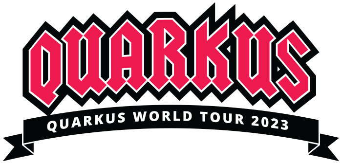

# Quarkus World Tour 2022 - The Road Never Ends

## For true rock stars, the road never ends.

We’re bringing the band back on the road to continue bringing our unique, hands-on experience with access to Quarkus experts designed to help you get started with Java in a Kubernetes world. Whether you are a Quarkus first-timer or seasoned pro, your JUG will love this show.

We’ll be playing some classics as well as some songs from the new releases(s).

Join us (virtually or live) as we tour Java User Groups across the globe for 90 minutes of technical discussion, some hands-on coding and a lively Q&A tailored to each JUG’s interests.

We are taking requests… if you had a tour stop before, we can create a new experience to give your JUG a fresh deeper look at Quarkus. No Freebird or Stairway to Heaven. ;)

Are we visiting a JUG near you? Then look out for their announcements or if not, get them to reach out to us and we’ll see if we can squeeze them in!

And yeah, we still have cool concert shirts and swag.

Keep rocking the Java world!

### Want a tour stop at your JUG?

Interested in having the Quarkus Tour come through your local Java User Group? Contact us today to get more details and make it happen.

[Sign up for a tour stop!](https://github.com/quarkusio/quarkus/discussions/23453)

### Want to help present?

Do you have Quarkus skills and want to join the band? Want to help present the shows? Become a Roadie and join the tour.

[Become a Roadie!](https://github.com/quarkusio/quarkus/discussions/23454)
