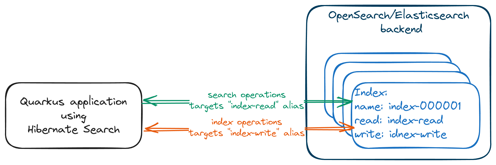
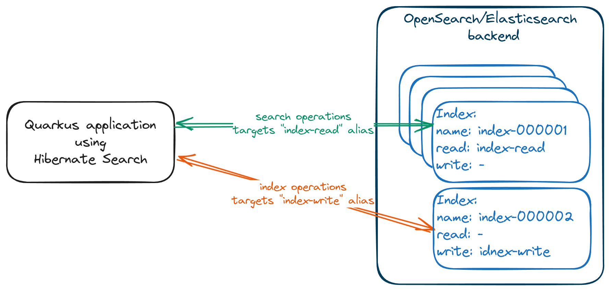
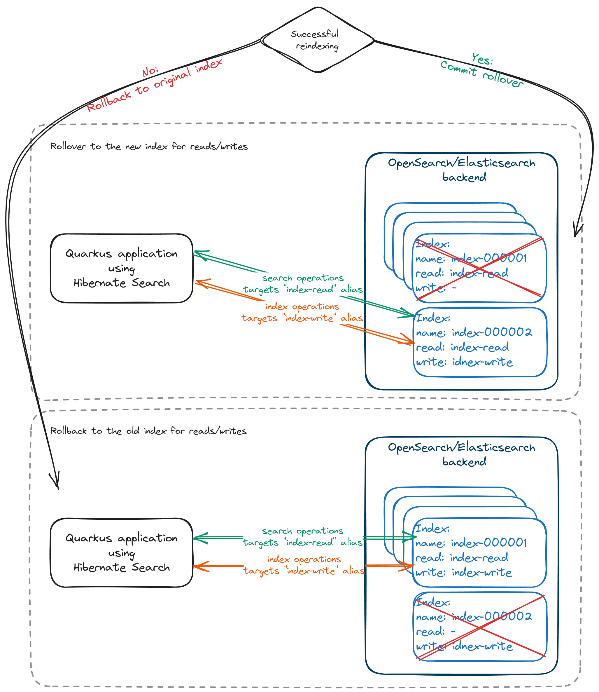

# Indexing rollover with Quarkus and Hibernate Search

This is the first post in the series diving into the implementation details of the [application](https://github.com/quarkusio/search.quarkus.io) backing the guide search of [quarkus.io](https://quarkus.io/guides/).

Does your application need full-text search capabilities? Do you need to keep your application running and producing search results without any downtime, even when reindexing all your data? Look no further. In this post, we'll cover how you can approach this problem and solve it in practice with a few low-level APIs, provided you use Hibernate Search, be it [on top of Hibernate ORM](https://quarkus.io/guides/hibernate-search-orm-elasticsearch) or [in standalone mode](https://quarkus.io/version/main/guides/hibernate-search-standalone-elasticsearch).

The approach suggested in this post is based on the fact that Hibernate Search uses [aliased indexes](https://docs.jboss.org/hibernate/search/7.0/reference/en-US/html_single/#backend-elasticsearch-indexlayout), and communicates with the actual index through a read/write alias, depending on the operation it needs to perform. For example, a search operation will be routed to a read index alias, while an indexing operation will be sent to a write index alias.



> [!NOTE]
> This approach is implemented and successfully used in our Quarkus application that backs the guides' search of [quarkus.io/guides/](https://quarkus.io/guides/). You can see the complete implementation here: [rollover implementation](https://github.com/quarkusio/search.quarkus.io/blob/d956b6a1341d8693fa1d6b7881f3840f48bdaacd/src/main/java/io/quarkus/search/app/indexing/Rollover.java#L44-L331) and [rollover usage](https://github.com/quarkusio/search.quarkus.io/blob/d956b6a1341d8693fa1d6b7881f3840f48bdaacd/src/main/java/io/quarkus/search/app/indexing/IndexingService.java#L226-L244).

Applications using Hibernate Search can keep their search indexes up-to-date by updating the index gradually, as the data on which the index documents are based is modified, providing a near real-time index synchronisation.

On the other hand, if the search requirements allow for a delay in synchronisation or the data is updated only at certain times of day, the option of mass indexing can effectively keep the indexes up-to-date. The [Hibernate Search documentation](https://docs.jboss.org/hibernate/search/7.0/reference/en-US/html_single/) provides more information about these approaches and other Hibernate Search capabilities.

The application discussed in this post is using the mass indexing approach. This means that at certain events, e.g., when a new version of the application is deployed or a scheduled time is reached, the application has to process the documentation guides and create search index documents from them.

Now, since we want our application to keep  providing results to any search requests while we add/update documents to the indexes, we cannot perform a simple reindexing operation using a [mass indexer](https://docs.jboss.org/hibernate/search/7.0/reference/en-US/html_single/#search-batchindex-massindexer), or the recently added [management endpoint in Quarkus](https://quarkus.io/guides/hibernate-search-orm-elasticsearch#management), as these would drop all existing documents from the index before indexing them: search operations would not be able to match them anymore until reindexing finishes.

Instead, we can create a new index with the same schema and route any write operations to it.



Since Hibernate Search does not provide the rollover feature out of the box ([yet](https://hibernate.atlassian.net/browse/HSEARCH-3499)) we will need to resort to using the lower-level APIs to access the Elasticsearch client and perform the required operations ourselves. To do so, we need to follow a few simple steps:

1. Get the mapping information for the index we want to reindex using the schema manager.

   ```
   @Inject
   SearchMapping searchMapping; //
   // ...

   searchMapping.scope(MyIndexedEntity.class).schemaManager() //
       .exportExpectedSchema((backendName, indexName, export) -> { //
           var createIndexRequestBody = export.extension(ElasticsearchExtension.get())
                   .bodyParts().get(0); //
           var mappings = createIndexRequestBody.getAsJsonObject("mappings"); //
           var settings =createIndexRequestBody.getAsJsonObject("settings"); //
       });
   ```

2. Inject `SearchMapping` somewhere in your app so that we can use it to access a schema manager.
3. Get a schema manager for the indexed entity we are interested in (`MyIndexedEntity`). If all entities should be targeted, then `Object.class` can be used to create the scope.
4. Use the export schema API to access the mapping information.
5. Use the extension to get access to the Elasticsearch-specific `.bodyParts()` method that returns a JSON representing the JSON HTTP body needed to create the indexes.
6. Get the mapping information for the particular index.
7. Get the settings for the particular index.

   1. Get the reference to the Elasticsearch client, so we can perform API calls to the search backend cluster:

   ```
   @Inject
   SearchMapping searchMapping; //
   // ...
   RestClient client = searchMapping.backend() //
       .unwrap(ElasticsearchBackend.class) //
       .client(RestClient.class); //
   ```

8. Inject `SearchMapping` somewhere in your app so that we can use it to access a schema manager.
9. Access the backend from a search mapping instance.
10. Unwrap the backend to the `ElasticsearchBackend`, so that we can access backend-specific APIs.
11. Get a reference to the Elasticsearch's rest client.

    1. Create a new index using the OpenSearch/Elasticsearch rollover API that would allow us to keep using the existing index for read operations, while write operations will be sent to the new index:

    ```
    @Inject
    SearchMapping searchMapping; //
    // ...

    SearchIndexedEntity<?> entity = searchMapping.indexedEntity(MyIndexedEntity.class);
    var index = entity.indexManager().unwrap(ElasticsearchIndexManager.class).descriptor(); //

    var request = new Request("POST", "/" + index.writeName() + "/_rollover"); //
    var body = new JsonObject();
    body.add("mappings", mappings);
    body.add("settings", settings);
    body.add("aliases", new JsonObject()); //
    request.setEntity(new StringEntity(gson.toJson(body), ContentType.APPLICATION_JSON));

    var response = client.performRequest(request); //
    //...
    ```

12. Inject `SearchMapping` somewhere in your app so that we can use it to access a schema manager.
13. Get the index descriptor to get the aliases from it.
14. Start building the rollover request body using the write index alias from the index descriptor.
15. Note that we are including an empty "aliases" so that the aliases are not copied over to the new index, except for the write alias (which is implicitly updated since the rollover request is targeting it directly). We don't want the read alias to start pointing to the new index immediately.
16. Perform the rollover API request using the Elasticsearch REST client obtained in the previous step.

    With this successfully completed, indexes are in the state we wanted:

    

    We can start populating our write index without affecting search requests.

    Once we are done with indexing, we can either commit or rollback depending on the results:

    

    Committing the index rollover means that we are happy with the results and ready to switch to the new index for both reading and writing operations while removing the old one. To do that, we need to send a request to the cluster:

    ```
    var client = ...

    var request = new Request("POST", "_aliases"); //
    request.setEntity(new StringEntity("""
            {
                "actions": [
                    {
                        "add": {  //
                            "index": "%s",
                            "alias": "%s",
                            "is_write_index": false
                        },
                        "remove_index": {  //
                            "index": "%s"
                        }
                    }
                ]
            }
            """.formatted( newIndexName, readAliasName, oldIndexName ) //
        , ContentType.APPLICATION_JSON));

    var response = client.performRequest(request); //
    //...
    ```

17. Get access to the Elasticsearch REST client as described above.
18. Start creating an `_aliases` API request.
19. Add an action to update the index aliases to use the new index for both read and write operations. Here, we must make the read alias point to the new index.
20. Add an action to remove the old index.
21. The names of the new/old index can be retrieved from the response of the initial `_rollover` API request, while the aliases can be retrieved from the index descriptor.

    Otherwise, if we have encountered an error or decided for any other reason to stop the rollover, we can roll back to using the initial index:

    ```
    var client = ...

    var request = new Request("POST", "_aliases"); //
    request.setEntity(new StringEntity("""
            {
                "actions": [
                    {
                        "add": {  //
                            "index": "%s",
                            "alias": "%s",
                            "is_write_index": true
                        },
                        "remove_index": {  //
                            "index": "%s"
                        }
                    }
                ]
            }
            """.formatted( oldIndexName, writeAliasName, newIndexName ) //
        , ContentType.APPLICATION_JSON));

    var response = client.performRequest(request); //
    //...
    ```

22. Get access to the Elasticsearch REST client as described above.
23. Start creating an `_aliases` API request.
24. Add an action to update the index aliases to use the old index for both read and write operations. Here, we must make the write alias point back to the old index.
25. Add an action to remove the new index.
26. The names of the new/old index can be retrieved from the response of the initial `_rollover` API request, while the aliases can be retrieved from the index descriptor.

    > [!NOTE]
    > Keep in mind that in case of a rollback, your initial index may be out of sync if any write operations were performed while the write alias was pointing to the new index.

    With this knowledge, we can organize the rollover process as follows:

    ```
    try (Rollover rollover = Rollover.start(searchMapping)) {
        // Perform the indexing operations ...
        rollover.commit();
    }
    ```

    Where the `Rollover` class will look as follows:

    ```
    class Rollover implements Closeable {
        public static Rollover start(SearchMapping searchMapping) {
            // initiate the rollover process by sending the _rollover request ...
            // ...
            return new Rollover( client, rolloverResponse );  //
        }

        @Override
        public void close() {
            if ( !done ) { //
                rollback();
            }
        }

        public void commit() {
            // send the `_aliases` request to switch to the *new* index
            // ...
            done = true;
        }

        public void rollback() {
            // send the `_aliases` request to switch to the *old* index
            // ...
            done = true;
        }
    }
    ```

27. Keep the reference to the Elasticsearch REST client to perform API calls.
28. If we haven't successfully committed the rollover, it'll be rolled back on close.

    Once again, for a complete working example of this rollover implementation, check out the [search.quarkus.io on GitHub](https://github.com/quarkusio/search.quarkus.io).

    If you find this feature useful and would like to have it built-in into your Hibernate Search and Quarkus apps feel free to reach out to us on the [pending feature requests](https://hibernate.atlassian.net/browse/HSEARCH-3499) to discuss your ideas and suggestions.

    Stay tuned for more details in the coming weeks as we publish more blog posts diving into other interesting implementation aspects of this application. Happy searching and rolling over!
