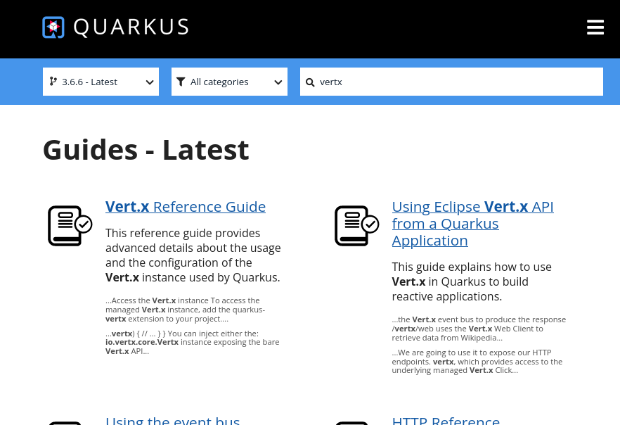

# Quarkus documentation, now with full-text search!

The Quarkus documentation has had a search feature for a long time, but until now it was a simple substring search on the title and summary of each guide. It was better than nothing, but admittedly quite limited.

We've recently improved on that. The [guides page](https://quarkus.io/guides/) now provides actual full-text search:

> [!NOTE]
> The feature is not yet available on [localized sites](https://quarkus.io/blog/l10n-of-quarkusio/), but will be in a few days, after their next sync.

Among the (many!) improvements:

- This is no longer a simple substring search, but state-of-the-art full-text search, with tokenization and text analysis (see how `vertx` matched `Vert.x` above?).
- Results are sorted by relevance, thanks to the ability of full-text to assign a score to each hit.
- Search takes into account the title and summary of each guide, but also the *full content of the guide's HTML page*.
- Matching terms get highlighted in the list of results, giving a glimpse of relevant content from each guide.

And the best part? This new search is backed by a [Quarkus app](https://github.com/quarkusio/search.quarkus.io)! It uses in particular the [Hibernate Search extension](https://quarkus.io/guides/hibernate-search-orm-elasticsearch), which provides [integration with OpenSearch/Elasticsearch](https://docs.jboss.org/hibernate/stable/search/reference/en-US/html_single/#elasticsearch-integration).

Stay tuned for more details in the coming weeks as we publish more blog posts to dive into the implementation details. In the meantime, happy searching! And feel free to drop by in the comments below if you notice weird behavior that you'd like to see fixed.
