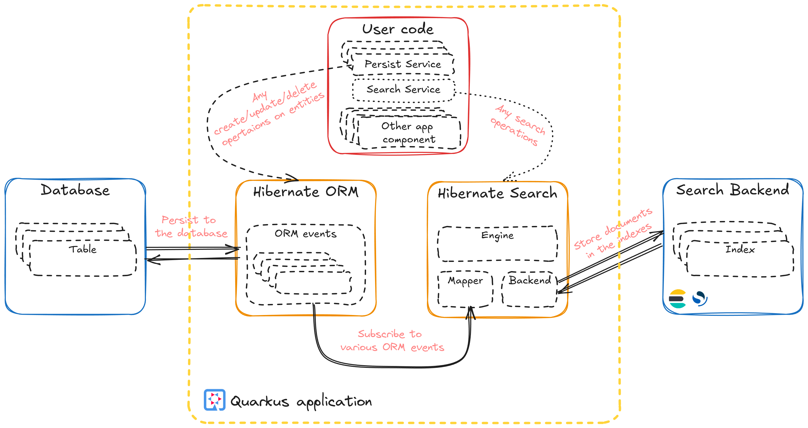
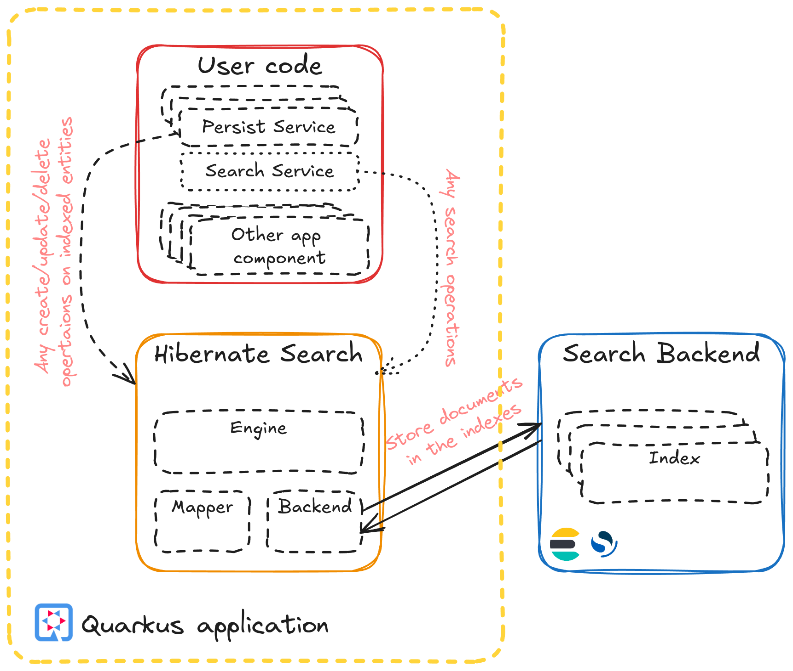
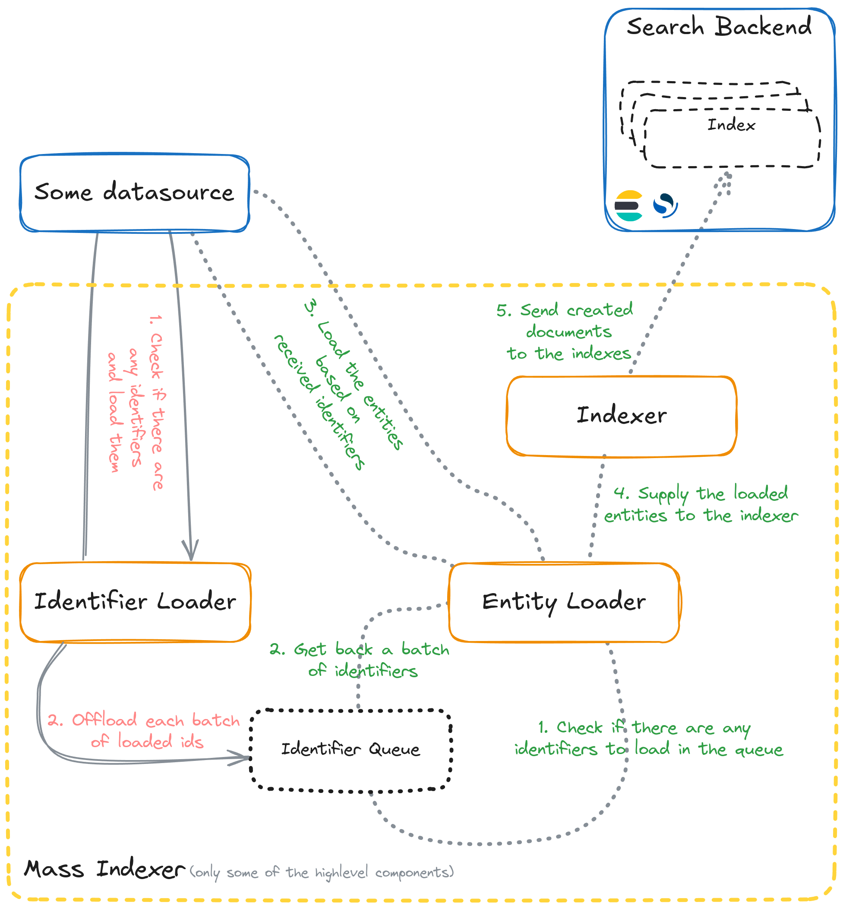

# Leveraging Hibernate Search capabilities in a Quarkus application without a database

This is the second post in the series diving into the implementation details of the [application](https://github.com/quarkusio/search.quarkus.io) backing the guide search of [quarkus.io](https://quarkus.io/guides/).

Hibernate Search is mainly known for its [integration with Hibernate ORM]({quarkus-hibernate-search-docs-url}), where it can detect the entity changes made through ORM and reflect them in the search indexes. But there is more to Hibernate Search than that.


*Hibernate Search integration with Hibernate ORM*

Not all applications that require search capabilities rely on databases to provide the source for the search indexes. Some applications rely on a NOSQL store where Hibernate ORM is not applicable, or even flat file storage. What can be done in these scenarios?

That's where the [Hibernate Search Standalone mapper](https://quarkus.io/guides/hibernate-search-standalone-elasticsearch) can come in handy. It was [recently](https://quarkus.io/blog/quarkus-3-10-0-released/) included as one of the Quarkus core extensions. This mapper allows domain entities to be annotated with Hibernate Search annotations and then uses the Search DSL's power to perform search operations and more.

With the release 3.10 of Quarkus, we've migrated our Quarkus application that backs the guides' search of [quarkus.io/guides/](https://quarkus.io/guides/) to the Standalone mapper and would like to share with you how to use this mapper to index the data coming from files and without knowing the total number of records to index. Please refer to the [guide](https://quarkus.io/guides/hibernate-search-standalone-elasticsearch) for a more in depth review of how to configure and use the mapper.


*Hibernate Search Standalone mapper*

Let's start by describing the task that this search application has to perform. The application's main goal is to provide search capabilities over the documentation guides. It obtains the required information about these guides from reading multiple files. We want to read the data just once, start indexing as soon as we can, and keep only as many records in memory as strictly necessary. We would also want to monitor the progress and report any exceptions that may occur during the indexing process. Hence, we would want to create a finite stream of data that we would feed to a [mass indexer](https://docs.jboss.org/hibernate/search/7.1/reference/en-US/html_single/#indexing-massindexer-basics), which will create the documents in the search index that we will later use to perform search operations.

Generally speaking, mass indexing can be as simple as:

```java
@Inject
SearchMapping searchMapping; //
// ...

var future = searchMapping.scope(Object.class) //
    .massIndexer() //
    .start(); //
```

1. Inject `SearchMapping` somewhere in your app so that it can be used to access Hibernate Search capabilities.
2. Create a scope targeting the entities that we plan to reindex. In this case, all indexed entities should be targeted; hence, the `Object.class` can be used to create the scope.
3. Create a mass indexer with the default configuration.
4. Start the indexing process. Starting the process returns a future; the indexing happens in the background.

For Hibernate Search to perform this operation, we must tell it how to load the indexed entities. We will use an `EntityLoadingBinder` to do that. It is a simple interface providing access to the binding context where we can define selection-loading strategies (for search) and mass-loading strategies (for indexing). Since, in our case, we are only interested in the mass indexer, it would be enough only to define the mass loading strategy:

```java
public class GuideLoadingBinder implements EntityLoadingBinder {

    @Override
    public void bind(EntityLoadingBindingContext context) { //
        context.massLoadingStrategy(Guide.class, new MassLoadingStrategy<Guide, Guide>() { //
            // ...
        });
    }
}
```

1. Implement the single `bind(..)` method of the `EntityLoadingBinder`.
2. Specify the mass loading strategy for the `Guide` search entity. We'll discuss the implementation of the strategy later in this post.

And then, with the entity loading binder defined, we can simply reference it within the `@SearchEntity` annotation:

```java
@SearchEntity(loadingBinder = @EntityLoadingBinderRef(type = GuideLoadingBinder.class)) //
@Indexed( ... )
public class Guide {
    @DocumentId
    public URI url;

    // other fields annotated with various Hibernate Search annotations,
    // e.g. @KeywordField/@FullTextField.
}
```

1. Reference the loading binder implementation by the type. As with many other Hibernate Search components, a CDI bean reference can be used here instead by providing the bean name, for example, if the loading binder requires access to some CDI beans and is a CDI bean itself.

That is all that is needed to tie things together. The only open question is how to implement the mass loading strategy. Let's first review how the mass indexer works on a high level:


*High level mass indexer flow*

Implementing the mass loading strategy requires providing an identifier and entity loaders. As already mentioned, in our case, we want a data stream that reads the information from files and does the reading part just once. Hence, we want to avoid decoupling the id/entity reading steps. While the identifier loader's contract suggests that it should provide the batch of identifiers to the sink, nothing prevents us from passing a batch of actual entity instance instead. It is acceptable to do in this case since we are only interested in the mass loading; we are not implementing a selection loading strategy that would be used when searching. Now, if the identifier loader provides actual entity instances, the entity loader has nothing more to do than just pass through the batch of received "identifiers", which are actual entities, to the entity sink.

With that in mind, the mass-loading strategy may be implemented as:

```java
new MassLoadingStrategy<Guide, Guide>() {
    @Override
    public MassIdentifierLoader createIdentifierLoader(LoadingTypeGroup<Guide> includedTypes,
            MassIdentifierSink<Guide> sink, MassLoadingOptions options) {
            // ...  //
        };
    }

    @Override
    public MassEntityLoader<Guide> createEntityLoader(LoadingTypeGroup<Guide> includedTypes,
            MassEntitySink<Guide> sink,
            MassLoadingOptions options) {
        return new MassEntityLoader<Guide>() { //
            @Override
            public void close() {
                // noting to do
            }

            @Override
            public void load(List<Guide> guides) throws InterruptedException {
                sink.accept(guides); //
            }
        };
    }
})
```

1. We'll look at the implementation of the identifier loader in the following code snippet as it is slightly trickier than the pass-through entity loader. Hence, we would want to take a closer look at it.
2. An implementation of the pass-through entity loader.
3. As explained above, we treat the search entities as identifiers and simply pass the entities we receive to the sink.

> [!NOTE]
> If passing entities as identifiers feels like a hack, it's because it is. Hibernate Search will, at some point, provide alternative APIs to achieve this more elegantly: [HSEARCH-5209](https://hibernate.atlassian.net/browse/HSEARCH-5209)

Since the guide search entities are constructed from the information read from a file, we have to somehow pass the stream of these guides to the identifier loader. We could do this by using the `MassLoadingOptions options`. These mass loading options provide access to the context objects passed to the mass indexer by the user.

```java
@Inject
SearchMapping searchMapping; //
// ...

var future = searchMapping.scope(Object.class) //
    .context(GuideLoadingContext.class, guideLoadingContext) //
    // ...
    .massIndexer() //
    .start(); //
```

1. Inject `SearchMapping` somewhere in your application.
2. Create a scope, as usual.
3. Pass the context object to the mass indexer that knows how to read the files, and is able to provide the batches of `Guide` search entities. See the following code snippet for an example of how such context can be implemented.
4. Set any other mass indexer configuration options as needed.
5. Create a mass indexer.
6. Start the indexing process.

```java
public class GuideLoadingContext {

    private final Iterator<Guide> guides;

    GuideLoadingContext(Stream<Guide> guides) {
        this.guides = guides.iterator(); //
    }

    public List<Guide> nextBatch(int batchSize) {
        List<Guide> list = new ArrayList<>();
        for (int i = 0; guides.hasNext() && i < batchSize; i++) {
            list.add(guides.next()); //
        }
        return list;
    }
}
```

1. Get an iterator from the finite data stream of guides.
2. Read the next batch of the guides from the iterator. We are using the batch size limit that we will retrieve from the mass-loading options and checking the iterator to see if there are any more entities to pull.

Now, having the way of reading the entities in batches from the stream and knowing how to pass it to the mass indexer, implementing the identifier loader can be as easy as:

```java
@Override
public MassIdentifierLoader createIdentifierLoader(LoadingTypeGroup<Guide> includedTypes,
        MassIdentifierSink<Guide> sink, MassLoadingOptions options) {
    var context = options.context(GuideLoadingContext.class); //
    return new MassIdentifierLoader() {
        @Override
        public void close() {
            // nothing to do
        }

        @Override
        public long totalCount() {
            return 0; //
        }

        @Override
        public void loadNext() throws InterruptedException {
            List<Guide> batch = context.nextBatch(options.batchSize()); //
            if (batch.isEmpty()) {
                sink.complete();  //
            } else {
                sink.accept(batch); //
            }
        }
    };
}
```

1. Retrieve the guide loading context that is expected to be passed to the mass indexer. (e.g. `.context(GuideLoadingContext.class, guideLoadingContext)`)
2. We do not know how many guides there will be until we finish reading all the files and completing the indexing, so we'll just pass `0` here.

   The information is not critical: it's only used to monitor progress.

   > [!NOTE]
   > This is one of the areas that we plan to improve; see [one of the improvements we are currently working on](https://hibernate.atlassian.net/browse/HSEARCH-5180).

3. Request the next batch of guides. `options.batchSize()` will provide us with the value configured for the current mass indexer.
4. If the batch is empty, it means that the stream iterator has no more guides to return. Hence, we can notify the mass indexing sink that no more items will be provided by calling `.complete()`.
5. If there are any guides in the loaded batch, we'll pass them to the sink to be processed.

To sum up, here is a summary of the steps to take to index an unknown number of search entities from a datasource while reading each entity only once, and without relying on lookups by identifier:

1. Start by creating a loader binder and let Hibernate Search know about it via the `@SearchEntity` annotation.
2. Implement a mass loading strategy (`MassLoadingStrategy`) that includes: - An identifier loader that does all the heavy lifting and actually constructs entire entities. - An entity loader that simply passes through the entities loaded by the identifier loader to the indexing sink.
3. Supply through the mass indexer context any helpful services, resources, helpers, etc., that are used to load the data. And access them in the loaders through `options.context(..);`
4. With everything in place, run the mass indexing as usual.

For a complete working example of this approach, check out the [search.quarkus.io on GitHub](https://github.com/quarkusio/search.quarkus.io).

Please note that some of the features discussed in this post are still incubating and may change in the future. In particular, we've already identified and are working on possible [improvements](https://hibernate.atlassian.net/browse/HSEARCH-5180) for mass indexing of a finite data stream, where the total size of entities is unknown beforehand. If you find the approach described in the post interesting and have similar use cases, we encourage you to give it a try. Feel free to reach out to us to discuss your ideas and suggestions for other improvements, if any.

Stay tuned for more details in the coming weeks as we publish more blog posts exploring other interesting implementation aspects of this application. Happy searching and mass indexing!
