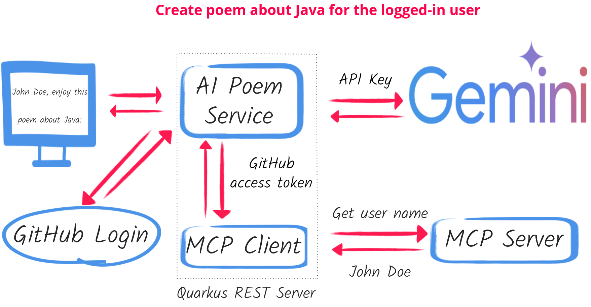
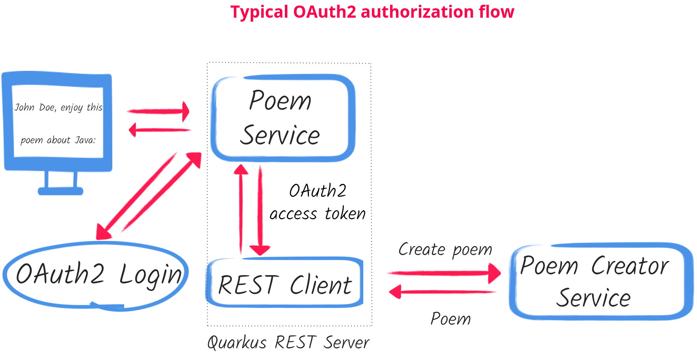
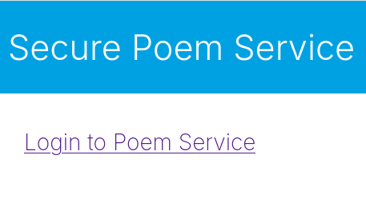
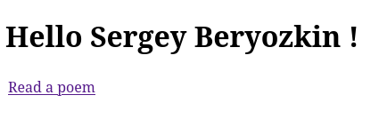
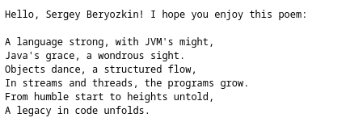

# Use Quarkus MCP client to access secure MCP HTTP servers

## Introduction

MCP servers that use the *Streamable HTTP* or HTTP/SSE transports may require MCP client authentication.

In the [Getting ready for secure MCP with Quarkus MCP Server](https://quarkus.io/blog/secure-mcp-sse-server/) blog post, we explained how to enforce MCP client authentication with the [Quarkus MCP Server](https://github.com/quarkiverse/quarkus-mcp-server) and demonstrated how [MCP Server DevUI](https://quarkus.io/blog/secure-mcp-sse-server/#mcp-server-devui) can use Keycloak access tokens to access the MCP server in dev mode and how [MCP Inspector](https://quarkus.io/blog/secure-mcp-sse-server/#mcp-inspector) and [curl](https://quarkus.io/blog/secure-mcp-sse-server/#use-curl-to-access-the-mcp-server) can use GitHub access tokens to access the MCP server in prod mode.

In this blog post, we will explain how [Quarkus MCP Client](https://docs.quarkiverse.io/quarkus-langchain4j/dev/mcp.html) can use access tokens to access secure MCP servers.

We will show how to log in to Quarkus LangChain4j AI `Poem Service` application with GitHub OAuth2 and have Google AI Gemini use tools with the help from Quarkus MCP Client that can propagate the GitHub access token to the secure Quarkus MCP Server.

<a id="demo-architecture"></a>
## Demo architecture



As you can see in the diagram above, the user logs in into the Quarkus REST `Poem Service` application endpoint. To support the user request to create a poem, the `Poem Service` uses `AI Gemini` and requests `MCP Client` to complete a tool call to help `AI Gemini` to find out the name of the logged-in user.

An essential point is that both `Poem Service` and `MCP Client` are part of the same single Quarkus REST application that only users who logged in with GitHub can access. The users do not login to `MCP Client`, they login to the `Poem Service` application, using the `MCP client` is an implementation detail of how this application completes the user request.

Therefore, this demo does not demonstrate an implementation of the [MCP Authorization](https://modelcontextprotocol.io/specification/2025-03-26/basic/authorization) flow which is primarily of interest to public MCP clients implemented as Single-page applications (SPA), such as as Anthropic Claude, that will be able to initiate a user login into an imported MCP server.

This demo shows a typical `OAuth2` authorization code flow where a user logs-in to a REST endpoint and authorizes it to access another service on the user's behalf. It also strengthens the message about the [AI security being an integral part of your application security](https://quarkus.io/blog/gemini-personal-assistant/#integrated-ai-security).

For example, let's temporarily update the diagram by removing the `AI Gemini`, replacing `MCP Client` with `REST Client`, `MCP Server` with `Poem Creator service` and `GitHub` with `OAuth2`:



You will very likely find similarities between this diagram and what you do in your projects. It is the OAuth2 authorization code flow in action: the user logs in to the application and authorizes it to access another service offering a poem creation on the user's behalf.

The demo shows that Quarkus MCP Client can work effectively in such architectures by being able to use access tokens acquired during the user login, without you having to write any custom code.

We are now ready to start working on the `Secure MCP Client Server` demo.

You can find the complete project source in the [Quarkus LangChain4j Secure MCP Client Server sample](https://github.com/quarkiverse/quarkus-langchain4j/tree/main/samples/secure-mcp-client-server).

<a id="create-mcp-server"></a>
## Step 1 - Create and start MCP server

First, let's create a secure Quarkus MCP SSE server.

> [!NOTE]
> If you already created the MCP server [as described](https://quarkus.io/blog/secure-mcp-sse-server/#initial-mcp-server) in the the [Getting ready for secure MCP with Quarkus MCP Server](https://quarkus.io/blog/secure-mcp-sse-server/) blog post, then you will find instructions below familiar and should be able to reuse the project you created earlier with minor updates.

MCP server requires authentication to establish Server-Sent Events (SSE) connection and also when invoking the tools. Additionally, the MCP server endpoint that provides access to tools requires that the security identity has a `read:name` permission.

<a id="mcp-server-dependencies"></a>
### MCP server maven dependencies

Add the following dependencies:

```xml
<dependency>
    <groupId>io.quarkiverse.mcp</groupId>
    <artifactId>quarkus-mcp-server-sse</artifactId> <1>
    <version>1.1.1</version>
</dependency>
<dependency>
    <groupId>io.quarkus</groupId>
    <artifactId>quarkus-oidc</artifactId> <2>
</dependency>
<dependency>
    <groupId>io.quarkus</groupId>
    <artifactId>quarkus-hibernate-orm-panache</artifactId> <3>
</dependency>
<dependency>
    <groupId>io.quarkus</groupId>
    <artifactId>quarkus-jdbc-postgresql</artifactId> <3>
</dependency>
```

1. `quarkus-mcp-server-sse` is required to support MCP SSE transport.
2. `quarkus-oidc` is required to secure access to MCP SSE endpoints. Its version is defined in the Quarkus BOM.
3. `quarkus-hibernate-orm-panache` and `quarkus-jdbc-postgresql` are required to support the [Security Identity Augmentation](#security-identity-augmentation). Their versions are defined in the Quarkus BOM.

<a id="mcp-server-tool"></a>
### MCP server tool

Let's create a tool that can return the name of the currently logged-in user. It can be invoked only if the current MCP request is authenticated but also if the security identity has a `read:name` permission:

```java
package io.quarkiverse.langchain4j.sample;

import io.quarkiverse.mcp.server.TextContent;
import io.quarkiverse.mcp.server.Tool;
import io.quarkus.security.PermissionsAllowed;
import io.quarkus.security.identity.SecurityIdentity;
import jakarta.inject.Inject;

public class UserNameProvider {

    @Inject
    SecurityIdentity securityIdentity;
    
    @Tool(name = "user-name-provider", description = "Provides a name of the currently logged-in user") <1>
    @PermissionsAllowed("read:name") <2>
    TextContent provideUserName() {
        return new TextContent(securityIdentity.getPrincipal().getName()); <3>
    }
}
```

1. Provide a tool that can return the name of the current user.
2. Require authenticated tool access with an additional authorization `read:name` permission constraint - yes, the only difference with an unauthenticated MCP server tool is `@PermissionsAllowed("read:name")`, that's it! See also how the main MCP SSE endpoint is secured in the [MCP Server Configuration](#mcp-server-configuration) section below.
3. Use the injected `SecurityIdentity` to return the current user's name. Alternatively, it can be acquired from the injected `quarkus.oidc.UserInfo`.

<a id="security-identity-augmentation"></a>
### Security Identity Augmentation

To meet the `@PermissionsAllowed("read:name")` authorization constraint, the security identity created after verifying the GitHub access token must be augmented to have a `read:name` permission.

The demo expects that a database has a record with a GitHub account name and the assigned permission. The security identity augmentor uses the identity name to retrieve this record and enhance the identity with the discovered permission.

Let's see how this rather complex task can be easily achieved in Quarkus.

First, we create a Panache entity that keeps the account name and permission values:

```java
package io.quarkiverse.langchain4j.sample;

import io.quarkus.hibernate.orm.panache.PanacheEntity;
import jakarta.persistence.Column;
import jakarta.persistence.Entity;

@Entity
public class Identity extends PanacheEntity {
    @Column(unique = true)
    public String name;
    public String permission;

    public static Identity findByName(String name) { <1>
        return find("name", name).firstResult();
    }
}
```

1. Utility method to find an identity record with a matching GitHub account name.

Second, we create an `import.sql` script to have a demo record added to the database:

```properties
INSERT INTO identity(id, name, permission) VALUES (1, '${user.name}', 'read:name'); <1>
```

1. Insert a demo record. You will provide your GitHub account name when starting MCP server.

Finally, we create a security identity augmentor:

```java
package io.quarkiverse.langchain4j.sample;

import io.quarkus.security.identity.AuthenticationRequestContext;
import io.quarkus.security.identity.SecurityIdentity;
import io.quarkus.security.identity.SecurityIdentityAugmentor;
import io.quarkus.security.runtime.QuarkusSecurityIdentity;
import io.smallrye.mutiny.Uni;
import jakarta.enterprise.context.ApplicationScoped;
import jakarta.enterprise.context.control.ActivateRequestContext;
import jakarta.inject.Inject;

@ApplicationScoped
public class SecurityIdentityPermissionAugmentor implements SecurityIdentityAugmentor { <1>

    @Inject 
    HibernateBlockingAugmentor hibernateBlockingAugmentor;

    @Override
    public Uni<SecurityIdentity> augment(SecurityIdentity identity, AuthenticationRequestContext context) {
        return context.runBlocking(() -> hibernateBlockingAugmentor.augment(identity)); <2>
    }

    @ApplicationScoped
    static class HibernateBlockingAugmentor {

        @ActivateRequestContext
        public SecurityIdentity augment(SecurityIdentity securityIdentity) {
            Identity identity = Identity.findByName(securityIdentity.getPrincipal().getName()); <3>
            
            QuarkusSecurityIdentity.Builder builder = QuarkusSecurityIdentity.builder(securityIdentity); <4>
            return builder.addPermissionAsString(identity.permission).build(); <5>
        }
    }
}
```

1. Custom `SecurityIdentityAugmentor` can augment the already verified security identity.
2. Run the augmentation in a blocking mode because it requires access to the database.
3. Find the recorded `Identity` matching the current user's name.
4. Initialize a security identity builder from the current identity.
5. Add the permission allocated to this user and create an updated `SecurityIdentity`.

This is all, the augmentation step is done with a few lines of code only.

<a id="mcp-server-configuration"></a>
### MCP Server Configuration

Let's configure our secure MCP server:

```properties
quarkus.mcp.server.traffic-logging.enabled=true <1>
quarkus.mcp.server.traffic-logging.text-limit=1000

quarkus.http.auth.permission.authenticated.paths=/mcp/sse <2>
quarkus.http.auth.permission.authenticated.policy=authenticated

quarkus.oidc.provider=github <3>
quarkus.oidc.application-type=service <4>

quarkus.hibernate-orm.database.generation=drop-and-create <5>
quarkus.hibernate-orm.log.sql=true
quarkus.hibernate-orm.sql-load-script=import.sql

quarkus.http.port=8081 <6>
```

1. Enable MCP server traffic logging
2. Enforce an authenticated access to the main MCP SSE endpoint during the initial handshake. See also how the tool is secured with an annotation in the [MCP server tool](#mcp-server-tool) section above, though you can also secure access to the tool by listing both main and tools endpoints in the configuration, for example: `quarkus.http.auth.permission.authenticated.paths=/mcp/sse,/mcp/messages/*`.
3. Requires that only GitHub access tokens can be used to access MCP server.
4. By default, `quarkus.oidc.provider=github` supports an authorization code flow only. `quarkus.oidc.application-type=service` overrides it and requires the use of bearer tokens.
5. Database that keeps the identity records is supported by the PostgreSQL DevService.
6. Start MCP server on port `8081` - this is done for the Quarkus LangChain4j `Poem Service` application that uses an MCP client to be able to start on the default `8080` port.

<a id="start-mcp-server"></a>
### Start the MCP server in dev mode

```shell
mvn quarkus:dev -Duser.name="Your GitHub account name" <1>
```

1. Use your GitHub account name, for example, `mvn quarkus:dev -Duser.name="John Doe"`. It is required to correctly import the user name and permission data to the database.

> [!NOTE]
> The MCP server's security-related configuration remains exactly the same in prod mode, therefore we are not going to talk about running the MCP server in prod to save some blog post space. Please check the [Quarkus LangChain4j Secure MCP Client Server sample](https://github.com/quarkiverse/quarkus-langchain4j/tree/main/samples/secure-mcp-client-server) if you would like to run MCP server in prod mode - you will only need to make sure PostresSQL is available in prod mode too.

<a id="create-poem-service"></a>
## Step 2 - Create and start Poem Service that uses AI Gemini and MCP client

The MCP server is now running and ready to accept tool calls. Let's create an AI `Poem Service` that will work with AI Gemini and use an MCP client to complete tool calls.

<a id="poem-service-maven-dependencies"></a>
### Poem Service Maven dependencies

Add the following dependencies:

```xml
<dependency>
    <groupId>io.quarkiverse.langchain4j</groupId>
    <artifactId>quarkus-langchain4j-ai-gemini</artifactId> <1>
</dependency>
<dependency>
    <groupId>io.quarkiverse.langchain4j</groupId>
    <artifactId>quarkus-langchain4j-mcp</artifactId> <2>
</dependency>
<dependency>
    <groupId>io.quarkiverse.langchain4j</groupId>
    <artifactId>quarkus-langchain4j-oidc-mcp-auth-provider</artifactId> <3>
</dependency>
<dependency>
    <groupId>io.quarkus</groupId>
    <artifactId>quarkus-oidc</artifactId> <4>
</dependency>
<dependency>
    <groupId>io.quarkus</groupId>
    <artifactId>quarkus-rest-qute</artifactId> <5>
</dependency>
```

1. `quarkus-langchain4j-ai-gemini` brings support for AI Gemini.
2. `quarkus-langchain4j-mcp` provides core MCP Client support.
3. `quarkus-langchain4j-oidc-mcp-auth-provider` provides an implementation of [McpClientAuthProvider](https://docs.quarkiverse.io/quarkus-langchain4j/dev/mcp.html#_authorization) that can supply access tokens acquired during the GitHub OAuth2 authorization code flow.
4. `quarkus-oidc` supports GitHub OAuth2 login to secure access to `Poem Service`. Its version is defined in the Quarkus BOM.
5. `quarkus-rest-qute` generates an HTML page to welcome the logged-in user. Its version is defined in the Quarkus BOM.

<a id="register-github-application"></a>
### Register GitHub OAuth2 application

Register a GitHub OAuth2 application that you will authorize when logging in to the `Poem Service` application.

Follow the [GitHub OAuth2 registration](https://quarkus.io/guides/security-openid-connect-providers#github) process, and make sure to register the `http://localhost:8080/login` callback URL.

Use the generated GitHub client id and secret to either set `GITHUB_CLIENT_ID` and `GITHUB_CLIENT_SECRET` environment properties or update the `quarkus.oidc.client-id=${github_client_id}` and `quarkus.oidc.credentials.secret=${github_client_secret}` properties in application.properties by replacing `${github_client_id}` with the generated client id and `${github_client_secret}` with the generated client secret.

> [!NOTE]
> By default, Quarkus GitHub provider submits the client id and secret in the HTTP Authorization header. However, GitHub may require that both client id and secret are submitted as form parameters instead.
>
> If you get HTTP 401 error after logging in to GitHub and being redirected back to Quarkus MCP server, try to replace `quarkus.oidc.credentials.secret=${github.client.secret}` property with the following two properties instead:
>
> ```properties
> quarkus.oidc.credentials.client-secret.method=post
> quarkus.oidc.credentials.client-secret.value=${github.client.secret}
> ```

<a id="ai-gemini-key"></a>
### AI Gemini API key

`Poem Service` relies on AI Gemini to create a poem for the logged-in user.

Get [AI Gemini API key](https://aistudio.google.com/app/apikey) and either set an `AI_GEMINI_API_KEY` environment property or update the `quarkus.langchain4j.ai.gemini.api-key=${ai_gemini_api_key}` property in `application.properties` by replacing `${ai_gemini_api_key}` with the API key value.

<a id="github-login-endpoint"></a>
### GitHub Login Endpoint

The `Poem Service` needs to have an endpoint that manages a GitHub OAuth2 login. Typically, such an endpoint welcomes the logged-in user and offers links for the user to navigate to the rest of the secured application.

Let's implement this login endpoint:

```java
package io.quarkiverse.langchain4j.sample;

import io.quarkus.qute.Template;
import io.quarkus.qute.TemplateInstance;
import io.quarkus.oidc.UserInfo;
import io.quarkus.security.Authenticated;
import jakarta.inject.Inject;
import jakarta.ws.rs.GET;
import jakarta.ws.rs.Path;
import jakarta.ws.rs.PathParam;
import jakarta.ws.rs.Produces;

/**
 * Login resource which returns a poem welcome page to the authenticated user
 */
@Path("/login")
@Authenticated <1>
public class LoginResource {

    @Inject
    UserInfo userInfo; <2>

    @Inject
    Template poem;

    @GET
    @Produces("text/html")
    public TemplateInstance poem() {
        return poem.data("name", userInfo.getName()); <3>
    }
}
```

1. Require an authenticated access. It forces an authorization code flow for users who did not login with GitHub yet and a session verification for the already authenticated users.
2. GitHub access tokens are binary and Quarkus OIDC indirectly verifies them by using them to request GitHub specific `UserInfo` representation.
3. After the user logs in to GitHub and is redirected to this endpoint, an HTML page with a user name and a link to the [Poem Resource endpoint](#jaxrs-poem-resource) is generated with a simple [Qute template](https://github.com/quarkiverse/quarkus-langchain4j/blob/main/samples/secure-mcp-client-server/secure-mcp-client/src/main/resources/templates/poem.html) and returned to the user.

<a id="jaxrs-poem-resource"></a>
### Create Poem Resource endpoint

The `Poem Resource` endpoint accepts poem requests from authenticated users and delegates these requests to AI `Poem Service` that uses `AI Gemini`. `AI Gemini` relies on the MCP client to get the name of the logged-in user.

```java
package io.quarkiverse.langchain4j.sample;

import dev.langchain4j.agent.tool.Tool;
import dev.langchain4j.service.UserMessage;
import io.quarkiverse.langchain4j.RegisterAiService;
import io.quarkiverse.langchain4j.mcp.runtime.McpToolBox;
import io.quarkus.security.Authenticated;
import jakarta.inject.Inject;
import jakarta.inject.Singleton;
import jakarta.ws.rs.GET;
import jakarta.ws.rs.Path;

@Path("/poem")
@Authenticated <1>
public class PoemResource {

    static final String USER_MESSAGE = """
            Write a short 1 paragraph poem about a Java programming language.
            Please start by greeting the currently logged in user by name and asking to enjoy reading the poem.""";

    @RegisterAiService
    public interface PoemService { <2>
        @UserMessage(USER_MESSAGE)
        @McpToolBox("user-name") <3>
        String writePoem();
    }
        
    @Inject
    PoemService poemService;

    @GET
    public String getPoem() {
        return poemService.writePoem();
    }
}
```

1. Require authenticated poem requests.
2. AI Poem Service interface.
3. Refer to the MCP client `user-name` configuration, see the [Poem Service Configuration](#poem-service-configuration) section below.

<a id="poem-service-configuration"></a>
### Poem Service Configuration

Let's see how the `Poem Service` configuration looks like:

```properties
quarkus.langchain4j.mcp.user-name.transport-type=http <1>
quarkus.langchain4j.mcp.user-name.url=http://localhost:8081/mcp/sse/ <2>

quarkus.oidc.provider=github <3>
quarkus.oidc.client-id=${github_client_id} <4>
quarkus.oidc.credentials.secret=${github_client_secret} <4>

quarkus.langchain4j.ai.gemini.api-key=${ai_gemini_api_key} <5>
quarkus.langchain4j.ai.gemini.log-requests=true <6>
quarkus.langchain4j.ai.gemini.log-responses=true
```

1. Enable MCP client HTTP transport. In this demo we use SSE, with `Streamable HTTP` to be supported in the future.
2. Point to the Quarkus MCP server endpoint that you started in the [Start the MCP server in dev mode](#start-mcp-server) step.
3. Require GitHub OAuth2 login.
4. GitHub client id and secret that were generated during the [Register GitHub OAuth2 application](#register-github-application) step.
5. AI Gemini key that you acquired during the [AI Gemini API key](#ai-gemini-key) step.
6. Enable AI Gemini request and response logging

> [!NOTE]
> Please pay attention to the fact that the MCP client configuration has a `user-name` name. You referred to this configuration with the `@McpToolBox("user-name")` annotation in the [Create Poem Resource endpoint](#jaxrs-poem-resource) step.

<a id="start-poem-service"></a>
### Start Poem Service in dev mode

```shell
mvn quarkus:dev
```

> [!NOTE]
> All the Poem Service configuration remains exactly the same in prod mode, therefore we are not going to talk about running it in prod to save some blog post space. Please check the [Quarkus LangChain4j Secure MCP Client Server sample](https://github.com/quarkiverse/quarkus-langchain4j/tree/main/samples/secure-mcp-client-server) if you would like to run it in prod mode.

We are ready to test our AI `Poem Service` application.

## Step 3 - Test Poem Service

Access <http://localhost:8080> and login to `Poem Service`:



You should get a response with your name and a link to the `Poem Service` endpoint:



At this point, Quarkus MCP Client was not involved in getting your name produced, it was done by the [GitHub Login Endpoint](#github-login-endpoint).

Click on the link to get a poem created and have AI Gemini producing a poem about Java for you:



This time, Quarkus MCP Client helped AI Gemini to get your name from the secure Quarkus MCP server.

## Access token delegation considerations

In general, access tokens issued by social providers such as GitHub are not designed to be used in your distributed application architecture, with a service such as `Poem Service` accessing GitHub API indirectly through another service such as `Quarkus MCP server`.

Quarkus REST service that has users logged in with GitHub can access GitHub API directly. For example, `Poem Service` can use a great Quarkus LangChain4j capability to mark REST Clients as tools to access GitHub API. See how [it was done with the Google Calendar service](https://quarkus.io/blog/gemini-personal-assistant/#implementation).

In this demo, we show the [Quarkus MCP Client](https://docs.quarkiverse.io/quarkus-langchain4j/dev/mcp.html)'s capability to interoperate with MCP servers and use access tokens to access secure MCP servers. We use GitHub OAuth2 because it is easily accessible to most developers.

Providers such as `Keycloak` and `Auth0` can create access tokens that are meant to be propagated from one service to another one. You will quite likely have your Quarkus MCP server implementations dealing with such tokens in the enterprise. Alternatively, when possible, the AI service application which accepts an authenticated user can request the token issuer to exchange its access token for another token that will be used to access the downstream MCP Server instead.

Quarkus AI Service applications may have to and can support a delegation flow such as `GitHub access token -> Poem Service -> MCP Client -> MCP Server tool -> GitHub API` with additional security measures that the Quarkus team wil discuss in the future blog posts and the identity augmentation like the one shown in this demo.

## Conclusion

In this blog post, we demonstrated how [Quarkus MCP Client](https://docs.quarkiverse.io/quarkus-langchain4j/dev/mcp.html) can access secure MCP servers by propagating access tokens available to the Quarkus LangChain4j AI Service application after the OAuth2 authorization code flow is complete.

Stay tuned for more upcoming blog posts about using MCP securely with Quarkus MCP client and MCP Server.

Enjoy !
