# Use Quarkus OIDC Proxy to encrypt Quarkus MCP Server tokens

## Introduction

In the [Use MCP OAuth2 Flow to access Quarkus MCP Server](https://quarkus.io/blog/secure-mcp-server-oauth2/) blog post, we explained how an MCP Client such as [MCP Inspector](https://github.com/modelcontextprotocol/inspector) could use the OAuth2 Flow with a pre-registered OAuth2 Client application to discover the MCP server's [OAuth2 Protected Resource Metadata](https://datatracker.ietf.org/doc/html/rfc9728), the metadata of the authorization server, login a user and acquire an access token that it could use to access MCP Server provided tools.

In this blog post, we will look at how [MCP Inspector](https://github.com/modelcontextprotocol/inspector) can register OAuth2 Client applications dynamically, instead of using a pre-registered OAuth2 Client, but also, use [Quarkus OIDC Proxy](https://github.com/quarkiverse/quarkus-oidc-proxy) to delegate to [Keycloak](https://www.keycloak.org/) during the MCP OAuth2 flow, [analyze why it can be useful](#point-of-using-oidc-proxy) and show how it can [encrypt access and refresh tokens and exclude ID tokens](#use-oidc-proxy-to-encrypt-tokens), before they are made available to [MCP Inspector](https://github.com/modelcontextprotocol/inspector).

<a id="demo-flow-diagram"></a>
## Demo MCP OAuth2 Flow Diagram

In the [Use MCP OAuth2 Flow to access Quarkus MCP Server](https://quarkus.io/blog/secure-mcp-server-oauth2/) blog post, we looked at how [MCP Inspector](https://github.com/modelcontextprotocol/inspector) could use OAuth 2.0 Flow with a [pre-registered OAuth2 client](https://quarkus.io/blog/secure-mcp-server-oauth2/#demo-flow-diagram).

The demo flow diagram in this section is very similar to the one from the [Use MCP OAuth2 Flow to access Quarkus MCP Server](https://quarkus.io/blog/secure-mcp-server-oauth2/#demo-flow-diagram) blog post. It shows how [MCP Inspector](https://github.com/modelcontextprotocol/inspector) can use [OAuth2 Dynamic Client Registration](https://datatracker.ietf.org/doc/html/rfc7591) instead of requiring that an OAuth2 Client is pre-registered, and with the [Quarkus OIDC Proxy](https://github.com/quarkiverse/quarkus-oidc-proxy) interposing between MCP Client and Keycloak.

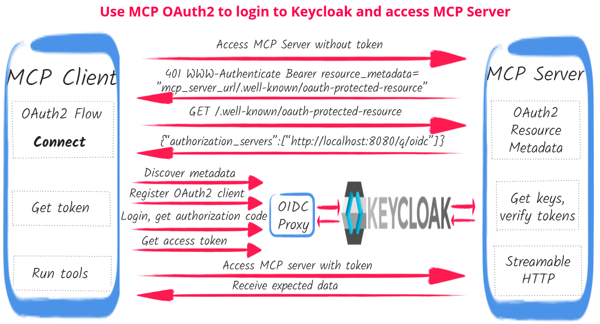

When [OAuth2 Dynamic Client Registration](https://datatracker.ietf.org/doc/html/rfc7591) is used, MCP Client such as [MCP Inspector](https://github.com/modelcontextprotocol/inspector) requires configuring an MCP *Streamable HTTP* endpoint URL only.

MCP Client starts by accessing the MCP server without a token and gets back HTTP 401 with a `WWW-Authenticate` `resource_metadata` parameter that links to the MCP server's [OAuth2 Protected Resource Metadata](https://datatracker.ietf.org/doc/html/rfc9728) route. The client now fetches a URL of the authorization server that secures the MCP server as well as the MCP server's resource identifier.

Since [Quarkus OIDC Proxy](https://github.com/quarkiverse/quarkus-oidc-proxy) is used, MCP Client does not see a Keycloak URL as the authorization server URL but `http://localhost:8080/q/oidc` URL pointing to a default [Quarkus OIDC Proxy](https://github.com/quarkiverse/quarkus-oidc-proxy)'s base URL.

Next, MCP Client uses the [Quarkus OIDC Proxy](https://github.com/quarkiverse/quarkus-oidc-proxy)'s URL to discover its authorization, token, client registration and other endpoint URLs. [Quarkus OIDC Proxy](https://github.com/quarkiverse/quarkus-oidc-proxy) provides its metadata by discovering Keycloak's metadata and replacing Keycloak-specific URLs with its own proxy-managed URLs, but does not transform other Keycloak metadata such as supported [Proof Key for Code Exchange](https://www.rfc-editor.org/rfc/rfc7636) (PKCE) methods.

The user is now redirected to [Quarkus OIDC Proxy](https://github.com/quarkiverse/quarkus-oidc-proxy) which in turn redirects the user to Keycloak to login.

Once the user logs in and authorizes MCP Inspector to access Quarkus MCP server, the user is redirected back to the `http://localhost:6274/oauth/callback` endpoint, MCP client exchanges the returned `code` to get ID, access and refresh tokens, and uses the access token to access the MCP server, allowing the user to select and run the tool.

We are now ready to have a deeper look at how it works in the demo.

You can find the complete project source in the [Secure Quarkus MCP HTTP Server with OIDC Proxy sample](https://github.com/sberyozkin/quarkus-mcp-server-oidc-proxy/tree/main/secure-mcp-http-server-with-oidc-proxy).

<a id="create-mcp-server"></a>
## Step 1 - Create and start MCP server

First, let's create a secure Quarkus MCP server.

<a id="mcp-server-dependencies"></a>
### MCP server maven dependencies

Add the following dependencies:

```xml
<dependency>
    <groupId>io.quarkiverse.mcp</groupId>
    <artifactId>quarkus-mcp-server-sse</artifactId> <1>
    <version>1.6.0</version>
</dependency>
<dependency>
    <groupId>io.quarkus</groupId>
    <artifactId>quarkus-oidc</artifactId> <2>
</dependency>
<dependency>
    <groupId>io.quarkiverse.oidc-proxy</groupId>
    <artifactId>quarkus-oidc-proxy</artifactId> <3>
</dependency>
```

1. `quarkus-mcp-server-sse` is required to support both MCP Streamable HTTP and SSE transports.
2. `quarkus-oidc` is required to secure access to Quarkus MCP Server. Its version is defined in the Quarkus BOM.
3. `quarkus-oidc-proxy` is required to support OIDC proxy between MCP Client and Keycloak

<a id="mcp-server-configuration"></a>
### MCP Server Configuration

Let's configure the MCP server:

```properties
# Require an authenticated access to the MCP server

quarkus.http.auth.permission.authenticated.paths=/mcp/* # <1>
quarkus.http.auth.permission.authenticated.policy=authenticated

# Default OIDC tenant that secures the MCP server <2>
# Its required `quarkus.oidc.auth-server-url` property is set by Keycloak Dev Service
# and points to the Keycloak `quarkus-mcp-realm` realm endpoint

quarkus.oidc.token.audience=quarkus-mcp-server # <3>
quarkus.oidc.resource-metadata.enabled=true # <4>
quarkus.oidc.resource-metadata.authorization-server=http://localhost:8080/q/oidc # <5>
quarkus.oidc.resource-metadata.force-https-scheme=false

# Keycloak devservice that supports the default OIDC tenant.

quarkus.keycloak.devservices.realm-path=quarkus-mcp-realm.json # <6>
quarkus.keycloak.devservices.create-client=false # <7>

# CORS configuration to allow MCP Inspector's SPA script calls

quarkus.http.cors.enabled=true
quarkus.http.cors.origins=http://localhost:6274 # <8>
```

1. Require authentication for all requests to the MCP server. This authentication policy is enforced by the default OIDC tenant configuration.
2. Default OIDC tenant secures the MCP server, Keycloak DevService inserts a missing `quarkus.oidc.auth-server-url` property that links to the Keycloak `quarkus-mcp-realm` realm endpoint.
3. Require that tokens that are allowed to access the MCP server must have an audience (`aud`) claim that contains a `quarkus-mcp-server` value.
4. Enable the [OAuth2 Protected Resource Metadata](https://datatracker.ietf.org/doc/html/rfc9728) route for the default OIDC tenant. It will help [MCP Inspector](https://github.com/modelcontextprotocol/inspector) to find out about the authorization server that secures the MCP server.
5. Quarkus [OAuth2 Protected Resource Metadata](https://datatracker.ietf.org/doc/html/rfc9728) handler is not aware that [Quarkus OIDC Proxy](https://github.com/quarkiverse/quarkus-oidc-proxy) is meant to intercept OAuth2 Flow requests between [MCP Inspector](https://github.com/modelcontextprotocol/inspector) and Keycloak, so we help it to return a correct URL by setting an absolute URL that points to the base [Quarkus OIDC Proxy](https://github.com/quarkiverse/quarkus-oidc-proxy) URL.
6. Ask Keycloak DevService to upload the `quarkus-mcp-realm.json` realm file. This realm does not have pre-registered clients.
7. Ask Keycloak not to add `quarkus.oidc.client-id` since [MCP Inspector](https://github.com/modelcontextprotocol/inspector) will register OAuth2 clients dynamically.
8. CORS policy to allow [MCP Inspector](https://github.com/modelcontextprotocol/inspector) script requests.

You can read about how [OAuth2 Protected Resource Metadata](https://datatracker.ietf.org/doc/html/rfc9728) is supported in Quarkus OIDC in the [Expanded OpenId Connect Configuration guide](https://quarkus.io/guides/security-oidc-expanded-configuration#resource-metadata-properties).

<a id="mcp-server-tools"></a>
### MCP User Name Provider tool

Let's create a single tool that can return a name of the current MCP Client user:

```java
package org.acme;

import io.quarkiverse.mcp.server.TextContent;
import io.quarkiverse.mcp.server.Tool;
import io.quarkus.oidc.UserInfo;
import io.quarkus.security.identity.SecurityIdentity;
import jakarta.inject.Inject;

public class ServerFeatures {

    @Inject
    SecurityIdentity identity; // <1>
    
    @Tool(name = "user-name-provider", description = "Provides a name of the current user") // <2>
    TextContent provideUserName() {
        return new TextContent(identity.getPrincipal().getName());
    }
}
```

1. Capture a security identity represented by the verified access token
2. The `user-name-provider` tool returns a name of the current MCP Client user.

> [!NOTE]
> The `user-name-provider` tool is a very simple tool designed to show that an identity of the MCP client user on whose behalf this tool is called by the MCP client is available for the tool to perform a user identity specific action, an important element for a secure agentic AI system.

<a id="keycloak-configuration"></a>
### Keycloak Configuration

The Keycloak configuration has already been prepared in the `quarkus-mcp-realm.json` that Keycloak DevService uploads to Keycloak at the start-up time.

Let's have a closer look. Please go to `http://localhost:8080/q/dev-ui` and select an `OpenId Connect` card:

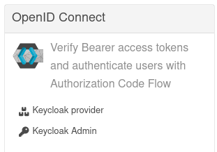

Click on `Keycloak Admin`, login as `admin:admin` and check the `quarkus-mcp-realm` realm configuration.

The `quarkus-mcp-realm` has only Keycloak specific clients registered that are required to support various Keycloak realm operations, it has no custom clients registered. This realm has a single user, `alice` with a password `alice`. It also has a custom `quarkus-mcp-server` client scope with an audience mapping:

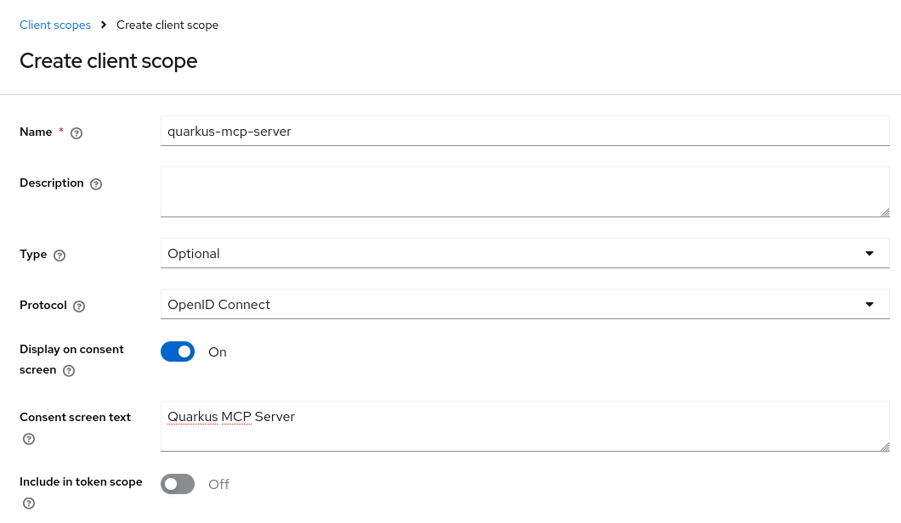

The `quarkus-mcp-server` scope has an audience mapping:

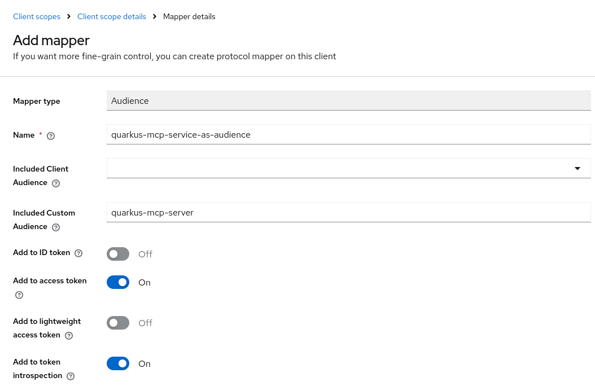

The `quarkus-mcp-realm` realm have the `quarkus-mcp-server` client scope with the `quarkus-mcp-server` audience mapping to let users specify the `quarkus-mcp-server` scope in order to request the correct token audience when [MCP Inspector](https://github.com/modelcontextprotocol/inspector) initiates OAuth2 Flow.

[OAuth2 Resource Indicator](https://www.rfc-editor.org/rfc/rfc8707.html) specification provides an alternative option, where MCP Client can pass an MCP Server's `resource` indicator to the OAuth2 provider and the provider can add it to the token audience. You can choose to avoid creating custom Keycloak client scopes with an audience mapping once Keycloak starts supporting the [OAuth2 Resource Indicator](https://www.rfc-editor.org/rfc/rfc8707.html) specification.

<a id="start-mcp-server"></a>
### Start the MCP server in dev mode

Now let's start the MCP server in dev mode:

```shell
mvn quarkus:dev
```

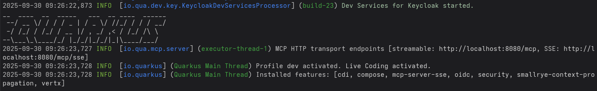

You can see that default *Streamable HTTP* and SSE endpoints are available at `http://localhost:8080/mcp` and `http://localhost:8080/mcp/sse` respectively.

<a id="start-mcp-inspector"></a>
## Step 2: Start the MCP Inspector

```shell
npx @modelcontextprotocol/inspector@0.16.7
```

> [!NOTE]
> While [MCP Inspector](https://github.com/modelcontextprotocol/inspector) provides a very good OAuth2 Flow support, it is still a very active project and at the moment, you may observe [MCP Inspector](https://github.com/modelcontextprotocol/inspector) failing to connect to the OAuth2 provider in some versions. [MCP Inspector](https://github.com/modelcontextprotocol/inspector) v0.16.7 is currently recommended.

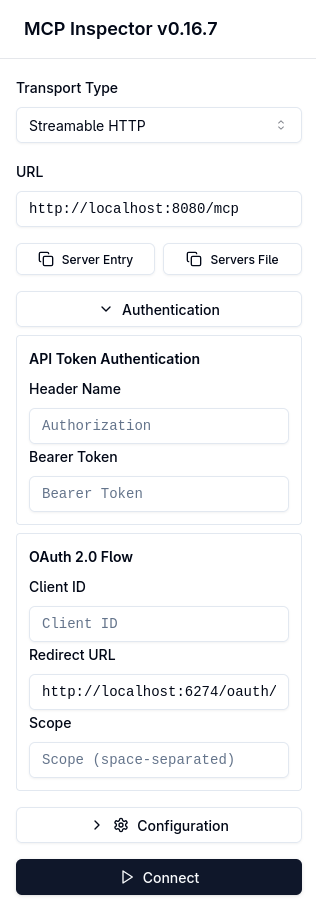

As you can see, no pre-configured OAuth2 Client ID is set.

Now, do not press `Connect` immediately. We are going to follow the [MCP Inspector](https://github.com/modelcontextprotocol/inspector)'s `Guided OAuth Flow` to [register an OAuth2 Client, login a user and acquire an access token](#use-mcp-inspector-to-access-mcp-server) instead, and request a `Connect` once the `Guided OAuth Flow` is complete.

We will then have a look at how to [Encrypt access and refresh tokens and drop ID token](#use-oidc-proxy-to-encrypt-tokens).

See the [Demo MCP OAuth2 Flow Diagram](#demo-flow-diagram) section for an overview of how [MCP Inspector](https://github.com/modelcontextprotocol/inspector) performs a `Connect` request.

Please keep your browser's `Developer Tools`'s `Network` tab open if you would like to observe how MCP Inspector probes various MCP server and [Quarkus OIDC Proxy](https://github.com/quarkiverse/quarkus-oidc-proxy) endpoints and eventually succeeds in getting a user logged in and acquiring the access token.

<a id="use-mcp-inspector-to-access-mcp-server"></a>
## Step 3: Use MCP Inspector to register OAuth2 Client and access MCP Server

We are now going to use the [MCP Inspector](https://github.com/modelcontextprotocol/inspector)'s `Guided OAuth Flow` to register an OAuth2 Client, login a user and acquire tokens.

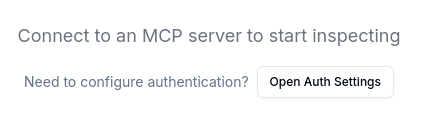

Click on `Open Auth Settings` which you can find opposite the Connection settings that you saw in the [Step 2: Start the MCP Inspector](#start-mcp-inspector) section, and click on the `Guided OAuth2 Flow`:

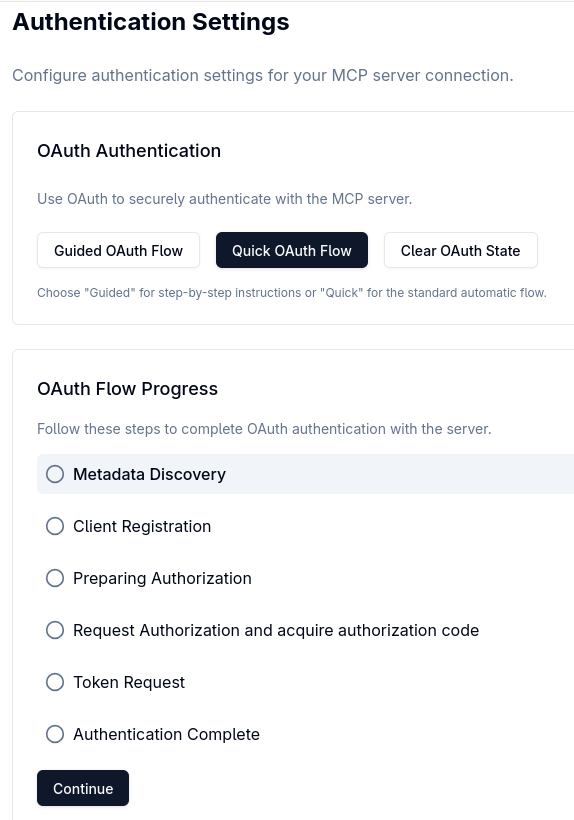

The `Guided OAuth2 Flow` may not be highlighted after you select it but [MCP Inspector](https://github.com/modelcontextprotocol/inspector) will run it once you press `Continue`.

Press `Continue` to do the `Metadata Discovery`:

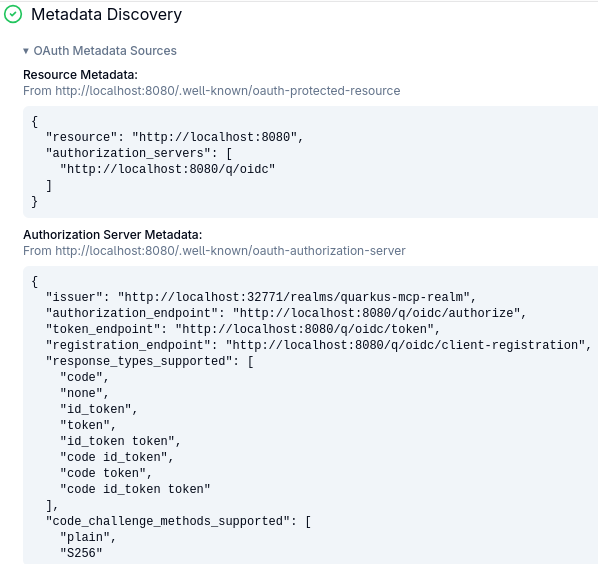

As you can see, [MCP Inspector](https://github.com/modelcontextprotocol/inspector) discovers the MCP Server's [OAuth2 Protected Resource Metadata](https://datatracker.ietf.org/doc/html/rfc9728) first, finds out the [OIDC Proxy](https://github.com/quarkiverse/quarkus-oidc-proxy)'s URL, and uses it to fetch the the OIDC Proxy's metadata. As mentioned in the [Demo MCP OAuth2 Flow Diagram](#demo-flow-diagram) section, [OIDC Proxy](https://github.com/quarkiverse/quarkus-oidc-proxy) provides its metadata by discovering Keycloak's metadata and replacing Keycloak-specific URLs with its own proxy-managed URLs, but does not transform other Keycloak metadata.

The next step is the `Client Registration`, press `Continue`.

[MCP Inspector](https://github.com/modelcontextprotocol/inspector) posts a client registration request that you can see in the browser's developer tools:

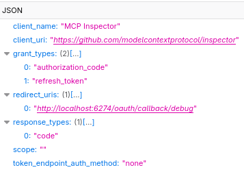

Note that the `token_endpoint_auth_method` property is set to `none` - this is how a `public` OAuth2 Client is registered, since managing confidential OAuth2 Clients that have secrets is harder for Single-page application (SPA) such as [MCP Inspector](https://github.com/modelcontextprotocol/inspector).

The `Client Registration` succeeds:

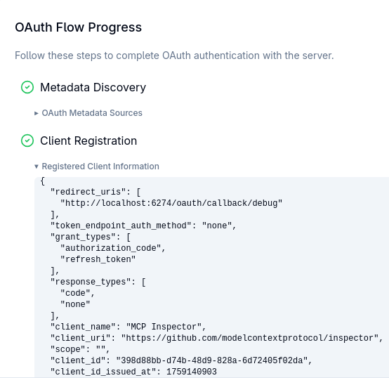

> [!NOTE]
> The `client_id` is a dynamically generated value. You will see a different `client_id` when you work with this blog post.

At this point, we have to pause the `Guided OAuth2 Flow` sequence, go to Keycloak and assign the `quarkus-mcp-server` and `profile` scopes to the registered client.

> [!NOTE]
> The whole point of registering OAuth2 Clients dynamically is to avoid having to deal with manually configuring them. However, as you could see in the Client Registration Request image above, [MCP Inspector](https://github.com/modelcontextprotocol/inspector) currently does not allow to pass OAuth2 scopes during the OAuth2 Client Registration - irrespectively of whether you configure `Scope` in its [Connection settings](#start-mcp-inspector) or not.
>
> The scopes impact what an issued access token can do, what kind of information it can include. The current OAuth2 Client application that logins the current user can request some scopes, for the user to authorize the client to use the access token according to permissions enabled by these scopes. Without requesting scopes during the OAuth2 Client Registration, Keycloak can only issue access tokens with a very limited content, with no audience and the logged-in user information included.
>
> Therefore, to support this post's demo flow, we need to manually assign the required scopes to the registered client directly in the Keycloak Admin Dashboard.
>
> In general, the [MCP Authorization](https://modelcontextprotocol.io/specification/2025-06-18/basic/authorization)-compliant MCP Clients should be able to use custom OAuth2 scopes during the [OAuth2 Dynamic Client Registration](https://datatracker.ietf.org/doc/html/rfc7591) going forward.

OK, let's update the registered client in Keycloak.

Login to Keycloak as described in the [Keycloak Configuration](#keycloak-configuration) section, select the `quarkus-mcp-realm` in `Manage Realms` and the registered client in this realm's `Clients`:

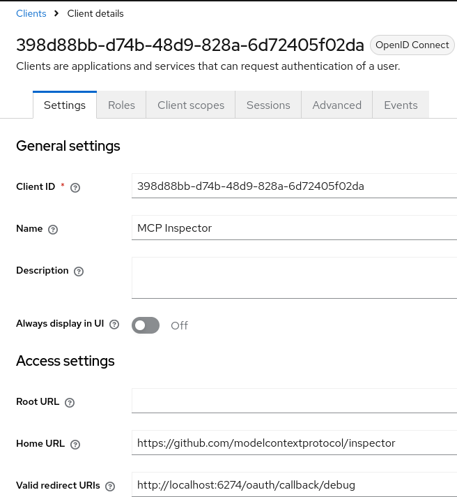

Click on its `Client Scopes` tab, and add `profile` and `quarkus-mcp-server` scopes as `Default` scopes:

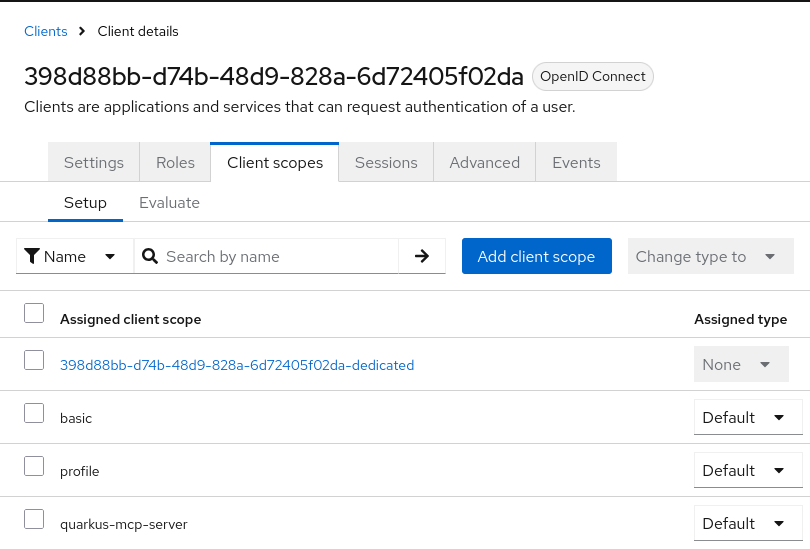

Usually, these scopes should be optional for them to be requested at the authorization code flow login time, but in this case we set them as default scopes since the registered client is currently not aware of such scopes at the registration and login times due to the [MCP Inspector](https://github.com/modelcontextprotocol/inspector)'s limitation described above in this section.

As far as these two scopes are concerned, the `quarkus-mcp-server` scope was described in the [Keycloak Configuration](#keycloak-configuration) section and is used to ensure the access tokens that are issued to the registered client include the correct MCP server audience, while the `profile` scope is only added for the access tokens to contain the logged-in user's name - adding this scope is not strictly necessary.

Let's go back to the [MCP Inspector](https://github.com/modelcontextprotocol/inspector)'s `Guided OAuth Flow` where we have already completed the `Metadata Discovery` and `Client Registration` steps.

Press `Continue` to begin the `Preparing Authorization` step and you will see an `Authorization URL` displayed:

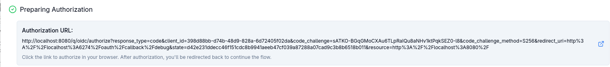

Click on it using the provided button on the right, and you will be redirected to Keycloak, via [OIDC Proxy](https://github.com/quarkiverse/quarkus-oidc-proxy), to login:

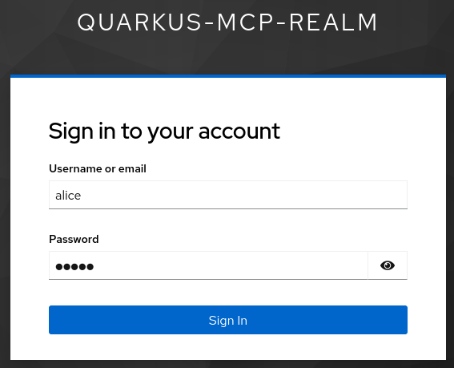

Login as `alice:alice`, and now Keycloak will request you to give your consent to the registered MCP Inspector Client to access Quarkus MCP Server:

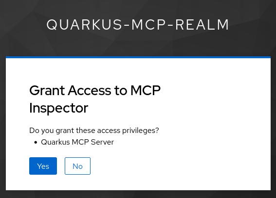

This is what using scopes during the client registration, and `quarkus-mcp-server` scope in particular, give you: a must have option to authorize the registered MCP client application to access the MCP Server on your behalf.

Press `Yes`, Keycloak will redirect you back to the [MCP Inspector](https://github.com/modelcontextprotocol/inspector)'s callback page in another tab that will display the authorization code:

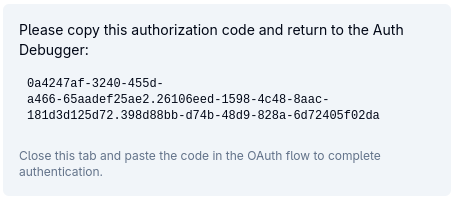

Copy and paste this code into the `Prepare Authorization` field in the `Guided OAuth Flow` view:

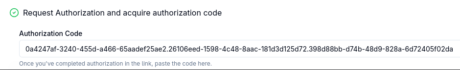

Press `Continue`. [MCP Inspector](https://github.com/modelcontextprotocol/inspector) now successfully acquires the tokens:

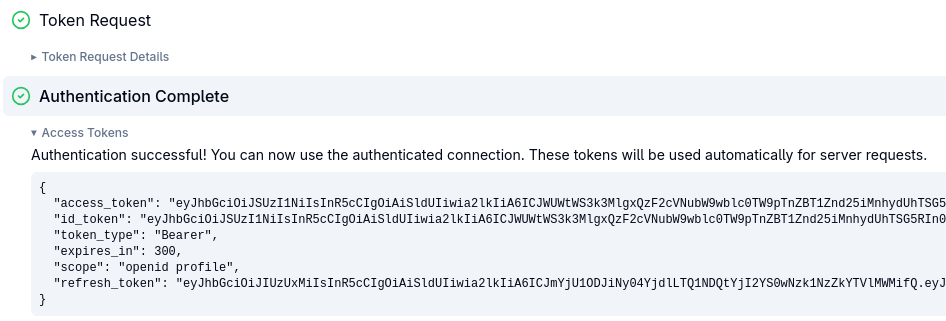

As you can see, 3 tokens, the access and refresh tokens but also the ID token are returned. [MCP Inspector](https://github.com/modelcontextprotocol/inspector) does not really need the ID token, it only needs an access token in order to be able to access the MCP server, and optionally, the refresh token to get another access token when the current one expires. We'll have a look at how to drop the ID token in the [Encrypt access and refresh tokens and drop ID token](#use-oidc-proxy-to-encrypt-tokens) section.

Copy the access token from the provided JSON data and paste it into [jwt.io](https://www.jwt.io/):

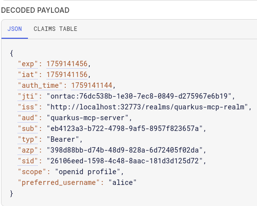

It contains a required `quarkus-mcp-server` audience, exactly what the [MCP Server expects](#mcp-server-configuration).

Now you are ready to press `Connect` in the Connection view that you saw in the [Step 2: Start the MCP Inspector](#start-mcp-inspector) section.

At this point, the access token is already available, so [MCP Inspector](https://github.com/modelcontextprotocol/inspector) uses this token to let you select and run the `user-name-provider` tool:

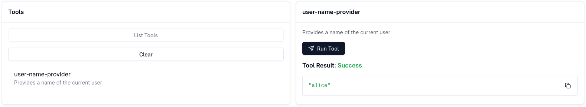

Now press `Disconnect` first, and then `Clear OAuth State`:

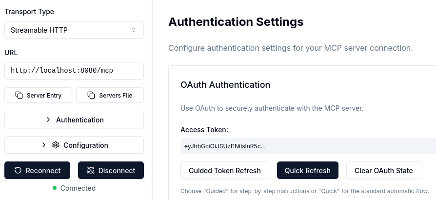

But keep the [MCP server running](#start-mcp-server), do not stop it.

Let's see next how [OIDC Proxy can encrypt access and refresh tokens and drop ID token](#use-oidc-proxy).

<a id="use-oidc-proxy"></a>
## Step 4: Use OIDC Proxy to encrypt access and refresh tokens and drop ID token

<a id="point-of-using-oidc-proxy"></a>
### What is the point of using OIDC Proxy ?

You may be wondering by now, what is the point of using [Quarkus OIDC Proxy](https://github.com/quarkiverse/quarkus-oidc-proxy) and [Quarkus MCP Server](https://github.com/quarkiverse/quarkus-mcp-server) together, with all the proxying going on between [MCP Inspector](https://github.com/modelcontextprotocol/inspector) and Keycloak ?

And if you have been following the evolution of the MCP Authorization specification, from its older [2025-03-26 version](https://modelcontextprotocol.io/specification/2025-03-26/basic/authorization) to the [latest one](https://modelcontextprotocol.io/specification/2025-06-18/basic/authorization), you may want to ask, does the idea of using [Quarkus OIDC Proxy](https://github.com/quarkiverse/quarkus-oidc-proxy) bring us back to the days where the MCP Server was expected to do OAuth2 itself in the [2025-03-26 version](https://modelcontextprotocol.io/specification/2025-03-26/basic/authorization) ?

Not really, [Quarkus OIDC Proxy](https://github.com/quarkiverse/quarkus-oidc-proxy) was introduced in the [Use OIDC Proxy to integrate OIDC service endpoints with custom GPT](https://quarkus.io/blog/oidc-proxy/) blog post, more than half a year before the original MCP specification was published.

The main idea behind [Quarkus OIDC Proxy](https://github.com/quarkiverse/quarkus-oidc-proxy) is to let SPA applications write the same OAuth2 code no matter what the connection details and capabilities of the actual proxied OAuth2 provider are, with the [Quarkus OIDC Proxy](https://github.com/quarkiverse/quarkus-oidc-proxy) mediating between the client that is trying to perform various OAuth2 actions and the actual provider.

For example, as it happens, Keycloak currently does not accept OAuth2 dynamic client registration requests that are sent directly from the [MCP Inspector](https://github.com/modelcontextprotocol/inspector) SPA because its client registration endpoint does not support CORS. However, [Quarkus OIDC Proxy](https://github.com/quarkiverse/quarkus-oidc-proxy), by being co-located with the Quarkus MCP Server, does support CORS, and thus can approve and forward OAuth2 client registration requests from the [MCP Inspector](https://github.com/modelcontextprotocol/inspector) SPA's host to Keycloak. [Quarkus OIDC Proxy](https://github.com/quarkiverse/quarkus-oidc-proxy) can also augment or transform some of the OAuth2 requests and responses.

Besides helping SPAs write an interoperable OAuth2 code, [it can help with restricting which authorization code flow tokens can be returned and support a locally managed redirect endpoint](https://quarkus.io/blog/oidc-proxy/#security-considerations).

Recently, we have also enhanced [Quarkus OIDC Proxy](https://github.com/quarkiverse/quarkus-oidc-proxy) to support encrypting access and refresh tokens before returning them to SPA. We'll look at it in the next [Encrypt access and refresh tokens and drop ID token](#use-oidc-proxy-to-encrypt-tokens) section.

<a id="use-oidc-proxy-to-encrypt-tokens"></a>
### Encrypt access and refresh tokens and drop ID token

When we were discussing the early [MCP Authorizaton version 2025-03-26](https://modelcontextprotocol.io/specification/2025-03-26/basic/authorization) options in the [Getting ready for secure MCP with Quarkus MCP Server](https://quarkus.io/blog/secure-mcp-sse-server/) blog post, my colleague [Ozzy Osborne](https://github.com/BarDweller) thought about the security of access tokens that were made available to MCP Clients and prototyped a Quarkus MCP Server demo where the MCP Server was used to access GitHub but the Claude AI MCP Client only had access to the wrapped access tokens that can not be used directly against GitHub.

[Quarkus OIDC Proxy](https://github.com/quarkiverse/quarkus-oidc-proxy) builds on Ozzy's idea to wrap tokens and makes it possible to encrypt both access and refresh tokens that are returned to the MCP Client.

Let's see how it works.

Add the following configuration properties to the [MCP Server Configuration](#mcp-server-configuration), without restarting the [MCP Server](#start-mcp-server):

```properties
# Public key in JWK format that OIDC Proxy must use to encrypt access and refresh tokens.
# Keys in the PEM format are also supported. 
 
quarkus.oidc-proxy.token-encryption-key-location=publicKey.jwk # <1>

# Private key in JWK format that OIDC Proxy must use to decrypt refresh tokens and Quarkus OIDC - bearer access tokens.

# The private and public keys were generated to support tests and demos.
# 'quarkus.oidc.credentials.secret' property can be used encrypt and decrypt tokens instead.

quarkus.oidc.token.decryption-key-location=privateKey.jwk # <2>

# This is a hint to Quarkus OIDC that the incoming access tokens must be decrypted,
# given that by default it expects only encrypted ID tokens when `quarkus.oidc.token.decryption-key-location` is set.

quarkus.oidc.token.decrypt-access-token=true # <3>

quarkus.oidc-proxy.allow-id-token=false # <4>
```

1. [Public RSA key](https://github.com/sberyozkin/quarkus-mcp-server-oidc-proxy/blob/main/secure-mcp-http-server-with-oidc-proxy/src/main/resources/publicKey.jwk) that OIDC Proxy must use to encrypt access and refresh tokens, when intercepting the `authorization_code` and `refresh_token` grant responses. Note that Quarkus OIDC that protects the MCP Server does not control the communication between [MCP Inspector](https://github.com/modelcontextprotocol/inspector) and the token issuer, therefore it can not encrypt the tokens, only OIDC Proxy can.
2. [Private RSA key](https://github.com/sberyozkin/quarkus-mcp-server-oidc-proxy/blob/main/secure-mcp-http-server-with-oidc-proxy/src/main/resources/privateKey.jwk) that OIDC Proxy must use to decrypt refresh tokens and Quarkus OIDC - bearer access tokens. Note that OIDC Proxy does not control access to the Quarkus service endpoint such as Quarkus MCP server but only intercepts requests/responses to/from the token issuer, therefore it can only decrypt refresh tokens when intercepting `refresh_token` grant requests, while Quarkus OIDC must handle the decryption of the access tokens that were encrypted by OIDC Proxy and are used to access the MCP Server.
3. This is a hint to Quarkus OIDC that when the `quarkus.oidc.token.decryption-key-location` is set, that only an access token, either the bearer or authorization code flow one, that must be decrypted.
4. As you could see at the end of the [Step 3: Use MCP Inspector to register OAuth2 Client and access MCP Server](#use-mcp-inspector-to-access-mcp-server) section, ID token was also returned to [MCP Inspector](https://github.com/modelcontextprotocol/inspector) which does not need it. OIDC proxy also does not encrypt ID tokens the same way it can encrypt access and refresh tokens, because the whole point of an ID token when SPA applications login the user is for SPA be able to find some information about the user from the ID token, therefore encrypting it by the OIDC proxy would make it impossible. But an ID token can contain sensitive information so why return it to SPA which does not need it ? So we let [OIDC Proxy](https://github.com/quarkiverse/quarkus-oidc-proxy) remove it from the authorization code flow grant response.

Save the updated configuration, Quarkus MCP Server will notice them in dev mode.

Now please go back to the [Step 3: Use MCP Inspector to register OAuth2 Client and access MCP Server](#use-mcp-inspector-to-access-mcp-server) section and repeat the same steps, including updating another registered client in Keycloak. Once you completed the [MCP Inspector](https://github.com/modelcontextprotocol/inspector)'s `Guided OAuth Flow`, check the returned tokens:

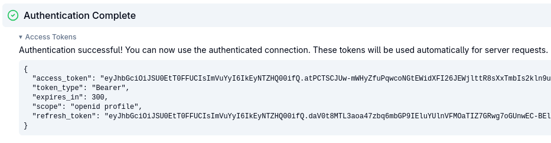

As you can see an ID token is no longer returned. Now copy the access token value. [jwt.io](https://www.jwt.io/) no longer accepts encrypted JWT tokens, but you can find another JWT decoder online such as [FusionAuth JWT Decoder](https://fusionauth.io/dev-tools/jwt-decoder). Paste the access token - the actual claims are encrypted but it can still show the JWT headers:

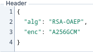

These are not signing but encryption algorithms. `RSA-OAEP` encrypts the generated content encryption key while `A256GCM` algorithm uses this key to encrypt claims.

In this particular demo, the fact that the access and refresh tokens are encrypted primarily eliminates the information leak risk as Keycloak access and refresh tokens are usually in JWT format and can contain sensitive details. We also rely on the MCP Client to use [Proof Key for Code Exchange](https://modelcontextprotocol.io/specification/2025-06-18/basic/authorization#authorization-code-protection) to minimize a risk of the authorizaion code being leaked and the attacker acquiring the tokens, and we enforce the CORS policy in the [MCP Server Configuration](#mcp-server-configuration) section to allow requests to the MCP Server only from the known [MCP Inspector](https://github.com/modelcontextprotocol/inspector)'s host and port.

Encrypting access tokens before returning them to the MCP Client is very useful when your MCP Server is implemented to propagate the incoming access tokens to other services, such as GitHub, or downstream microservices that may not enforce specific CORS policies, or token verification constraints such as a token audience check. In such cases, if the MCP Client leaks the access token, the attacker can bypass Quarkus MCP server and access those other services directly. This risk is avoided when the access token is encrypted by [OIDC Proxy](https://github.com/quarkiverse/quarkus-oidc-proxy) because those other services won't be able to decrypt it.

Similarly, when the SPA tries to use a refresh token to refresh the expired access token and the attacker manages to get hold of the refresh token and is aware of the actual token issuer's refresh endpoint, then the refresh grant request can go directly to the provider. This risk is avoided when the refresh token is encrypted by [OIDC Proxy](https://github.com/quarkiverse/quarkus-oidc-proxy) because the token issuer won't be able to decrypt it.

Now that we discussed why it may be worth encrypting the access and refresh tokens, please go to the end of the [Step 3: Use MCP Inspector to register OAuth2 Client and access MCP Server](#use-mcp-inspector-to-access-mcp-server) section, `Connect` to the MCP Server, and run the tool to confirm that the encrypted access token is correctly decrypted by the MCP Server.

## Security Considerations

The key security recommendation remains the same as the one in the [Use MCP OAuth2 Flow to access Quarkus MCP Server](https://quarkus.io/blog/secure-mcp-server-oauth2/#security-considerations) blog post: secure Quarkus MCP servers must enforce that access tokens have a correct audience, for the MCP Server to assert that the current token is meant to access this MCP server only. And indeed, MCP Servers that propagate tokens further should consider exchanging such tokens, for a new token to target the downstream service correctly - it also minimizes the risk discussed next.

When your MCP server forwards the tokens, please consider how to minimize a risk of the attacker stealing the tokens from the MCP Client and using them to access directly the same services that MCP Server forwards tokens to. [Quarkus OIDC Proxy](https://github.com/quarkiverse/quarkus-oidc-proxy) provides a way to [encrypt access and refresh tokens](#use-oidc-proxy-to-encrypt-tokens) that are returned to the MCP Client, making them acceptable only by either the MCP server or [OIDC Proxy](https://github.com/quarkiverse/quarkus-oidc-proxy) itself.

When MCP Client registers OAuth2 Clients dynamically, please consider enforcing a user consent during the authentication with a standard OpenId Connect `prompt=consent` parameter. [Quarkus OIDC Proxy](https://github.com/quarkiverse/quarkus-oidc-proxy) recognizes the `quarkus.oidc.authentication.extra-params.prompt=consent` property that you can use if the MCP Client does not add it itself when initiating an authorization code flow for the dynamically registered client.

Please note that the [Quarkus OIDC Proxy](https://github.com/quarkiverse/quarkus-oidc-proxy) extension currently has an `experimental` status, therefore, while we do encourage you to experiment with it, we do not recommend to use it in production for the purpose of hardening the [Quarkus MCP Server](https://github.com/quarkiverse/quarkus-mcp-server) token security yet.

Please never use a wildcard CORS policy in production, get the MCP server accept only known MCP Client SPA origins.

## Conclusion

In this blog post we looked at how [Quarkus OIDC Proxy](https://github.com/quarkiverse/quarkus-oidc-proxy) can help to harden the security of [Quarkus MCP Server](https://github.com/quarkiverse/quarkus-mcp-server) tokens, by encrypting access and refresh tokens, and removing a possibly sensitive ID token, before the tokens are returned to the MCP Client.

We also used [Quarkus OIDC Proxy](https://github.com/quarkiverse/quarkus-oidc-proxy) to get OAuth2 Dynamic Client Registration working by controlling the CORS policy at the [Quarkus MCP Server](https://github.com/quarkiverse/quarkus-mcp-server) level and forwarding the client registration requests to Keycloak.

Please let us know what you think, enjoy !
