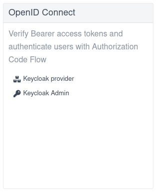
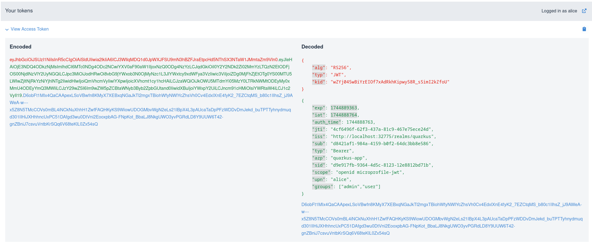
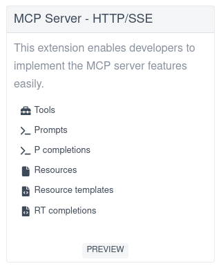
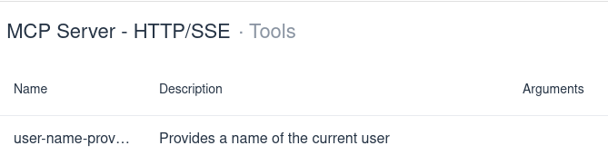
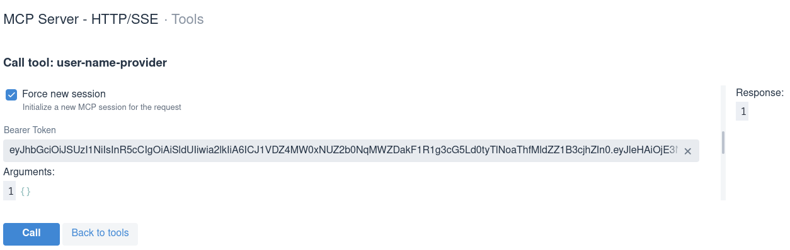
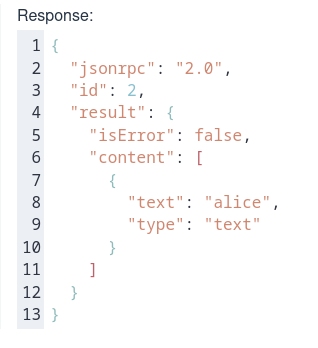
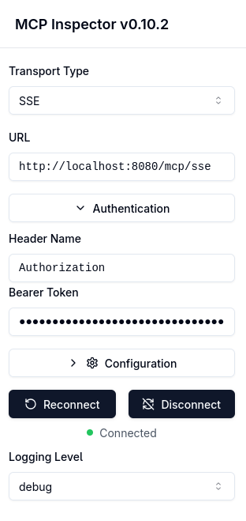
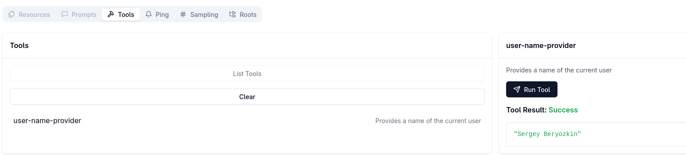

# Getting ready for secure MCP with Quarkus MCP Server

## Introduction

[The latest version of the Model Context Protocol (MCP) specification](https://modelcontextprotocol.io/specification/2025-03-26) introduces an [authorization](https://modelcontextprotocol.io/specification/2025-03-26/basic/authorization) flow.

While it will take a bit of time for the new MCP specification to be widely supported, you can already add authentication to client and server following the [previous MCP version](https://modelcontextprotocol.io/specification/2024-11-05).

You only need an MCP client that can receive an access token and pass it to the MCP server and, obviously, an MCP server that verifies the token.

In this post, we will detail how you can enforce authentication with the [Quarkus MCP SSE Server](https://github.com/quarkiverse/quarkus-mcp-server).

We will first use Keycloak as an OpenID Connect (OIDC) provider to login and use a Keycloak JWT access token to access the server with `Quarkus MCP SSE Server Dev UI` in dev mode.

Secondly, we will show how to log in using GitHub OAuth2 and use a GitHub binary access token to access the server in prod mode with both [MCP inspector](https://modelcontextprotocol.io/docs/tools/inspector) and the `curl` tools.

<a id="initial-mcp-server"></a>
## Step 1 - Create an MCP server using the SSE transport

First, let's create a secure Quarkus MCP SSE server that requires authentication to establish Server-Sent Events (SSE) connection and also when invoking the tools.

You can find the complete project source in the [Quarkus MCP SSE Server samples](https://github.com/quarkiverse/quarkus-mcp-server/tree/main/samples/secure-mcp-sse-server).

<a id="initial-dependencies"></a>
### Maven dependencies

Add the following dependencies:

```xml
<dependency>
    <groupId>io.quarkiverse.mcp</groupId>
    <artifactId>quarkus-mcp-server-sse</artifactId> <1>
    <version>1.1.1</version>
</dependency>

<dependency>
    <groupId>io.quarkus</groupId>
    <artifactId>quarkus-oidc</artifactId> <2>
</dependency>
```

1. `quarkus-mcp-server-sse` is required to support MCP SSE transport.
2. `quarkus-oidc` is required to secure access to MCP SSE endpoints. Its version is defined in the Quarkus BOM.

<a id="tool"></a>
### Tool

Let's create a tool that can be invoked only if the current MCP request is authenticated:

```java
package org.acme;

import io.quarkiverse.mcp.server.TextContent;
import io.quarkiverse.mcp.server.Tool;
import io.quarkus.security.Authenticated;
import io.quarkus.security.identity.SecurityIdentity;
import jakarta.inject.Inject;

public class ServerFeatures {

    @Inject
    SecurityIdentity identity;

    @Tool(name = "user-name-provider", description = "Provides a name of the current user") <1>
    @Authenticated <2>
    TextContent provideUserName() {
        return new TextContent(identity.getPrincipal().getName()); <3>
    }
}
```

1. Provide a tool that can return a name of the current user. Note the `user-name-provider` tool name, you will use it later for a tool call.
2. Require authenticated tool access - yes, the only difference with an unauthenticated MCP server tool is `@Authenticated`, that's it! See also how the main MCP SSE endpoint is secured in the [Configuration](#initial-configuration) section below.
3. Use the injected `SecurityIdentity` to return the current user's name.

<a id="initial-configuration"></a>
### Configuration

Finally, let's configure our secure MCP server:

```properties
quarkus.http.auth.permission.authenticated.paths=/mcp/sse <1>
quarkus.http.auth.permission.authenticated.policy=authenticated
```

1. Enforce an authenticated access to the main MCP SSE endpoint during the initial handshake. See also how the tool is secured with an annotation in the [Tool](#tool) section above, though you can also secure access to the tool by listing both main and tools endpoints in the configuration, for example: `quarkus.http.auth.permission.authenticated.paths=/mcp/sse,/mcp/messages/*`.

We are ready to test our secure MCP server in dev mode.

## Step 2 - Access the MCP server in dev mode

### Start the MCP server in dev mode

```shell
mvn quarkus:dev
```

The configuration properties that we set in the [Configuration](#initial-configuration) section above are sufficient to start the application in dev mode.

The OIDC configuration is provided in dev mode automatically by [Dev Services for Keycloak](https://quarkus.io/guides/security-openid-connect-dev-services). It creates a default realm, client and adds two users, `alice` and `bob`, for you to get started with OIDC immediately. You can also register a custom Keycloak realm to work with the existing realm, client and user registrations.

You can also login to other OIDC and OAuth2 providers in OIDC Dev UI, see the [Use Quarkus MCP Server Dev UI to access the MCP server](#mcp-server-devui) section for more details.

<a id="oidc-devui"></a>
### Use OIDC Dev UI to login and copy access token

Go to [Dev UI](http://localhost:8080/q/dev), find the OpenId Connect card:



Follow the `Keycloak Provider` link and [login to Keycloak](https://quarkus.io/guides/security-openid-connect-dev-services#develop-service-applications) using an `alice` name and an `alice` password.

> [!NOTE]
> You can login to other providers such as `Auth0` or [GitHub](https://quarkus.io/guides/security-openid-connect-providers#github) from OIDC DevUI as well. The only requirement is to update your application registration to allow callbacks to DevUI. For example, see how you can [login to Auth0 from Dev UI](https://quarkus.io/guides/security-oidc-auth0-tutorial#looking-at-auth0-tokens-in-the-oidc-dev-ui).

After logging in with `Keycloak` as `alice`, copy the acquired access token using a provided copy button:



<a id="mcp-server-devui"></a>
### Use Quarkus MCP Server Dev UI to access the MCP server

Make sure to login and copy the access token as explained in the [Use OIDC Dev UI to login and copy access token](#oidc-devui) section above.

Go to [Dev UI](http://localhost:8080/q/dev), find the MCP Server card:



Select its `Tools` option and choose to `Call` the `user-name-provider` tool:



Paste the copied Keycloak access token into the Tool's `Bearer token` field, and request a new MCP SSE session:



Make a tool call and get a response which contains the `alice` user name:



All is good in dev mode; it is time to see how it will work in prod mode. Before that, stop the MCP server, which runs in dev mode.

## Step 3 - Access the MCP server in prod mode

<a id="register-github-application"></a>
### Register GitHub OAuth2 application

Before it was all in dev mode - using Quarkus devservices to try things out. Now, let's move to prod mode. If you already have a Keycloak instance running then you can use it. But to illustrate how OAuth2 works with more than just Keycloak, we will switch to GitHub OAuth2 when the application runs in *prod mode*.

First, start with registering a GitHub OAuth2 application.

Follow the [GitHub OAuth2 registration](https://quarkus.io/guides/security-openid-connect-providers#github) process, and make sure to register the `http://localhost:8080/login` callback URL.

Next, use the client id and secret generated during the GitHub OAuth2 application registration to [update the configuration to support GitHub](#update-config-to-support-github).

<a id="update-config-to-support-github"></a>
### Update the configuration to support GitHub

The [configuration](#initial-configuration) that was used to run the MCP server in dev mode was suffient because Keycloak Dev Service was supporting the OIDC login.

To work with GitHub in prod mode, we update the configuration as follows:

```properties
quarkus.http.auth.permission.authenticated.paths=/mcp/sse <1>
quarkus.http.auth.permission.authenticated.policy=authenticated

%prod.quarkus.oidc.provider=github <2>
%prod.quarkus.oidc.application-type=service <3>

%prod.quarkus.oidc.login.provider=github <4>
%prod.quarkus.oidc.login.client-id=github-application-client-id <5>
%prod.quarkus.oidc.login.credentials.secret=github-application-client-secret <5>
```

1. Enforce an authenticated access to the main MCP SSE endpoint during the initial handshake. See also how the tool is secured with an annotation in the [Tool](#tool) section above.
2. Default Quarkus OIDC configuration requires that only GitHub access tokens can be used to access MCP SSE server.
3. By default, `quarkus.oidc.provider=github` supports an authorization code flow only. `quarkus.oidc.application-type=service` overrides it and requires the use of bearer tokens.
4. Use GitHub authorization code flow to support the login endpoint with a dedicated Quarkus OIDC `login` [tenant](https://quarkus.io/guides/security-openid-connect-multitenancy) configuration.
5. Use the client id and secret generated in the [Register GitHub OAuth2 application](#register-github-application) section.

> [!NOTE]
> Note the use of the `%prod.` prefixes. It ensures the configuration properties prefixed with `%prod.` are only effective in prod mode and do not interfere with dev mode.

### Implement Login endpoint

Currently, MCP clients can not use the authorization code flow themselves. Therefore, we implement an OAuth2 login endpoint that will return a GitHub token for the user to use with MCP clients, which can work with bearer tokens.

Add another dependency to support Qute templates:

```xml
<dependency>
    <groupId>io.quarkus</groupId>
    <artifactId>quarkus-rest-qute</artifactId> <1>
</dependency>
```

1. `quarkus-rest-qute` is required to generate HTML pages. Its version is defined in the Quarkus BOM.

and implement the login endpoint:

```java
package org.acme;

import io.quarkus.oidc.AccessTokenCredential;
import io.quarkus.oidc.UserInfo;
import io.quarkus.qute.Template;
import io.quarkus.qute.TemplateInstance;
import io.quarkus.security.Authenticated;
import jakarta.inject.Inject;
import jakarta.ws.rs.GET;
import jakarta.ws.rs.Path;
import jakarta.ws.rs.Produces;

@Path("/login")
@Authenticated
public class LoginResource {

    @Inject
    UserInfo userInfo; <1>
    
    @Inject
    AccessTokenCredential accessToken; <2>

    @Inject
    Template accessTokenPage;

    @GET
    @Produces("text/html")
    public TemplateInstance poem() {
        return accessTokenPage
           .data("name", userInfo.getName())
           .data("accessToken", accessToken.getToken()); <3>
    }
}
```

1. GitHub access tokens are binary and Quarkus OIDC indirectly verifies them by using them to request GitHub specific `UserInfo` representation.
2. `AccessTokenCredential` is used to capture a binary GitHub access token.
3. After the user logs in to GitHub and is redirected to this endpoint, the access token will be returned to the user in an HTML page generated with a simple [Qute template](https://github.com/quarkiverse/quarkus-mcp-server/tree/main/samples/secure-mcp-sse-server/src/main/resources/templates/accessTokenPage.html). Of course, you would not do that in a real application. It is just an example to demonstrate the capability.

### Package and run the MCP Server

Package the MCP server application:

```shell
mvn package
```

Run it:

```shell
java -jar target/quarkus-app/quarkus-run.jar
```

> [!NOTE]
> You can also run the MCP server from its Maven coordinates directly with `jbang`:
>
> ```shell
> mvn install
> jbang org.acme:secure-mcp-sse-server:1.0.0-SNAPSHOT:runner
> ```

### Login to GitHub and copy the access token

Access `http://localhost:8080/login`, login to GitHub, and copy the returned access token:


> [!NOTE]
> By default, Quarkus GitHub provider submits the client id and secret in the HTTP Authorization header. However, GitHub may require that both client id and secret are submitted as form parameters instead.
>
> When you get HTTP 401 error after logging in to GitHub and being redirected back to Quarkus MCP server, try to replace `%prod.quarkus.oidc.login.credentials.secret=${github.client.secret}` property with the following two properties instead:
>
> ```properties
> %prod.quarkus.oidc.login.credentials.client-secret.method=post
> %prod.quarkus.oidc.login.credentials.client-secret.value=${github.client.secret}
> ```

<a id="mcp-inspector"></a>
### Use MCP Inspector to access the MCP server

[MCP Inspector](https://modelcontextprotocol.io/docs/tools/inspector) is an interactive developer tool for testing and debugging MCP servers. Let's use it to invoke our MCP server with the authentication.

Launch [MCP inspector](https://modelcontextprotocol.io/docs/tools/inspector):

```shell
npx @modelcontextprotocol/inspector
```

> [!NOTE]
> Ensure that you have [modelcontextprotocol/inspector](https://github.com/modelcontextprotocol/inspector/releases/tag/0.6.0) version 0.6.0 or later installed as it adds support for specifying bearer token authentication.

Navigate to the URL provided into a browser.

Change the *Transport Type* dropdown to `SSE` and the *URL* to `http://localhost:8080/mcp/sse` so that it targets the running Quarkus MCP Server:

Select the *Authorization* button and paste the copied GitHub access token from the browser to the `Bearer Token` field and connect to the Quarkus MCP SSE server:



Next, make a `user-name-provider` tool call:



You will see the name from your GitHub account returned.

### Use curl to access the MCP server

Finally, let's use `curl` and also learn a little bit how both the MCP protocol and MCP SSE transport work.

First, open a new terminal window and access the main SSE endpoint without the GitHub access token:

```shell
curl -v localhost:8080/mcp/sse
```

You will get HTTP 401 error.

Use the access token that was obtained previously to access MCP server:

```shell script curl -v -H "Authorization: Bearer gho_..." localhost:8080/mcp/sse ```

and get an SSE response such as:

```shell
< content-type: text/event-stream
< 
event: endpoint
data: /messages/ZTZjZDE5MzItZDE1ZC00NzBjLTk0ZmYtYThiYTgwNzI1MGJ
```

The SSE connection is created.  Note the unique path in the received `data`, we need this path to invoke the tools. We cannot invoke the tool directly, we first need to follow the MCP handshake protocol.

Open another terminal window and use the same GitHub access token to initialize the curl as MCP client, and access the tool, using the value of the `data` property to build the target URL.

Send the client initialization request:

```shell
curl -v -H "Authorization: Bearer gho_..." -H "Content-Type: application/json" --data @initialize.json http://localhost:8080/mcp/messages/ZTZjZDE5MzItZDE1ZC00NzBjLTk0ZmYtYThiYTgwNzI1MGJ
```

where the `initialize.json` file has a content like this:

```json
{
  "jsonrpc": "2.0",
  "id": 1,
  "method": "initialize",
  "params": {
    "protocolVersion": "2024-11-05",
    "capabilities": {
      "roots": {
        "listChanged": true
      },
      "sampling": {}
    },
    "clientInfo": {
      "name": "CurlClient",
      "version": "1.0.0"
    }
  }
}
```

Send the client initialization confirmation:

```shell
curl -v -H "Authorization: Bearer gho_..." -H "Content-Type: application/json" --data @initialized.json http://localhost:8080/mcp/messages/ZTZjZDE5MzItZDE1ZC00NzBjLTk0ZmYtYThiYTgwNzI1MGJ
```

where the `initialized.json` file has a content like this:

```json { "jsonrpc": "2.0", "method": "notifications/initialized" } ```

Finally, send the request that will invoke the tool:

```shell
curl -v -H "Authorization: Bearer gho_..." -H "Content-Type: application/json" --data @call.json http://localhost:8080/mcp/messages/ZTZjZDE5MzItZDE1ZC00NzBjLTk0ZmYtYThiYTgwNzI1MGJ
```

where the `call.json` file has a content like this:

```json
{
  "jsonrpc": "2.0",
  "id": 2,
  "method": "tools/call",
  "params": {
    "name": "user-name-provider",
    "arguments": {
    }
  }
}
```

Now look at the terminal window containing the SSE connection and you will see the name from your GitHub account returned.

## Conclusion

In this blog post, we explained how you can easily create a Quarkus MCP SSE server that requires authentication, obtain an access token and use it to access the MCP server tool in dev mode with `Quarkus MCP SSE Server Dev UI` and prod mode with both the [MCP inspector](https://modelcontextprotocol.io/docs/tools/inspector) and the curl tools. You can use any MCP client that allows passing a bearer token to the server.

Notice, that there is no real difference in how OAuth2 is done for either Quarkus MCP server or REST endpoints. The most complex part is to get the settings configured correctly for your OAuth2 provider - but when all is done you just apply a few annotations to mark relevant methods as secure and Quarkus handles the authentication for you.

This blog post uses the previous version of the MCP protocol. The Quarkus team is keeping a close eye on the MCP Authorization specification evolution and working on having all possible MCP Authorization scenarios supported.

Stay tuned for more updates!
