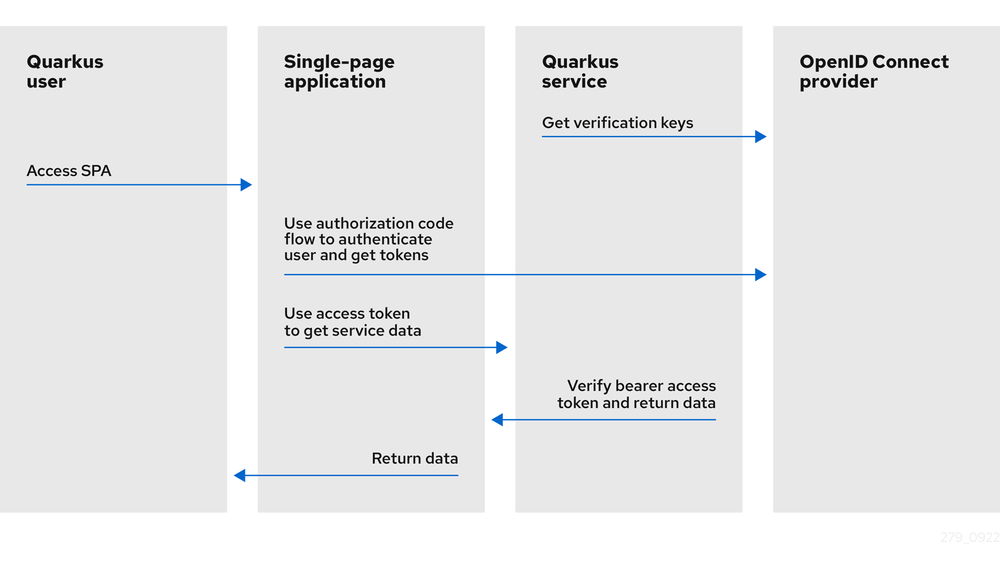
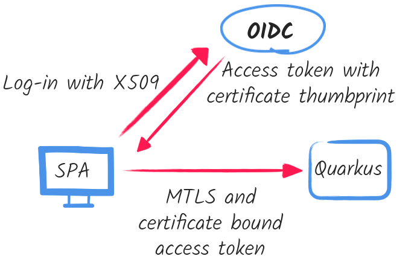
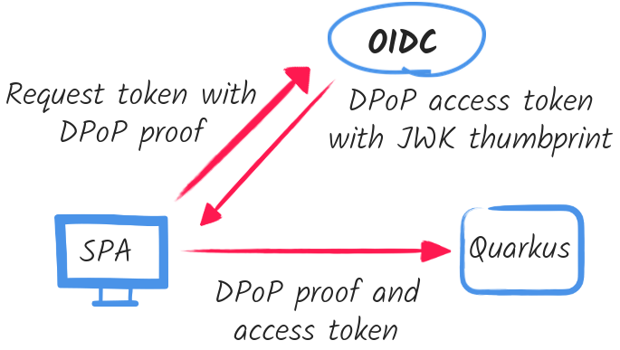

# Sender-constraining access tokens with Quarkus OIDC

## Introduction

Single-page application (SPA) runs in the browser and uses [OIDC authorization code flow](https://quarkus.io/guides/security-oidc-code-flow-authentication#overview-of-the-oidc-authorization-code-flow-mechanism) to log-in users, without depending on Quarkus OIDC. When the authentication is complete, SPA sends the access token to access Quarkus on behalf of the authenticated user.

Have a look at the simple diagram showing how this process works, copied to this post from the [OIDC Bearer token guide](https://quarkus.io/guides/security-oidc-bearer-token-authentication):

As illustrated in the picture above, the OIDC provider authenticates the current user, SPA receives ID and access tokens and uses the access token to access the Quarkus endpoint.

The security challenge that the OAuth2 experts have been trying to address is how to prove that the client such as SPA which is sending the token actually owns this token ? There is nothing in the HTTP `Authorization: Bearer <token>` header that proves that SPA did not leak the token.

Two specifications for sender-constraining access tokens have emerged over the years, [RFC 8705: Mutual TLS Client Authentication and Certificate-Bound Access Tokens](https://datatracker.ietf.org/doc/html/rfc8705) and [RFC 9449: OAuth 2.0 Demonstrating Proof-of-Possession (DPoP)](https://datatracker.ietf.org/doc/html/rfc9449).

## Mutual TLS Client Authentication and Certificate-Bound Access Tokens

[Mutual TLS Client Authentication and Certificate-Bound Access Tokens](https://datatracker.ietf.org/doc/html/rfc8705) specification describes how access tokens can be cryptographically bound to the MTLS client certificate.

By proving that the access token is bound to the client certificate, the Quarkus application can get a high degree of confidence that the current access token is constrained to, owned by the client which authenticated to Quarkus over MTLS.

Implementing the cryptographic binding is not complex in this case. The current access token is expected to contain a confirmation with the SHA-256 certificate thumbprint and it must match the thumbprint of the current MTLS client certificate. If the token is in JWT format, then it must include a confirmation claim. If the token is binary then the confirmation must be included in the remote token introspection response.

Such a binding can only be successful if the OpenId Connect provider has access to the same client certificate which is used during the MTLS authentication to Quarkus.

The downside of using the MTLS token binding is that correctly configuring the OpenId Connect provider, ensuring that browsers can request an X509 certiticate authentication when SPA redirects the user to authenticate to the OIDC provider is complex.

If you are a Keycloak user, check the [OAuth 2.0 Mutual TLS Certificate Bound Access Tokens Enabled](https://www.keycloak.org/docs/latest/server_admin/#con-advanced-settings_server_administration_guide) in the Advanced Configuration section of the [Keycloak Server Administration documentation](https://www.keycloak.org/docs/latest/server_admin) and the [How to Use Certificate-Bound Access Token with Kong and Keycloak](https://tech.aufomm.com/how-to-use-certificate-bound-access-token-with-kong-and-keycloak/) community blog post.

As far as Quarkus is concerned, you only need to set a single OIDC configuration property, `quarkus.oidc.token.binding.certificate=true`, in addition to the Vert.x HTTP MTLS configuration, to enforce the MTLS token binding.

See the [Quarkus OIDC Mutual TLS Token Binding](https://quarkus.io/guides/security-oidc-bearer-token-authentication#mutual-tls-token-binding) documentation for more details.

## Demonstrating Proof-of-Possession (DPoP)

[Demonstrating Proof-of-Possession (DPoP)](https://datatracker.ietf.org/doc/html/rfc9449) specification describes how access tokens can be cryptographically bound to special JWT tokens called DPoP proofs.

The SPA client generates a private and public key pair, and creates a DPoP proof token to complete the access token acquisition from the OIDC provider. It then forwards this DPoP token to Quarkus with a new DPoP proof. The access token must be bound to the DPoP proof by containing a public JSON Web Key (JWK) key thumbprint which matches the thumbprint of the public JWK key contained in the DPoP proof.

This binding can only be successful if the client uses the same public and private key pair for creating the DPoP proof to request the access token in the previous step and creating another DPoP proof for submitting it alongside the DPoP access token to Quarkus.

Quarkus OIDC will also enforce [other DPoP proof check requirements](https://datatracker.ietf.org/doc/html/rfc9449#name-checking-dpop-proofs). Support for custom [DPoP nonce providers](https://datatracker.ietf.org/doc/html/rfc9449#name-resource-server-provided-no) is also planned.

Adoption of DPoP, compared to that of the MTLS token binding, is expected to progress faster, because DPoP is an `application-level` protocol, with no expectation that the transport-level MTLS authentication takes place. However, correctly creating DPoP proofs at the SPA level is not straightforward and requires care.

If you are a Keycloak user, then enabling an experimental `dpop` feature is sufficient to get started. Also check the [OAuth 2.0 Demonstrating Proof-of-Possession at the Application Layer (DPoP)](https://www.keycloak.org/docs/latest/server_admin/#con-advanced-settings_server_administration_guide) in the Advanced Configuration section of the [Keycloak Server Administration documentation](https://www.keycloak.org/docs/latest/server_admin) and the [How to Use Demonstrating Proof-of-Possession (DPoP) Token with Kong and keycloak](https://tech.aufomm.com/how-to-use-demonstrating-proof-of-possession-dpop-token-with-kong-and-keycloak/) community blog post.

As far as Quarkus is concerned, you only need to set a single OIDC configuration property, `quarkus.oidc.token.authorization-scheme=dpop` to accept DPoP tokens and enforce their binding to the accompanying DPoP proofs.

See the [Quarkus OIDC Demonstrating Proof of Possession (DPoP)](https://quarkus.io/guides/security-oidc-bearer-token-authentication#demonstrating-proof-of-possession-dpop) documentation for more details.

## Financial-Grade API (FAPI)

[Financial-Grade API (FAPI)](https://openid.net/wg/fapi/) is a general high-security API profile built on top of OAuth2.

Both [RFC 8705: Mutual TLS Client Authentication and Certificate-Bound Access Tokens](https://datatracker.ietf.org/doc/html/rfc8705) and [RFC 9449: OAuth 2.0 Demonstrating Proof-of-Possession (DPoP)](https://datatracker.ietf.org/doc/html/rfc9449) specifications are included in the Financial-Grade API 2.0 [General Security Profile](https://openid.net/specs/fapi-security-profile-2_0-final.html#name-general).

## Conclusion

In this article, we have discussed two important OAuth2 specifications for sender-constraining access tokens, [RFC 8705: Mutual TLS Client Authentication and Certificate-Bound Access Tokens](https://datatracker.ietf.org/doc/html/rfc8705) and [RFC 9449: OAuth 2.0 Demonstrating Proof-of-Possession (DPoP)](https://datatracker.ietf.org/doc/html/rfc9449).

Both of these token security elevation technologies can be easily supported in Quarkus OIDC, by using a single configuration property only, without having to write a lot of custom code and configuration.

Please experiment with [Mutual TLS Client Authentication and Certificate-Bound Access Tokens](https://datatracker.ietf.org/doc/html/rfc8705) and [Demonstrating Proof-of-Possession (DPoP)](https://datatracker.ietf.org/doc/html/rfc9449) in Quarkus and let us know what you think.
