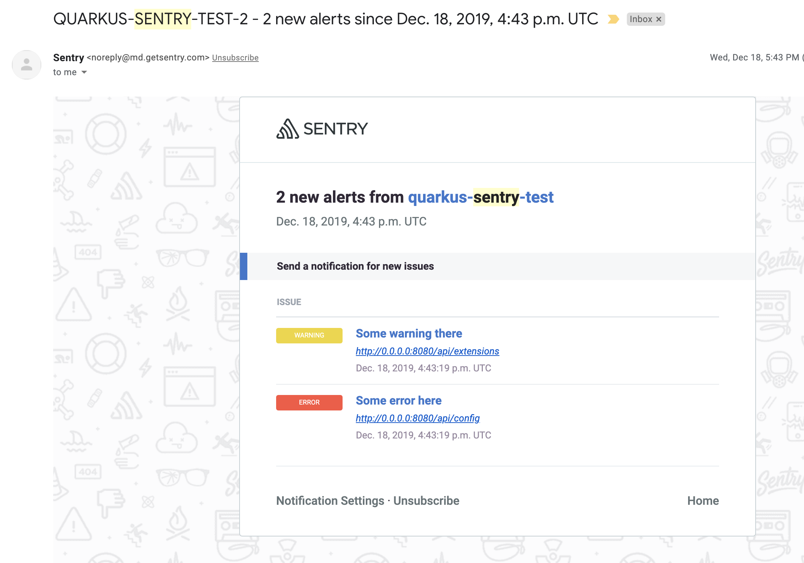
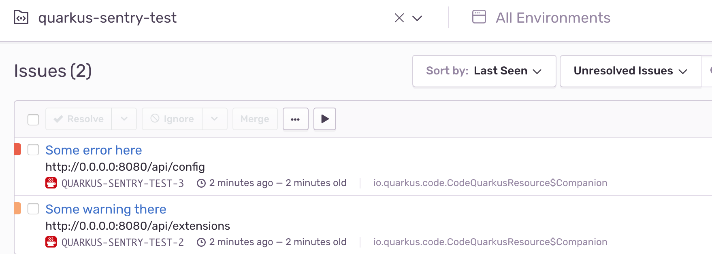
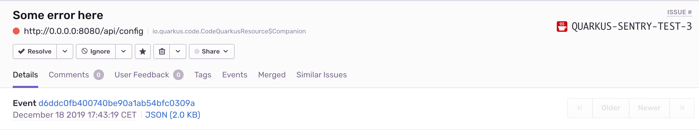
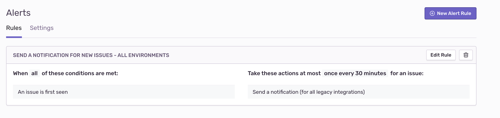

# Sentry Error Tracker - A guardian of your Quarkus application

If like me you have met Quarkus and fell in love, you started implementing your backend and you started to feel so light and quick, click clack, whoot whoot... in a woosh, your lightning fast native container is ready to be sent on your brand new Kubernetes cluster 🤙

This is awesome!!

Mmmeahh you may have forgotten a detail... have you thought about the fate of your first production exception (please be honest with me :-)?

1. As a backend god, master of the world, first of his name, you implemented some Logstash process to extract your log files, send them to some Elasticsearch server somewhere and... sorry to say it, but you just spend more time configuring it than actually coding your app 😅.
2. You thought you could manually check the error logs a few times a week and ... oops, unlucky you, your application broke exactly the day you forgot to check, let's hope no one else noticed 🤭?
3. You were waiting for this article 🤓

Now that you are teased, aren't you? Let's dive in.

## Sentry, the guardian has arrived on Quarkus

Once your code is reviewed, tested in many ways, containerized, ..., and finally promoted to production, <mark>I guess you can expect it to run smoothly ever after..</mark> an exception is going to pop, it's just a question of time. The questions are:

1. How will you get notified about this error?
2. What are you going to do about it?

Well, this looks like a complex problem right? This is what I really like about using Quarkus and Sentry together, you will be all set in a few minutes:

- Create a [Sentry account](https://sentry.io/signup/), you can choose a free plan or another depending on your project needs (or with a bit more time, even a [self hosted sentry](https://docs.sentry.io/server/))

  > [!WARNING]
  > Sentry has recently [re-licensed most of its code to BSL](https://blog.sentry.io/2019/11/06/relicensing-sentry) - which is not an OSI-approved license. The Java SDK is still under the 3-Clause BSD license.

- 

  Configure Sentry on your Quarkus application

  1. Add the extension:

  ```shell
  $ ./mvnw quarkus:add-extension -Dextensions=sentry
  ```

  1. Set it up:

  ```properties
  quarkus.log.sentry=true
  quarkus.log.sentry.dsn=[your Sentry DSN]
  quarkus.log.sentry.in-app-packages=org.acme
  ```

  > [!NOTE]
  > More details about the configuration can be found in the [Logging with Sentry guide](https://quarkus.io/guides/logging-sentry)


## Happily ever after

You are now pretty confident that in the very unlikely event of an error in your fully tested code, your guardian will be watching..

Bip bip, you've got mail.. ewww snap an error 🥳 (and you are happy that you haven't missed it)



You now enter the really pretty Sentry application. It is also smart enough to group similar events into issues (or you can also decide to group them yourself).



It's now time to generate and link an issue on your favorite tracker (GitHub, Bitbucket, GitLab, ...). It will contain a lot of contextual information about the errors (endpoint, params, stacktrace, environment, ...) to help your team fix that nasty bug.



If you want to go a bit further you can start cooking some custom rules to dispatch alerts with your own taste.



Bonus point, Sentry is also available for your [frontend](https://sentry.io/for/javascript/).

Good luck 🤙

> [!NOTE]
> Once an extension is integrated in the Quarkus eco-system, the life of thousand of developers is made easier. If you know of a similar (or any) tool you think could help the Quarkus community, [propose it](https://github.com/quarkusio/quarkus/issues/new?assignees=&labels=extension-proposal&template=extension_proposal.md&title=)!
