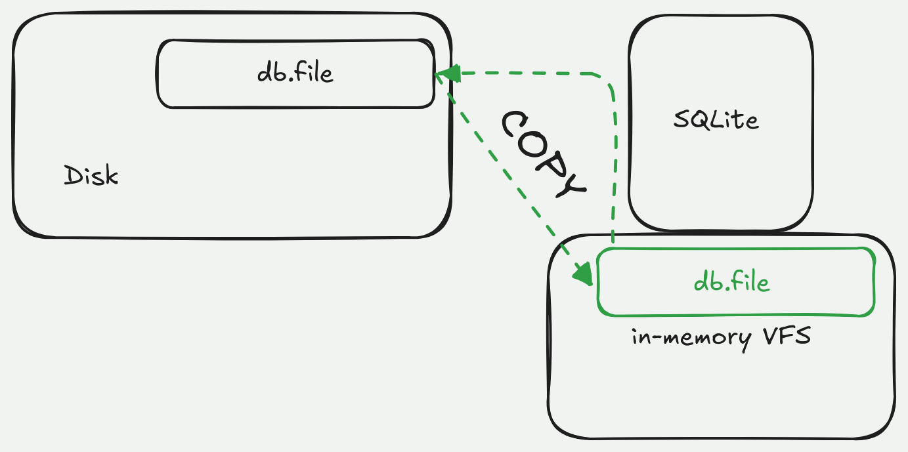
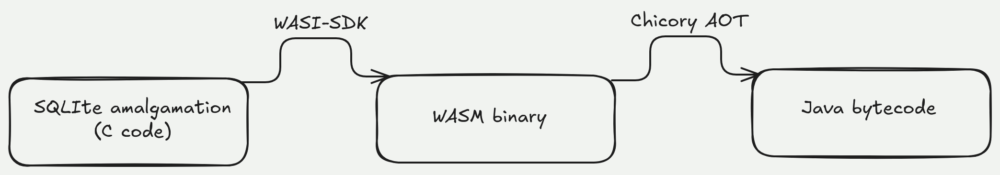

# Running SQLite in Pure Java with Quarkus

What if you could run a C-based database in pure Java, with zero configuration, and even compile it to a native image effortlessly? With the new Quarkiverse extension [quarkus-jdbc-sqlite4j](https://github.com/quarkiverse/quarkus-jdbc-sqlite4j), you can do exactly that.

Traditionally, embedded databases in Java require reimplementing their C counterparts, often leading to differences in behavior, missing optimizations, and delayed bug fixes. However, [sqlite4j](https://github.com/roastedroot/sqlite4j) provides a JDBC driver that leverages the original SQLite C implementation while running safely inside a sandbox.

## Hands-on Example

To see [quarkus-jdbc-sqlite4j](https://github.com/quarkiverse/quarkus-jdbc-sqlite4j) in action, you can start with any existing Quarkus application or one of the [quickstarts](https://github.com/quarkusio/quarkus-quickstarts). If you prefer a ready-made example, check out [this demo repository](https://github.com/andreaTP/demo-hibernate-orm-quickstart-wasm), which integrates SQLite within a Quarkus application using Hibernate ORM.

By simply changing the JDBC driver dependency, you can embed a fully functional SQLite database inside your application while retaining all the benefits of the native SQLite implementation.

To get started, add the extension dependency to your *pom.xml*:

```xml
<dependency>
    <groupId>io.quarkiverse.jdbc</groupId>
    <artifactId>quarkus-jdbc-sqlite4j</artifactId>
</dependency>
```

Then, configure your Quarkus application to use SQLite with standard JDBC settings:

```properties
quarkus.datasource.db-kind=sqlite
quarkus.datasource.jdbc.url=jdbc:sqlite:sample.db
quarkus.datasource.jdbc.min-size=1
```

You can now use your datasource as you normally would with Hibernate and Panache. Note that we keep a minimum connection pool size > 0 to avoid redundant copies from disk to memory of the database.

## Running in a Secure Sandbox

Under the hood, SQLite runs in a fully in-memory sandboxed environment, ensuring security and isolation.



When a connection to a local file is opened, the following occurs:

1. The database file is copied from disk to an in-memory Virtual FileSystem.
2. A connection is established to the in-memory database.

While this approach is highly secure, many users need to persist database changes. One recommended solution is to periodically back up the in-memory database to disk. This can be achieved through a scheduled job that:

1. Backs up the in-memory database to a new file.
2. Copies the backup to the host file system.
3. Atomically replaces the old database file with the new backup.

This setup ensures a seamless experience while maintaining SQLite's sandboxed security. You can adapt this approach to fit your specific needs.

Here's a sample implementation:

```java
@ApplicationScoped
public class SQLiteBackup {
    @ConfigProperty(name = "quarkus.datasource.jdbc.url")
    String jdbcUrl;

    @Inject
    AgroalDataSource dataSource;

    // Execute a backup every 10 seconds
    @Scheduled(delay=10, delayUnit=TimeUnit.SECONDS, every="10s")
    void scheduled() { backup(); }

    // Execute a backup during shutdown
    public void onShutdown(@Observes ShutdownEvent event) { backup(); }

    void backup() {
        String dbFile = jdbcUrl.substring("jdbc:sqlite:".length());

        var originalDbFilePath = Paths.get(dbFile);
        var backupDbFilePath = originalDbFilePath
                                    .toAbsolutePath()
                                    .getParent()
                                    .resolve(originalDbFilePath.getFileName() + "_backup");

        try (var conn = dataSource.getConnection();
                var stmt = conn.createStatement()) {
            // Execute the backup
            stmt.executeUpdate("backup to " + backupDbFilePath);
            // Atomically replace the DB file with its backup
            Files.move(backupDbFilePath, originalDbFilePath,
                StandardCopyOption.ATOMIC_MOVE,
                StandardCopyOption.REPLACE_EXISTING);
        } catch (IOException | SQLException e) {
            throw new RuntimeException("Failed to back up the database", e);
        }
    }
}
```

## Technical Deep Dive

[sqlite4j](https://github.com/roastedroot/sqlite4j) compiles the official SQLite C [amalgamation](https://www.sqlite.org/amalgamation.html) to WebAssembly (Wasm), which is then translated into Java bytecode using the [Chicory AOT compiler](https://chicory.dev/docs/experimental/aot). This enables SQLite to run in a pure Java environment while maintaining its full functionality.



## Security and Isolation

One of the key benefits of this approach is security. Running SQLite inside a Wasm sandbox ensures memory safety and isolates it from the host system, making it an excellent choice for applications that require embedded databases while avoiding the risks of native code execution.

## Conclusion

With the new [quarkus-jdbc-sqlite4j](https://github.com/quarkiverse/quarkus-jdbc-sqlite4j) extension, you get the best of both worlds: the power and reliability of SQLite combined with the safety and portability of Java. This extension seamlessly integrates SQLite into Quarkus applications while maintaining a lightweight and secure architecture. Best of all, everything compiles effortlessly with *native-image*.

Ready to try it out? Give [quarkus-jdbc-sqlite4j](https://github.com/quarkiverse/quarkus-jdbc-sqlite4j) a spin in your projects and experience the benefits of running SQLite in pure Java with Quarkus!

### Prior Art

- [ncruces/go-sqlite3](https://github.com/ncruces/go-sqlite3)
- [Ben Eckel - Infoq - WebAssembly, the Safer Alternative to Integrating Native Code in Java](https://www.infoq.com/articles/sqlite-java-integration-webassembly/)
