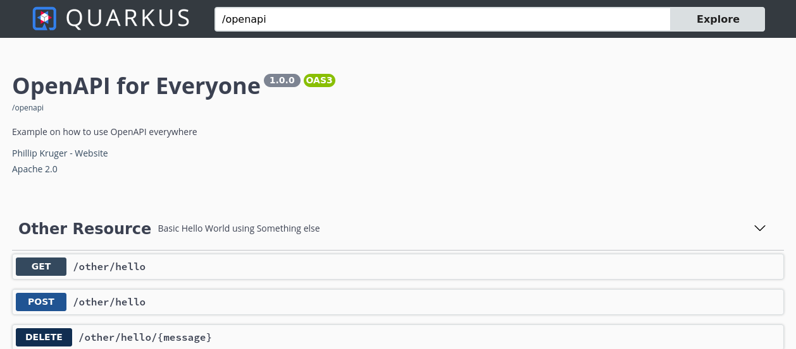
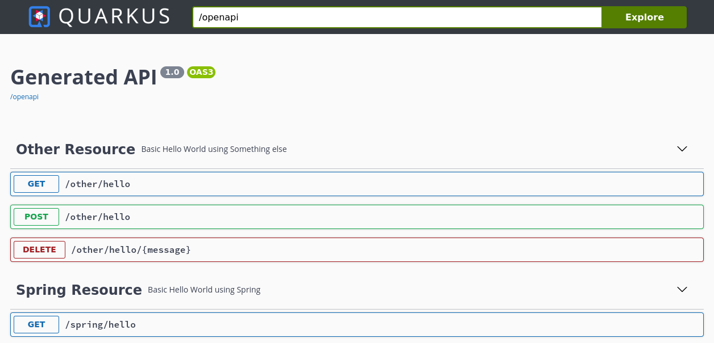
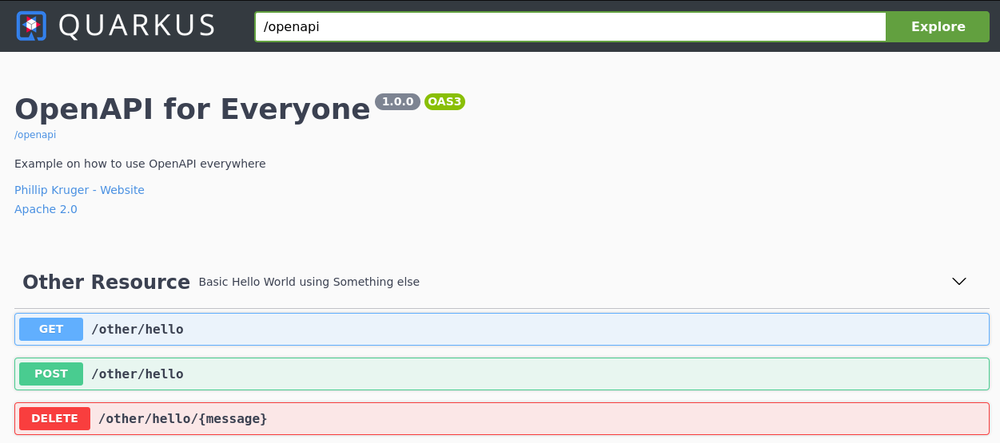
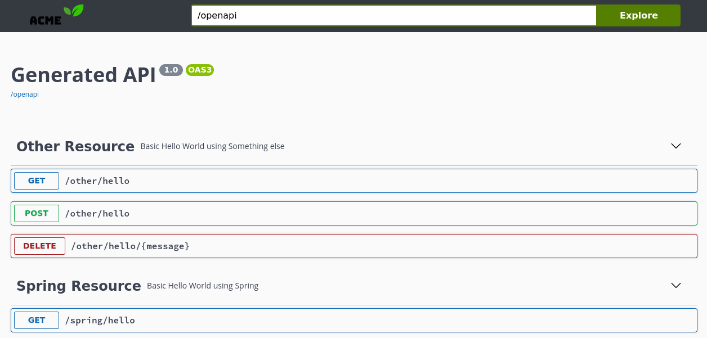
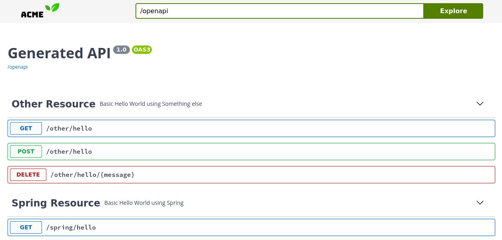
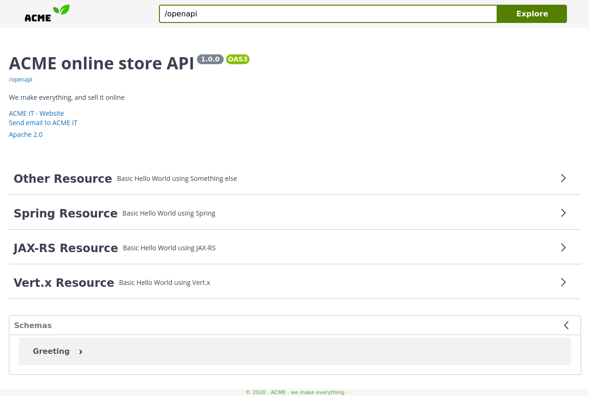
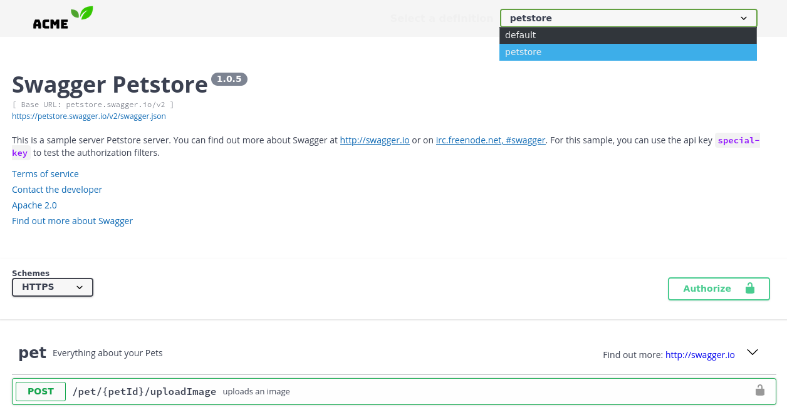
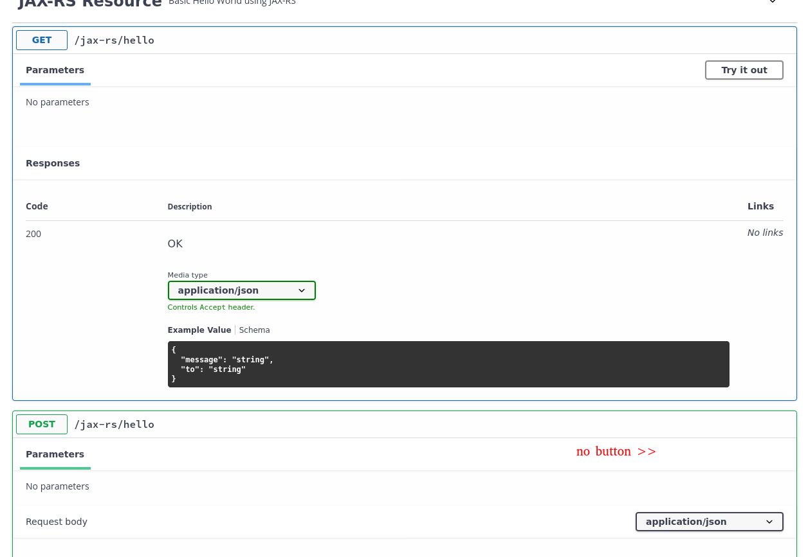
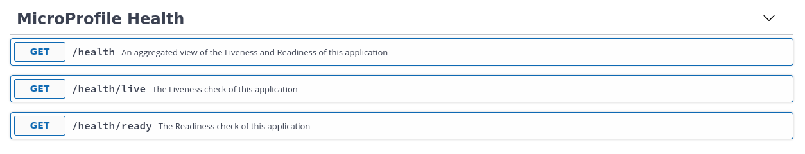

# Stylish API

# Stylish API

In this blog post we are going to look at the new styling and other new options available in OpenAPI and Swagger UI Quarkus extensions (version 1.10+).

All the source code for the examples below is [available here](https://github.com/phillip-kruger/openapi-example).

## Styling

### Default style

The default style for Swagger UI has changed from the vanilla Swagger UI to a Quarkus branded page:



In this post we mostly focus on Swagger UI, but the styling options also apply to the [GraphQL UI](https://quarkus.io/guides/microprofile-graphql#graphiql-ui) and the [Health UI](https://quarkus.io/guides/microprofile-health#health-ui).

### Theme

[Swagger UI Themes](https://ostranme.github.io/swagger-ui-themes/) are now available in configuration, with the default theme being 'feeling blue'.

You can change the theme by setting the `quarkus.swagger-ui.theme` property, for example:

```properties
quarkus.swagger-ui.theme=outline
```



You can also go back to the original (vanilla) Swagger UI theme:

```properties
quarkus.swagger-ui.theme=original
```



Theme options available:

- feeling-blue (default)
- original
- flattop
- material
- monokai
- muted
- newspaper
- outline

### Logo

As part of the custom branding, you can supply your own logo to replace the Quarkus logo. For example, let's say you own a company that makes everything, ACME, and you are using REST Services for your online store, and wants to brand the Swagger UI Page:



> [!NOTE]
> Hot reload is not working for logo changes, and remember browser cache, you might need to [force refresh](https://refreshyourcache.com/en/cache/) your browser.

To supply your own logo, you need to place a file called `logo.png` in `src/main/resources/META-INF/branding`.

### Style

You can go further, and supply your own `style.css`, to fine-tune the branding. As an example, to change the `topbar` of the Swagger UI screen to fit the corporate colors of ACME:

```css
html{
    box-sizing: border-box;
    overflow: -moz-scrollbars-vertical;
    overflow-y: scroll;
}

*,
*:before,
*:after
{
    box-sizing: inherit;
}

body{
    margin:0;
    background: white;
}

.swagger-ui .topbar {
    background-color: whitesmoke; <1>
}

#footer {
    background-color: whitesmoke;
    font-family:sans-serif;
    color:#4da32c;
    font-size:70%;
    text-align: center;
}
```

1. here set the `topbar` background color.



You can change any styling element in this css file, you need to place this file called `style.css` in `src/main/resources/META-INF/branding`.

### Other styling options

You can also set the HTML title, and add a footer:

```properties
quarkus.swagger-ui.title=ACME API
quarkus.swagger-ui.footer=&#169; 2020 . ACME
```

Along with other OpenAPI Header fields that can be set via configuration properties (as discussed in [this post](/blog/openapi-for-everyone/)):

```properties
mp.openapi.extensions.smallrye.info.title=ACME online store API
mp.openapi.extensions.smallrye.info.version=1.0.0
mp.openapi.extensions.smallrye.info.description=We make everything, and sell it online
mp.openapi.extensions.smallrye.info.contact.email=it@acme.com
mp.openapi.extensions.smallrye.info.contact.name=ACME IT
mp.openapi.extensions.smallrye.info.contact.url=https://www.acme.com
mp.openapi.extensions.smallrye.info.license.name=Apache 2.0
mp.openapi.extensions.smallrye.info.license.url=http://www.apache.org/licenses/LICENSE-2.0.html
```

The UI is now fully branded:



## Other Swagger UI Options

Another new feature available in Quarkus (version 1.10+) is the ability to set any of the [configuration options](https://swagger.io/docs/open-source-tools/swagger-ui/usage/configuration/) available in Swagger UI. As an example, we can set the `urls` and add the petstore (as the default selected option) to Swagger UI:

```properties
quarkus.swagger-ui.urls.default=/openapi
quarkus.swagger-ui.urls.petstore=https://petstore.swagger.io/v2/swagger.json
quarkus.swagger-ui.urls-primary-name=petstore
```

This will change the `topbar` to have a dropdown box with the urls provided:



Another example, `supportedSubmitMethods` can hide the `Try it out` button for certain HTTP Method Types:

```properties
quarkus.swagger-ui.supported-submit-methods=get
```

Note below the missing `Try it out` button on the `POST`



All the other Swagger UI options are now available to configure the UI.

## Other small new features

Let me present you two small new features in OpenAPI and Swagger UI: the ability to add the Health Endpoints and the ability to disable the UI and/or Schema at runtime.

### Add Health API to Open API

If you are using the `smallrye-health` extension, you can add the Health Endpoints to OpenAPI:

```properties
quarkus.health.openapi.included=true
```



### Disable at Runtime

If you included the UI in your app (`quarkus.swagger-ui.always-include=true`), you can now disable it when starting the application.

```
java -jar -Dquarkus.swagger-ui.enable=false target/yourapp-1.0.0-runner.jar
```

This will return a **HTTP 404 (Not Found)** on the Swagger UI page.

Similarly you can disable the schema (usually under `/openapi`) by doing:

```
java -jar -Dquarkus.smallrye-openapi.enable=false target/yourapp-1.0.0-runner.jar
```
