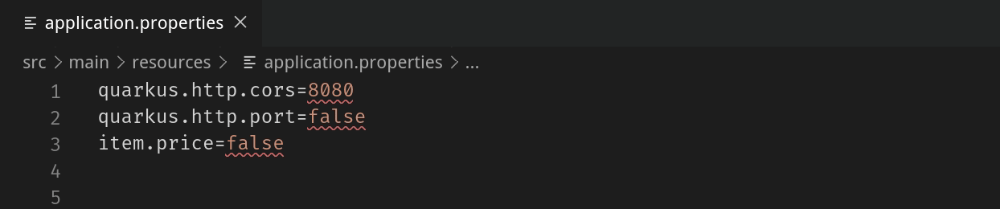
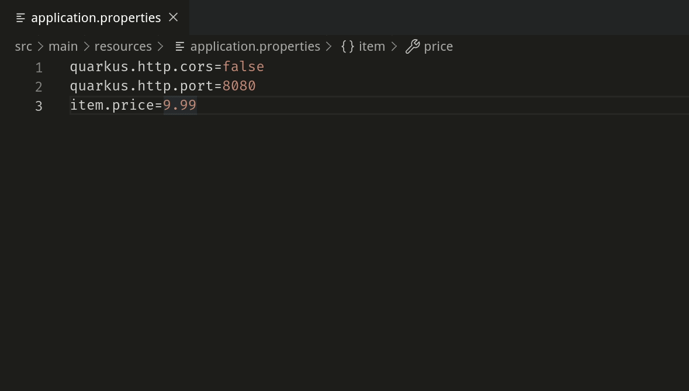
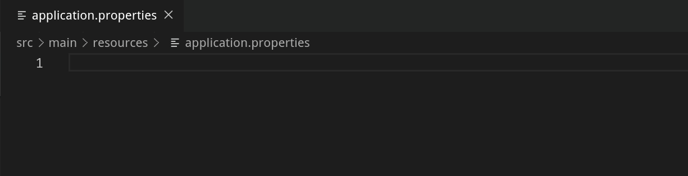
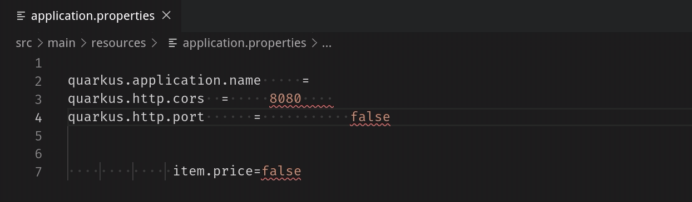
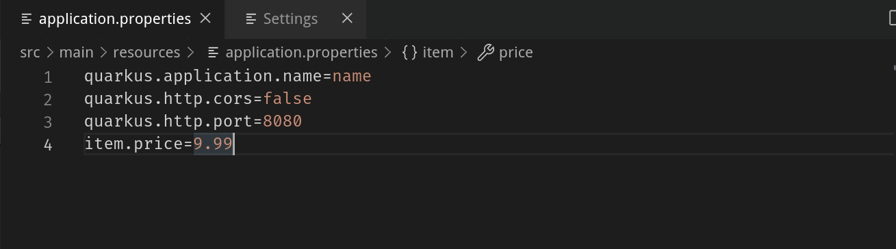

# Quarkus Tools for Visual Studio Code - 1.1.0 release

## What’s new with Quarkus Tools for Visual Studio Code

The 1.1.0 release of [Quarkus Tools for Visual Studio Code](https://marketplace.visualstudio.com/items?itemName=redhat.vscode-quarkus) offers more language features for the `application.properties` file and new additions to existing features like validation and snippets support.

For a list of all changes, please refer to the [changelog](https://github.com/redhat-developer/vscode-quarkus/blob/master/CHANGELOG.md).

## New features

- [Value type validation for `application.properties`](#value-type-validation-for-application-properties)
- [Go to definition support for `application.properties`](#go-to-definition-support-for-config-properties-in-application-properties)
- [New snippets (Quarkus datasource & Jaeger tracer)](#new-snippets)
- [Formatting support for `application.properties`](#formatting-support-for-application-properties)

## Value type validation for `application.properties`

For property values, there will now be an error diagnostic if the expected type does not match the value type.



For the example above, `quarkus.http.cors` expects a `boolean` and `quarkus.http.port` expects an `int`.

The `item.price` config property was defined in a resource class to expect a `float` like so:

**MyResource.java**

```java
@ConfigProperty(name = "item.price")
float price;
```

## Go to definition support for config properties in `application.properties`

In VS Code, the 'Go to definition' feature is used by holding Ctrl (or ⌘) and left clicking on the desired config property, or by right-clicking the desired config property and clicking ‘Go to definition’ in the context menu.



## New snippets

This release also brings new `application.properties` snippets:

`qds` - Configure a Quarkus datasource

`qj` - Configure a Jaeger tracer



## Formatting support for `application.properties`

Thanks to formatting support, it is now possible to quickly remove extra whitespace or lines that may cluttering your `application.properties` file.



Another use case for formatting, is adding/removing spacing around the equals sign. To add/remove spacing around the equals sign, change the `quarkus.tools.formatting.surroundEqualsWithSpaces` setting to `true`/`false` in the VS Code settings. Then, format the document.



This wraps up the new major features in this release. If you have any suggestions or feedback, please do not hesitate to open a GitHub issue.

Stay tuned for the next release!

## Links

- VS Code Marketplace link: <https://marketplace.visualstudio.com/items?itemName=redhat.vscode-quarkus>
- GitHub repository: <https://github.com/redhat-developer/vscode-quarkus>
- Open a GitHub issue: <https://github.com/redhat-developer/vscode-quarkus/issues>
- View changelog: <https://github.com/redhat-developer/vscode-quarkus/blob/master/CHANGELOG.md>
