# Qute Templating Engine Support - Now Available for Quarkus Tools for Visual Studio Code

Quarkus Tools for Visual Studio Code version 1.10.0 has been released on the [VS Code Marketplace](https://marketplace.visualstudio.com/items?itemName=redhat.vscode-quarkus) & [Open VSX](https://open-vsx.org/extension/redhat/vscode-quarkus).

If you haven't seen the blog post on [Quarkus Tools for Visual Studio Code - 1.10.0 release](https://quarkus.io/blog/vscode-quarkus-1.10.0/), we suggest you take a look at the marvelous features we've introduced in this long awaited release.

One of the major new enhancements added in the 1.10.0 release was the introduction of language support for the Quarkus-specific [Qute templating engine](https://quarkus.io/guides/qute). These new features allow Quarkus developers to visualize the changes they make to their Quarkus Java projects, where all files and sub-directories located in `src/main/resources/templates` are watched for changes and modifications and made immediately visible.

For any given Quarkus project open in Visual Studio Code with the Quarkus Tools for Visual Studio Code extension installed, all `\*.html`, `*.txt`, `\*.yaml` and `*.json` files under `src/main/resources/templates` will receive Qute support and syntax highlighting. Additionally, all `\*.qute.*` added before the above extension files (i.e. `*.qute.html`) will also benefit from Qute support features. To check if the current file is supported, ensure the *Select Language Mode* option has selected one of the following:

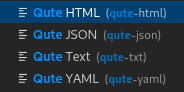

Figure 1: Supported Qute language modes

For more details on the Qute features included in Quarkus Tools for Visual Studio code, take a look at the [documentation](https://github.com/redhat-developer/vscode-quarkus/tree/master/docs/qute), and learn more about the capabilities of the Qute Templating Engine from the [Qute Reference Guide](https://quarkus.io/guides/qute).

For a list of all currently supported Qute features, please refer to the [changelog](https://github.com/redhat-developer/vscode-quarkus/blob/master/CHANGELOG.md) for more information.

Now let's dive deeper into the great Qute features introduced in the 1.10.0 release.

## New Qute Features

Notable Qute features included in Quarkus Tools for Visual Studio Code 1.10.0 include:

- Getting Started with Quarkus Qute Templating Extension
- Integration Between Java and Qute Template Files
- Method Parameter Support in Qute Templates
- Java Type Hover Support for Qute Templates
- Linked Editing Range Support in Qute Templates
- Qute Section Completion
- Support for Qute Validation
- Completion for Qute Value Resolvers
- Support for @TemplateExtension Methods
- Support for Directly Injecting Beans into Qute Templates

## Getting Started with Quarkus Qute Templating Extension

Using the *Quarkus: Generate a Quarkus project* command, there is the option to add the `RESTEasy Qute` extension for the downloaded Quarkus project to be initialized with a Qute template.

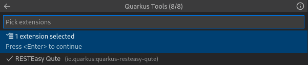

Figure 2: Qute extension option in extension stage of *Quarkus: Generate a Quarkus project* command

Want to get started on a Qute template on your own? Learn how [here](https://quarkus.io/guides/qute#hello-world-with-jax-rs).

## Integration Between Java and Qute Template Files

A quick and easy way to generate and access Qute templates is through CodeLens support. The `qute.codeLens.enabled` setting controls whether the Qute CodeLens is visible.

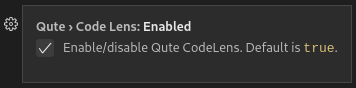

Figure 3: The Qute CodeLens setting

Now any `Template` attribute will show the option to generate a corresponding Qute template, or navigate to the existing template file.

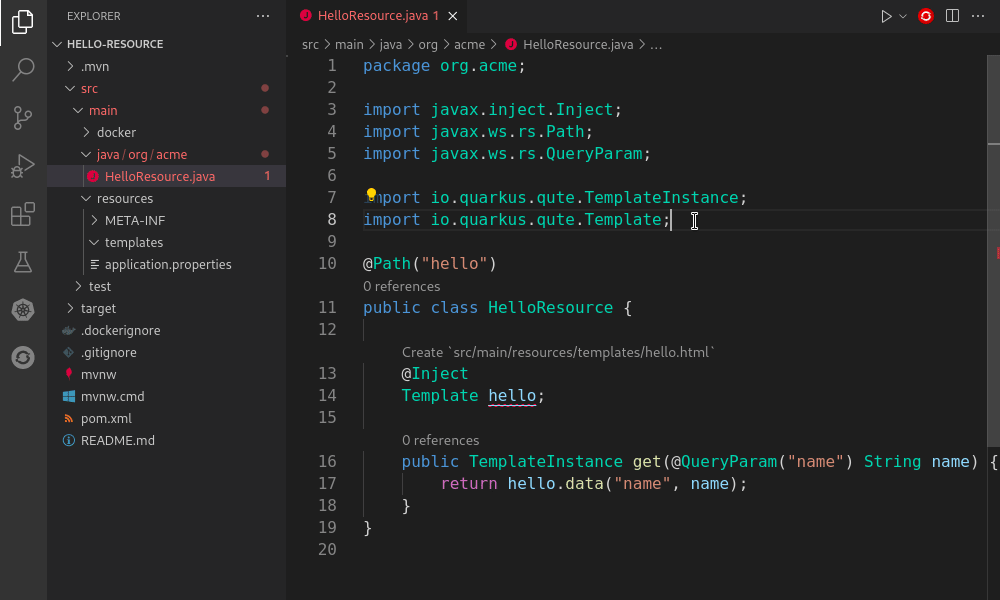

Figure 4: CodeLens generation of and navigation to Qute template file using `Template`

Additionally, any Java file with the marked `@CheckedTemplate` annotation will have its `TemplateInstance` fields also show the option to generate a corresponding Qute template, or navigate to the existing template file.

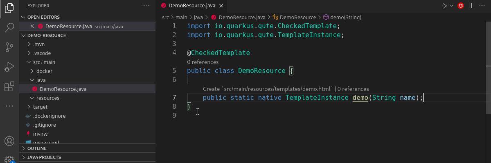

Figure 5: CodeLens generation of and navigation to Qute template file using `@CheckedTemplate`

The template file will always be created under the project’s existing `src/main/resources/templates` directory, and will otherwise create the necessary directory to store templates.

All Qute files paired with a corresponding Java resource supports a number of language client features, such as go to definition, hover, autocompletion, etc.. Each of these we will explore further in the article.

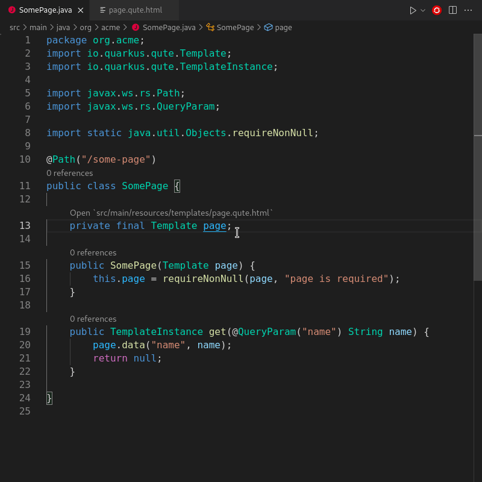

Figure 6: Overview of Java-to-template interaction

These features are handy for efficiently getting started on Qute templates and navigating through multiple template files!

## Method Parameter Support in Qute Templates

The Qute language server has support for built-in and user-defined Java classes, including parameter completion and validation for their methods. Take advantage of this to easily avoid Java related mistakes.

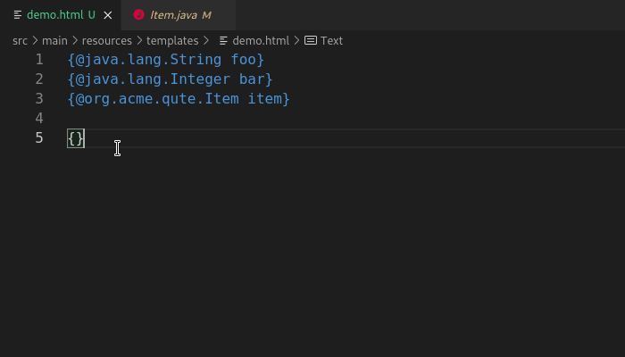

Figure 7: Method parameter support for built-in Java methods and Quarkus Java files

## Java Type Hover Support for Qute Templates

Alongside support for Java completion and validation, the extension also supports type hovering for built-in and user-defined Java classes.

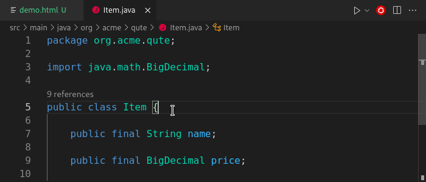

Figure 8: Java type hover support for built-in Java classes and user defined classes

## Linked Editing Range Support in Qute Templates

Similar to most language clients, linked editing is now supported for Qute templates , allowing for simultaneous renaming of multiple parameter expressions. To enable this feature, the setting `editor.linkedEditing` must be set to true in your `settings.json`.

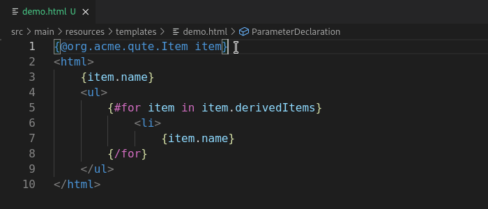

Figure 9: Qute template linked editing support

## Qute Section Completion

Qute templates use sections in its templating language to power any logic required when compiling and displaying the resulting document. To support this, the extension’s Qute support populates a completion list with all available Qute sections, along with any parameters they take and a small code snippet of its usage.

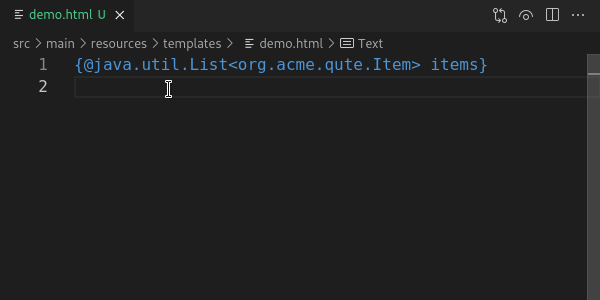

Figure 10: Qute section completion using section start

Learn more about Qute sections [here](https://quarkus.io/guides/qute-reference#sections).

## Support for Qute Validation

Java and Qute validation is included for Qute templates with Quarkus Tools for Visual Studio Code, including diagnostics and quick fix suggestions.

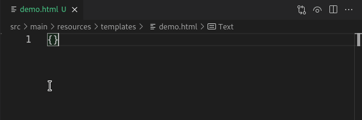

Figure 11: Parameter declaration Qute quick fix suggestion

The developer has the ability to disable this validation in their settings. `qute.validation.enabled` controls the global validation for the current workspace, while `qute.validation.excluded` can be populated with Qute templates that should be ignored from validation.

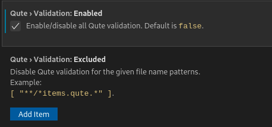

Figure 12: Qute validation settings for global and local validation enablement

If any of the available validation is disturbing your development, disable Qute validation for the current file with a single click, using the button that appears on the top right of the editor bar when Qute templates are opened, or for the entire workspace using a “Quick Fix” that appears on every Qute related diagnostic.

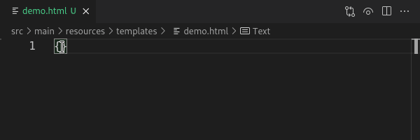

Figure 13: Enable/disable Qute validation per file and globally

## Completion for Qute Value Resolvers

Paired with corresponding Java methods, built-in Java classes also have built-in Qute value resolvers made available by the Qute templating engine that is evaluated and outputs, or resolves to, a value. Quarkus Tools for Visual Studio Code supports completion, hover and snippet generation for these built-in value resolvers.

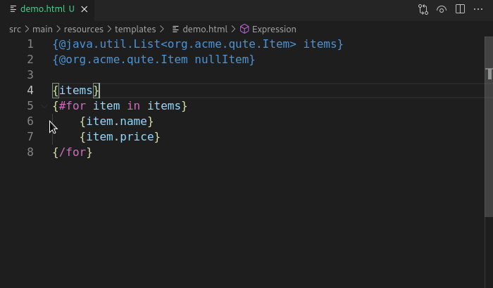

Figure 14: Support and Java doc for built-in Qute value resolvers, such as take, orEmpty and or

See a list of these Qute value resolvers [here](https://quarkus.io/guides/qute-reference#built-in-resolvers).

## Support for @TemplateExtension Methods

Template extension methods are used to extend the set of accessible properties of data objects. Qute support in Quarkus Tools for Visual Studio Code has support for marked `@TemplateExtension` Java methods, which extend a given data model.

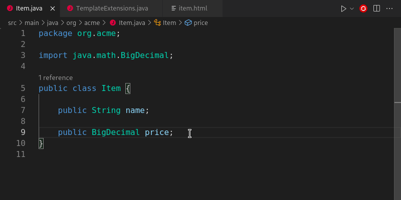

Figure 15: Support for `@TemplateExtension` data model methods

Read more on the `@TemplateExtension` [here](https://quarkus.io/guides/qute#template-extension-methods).

## Support for Directly Injecting Beans into Qute Templates

A CDI bean annotated with `@Named` can be referenced in any template through cdi and/or inject namespaces. Quarkus Tools for Visual Studio Code provides completion and definition navigation support for Beans.

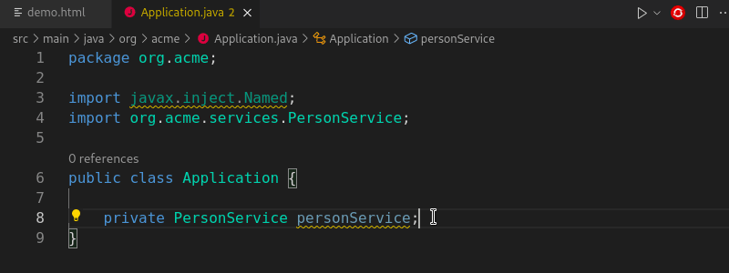

Figure 16: Using the `@Named` annotation allows Beans injection support for Qute templates

Learn more about injecting Beans [here](https://quarkus.io/guides/qute-reference#injecting-beans-directly-in-templates).

## What's Next?

Hopefully this article has shown you some of the notable features that Qute template support from Quarkus Tools for Visual Studio Code has to offer and encourages you to give these a try next time you work on a Quarkus project.

Have suggestions or feedback? Feel free to [open a GitHub issue](https://github.com/redhat-developer/vscode-quarkus/issues/new).

With many experimental features being added to the Qute templating engine, we aim to continue updating Qute language support to encourage current and aspiring Quarkus developers everywhere to give Qute a try!

## Links

Some important links for reference:

- [Quarkus Tools for Visual Studio Code on VS Code Marketplace](https://marketplace.visualstudio.com/items?itemName=redhat.vscode-quarkus)
- [GitHub repository](https://github.com/redhat-developer/vscode-quarkus)
- [VSCode Quarkus Documentation](https://github.com/redhat-developer/vscode-quarkus/tree/master/docs/qute)
- [Open a GitHub issue](https://github.com/redhat-developer/vscode-quarkus/issues/new)
- [1.10.0 Changelog](https://github.com/redhat-developer/vscode-quarkus/blob/master/CHANGELOG.md)
- [Quarkus Tools for Visual Studio Code 1.10.0 Features Blog](https://quarkus.io/blog/vscode-quarkus-1.10.0/)
- [Qute Templating Engine page](https://quarkus.io/guides/qute)
