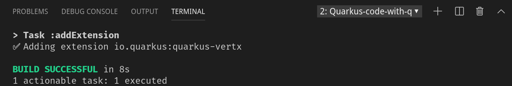
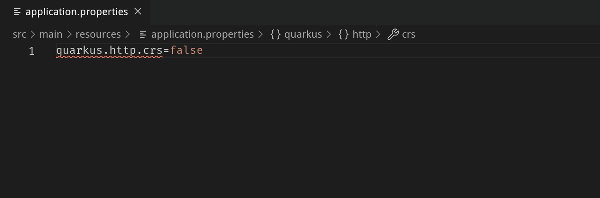
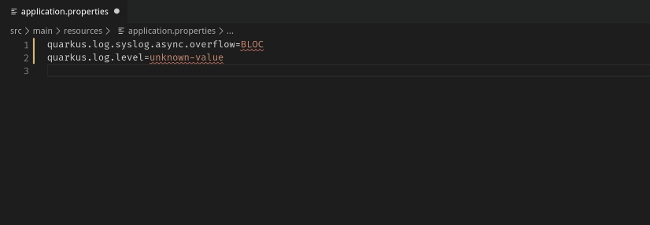
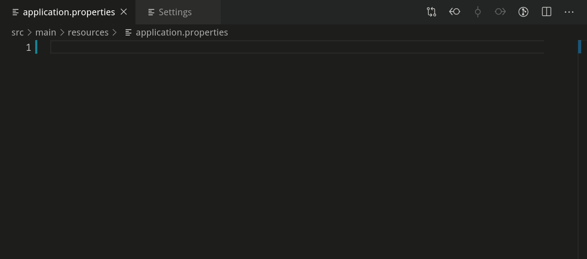
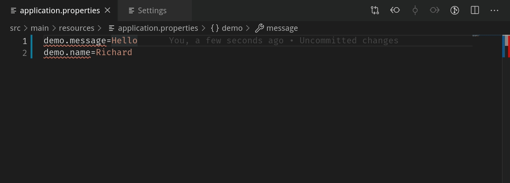
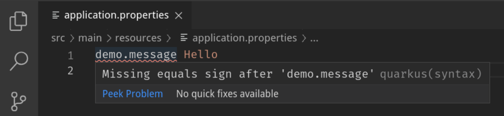
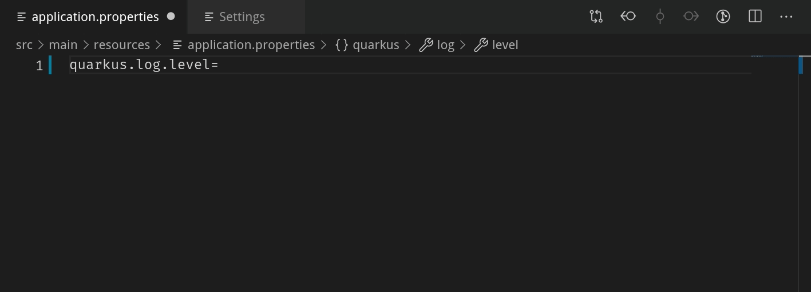
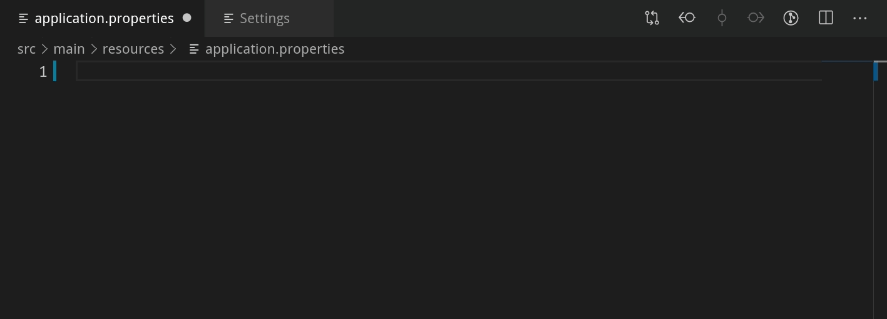

# Quarkus Tools for Visual Studio Code - 1.2.0 release

We are proud to present the new release of Quarkus Tools for Visual Studio Code, providing a feature-rich development experience in VS Code for Quarkus application development. This release focused on introducing tooling support for Gradle projects, as well as adding new application.properties language features.

Watch a demo of the new features:

[hZ_JJ9izV7s](hZ_JJ9izV7s)

## New Features

- [Gradle - Generate new Quarkus project](#gradle-generate-new-quarkus-project)
- [Gradle - Debug Quarkus project](#gradle-debug-quarkus-project)
- [Gradle - Add extensions to a Quarkus project](#gradle-add-extensions-to-a-quarkus-project)
- [Quick Fix for unknown property name](#quick-fix-for-unknown-property-name)
- [Quick Fix for invalid enum value](#quick-fix-for-invalid-enum-value)
- [Quick Fix for missing required properties](#quick-fix-for-missing-required-properties)
- [Add glob pattern for excluding unknown property validation](#add-glob-pattern-for-excluding-unknown-property-validation)
- [Language feature support for logging level values](#language-feature-support-for-logging-level-values)
- [Documentation for default profiles](#documentation-for-default-profiles)
- [Improved input validation when generating a new Quarkus project](#improved-input-validation-when-generating-a-new-quarkus-project)

## Gradle support

So far, Quarkus Tools for Visual Studio Code was geared towards Maven Quarkus projects. This release finally brings support to Gradle Quarkus projects. Moving forward, new features will be implemented with both Maven and Gradle in mind.

### Gradle - Generate new Quarkus project

The project generation wizard now provides the option to choose between creating a Maven or a Gradle project. The rest of the wizard is the same as before. After going through the wizard, your new Maven or Gradle project will download and open automatically.

To open the project generation wizard, open the VS Code command palette and call the `Quarkus: Generate a Quarkus project` command.

### Gradle - Debug Quarkus project

The debug command will now detect whether your currently opened Quarkus project is a Maven or Gradle project, and will start the application by running the Quarkus Dev command (`./mvnw quarkus:dev` for Maven, `./gradlew quarkusDev` for Gradle). Once the application is running, the debugger will attach.

To run the debug command, open the VS Code command palette and call the `Quarkus: Debug current Quarkus project` command.

### Gradle - Add extensions to a Quarkus project

The add extensions wizard now supports adding Quarkus extensions to Gradle projects. To view the list of extensions to add, open the VS Code command palette and call the `Quarkus: Add extensions to current project` command.

Here, the Eclipse Vert.x extension was added:

Since Eclipse Vert.x was selected, the `./gradlew addExtension --extensions="quarkus-vertx"` command will run in the integrated terminal in order to add the extension:

In short, the project generation wizard can now generate Gradle projects, and the `Quarkus: Add extensions to current project` and `Quarkus: Debug current Quarkus project` commands work for *both* Gradle and Maven projects.

## New `application.properties` features

### Quick Fix for unknown property name

The validation support provided by Quarkus Tools for Visual Studio Code checked for unknown property keys in your `application.properties` file. This release brings a new Quick Fix that suggests known properties for your unknown properties. This feature is kind of like autocorrect or "spellcheck" for your property keys.

To perform the Quick Fix, hover over an unknown property and click *Quick Fix...* to see the proposed suggestions. Please note, the Quick Fix suggestions only appear if your unknown property has a similar name to a known property.

### Quick Fix for invalid enum value

Similarly, there is also a new Quick Fix that suggests valid enum values. The Quick Fix will either suggest all valid enum values or, if the invalid enum value is similar to a valid enum value, only the similar enum value(s) will be suggested.

### Quick Fix for missing required properties

The last new Quick Fix is a Quick Fix that adds all missing required properties to the `application.properties` file. To use this feature, the required properties validation needs to be enabled, as it is disabled by default. To do so, open VS Code settings and set the **Quarkus > Tools > Validation > Required > Severity** setting to either “Warning” or “Error”.

Once the `application.properties` file is open, there will be a “Missing required property” warning or error message. The corresponding Quick Fix will add all missing required properties to the `application.properties` file:

### Add glob pattern for excluding unknown property validation

This release also allows you to exclude certain properties from unknown property validation. To do this, go to VS Code settings and add a new glob pattern to the **Quarkus > Tools > Validation > Unknown > Excluded** setting.

This only excludes properties matching the glob pattern from unknown property validation. Other validation such as missing equals sign validation will continue to work.

A good use case for this feature is to ignore certain MicroProfile Config annotated properties (See [quarkus-ls#135](https://github.com/redhat-developer/quarkus-ls/issues/135)), which Quarkus Tools for Visual Studio Code does not recognize for the time being.

### Language feature support for logging level values

There is now autocompletion, documentation, validation and hover support for `java.util.logging.Level` values. Autocompletion will provide all possible values alongside their documentation. Providing an incorrect logging level causes a validation error.

### Documentation for default profiles

Currently, there are three default profiles for the `application.properties` file: `%dev`, `%prod` and `%test`. Hovering over a default property or invoking completion after a `%` sign, will now provide relevant documentation:

### Improved input validation when generating a new Quarkus project

Last but not least, when generating a new project in using the wizard, the input validation messages are now more helpful. There are different naming restrictions for the groupId, artifactId, package name etc. which the validation messages now describe:

This wraps up the new features for this release. We would be ecstatic to hear any feedback and suggestions, as we take them very seriously. Thank you for reading and stay tuned for the next release!

## Links

VS Code Marketplace link: <https://marketplace.visualstudio.com/items?itemName=redhat.vscode-quarkus>\
GitHub repository: <https://github.com/redhat-developer/vscode-quarkus>\
Open a GitHub issue: <https://github.com/redhat-developer/vscode-quarkus/issues/new>\
Changelog: <https://github.com/redhat-developer/vscode-quarkus/blob/master/CHANGELOG.md>\
Version 1.1.0 blog post: <https://quarkus.io/blog/vscode-quarkus-1.1.0/>\
Version 1.0.0 blog post: <https://quarkus.io/blog/quarkus-developer-joy-for-vs-code>
